<p align="center">
    
</p>

<h1 align="center">
    Universidad Peruana de Ciencias Aplicadas
</h1>

<h3 align="center">
    Carrera: Ingeniería de Software
    <br> <br>
    Curso: 1ASI0572 - Desarrollo de Soluciones IoT
    <br> <br>
    Sección: 8740
    <br> <br>
    Profesor: David Carlos Vera Olivera
    <br> <br>
    Ciclo: 2026-20
    <br> <br>
    Informe de Trabajo Final
    <br> <br>
    Startup: HydroLink
    <br> <br>
    Producto: HydroGuard
</h3>

<div align="center">

| <div style="width:300px">Alumno</div> | <div style="width:125px">Código</div> |
|:-------------------------------------------:|:-------------------------------------------:|
|       Gomez Hurtado, Miguel Angel     |              u202220294                     |
|         Rodriguez Macedo, Sebastian       |                  u202310199                 |
|       Santur Tello, Andrea Elizabeth        |               u202310988                    |
|  Prieto Mantari, Leonardo Fabrizzio Junior  |              u202319949                     |
|         Rios Pacheco, Hector Javier         |              u20231c540                     |
|         Olivera Barzola, Eric Marlon         |            u202315032                       |

</div>

<div align="center"> Septiembre 2026 </div>


## Registro de Versiones del Informe

| **Versión** | **Fecha** | **Autor(es)** | **Descripción de modificación** |
|:--:|:--:|:--|:--|
| AV1 | 01/09/2026 | Rios Pacheco, Hector Javier | Inicializó el informe, creó la portada y su estructura de capítulos; definió el perfil de la startup, el análisis 5W2H de la problemática, los segmentos objetivo y la bibliografía inicial. |
| AV1 | 03/09/2026 | Santur Tello, Andrea Elizabeth | Documentó el Big Picture EventStorming y completó el Ubiquitous Language con el glosario del dominio. |
| AV1 | 04/09/2026 | Rios Pacheco, Hector Javier | Actualizó la identidad de HydroLink/HydroGuard y desarrolló el análisis competitivo, las estrategias frente a competidores y el diseño de las entrevistas para los segmentos textil e hidropónico. |
| AV1 | 06/09/2026 | Rios Pacheco, Hector Javier | Incorporó su perfil de integrante, el proceso Lean UX, sus supuestos, hipótesis y resultados esperados, además del Lean UX Canvas y los recursos gráficos correspondientes. |
| AV1 | 08/09/2026 | Prieto Mantari, Leonardo Fabrizzio Junior | Elaboró los User Personas de ambos segmentos, la User Task Matrix y los User Journey Maps, incluyendo sus evidencias gráficas. |
| AV1 | 09/09/2026 | Santur Tello, Andrea Elizabeth<br>Prieto Mantari, Leonardo Fabrizzio Junior | **Santur Tello, Andrea Elizabeth:** refinó la descripción del proceso de teñido, consolidó las épicas, User Stories y Technical Stories, e incorporó la evidencia visual del EventStorming.<br>**Prieto Mantari, Leonardo Fabrizzio Junior:** elaboró los Empathy Maps de ambos segmentos e integró sus cambios con la rama de desarrollo. |
| AV1 | 10/09/2026 | Rios Pacheco, Hector Javier | Registró y analizó dos entrevistas del segmento textil, incorporando datos del entrevistado, hallazgos, puntos de dolor, necesidades, enlaces y evidencias visuales. |
| AV1 | 13/09/2026 | Santur Tello, Andrea Elizabeth | Actualizó el recurso gráfico empleado como evidencia del Big Picture EventStorming. |
| AV1 | 16/09/2026 | Santur Tello, Andrea Elizabeth | Actualizó el Big Picture EventStorming y la especificación de requisitos; documentó el Impact Mapping con su diagrama y añadió el Product Backlog inicial priorizado. |
| AV1 | 20/09/2026 | Olivera Barzola, Eric Marlon<br>Rios Pacheco, Hector Javier | **Olivera Barzola, Eric Marlon:** desarrolló Design-Level EventStorming, Candidate Context Discovery, Domain Message Flows Modeling y los Bounded Context Canvases.<br>**Rios Pacheco, Hector Javier:** consolidó el Student Outcome 5, las conclusiones y recomendaciones, la tabla de contenidos y el análisis estadístico de las seis entrevistas de los segmentos textil e hidropónico. |
| TB1 | 03/10/2026 | Prieto Mantari, Leonardo Fabrizzio Junior | Definió las guías generales de estilo y sus criterios para web, móvil e IoT; documentó las convenciones de código fuente, la matriz LACX de liderazgo y colaboración, y analizó la participación del equipo durante el Sprint 1 a partir de la evidencia de los repositorios. |
| TB1 | 05/10/2026 | Rodriguez Macedo, Sebastian | Incorporó los wireframes de las aplicaciones de HydroGuard para representar las vistas principales de la experiencia administrativa y móvil. |
| TB1 | 06/10/2026 | Rios Pacheco, Hector Javier | Incorporó Device Identity and Access como bounded context y alineó las especificaciones arquitectónicas y de UX/UI con el modelo operativo vigente. |
| TB1 | 07/10/2026 | Rios Pacheco, Hector Javier<br>Santur Tello, Andrea Elizabeth | **Rios Pacheco, Hector Javier:** refinó el EventStorming, los flujos de mensajes, los Bounded Context Canvases y el Context Mapping para incorporar identidad de dispositivo y el ciclo de tratamiento acordado.<br>**Santur Tello, Andrea Elizabeth:** desarrolló la configuración del entorno y del capítulo VI e incorporó los recursos visuales de las herramientas del proyecto. |
| TB1 | 08/10/2026 | Santur Tello, Andrea Elizabeth<br>Gomez Hurtado, Miguel Angel | **Santur Tello, Andrea Elizabeth:** actualizó Source Code Management, GitFlow, el despliegue del Landing Page, Sprint Planning y Sprint Backlog 1.<br>**Gomez Hurtado, Miguel Angel:** incorporó y amplió los mock-ups, User Flow Diagrams y el diseño del dispositivo IoT, e integró la versión final de los mock-ups. |
| TB1 | 09/10/2026 | Prieto Mantari, Leonardo Fabrizzio Junior<br>Gomez Hurtado, Miguel Angel<br>Rios Pacheco, Hector Javier | **Prieto Mantari, Leonardo Fabrizzio Junior:** completó la estructura de los capítulos V y VI, la evidencia de ejecución, el video de prototipado y la tabla de contenidos navegable; corrigió el Sprint Backlog y su evidencia de Trello, y actualizó su Student Outcome con los entregables del integrante 1 y el apoyo al integrante 4.<br>**Gomez Hurtado, Miguel Angel:** incorporó la explicación de las pruebas y las evidencias de despliegue en Vercel y Render.<br>**Rios Pacheco, Hector Javier:** integró los cambios documentales, incorporó los wireframes y mock-ups del Landing Page y conectó sus accesos con la aplicación web desplegada. |
| AV2 | 12/11/2026 | Prieto Mantari, Leonardo Fabrizzio Junior | Documentó la evidencia de desarrollo y la colaboración del Sprint 2; incorporó los cambios y pruebas de P-02 (edición de alias y modelo) y P-03 (motivos de bloqueo de acciones del Operario), y actualizó su Student Outcome. |
| AV2 | 12/11/2026 | Santur Tello, Andrea Elizabeth | Actualizó sus aportes en Student Outcome, añadió el registro complementario de P-04 al Sprint Backlog 2 e incorporó sus dos commits de backend al análisis de colaboración, indicando que están publicados en `feature/edit-groups-reservoirs` y pendientes de fusión en `develop`. |


## Project Report Collaboration Insights

Las actividades del proyecto se planificarán, asignarán y evidenciarán progresivamente en la organización del equipo en GitHub: <https://github.com/1ASI0572-2620-8740-IOT>.

### AV2 — Project Report Collaboration Insights

En AV2, el equipo actualizó el informe para documentar la evolución de HydroGuard desde el incremento web con Mock API hacia servicios persistentes, una aplicación móvil para el Operario y componentes de integración IoT. El avance reúne la planificación y el backlog del Sprint 2, las correcciones de arquitectura y UX/UI, las evidencias de desarrollo, pruebas y despliegue, y la preparación de las entrevistas de validación y la evaluación heurística.

La tabla resume los commits únicos sin fusiones registrados en `develop` de [`report`](https://github.com/1ASI0572-2620-8740-IOT/report/commits/develop/) del **10 de octubre al 12 de noviembre de 2026**, en hora de Lima, hasta `dfc21eb`. Este corte incluye las dos actualizaciones del informe sobre P-02 y P-03 posteriores a `2c693b5`, que es el límite usado para el repositorio `report` en el análisis del Sprint 2. No incluye la presente actualización.

| Integrante | Commits de AV2 en `report` | Contribución principal al informe |
|:--|--:|:--|
| Rios Pacheco, Hector Javier | 11 | Alineó arquitectura, mapa de contextos y flujos con la implementación; documentó el prototipo ESP32 y Wokwi, las pruebas automatizadas y los despliegues. |
| Santur Tello, Andrea Elizabeth | 4 | Actualizó historias, criterios de aceptación, planificación, asignaciones y backlog del Sprint 2; preparó las secciones de entrevistas de validación y evaluación heurística. |
| Gomez Hurtado, Miguel Angel | 34 | Refinó el diseño de dominio, los componentes, los contratos y los modelos de datos de IAM, Configuration, Telemetry, Treatment y Monitoring. |
| Prieto Mantari, Leonardo Fabrizzio Junior (`Wuux1`) | 5 | Consolidó la evidencia de desarrollo y los insights del Sprint 2; documentó P-02 y P-03 y actualizó su Student Outcome de AV2. |
| Rodriguez Macedo, Sebastian | 2 | Incorporó y documentó los wireflows de las aplicaciones, con sus diagramas y recorridos. |
| **Total** | **56** | |

**Aporte de Leonardo (`Wuux1`).**

Durante el AV2 consolidó las evidencias de desarrollo y colaboración del Sprint 2 y documentó sus aportes a P-02 y P-03 en backend, web y móvil. El [análisis de colaboración del Sprint 2](#6229-team-collaboration-insights-during-sprint) distingue el trabajo en los productos de la elaboración del informe e indica las revisiones usadas para el conteo.

**Alcance y evidencia.** El informe documenta la actualización de la Landing Page, la web administrativa, el backend y Gateway, la aplicación Flutter, el servicio Edge y los prototipos físico y virtual. Las [evidencias de desarrollo](#6224-development-evidence-for-sprint-review), [pruebas](#6225-testing-suite-evidence-for-sprint-review) y [despliegue](#6228-software-deployment-evidence-for-sprint-review) distinguen código integrado, resultados de pruebas y versiones publicadas. El [capítulo de validación](#63-validation-interviews) recoge el diseño y los formatos de registro; no acredita entrevistas o evaluaciones aún pendientes. La evidencia disponible tampoco acredita la publicación de los videos About-the-Product y About-the-Team, la distribución del móvil en tienda ni la validación física completa.

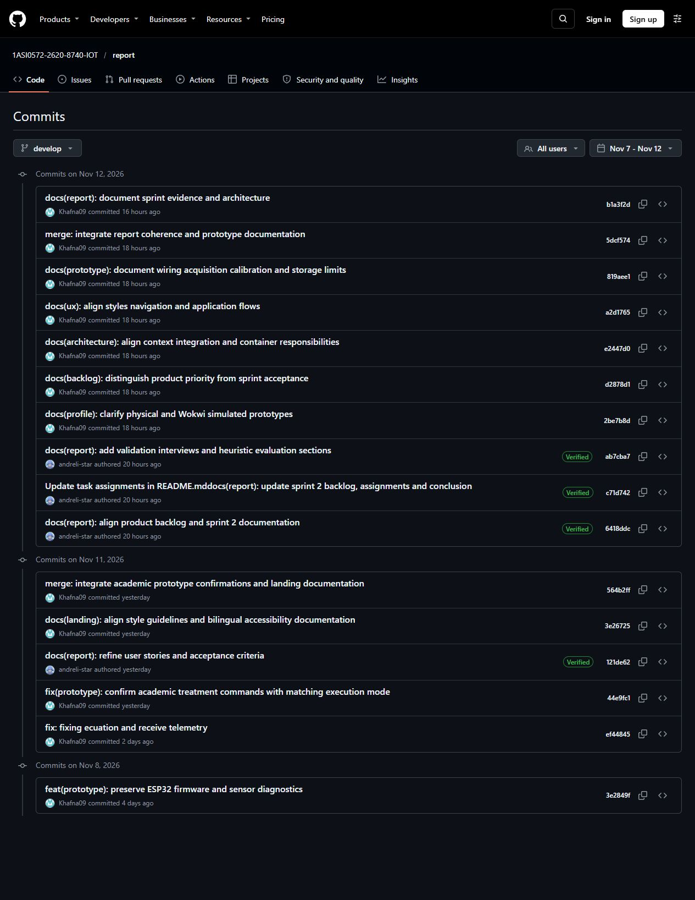

*Figura: historial de `report` en `develop`, filtrado del 7 al 12 de noviembre. La captura es un recorte del avance: incluye fusiones y fue tomada antes de las últimas actualizaciones, por lo que no sustituye el conteo de la tabla.*

El conteo corresponde al trabajo versionado en el informe. La colaboración también comprende la revisión e integración de aportes y el trabajo en los repositorios de cada producto.

## Tabla de Contenidos

- [Registro de Versiones del Informe](#registro-de-versiones-del-informe)
- [Project Report Collaboration Insights](#project-report-collaboration-insights)
  - [AV2 — Project Report Collaboration Insights](#av2--project-report-collaboration-insights)
- [Student Outcome](#student-outcome)
- [Capítulo I: Introducción](#capítulo-i-introducción)
  - [1.1. Startup Profile](#11-startup-profile)
    - [1.1.1. Descripción de la startup](#111-descripción-de-la-startup)
    - [1.1.2. Perfiles de integrantes del equipo](#112-perfiles-de-integrantes-del-equipo)
  - [1.2. Solution Profile](#12-solution-profile)
    - [1.2.1. Antecedentes y problemática](#121-antecedentes-y-problemática)
    - [1.2.2. Lean UX Process](#122-lean-ux-process)
      - [1.2.2.1. Lean UX Problem Statements](#1221-lean-ux-problem-statements)
      - [1.2.2.2. Lean UX Assumptions](#1222-lean-ux-assumptions)
      - [1.2.2.3. Lean UX Hypothesis Statements](#1223-lean-ux-hypothesis-statements)
      - [1.2.2.4. Lean UX Canvas](#1224-lean-ux-canvas)
  - [1.3. Segmentos objetivo](#13-segmentos-objetivo)
    - [Segmento 1: micro y pequeñas empresas textiles](#segmento-1-micro-y-pequeñas-empresas-textiles-con-teñido-o-acabado)
    - [Segmento 2: pequeños productores y microempresas hidropónicas](#segmento-2-pequeños-productores-y-microempresas-hidropónicas)
- [Capítulo II: Requirements Elicitation & Analysis](#capítulo-ii-requirements-elicitation--analysis)
  - [2.1. Competidores](#21-competidores)
    - [2.1.1. Análisis competitivo](#211-análisis-competitivo)
    - [2.1.2. Estrategias y tácticas frente a competidores](#212-estrategias-y-tácticas-frente-a-competidores)
  - [2.2. Entrevistas](#22-entrevistas)
    - [2.2.1. Diseño de entrevistas](#221-diseño-de-entrevistas)
    - [2.2.2. Registro de entrevistas](#222-registro-de-entrevistas)
    - [2.2.3. Análisis de entrevistas](#223-análisis-de-entrevistas)
      - [2.2.3.1. Análisis del Segmento 1](#2231-análisis-del-segmento-1-micro-y-pequeñas-empresas-textiles-con-teñido-o-acabado)
      - [2.2.3.2. Análisis del Segmento 2](#2232-análisis-del-segmento-2-pequeños-productores-y-microempresas-hidropónicas)
      - [2.2.3.3. Matriz Comparativa Inter-Segmentos y Hallazgos Globales](#2233-matriz-comparativa-inter-segmentos-y-hallazgos-globales-n6)
  - [2.3. Needfinding](#23-needfinding)
    - [2.3.1. User Personas](#231-user-personas)
    - [2.3.2. User Task Matrix](#232-user-task-matrix)
    - [2.3.3. User Journey Mapping](#233-user-journey-mapping)
    - [2.3.4. Empathy Mapping](#234-empathy-mapping)
  - [2.4. Big Picture EventStorming](#24-big-picture-eventstorming)
  - [2.5. Ubiquitous Language](#25-ubiquitous-language)
- [Capítulo III: Requirements Specification](#capítulo-iii-requirements-specification)
  - [3.1. User Stories](#31-user-stories)
    - [Reglas verificables compartidas](#reglas-verificables-compartidas)
  - [3.2. Impact Mapping](#32-impact-mapping)
  - [3.3. Product Backlog](#33-product-backlog)
- [Capítulo IV: Solution Software Design](#capítulo-iv-solution-software-design)
  - [4.1. Strategic-Level Domain-Driven Design](#41-strategic-level-domain-driven-design)
    - [4.1.1. Design-Level EventStorming](#411-design-level-eventstorming)
      - [4.1.1.1. Candidate Context Discovery](#4111-candidate-context-discovery)
      - [4.1.1.2. Domain Message Flows Modeling](#4112-domain-message-flows-modeling)
      - [4.1.1.3. Bounded Context Canvases](#4113-bounded-context-canvases)
    - [4.1.2. Context Mapping](#412-context-mapping)
      - [4.1.2.1. Línea base de implementación](#4121-línea-base-de-implementación)
    - [4.1.3. Software Architecture](#413-software-architecture)
      - [4.1.3.1. Software Architecture System Landscape Diagram](#4131-software-architecture-system-landscape-diagram)
      - [4.1.3.2. Software Architecture Context Level Diagrams](#4132-software-architecture-context-level-diagrams)
      - [4.1.3.3. Software Architecture Container Level Diagrams](#4133-software-architecture-container-level-diagrams)
      - [4.1.3.4. Software Architecture Deployment Diagrams](#4134-software-architecture-deployment-diagrams)
      - [4.1.3.5. Responsabilidades e interacciones de los contenedores](#4135-responsabilidades-e-interacciones-de-los-contenedores)
  - [4.2. Tactical-Level Domain-Driven Design](#42-tactical-level-domain-driven-design)
    - [4.2.1. Bounded Context: Human Identity and Access Management](#421-bounded-context-human-identity-and-access-management)
      - [4.2.1.1. Domain Layer](#4211-domain-layer)
      - [4.2.1.2. Interface Layer](#4212-interface-layer)
      - [4.2.1.3. Application Layer](#4213-application-layer)
      - [4.2.1.4. Infrastructure Layer](#4214-infrastructure-layer)
      - [4.2.1.5. Bounded Context Software Architecture Component Level Diagrams](#4215-bounded-context-software-architecture-component-level-diagrams)
      - [4.2.1.6. Bounded Context Software Architecture Code Level Diagrams](#4216-bounded-context-software-architecture-code-level-diagrams)
        - [4.2.1.6.1. Bounded Context Domain Layer Class Diagrams](#42161-bounded-context-domain-layer-class-diagrams)
        - [4.2.1.6.2. Bounded Context Database Design Diagram](#42162-bounded-context-database-design-diagram)
    - [4.2.2. Bounded Context: Configuration](#422-bounded-context-configuration)
      - [4.2.2.1. Domain Layer](#4221-domain-layer)
      - [4.2.2.2. Interface Layer](#4222-interface-layer)
      - [4.2.2.3. Application Layer](#4223-application-layer)
      - [4.2.2.4. Infrastructure Layer](#4224-infrastructure-layer)
      - [4.2.2.5. Bounded Context Software Architecture Component Level Diagrams](#4225-bounded-context-software-architecture-component-level-diagrams)
      - [4.2.2.6. Bounded Context Software Architecture Code Level Diagrams](#4226-bounded-context-software-architecture-code-level-diagrams)
        - [4.2.2.6.1. Bounded Context Domain Layer Class Diagrams](#42261-bounded-context-domain-layer-class-diagrams)
        - [4.2.2.6.2. Bounded Context Database Design Diagram](#42262-bounded-context-database-design-diagram)
    - [4.2.3. Bounded Context: IOT Telemetry](#423-bounded-context-iot-telemetry)
      - [4.2.3.1. Domain Layer](#4231-domain-layer)
      - [4.2.3.2. Interface Layer](#4232-interface-layer)
      - [4.2.3.3. Application Layer](#4233-application-layer)
      - [4.2.3.4. Infrastructure Layer](#4234-infrastructure-layer)
      - [4.2.3.5. Bounded Context Software Architecture Component Level Diagrams](#4235-bounded-context-software-architecture-component-level-diagrams)
      - [4.2.3.6. Bounded Context Software Architecture Code Level Diagrams](#4236-bounded-context-software-architecture-code-level-diagrams)
        - [4.2.3.6.1. Bounded Context Domain Layer Class Diagrams](#42361-bounded-context-domain-layer-class-diagrams)
        - [4.2.3.6.2. Bounded Context Database Design Diagram](#42362-bounded-context-database-design-diagram)
    - [4.2.4. Bounded Context: Treatment](#424-bounded-context-treatment)
      - [4.2.4.1. Domain Layer](#4241-domain-layer)
      - [4.2.4.2. Interface Layer](#4242-interface-layer)
      - [4.2.4.3. Application Layer](#4243-application-layer)
      - [4.2.4.4. Infrastructure Layer](#4244-infrastructure-layer)
      - [4.2.4.5. Bounded Context Software Architecture Component Level Diagrams](#4245-bounded-context-software-architecture-component-level-diagrams)
      - [4.2.4.6. Bounded Context Software Architecture Code Level Diagrams](#4246-bounded-context-software-architecture-code-level-diagrams)
        - [4.2.4.6.1. Bounded Context Domain Layer Class Diagrams](#42461-bounded-context-domain-layer-class-diagrams)
        - [4.2.4.6.2. Bounded Context Database Design Diagram](#42462-bounded-context-database-design-diagram)
    - [4.2.5. Bounded Context: Monitoring](#425-bounded-context-monitoring)
      - [4.2.5.1. Domain Layer](#4251-domain-layer)
      - [4.2.5.2. Interface Layer](#4252-interface-layer)
      - [4.2.5.3. Application Layer](#4253-application-layer)
      - [4.2.5.4. Infrastructure Layer](#4254-infrastructure-layer)
      - [4.2.5.5. Bounded Context Software Architecture Component Level Diagrams](#4255-bounded-context-software-architecture-component-level-diagrams)
      - [4.2.5.6. Bounded Context Software Architecture Code Level Diagrams](#4256-bounded-context-software-architecture-code-level-diagrams)
        - [4.2.5.6.1. Bounded Context Domain Layer Class Diagrams](#42561-bounded-context-domain-layer-class-diagrams)
        - [4.2.5.6.2. Bounded Context Database Design Diagram](#42562-bounded-context-database-design-diagram)
    - [4.2.6. Bounded Context: Device Identity and Access](#426-bounded-context-device-identity-and-access)
      - [4.2.6.1. Domain Layer](#4261-domain-layer)
      - [4.2.6.2. Interface Layer](#4262-interface-layer)
      - [4.2.6.3. Application Layer](#4263-application-layer)
      - [4.2.6.4. Infrastructure Layer](#4264-infrastructure-layer)
- [Capítulo V: Solution UI/UX Design](#capítulo-v-solution-uiux-design)
  - [5.1. Style Guidelines](#51-style-guidelines)
    - [5.1.1. General Style Guidelines](#511-general-style-guidelines)
    - [5.1.2. Web, Mobile and IoT Style Guidelines](#512-web-mobile-and-iot-style-guidelines)
  - [5.2. Information Architecture](#52-information-architecture)
    - [5.2.1. Organization Systems](#521-organization-systems)
    - [5.2.2. Labeling Systems](#522-labeling-systems)
    - [5.2.3. SEO Tags and Meta Tags](#523-seo-tags-and-meta-tags)
    - [5.2.4. Searching Systems](#524-searching-systems)
    - [5.2.5. Navigation Systems](#525-navigation-systems)
  - [5.3. Landing Page UI Design](#53-landing-page-ui-design)
    - [5.3.1. Landing Page Wireframe](#531-landing-page-wireframe)
    - [5.3.2. Landing Page Mock-up](#532-landing-page-mock-up)
  - [5.4. Applications UX/UI Design](#54-applications-uxui-design)
    - [5.4.1. Applications Wireframes](#541-applications-wireframes)
    - [5.4.2. Applications Wireflow Diagrams](#542-applications-wireflow-diagrams)
    - [5.4.3. Applications Mock-ups](#543-applications-mock-ups)
    - [5.4.4. Applications User Flow Diagrams](#544-applications-user-flow-diagrams)
  - [5.5. Applications Prototyping](#55-applications-prototyping)
  - [5.6. IoT Device Design](#56-iot-device-design)
    - [5.6.1. Montaje y conexiones vigentes](#561-montaje-y-conexiones-vigentes)
    - [5.6.2. Adquisición y conversión de lecturas](#562-adquisición-y-conversión-de-lecturas)
    - [5.6.3. Indicadores y flujo integrado](#563-indicadores-y-flujo-integrado)
    - [5.6.4. Configuración, memoria y límites pendientes](#564-configuración-memoria-y-límites-pendientes)
- [Capítulo VI: Product Implementation, Validation & Deployment](#capítulo-vi-product-implementation-validation--deployment)
  - [6.1. Software Configuration Management](#61-software-configuration-management)
    - [6.1.1. Software Development Environment Configuration](#611-software-development-environment-configuration)
    - [6.1.2. Source Code Management](#612-source-code-management)
    - [6.1.3. Source Code Style Guide & Conventions](#613-source-code-style-guide--conventions)
    - [6.1.4. Software Deployment Configuration](#614-software-deployment-configuration)
      - [Frontend Web Applications](#frontend-web-applications)
  - [6.2. Landing Page, Services & Applications Implementation](#62-landing-page-services--applications-implementation)
    - [6.2.1. Sprint 1](#621-sprint-1)
      - [6.2.1.1. Sprint Planning 1](#6211-sprint-planning-1)
      - [6.2.1.2. Aspect Leaders and Collaborators](#6212-aspect-leaders-and-collaborators)
      - [6.2.1.3. Sprint Backlog 1](#6213-sprint-backlog-1)
      - [6.2.1.4. Development Evidence for Sprint Review](#6214-development-evidence-for-sprint-review)
      - [6.2.1.5. Testing Suite Evidence for Sprint Review](#6215-testing-suite-evidence-for-sprint-review)
      - [6.2.1.6. Execution Evidence for Sprint Review](#6216-execution-evidence-for-sprint-review)
      - [6.2.1.7. Services Documentation Evidence for Sprint Review](#6217-services-documentation-evidence-for-sprint-review)
      - [6.2.1.8. Software Deployment Evidence for Sprint Review](#6218-software-deployment-evidence-for-sprint-review)
        - [Landing Page — Deployment Evidence](#landing-page--deployment-evidence)
        - [Frontend Web Applications — Deployment Evidence](#frontend-web-applications--deployment-evidence)
      - [6.2.1.9. Team Collaboration Insights during Sprint](#6219-team-collaboration-insights-during-sprint)
    - [6.2.2. Sprint 2](#622-sprint-2)
      - [6.2.2.1. Sprint Planning 2](#6221-sprint-planning-2)
      - [6.2.2.2. Aspect Leaders and Collaborators](#6222-aspect-leaders-and-collaborators)
      - [6.2.2.3. Sprint Backlog 2](#6223-sprint-backlog-2)
      - [6.2.2.4. Development Evidence for Sprint Review](#6224-development-evidence-for-sprint-review)
      - [6.2.2.5. Testing Suite Evidence for Sprint Review](#6225-testing-suite-evidence-for-sprint-review)
      - [6.2.2.8. Software Deployment Evidence for Sprint Review](#6228-software-deployment-evidence-for-sprint-review)
      - [6.2.2.9. Team Collaboration Insights during Sprint](#6229-team-collaboration-insights-during-sprint)
- [Conclusiones](#conclusiones)
  - [Conclusiones y recomendaciones](#conclusiones-y-recomendaciones)
- [Bibliografía](#bibliografía)
- [Anexos](#anexos)
  - [Final Project Keynote](#final-project-keynote)
  - [Final Project Individual Member Performance Report (by Team Leader)](#final-project-individual-member-performance-report-by-team-leader)
  - [Archivos complementarios (.zip)](#archivos-complementarios-zip)
## Student Outcome

**ABET – EAC - Student Outcome 5.** La capacidad de funcionar efectivamente en un equipo cuyos miembros juntos proporcionan liderazgo, crean un entorno de colaboración e inclusivo, establecen objetivos, planifican tareas y cumplen objetivos.

En el siguiente cuadro se describirán las acciones realizadas y las conclusiones del grupo que sustenten el logro del ABET – EAC - Student Outcome 5. Las celdas se completarán de manera acumulativa durante las entregas del proyecto.

| Criterios específicos | Acciones realizadas | Conclusiones |
|:--|:--|:--|
| Trabaja en equipo para proporcionar liderazgo en forma conjunta. | **Gomez Hurtado, Miguel Angel — AV1:** Asumió el liderazgo técnico de la arquitectura del backend, guiando las decisiones de diseño del sistema. Formuló y estructuró las 4 capas de arquitectura limpia (Domain, Application, Interface, Infrastructure) para todos los Bounded Contexts, asegurando el cumplimiento de las reglas de negocio y los estándares tácticos de DDD y CQRS.<br><br>**Gomez Hurtado, Miguel Angel — TB1:** Lideró la consolidación visual de los mock-ups y User Flows, y colaboró en la preparación del repositorio Mock API para el despliegue académico.<br><br>**Olivera Barzola, Eric Marlon — AV1:** Ejerció liderazgo conjunto estructurando y diseñando la fase de DDD estratégico mediante Design-Level EventStorming, Candidate Context Discovery, Domain Message Flows Modeling y los Bounded Context Canvases de todos los subdominios del sistema.<br><br>**Prieto Mantari, Leonardo Fabrizzio Junior — AV1:** Asumió el liderazgo del diseño centrado en el usuario, investigando y modelando los arquetipos de User Personas para ambos segmentos, la User Task Matrix, los User Journey Maps y los Empathy Maps, además de conducir y registrar la entrevista al productor hidropónico (Entrevista 4).<br><br>**Prieto Mantari, Leonardo Fabrizzio Junior — TB1:** Lideró Operational Monitoring and Traceability y asumió los entregables del integrante 1: definió las guías de estilo generales y para web, móvil e IoT (5.1.1 y 5.1.2), las convenciones de código (6.1.3), la matriz LACX (6.2.1.2) y el análisis de colaboración del Sprint (6.2.1.9). Estos criterios compartidos orientaron la integración visual y técnica del equipo. Además, apoyó al integrante 4 al incorporar el enlace del video del prototipo en 5.5 y organizar las evidencias de ejecución en 6.2.1.6, respetando la autoría de los artefactos y diferenciando la demostración web/mock de la integración real pendiente.<br><br>**Prieto Mantari, Leonardo Fabrizzio Junior — AV2:** Asumió la responsabilidad de consolidar la evidencia de desarrollo (6.2.2.4) y el análisis de colaboración del Sprint 2 (6.2.2.9). Contrastó los historiales de los repositorios para identificar cómo se relacionaban los cambios del frontend, el backend y el prototipo, y distinguió las responsabilidades de la matriz de colaboración de la autoría registrada en Git. Además, alineó el contrato de P-02 entre el backend y la web y el de P-03 entre el backend y la aplicación móvil, manteniendo en los servicios la validación de permisos y estados.<br><br>**Rios Pacheco, Hector Javier — AV1:** Inició y estructuró el informe compartido (portada y esquema de capítulos). Guió las decisiones tempranas del equipo desarrollando el análisis 5W2H, los segmentos objetivo, las referencias, el análisis competitivo, el diseño de entrevistas y el Lean UX Canvas, artefactos base que permitieron alinear la propuesta de valor y los requisitos del sistema.<br><br>**Rios Pacheco, Hector Javier — TB1:** Lideró la integración del flujo administrativo del frontend, alineando IAM, configuración, telemetría, monitoreo y tratamiento en una experiencia web coherente.<br><br>**Rodriguez Macedo, Sebastian — AV1:** Participó activamente en la definición de la arquitectura del sistema, proponiendo la separación de responsabilidades a partir de los Bounded Contexts identificados y su posterior representación mediante microservicios. Asimismo, elaboró los diagramas C4 de System Landscape, System Context y Container, además del Deployment Diagram.<br><br>**Rodriguez Macedo, Sebastian — TB1:** Lideró Device and Operational Configuration y aportó los wireframes que organizaron los recorridos principales de las aplicaciones.<br><br>**Santur Tello, Andrea Elizabeth — AV1:** Lideró la alineación entre el negocio y el equipo técnico mediante el desarrollo del *Big Picture EventStorming* y el *Ubiquitous Language*. Además, estructuró los requerimientos clave a través del *Impact Mapping* y las *User Stories* priorizadas.<br><br>**Santur Tello, Andrea Elizabeth — TB1:** Lideró IoT Telemetry y la documentación de planificación, control de versiones y despliegue del Landing Page para TB1.<br><br>**Santur Tello, Andrea Elizabeth — AV2:** Refinó historias y criterios de aceptación y actualizó el backlog del Sprint 2. Su aporte previo comprende vistas de telemetría y ajustes de contratos, DTO y Mock API. Implementó P-04 para editar descripciones de grupos y reservorios activos e inactivos, reutilizando seguridad y validaciones. | **Gomez Hurtado, Miguel Angel — AV1:** Demostró liderazgo conjunto al unificar los criterios de arquitectura y modelado de datos del backend, facilitando directrices claras y reutilizables para todo el equipo.<br><br>**Gomez Hurtado, Miguel Angel — TB1:** Convirtió decisiones de diseño e integración en artefactos compartidos que facilitaron la revisión conjunta del producto.<br><br>**Olivera Barzola, Eric Marlon — AV1:** Ejerció liderazgo conjunto al establecer los límites contextuales y las interacciones entre subdominios, asegurando una transición coherente del análisis estratégico al diseño táctico.<br><br>**Prieto Mantari, Leonardo Fabrizzio Junior — AV1:** Demostró liderazgo conjunto al fundamentar la empatía con los usuarios, asegurando que las decisiones funcionales y arquitectónicas resolvieran problemas reales de la operación de campo.<br><br>**Prieto Mantari, Leonardo Fabrizzio Junior — TB1:** Demostró liderazgo compartido al proporcionar estándares y responsabilidades explícitas que facilitaron un trabajo coherente entre los integrantes. Su apoyo al prototipado y a la evidencia de ejecución permitió relacionar el diseño con el incremento demostrado, sin atribuirse la elaboración completa del prototipo ni presentar como terminada la integración móvil, backend e IoT.<br><br>**Prieto Mantari, Leonardo Fabrizzio Junior — AV2:** Contribuyó al liderazgo compartido al reunir evidencia que el equipo podía revisar en conjunto. La relación documentada entre los cambios de Edge y del firmware permitió identificar un punto de coordinación entre componentes, sin atribuir a un integrante el trabajo de otro ni presentar el código versionado como prueba de integración completa. Su aporte en P-02 y P-03 dio al equipo un contrato común para revisar los cambios en los tres repositorios y evitó que la interfaz duplicara las reglas de autorización.<br><br>**Rios Pacheco, Hector Javier — AV1:** Demostró liderazgo conjunto al establecer las bases documentales y analíticas del proyecto, aportando entregables habilitadores que facilitaron el trabajo de los demás integrantes y la toma de decisiones compartidas.<br><br>**Rios Pacheco, Hector Javier — TB1:** Su coordinación permitió integrar contribuciones independientes sin perder consistencia funcional ni visual.<br><br>**Rodriguez Macedo, Sebastian — AV1:** Demostró liderazgo conjunto al orientar las decisiones arquitectónicas del proyecto y convertir los requerimientos y dominios identificados por el equipo en una estructura técnica de microservicios comprensible.<br><br>**Rodriguez Macedo, Sebastian — TB1:** Articuló la estructura operativa del dominio con una representación visual comprensible para el equipo.<br><br>**Santur Tello, Andrea Elizabeth — AV1:** Ejerció liderazgo conjunto al establecer un lenguaje unificado y flujos visuales claros mediante EventStorming y User Stories, facilitando al equipo el diseño posterior de la arquitectura y los microservicios.<br><br>**Santur Tello, Andrea Elizabeth — TB1:** Relacionó la implementación de telemetría con una gestión del Sprint y del código claramente documentada.<br><br>**Santur Tello, Andrea Elizabeth — AV2:** Relacionó requisitos, frontend y backend mediante aportes verificables. Delimitó P-04 a campos descriptivos, conservando identidad, organización, estado, relaciones y parámetros técnicos. |
| Crea un entorno colaborativo e inclusivo, establece metas, planifica tareas y cumple objetivos. | **Gomez Hurtado, Miguel Angel — AV1:** Planificó, diseñó y entregó la totalidad de los modelos de datos y diagramas técnicos del proyecto, incluyendo los diagramas de clases de dominio en PlantUML, los modelos relacionales de base de datos (DDL/ERD) y los diagramas de componentes C4 (Nivel 3) para todos los microservicios. Cumplió los objetivos técnicos planificados facilitando artefactos indispensables para el desarrollo técnico del equipo.<br><br>**Gomez Hurtado, Miguel Angel — TB1:** Integró mediante pull request los mock-ups finales y coordinó ajustes del Mock API y su configuración remota.<br><br>**Olivera Barzola, Eric Marlon — AV1:** Planificó y ejecutó colaborativamente el desglose de comandos, políticas, agregados y flujos de mensajes en los Bounded Context Canvases, articulando con los diseñadores de la arquitectura para cumplir las metas del cronograma.<br><br>**Prieto Mantari, Leonardo Fabrizzio Junior — AV1:** Planificó y ejecutó las tareas de Needfinding, levantando información empírica de campo, sintetizando dolores y expectativas en artefactos colaborativos y sincronizando sus contribuciones en el repositorio Git de acuerdo con los plazos previstos.<br><br>**Prieto Mantari, Leonardo Fabrizzio Junior — TB1:** Implementó monitoreo, alertas, incidentes y trazabilidad y su verificación automatizada; completó los estándares, la matriz LACX y los insights de colaboración asignados al integrante 1. Extendió su apoyo al integrante 4 incorporando el video del prototipo en 5.5 y seleccionando, ordenando y describiendo 20 capturas únicas en 6.2.1.6 para evidenciar los flujos administrativos y los estados sin datos. También completó la estructura del entregable y el índice navegable, y corrigió 6.2.1.3 y Trello para identificar las 17 US del Sprint 1, sus tareas y las brechas de integración. Versionó estos aportes por secciones y los compartió mediante la rama feature/prieto.<br><br>**Prieto Mantari, Leonardo Fabrizzio Junior — AV2:** Organizó el trabajo en dos entregables: documentó 19 commits representativos con su rama, fecha y aporte en 6.2.2.4, y consolidó en 6.2.2.9 los aportes por autor y repositorio, excluyendo fusiones y distinguiendo el ciclo AV2 del periodo posterior al Sprint Planning. Incorporó tres capturas de GitHub y actualizó el índice para facilitar la revisión de ambas secciones. Completó P-02 con la edición de alias y modelo sin alterar identidad ni vínculos, y P-03 con mensajes al iniciar, publicar y autorizar la liberación. Separó la implementación, las pruebas y la documentación en commits revisables publicados en develop.<br><br>**Rios Pacheco, Hector Javier — AV1:** Planificó y ejecutó entregables progresivos: formulación de la problemática, estudio de competidores, supuestos e hipótesis de Lean UX y el levantamiento y análisis de entrevistas del sector textil (Entrevistas 1 y 2). Integró las necesidades reales de los operarios para proveer insumos fundamentales al diseño del producto.<br><br>**Rios Pacheco, Hector Javier — TB1:** Organizó el trabajo de IAM, el mock API y la integración de ramas, además de preparar guías para que el equipo pudiera comprobar los flujos implementados.<br><br>**Rodriguez Macedo, Sebastian — AV1:** Organizó progresivamente los entregables relacionados con la arquitectura, partiendo de la definición de los Bounded Contexts y su correspondencia con los microservicios hasta la construcción de los diagramas de arquitectura y despliegue, cumpliendo los objetivos fijados.<br><br>**Rodriguez Macedo, Sebastian — TB1:** Implementó grupos, reservorios, dispositivos, perfiles y asignaciones, e integró el bounded context a la rama de desarrollo.<br><br>**Santur Tello, Andrea Elizabeth — AV1:** Organizó y priorizó las tareas del proyecto elaborando el *Product Backlog* y definiendo los criterios de aceptación en formato Gherkin. Asimismo, integró y estructuró las secciones de especificación de requerimientos en el informe final, cumpliendo con los objetivos en los plazos fijados.<br><br>**Santur Tello, Andrea Elizabeth — TB1:** Implementó las vistas y contratos de telemetría y completó Sprint Planning, Sprint Backlog, GitFlow y la evidencia del Landing Page.<br><br>**Santur Tello, Andrea Elizabeth — AV2:** Versionó cuatro actualizaciones documentales sobre requisitos, backlog, planificación, asignaciones propuestas y diseño de entrevistas de validación y evaluación heurística.  | **Gomez Hurtado, Miguel Angel — AV1:** Fomentó un entorno colaborativo y de soporte técnico continuo proveyendo especificaciones de software rigurosas, garantizando el cumplimiento de los estándares de desarrollo propuestos.<br><br>**Gomez Hurtado, Miguel Angel — TB1:** Cumplió entregables de diseño e integración que conectan la propuesta visual con la demostración técnica.<br><br>**Olivera Barzola, Eric Marlon — AV1:** Promovió la colaboración al clarificar el mapa de responsabilidades del sistema mediante diagramas accesibles, cumpliendo con los objetivos de diseño asignados en los plazos fijados.<br><br>**Prieto Mantari, Leonardo Fabrizzio Junior — AV1:** Fomentó un ambiente inclusivo y colaborativo al sintetizar los hallazgos de las entrevistas en artefactos de Needfinding compartidos, cumpliendo sus metas de trabajo en el tiempo previsto.<br><br>**Prieto Mantari, Leonardo Fabrizzio Junior — TB1:** Cumplió sus responsabilidades y colaboró en entregables de otro integrante sin reemplazar su participación, aportando un entorno de trabajo basado en reglas y evidencias compartidas. La organización de las capturas, el video y el backlog facilitó la revisión conjunta y permitió distinguir objetivos alcanzados en el incremento web/mock de trabajo pendiente; aprendió a mantener la trazabilidad y la coherencia del informe al integrar aportes paralelos.<br><br>**Prieto Mantari, Leonardo Fabrizzio Junior — AV2:** Cumplió los dos puntos asignados y dejó un registro verificable para la revisión del equipo. Al explicar que el conteo de commits no mide por sí solo el esfuerzo ni refleja toda la colaboración, reconoció los aportes que no quedan en Git. Como mejora para el siguiente sprint, propuso vincular las tareas de Trello con sus commits y evidencias de aceptación. La compilación web y las pruebas automatizadas de backend, Mock API y Flutter respaldaron ambos cambios. Distinguió esa verificación de una prueba de extremo a extremo con el backend desplegado, que quedó pendiente.<br><br>**Rios Pacheco, Hector Javier — AV1:** Fomentó la colaboración e inclusión al traducir las perspectivas de los usuarios en insumos de trabajo para todo el equipo, cumpliendo oportunamente los objetivos planificados y garantizando la coherencia global del informe.<br><br>**Rios Pacheco, Hector Javier — TB1:** Cumplió los objetivos asignados y dejó criterios y procedimientos compartidos que facilitaron la revisión del incremento por los demás integrantes.<br><br>**Rodriguez Macedo, Sebastian — AV1:** Contribuyó a un entorno colaborativo mediante la integración de los aportes funcionales de los integrantes dentro de una arquitectura común, cumpliendo con los entregables asignados y permitiendo que los componentes y responsabilidades quedaran claramente organizados.<br><br>**Rodriguez Macedo, Sebastian — TB1:** Cumplió el alcance asignado y proporcionó una base funcional utilizada por telemetría, tratamiento y monitoreo.<br><br>**Santur Tello, Andrea Elizabeth — AV1:** Fomentó la colaboración al entregar un backlog organizado, priorizado y trazable, cumpliendo oportunamente con sus entregables y asegurando que todo el equipo comprendiera la prioridad de cada funcionalidad.<br><br>**Santur Tello, Andrea Elizabeth — TB1:** Cumplió objetivos técnicos y documentales que permitieron comprobar el incremento y mantener su trazabilidad.<br><br>**Santur Tello, Andrea Elizabeth — AV2:** Entregó cambios trazables y revisables, respetando los aportes de sus compañeros. Distinguió la preparación de instrumentos de su ejecución con usuarios y las pruebas locales del despliegue o la integración física. |

# Capítulo I: Introducción

## 1.1. Startup Profile

HydroLink es una startup peruana de tecnología orientada a que micro y pequeñas organizaciones que necesiten supervisar parámetros críticos del agua sin depender de infraestructura industrial costosa. Su primera solución combina un dispositivo IoT, servicios de software y aplicaciones web y móvil para dos contextos: el acondicionamiento de aguas residuales en procesos textiles para su posterior desfogue y la preparación de agua para riego en cultivos hidropónicos.

La propuesta comparte un núcleo funcional para ambos segmentos: identificación de dispositivos, adquisición de temperatura y pH, comparación con rangos configurables, dosificación correctiva controlada por ciclos, control de una válvula, alertas, trazabilidad y supervisión remota. El contexto seleccionado determina los rangos, la estrategia de corrección, la dosificación, el modo de liberación y las reglas operativas.

### 1.1.1. Descripción de la startup

La startup desarrollará una solución IoT accesible y modular cuyo alcance integral contempla la dosificación física de sustancias y las actuaciones térmicas requeridas por la estrategia correctiva. En el prototipo físico académico, un ESP32 recibirá las mediciones de temperatura y pH y controlará una válvula representada mediante un servomotor. Debido a que este prototipo no contará con dosificadores ni mecanismos térmicos reales, un LED indicará que la actuación ordenada por el sistema está en ejecución mientras una persona del equipo realiza manualmente la corrección y la mezcla. Esta sustitución demostrativa no modifica la lógica del producto: después del tiempo de espera configurado, el sistema evalúa una nueva medición y decide si debe iniciar otra dosificación o finalizar la corrección.

La solución contempla dos roles. El operario tendrá asignado un dispositivo y podrá monitorear el proceso, atender indicaciones, iniciar acciones y aplicar un cierre de emergencia en caso de errores o situaciones extraordinarias. El administrador no tendrá un dispositivo propio: administrará a los operarios, configuraciones y dispositivos del sistema y podrá revisar la información de todos ellos. Para el alcance del curso tendremos una relación de un operario por dispositivo, sin impedir que el diseño pueda ampliarse posteriormente.

**Misión.** Facilitar a las micro y pequeñas organizaciones peruanas el monitoreo oportuno y trazable de la temperatura y el pH del agua mediante una solución IoT comprensible, configurable y de costo accesible.

**Visión.** Ser una alternativa tecnológica de referencia en el Perú para el monitoreo básico del agua en pequeñas operaciones productivas que requieren tomar decisiones seguras a partir de datos.


### 1.1.2. Perfiles de integrantes del equipo

| **Nombre** | **Descripción** | **Foto** |
|:--|:--|:--:|
| Gomez Hurtado, Miguel Angel | Tengo 24 años y estoy estudiando la carrera de Ingeniería Informática. Me encuentro en mi octavo ciclo en la UPC Sede San Miguel. Soy una persona académica y siempre estoy abierto al diálogo. Me apasiona mi carrera y siempre estoy dispuesto a aprender sobre este curso para brindar a mis futuros usuarios un buen producto acorde a sus necesidades. | [](https://postimg.cc/PNBHzB43) |
| Rodriguez Macedo, Sebastian |  Tengo 20 años y soy estudiante de Ingeniería de Software. Actualmente me encuentro cursando el octavo ciclo y realizando prácticas en el área de desarrollo de software. Me interesa especialmente el desarrollo backend y la arquitectura de software. Me considero una persona responsable y con disposición para trabajar en equipo. Durante los proyectos me gusta involucrarme activamente, proponer mejoras y aportar ideas que permitan desarrollar soluciones más organizadas. |   |
| Santur Tello, Andrea Elizabeth | Estoy cursando el octavo ciclo de mi carrera Ingeniería de Software, soy una persona responsable que le gusta resolver desafíos a la par con el trabajo responsable y en equipo tengo la capacidad de líder y me gusta aprender nuevas cosas dia a dia. |  |
| Prieto Mantari, Leonardo Fabrizzio Junior | Me considero una persona trabajadora, comprometida y colaborativa, siempre dispuesta a apoyar a mi equipo y contribuir al cumplimiento de los objetivos. Cuento con conocimientos en desarrollo frontend y backend para aplicaciones web y móviles, utilizando tecnologías como HTML, CSS, JavaScript, Python, C++, Java, Spring Boot, Vue.js, Angular, Kotlin y Flutter, además de nociones de C#. Busco aplicar estas habilidades para aportar valor al proyecto y contribuir activamente a lograr un resultado final sólido y exitoso. |   |
| Rios Pacheco, Hector Javier | Cuento con formación en desarrollo de software, incluyendo estructuras de datos, algoritmos y arquitecturas orientadas a servicios. Trabajo con lenguajes como Java, TypeScript, JavaScript, HTML5 y CSS3, y utilizo herramientas y frameworks como Angular, Spring Boot, Git/GitHub, Swagger y bases de datos relacionales. Soy responsable, me gusta involucrarme activamente en los proyectos, aportar ideas útiles |   |
| Olivera Barzola, Eric Marlon | Estudiante de Ingeniería de Software del octavo ciclo, con un interés particular en la ciberseguridad. A lo largo de mi formación he adquirido experiencia en diferentes lenguajes de programación como C#, C++ y Java|   |

## 1.2. Solution Profile

HydroGuard es una solución IoT de monitoreo de pH y temperatura, tratamiento correctivo y control de liberación del agua para pequeñas operaciones textiles e hidropónicas. Conecta un dispositivo físico o simulado con un servicio de borde, servicios de backend y aplicaciones web y móvil, para reunir mediciones, decisiones y trazabilidad en un mismo flujo configurable.

El Administrador organiza los grupos, reservorios, dispositivos y asignaciones de los Operarios. El Operario configura las condiciones de su unidad y supervisa el proceso desde la aplicación móvil. A partir de lecturas recientes y una configuración aplicada, el sistema evalúa la conformidad del agua. Si requiere corrección, propone una estrategia que el Operario aprueba antes de ejecutar los ciclos de actuación, espera y reevaluación. Los intentos están limitados y su resultado queda registrado.

Cuando los parámetros cumplen los rangos configurados, el proceso queda listo para la liberación manual o automática, según el modo elegido. Una lectura conforme no elimina las protecciones ante fallos o emergencias: el sistema mantiene el control de la válvula y conserva el historial de las decisiones y actuaciones.

La solución contempla dos variantes del prototipo. El **prototipo físico** utiliza un ESP32, sensores PH4502C y DS18B20 para obtener lecturas del líquido, LED para indicar actividad y corrección, y un servomotor para representar el control de la válvula. El **prototipo virtual simulado en Wokwi** representa esos componentes y permite variar las entradas de pH y temperatura para comprobar el mismo flujo de comunicación y control con Edge, backend y aplicaciones. En el montaje físico, una persona realiza la adición y mezcla correctivas; en Wokwi, modifica las entradas del simulador para representar su efecto. Ninguna variante incorpora dosificación química automática ni enfriamiento físico. Estas pruebas permiten comprobar el flujo de supervisión y tratamiento, pero no certifican la calidad sanitaria del agua ni sustituyen la validación instrumental de las mediciones.

### 1.2.1. Antecedentes y problemática

Las micro y pequeñas operaciones textiles e hidropónicas suelen depender de mediciones aisladas y decisiones manuales para verificar la temperatura y el pH antes de liberar el agua. Esta situación dificulta detectar desviaciones, comprobar el efecto de una corrección y conservar trazabilidad, por lo que se plantea integrar el monitoreo, las alertas y el control seguro de la válvula en una solución IoT configurable para ambos contextos.

#### Análisis mediante 5W2H

| Pregunta | Análisis preliminar |
|:--|:--|
| **Who — ¿A quién afecta?** | A operarios y administradores de micro y pequeñas empresas textiles con procesos de teñido o acabado, y a pequeños productores o emprendimientos hidropónicos que preparan y liberan agua o solución de riego. |
| **What — ¿Qué ocurre?** | La verificación manual, aislada o tardía dificulta saber si el agua está dentro del rango, cuándo intervenir y cuándo abrir la válvula. En descargas textiles al alcantarillado, los VMA incluyen pH de 6 a 9 y temperatura menor de 35 °C, además de otros parámetros que el prototipo no mide (Ministerio de Vivienda, Construcción y Saneamiento [MVCS], 2019). En hidroponía, una referencia técnica para hortalizas de hoja propone pH de 5,5 a 6,5 y advierte riesgos sanitarios por temperaturas superiores a 20 °C; estos valores no son universales y el sistema empleará rangos configurables (Ocas et al., 2025). |
| **Where — ¿Dónde ocurre?** | En tanques o recipientes de acondicionamiento ubicados en el Perú. Las descargas no domésticas al alcantarillado son controladas por la EPS correspondiente, como Sedapal dentro de su ámbito, bajo regulación de la Superintendencia Nacional de Servicios de Saneamiento (SUNASS, 2020); un vertimiento a un cuerpo natural requiere autorización de la Autoridad Nacional del Agua (ANA, s. f.). |
| **When — ¿Cuándo ocurre?** | Durante la preparación, acondicionamiento, verificación y liberación del agua, especialmente después de una corrección manual y antes de abrir la válvula. |
| **Why — ¿Por qué ocurre?** | Por el costo o ausencia de automatización adecuada para operaciones pequeñas, el uso de mediciones no integradas y la dependencia de observación y registros manuales. Esto retrasa la detección de desviaciones y dificulta comprobar si una corrección produjo un cambio útil. |
| **How — ¿Cómo se aborda actualmente?** | Con instrumentos independientes, inspección del operario, correcciones y mezcla manuales y apertura manual de válvulas; en algunos casos no existe historial centralizado ni alerta ante intentos sin efecto. |
| **How much — ¿Cuál es su magnitud?** | En 2023, el 99,1 % de las 14 259 empresas formales de fabricación de productos textiles fueron MYPE; no todas realizan procesos húmedos (Ministerio de la Producción [PRODUCE], 2024). En 2024, el Instituto Nacional de Innovación Agraria (INIA, 2024) asistió a 6 934 pequeños y medianos productores en módulos hidropónicos, dato que evidencia actividad regional pero no constituye un censo de microempresas hidropónicas. El tamaño exacto del mercado elegible deberá validarse. |


### 1.2.2. Lean UX Process

#### 1.2.2.1. Lean UX Problem Statements

El estado actual del monitoreo de temperatura y pH del agua en micro y pequeñas empresas textiles y en pequeños productores o microempresas hidropónicas del Perú se ha centrado principalmente en instrumentos independientes, verificaciones manuales, registros dispersos y decisiones que dependen de la presencia del operario. Lo que los productos y servicios existentes no abordan suficientemente es una solución asequible que conecte lecturas, rangos configurables, dosificación correctiva por ciclos, alertas, historial y liberación segura del agua. HydroGuard atenderá esta brecha con un dispositivo IoT y aplicaciones web y móvil que supervisen el pH y la temperatura, seleccionen y ordenen la actuación correctiva, decidan después de cada reevaluación si el tratamiento continúa o se detiene, registren el proceso y controlen la válvula según reglas configuradas. El enfoque inicial serán las micro y pequeñas empresas textiles y las unidades hidropónicas pequeñas que actualmente realizan correcciones manuales y no cuentan con una plataforma integrada. Sabremos que la solución tiene éxito cuando los operarios supervisen el estado antes de liberar el agua, atiendan las alertas, completen el ciclo de corrección y verificación, y los administradores recuperen el historial necesario para revisar una incidencia.

#### 1.2.2.2. Lean UX Assumptions


#### Business Assumptions

| ID | Supuesto | Impacto |
|:--|:--|:--:|
| BA-01 | Existe en ambos segmentos un grupo de micro  y pequeñas empresas con el problema que describimos, que además no cuentan con monitoreo integrado. | Alto | 
| BA-02 | Un sistema común de medición de pH, temperatura, estados, alertas y válvula puede servir a ambos segmentos mediante perfiles configurables según sus necesidades. | Alto |
| BA-03 | Los usuarios percibirán el valor en el monitoreo y trazabilidad. | Alto | 
| BA-04 | La instalación y operación pueden mantenerse comprensibles para equipos con poca especialización IoT. | Alto | 
| BA-05 | El costo total de implementación puede ser accesible para micro o pequeñas empresas. | Alto | 
| BA-06 | El modelo de ingresos será aceptable para los compradores. | Alto |


#### Business Outcome Assumptions

| ID | Creencia sobre el resultado de negocio |
|:--|:--|
| BO-01 | Creemos que habrá interés real de prueba en los dos segmentos. | 
| BO-02 | Creemos que el núcleo compartido cubrirá los flujos prioritarios. | 
| BO-03 | Creemos que la solución reducirá el esfuerzo de supervisión y reconstrucción de incidencias. |
| BO-04 | Creemos que se logrará uso recurrente durante una prueba piloto. | 


#### User Assumptions

| ID | Supuesto sobre el usuario |
|:--|:--|
| UA-01 | El operario textil mide o consulta temperatura y pH, realiza correcciones y participa en la decisión de liberar el agua. |
| UA-02 | El responsable hidropónico prepara la solución y ajusta, verifica su estado antes de habilitar el riego. |
| UA-03 | Un mismo tipo de cuenta de operario puede representar ambos contextos si su dispositivo tiene un perfil de operación. |
| UA-04 | Cada operario puede trabajar con un dispositivo asignado sin impedir una futura relación de uno a varios. |
| UA-05 | El administrador necesita gestionar cuentas, asignaciones, configuraciones y todos los dispositivos, pero no requiere un dispositivo propio. |
| UA-06 | Los operarios y administradores podrán utilizar al menos un teléfono inteligente durante parte de su jornada. |


#### User Outcome and Benefit Assumptions

| ID | Resultado o beneficio esperado por el usuario |
|:--|:--|
| UB-01 | Conocer de forma rápida si el agua está fuera de rango, en corrección, lista o en fallo. |
| UB-02 | Conocer la actuación correctiva ordenada, su estado de ejecución y el resultado de la reevaluación. |
| UB-03 | Evitar aperturas de válvula cuando las lecturas sean inválidas o no cumplan el perfil configurado. |
| UB-04 | Configurar rangos y reglas sin reprogramar el ESP32 ni modificar el backend. |
| UB-05 | Consultar lecturas, ciclos, alertas y comandos pasados para explicar una incidencia. |
| UB-06 | Supervisar a distancia y reducir inspecciones presenciales que no aportan una decisión nueva. |
| UB-07 | Operar de manera diferenciada: liberación usualmente automática en el caso textil y usualmente manual en hidroponía, sin impedir el otro modo. |
| UB-08 | Conservar control humano mediante cierre de emergencia y confirmación de acciones sensibles. |

#### Feature Assumptions

| ID | Supuesto de funcionalidad |
|:--|:--|
| FA-01 | Autenticación y autorización basada en roles permitirán separar las capacidades de operario y administrador. |
| FA-02 | La asignación operario-dispositivo y la vista global del administrador harán comprensible la responsabilidad sobre cada equipo. | 
| FA-03 | Los perfiles configurables permitirán usar el mismo producto en ambos segmentos. | Rangos, intervalo, máximo de ciclos y modo de liberación validados. |
| FA-04 | Un panel de telemetría con estado visible facilitará detectar desviaciones sin interpretar datos crudos. |
| FA-05 | Una máquina de estados evitará decisiones ambiguas durante lectura, corrección, espera, listo y fallo. |
| FA-06 | La liberación manual o automática podrá compartir una misma regla de habilitación segura. | Apertura solo desde estado listo; cierre ante error. |
| FA-07 | El cierre de emergencia y la política lógica de válvula cerrada ante fallos reducirán liberaciones no deseadas. |
| FA-08 | Las alertas por máximo de ciclos sin cambio útil permitirán escalar una intervención que no surte efecto. | 
| FA-09 | El historial de lecturas, estados, comandos y actor responsable brindará trazabilidad suficiente para la revisión operativa. |
| FA-10 | Una aplicación móvil permitirá atender el flujo principal cuando el operario no esté frente a una computadora. |
| FA-11 | El dispositivo físico y Wokwi podrán alimentar el mismo contrato de telemetría sin alterar las aplicaciones de usuario. | 

#### 1.2.2.3. Lean UX Hypothesis Statements

#### H-01. Perfiles configurables

Creemos que lograremos **atender los dos segmentos con un núcleo común** si **administradores y operarios autorizados** alcanzan **adaptar las reglas a su contexto sin modificar software** con **perfiles configurables por dispositivo**.

#### H-02. Panel de telemetría y estado

Creemos que lograremos **reducir el tiempo de detección de desviaciones** si **los operarios** alcanzan **comprender el estado actual y el siguiente paso sin interpretar lecturas aisladas** con **un panel de pH, temperatura, vigencia, estado operativo y ciclos**.

#### H-03. Estados, ciclos y alerta

Creemos que lograremos **escalar oportunamente las correcciones ineficaces** si **los operarios** alcanzan **reconocer cuándo esperar, volver a medir o detener el proceso** con **una máquina de estados y una alerta al alcanzar el máximo absoluto de ciclos sin cambio útil**.

#### H-04. Liberación segura y emergencia

Creemos que lograremos **reducir las liberaciones no deseadas** si **los operarios de ambos segmentos** alcanzan **liberar agua solo cuando el proceso esté listo y detenerla ante una incidencia** con **liberación manual o automática condicionada por reglas, cierre ante error y control manual de emergencia**.

#### 1.2.2.4. Lean UX Canvas

<p align="center">
  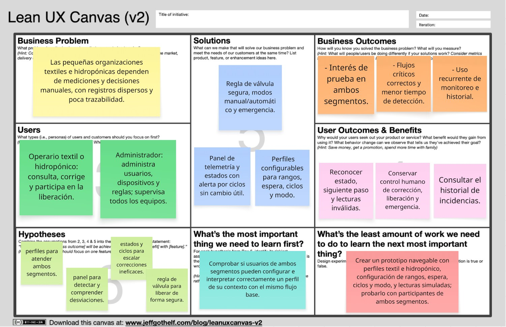
</p>

## 1.3. Segmentos objetivo

La solución se dirige a organizaciones del Perú que, por su tamaño y grado de digitalización, podrían no disponer de sistemas industriales integrados. Para delimitar el segmento se utilizará la clasificación peruana basada en ventas anuales: hasta 150 UIT para microempresa y más de 150 hasta 1 700 UIT para pequeña empresa (Ministerio de Trabajo y Promoción del Empleo [MTPE], s. f.).

### Segmento 1: micro y pequeñas empresas textiles con teñido o acabado

Comprende micro y pequeñas empresas formales o en proceso de formalización que realizan teñido, lavado, acabado u otra operación húmeda y que necesitan vigilar agua residual antes de su descarga al alcantarillado u otra gestión autorizada. Se priorizarán propietarios, responsables de planta y operarios que actualmente dependan de mediciones manuales, instrumentos no conectados o registros dispersos.

- **Ámbito geográfico:** todo el Perú, con posibilidad de reclutamiento inicial en Lima por su concentración empresarial.
- **Características organizacionales:** equipos reducidos, presupuesto tecnológico limitado, responsabilidades operativas combinadas y ausencia de una plataforma IoT propia.
- **Necesidades:** lectura centralizada de temperatura y pH, rangos configurables, alerta ante correcciones sin efecto, trazabilidad y liberación manual o automática según configuración.
- **Contexto normativo:** el sistema puede ayudar a vigilar dos parámetros, pero no reemplaza el muestreo, análisis de laboratorio ni la evaluación de todos los VMA aplicables.
- **Criterio de exclusión inicial:** empresas medianas o grandes con automatización equivalente ya implementada y negocios textiles que no realizan procesos húmedos relevantes para el caso de uso.

### Segmento 2: pequeños productores y microempresas hidropónicas

Comprende pequeños productores, emprendimientos y microempresas que preparan agua o solución nutritiva para cultivos hidropónicos y necesitan verificar temperatura y pH antes de iniciar o habilitar el riego.

- **Ámbito geográfico:** todo el Perú, tanto en entornos urbanos como periurbanos y rurales con conectividad suficiente o posibilidad de operación local.
- **Características organizacionales:** producción de escala pequeña, uno o pocos responsables por módulo, procesos manuales o semiautomatizados y necesidad de controlar costos.
- **Necesidades:** perfiles configurables por cultivo o proceso, observación móvil y web, aviso de desviaciones, historial y liberación normalmente manual, aunque el modo automático también estará disponible.
- **Limitación conocida:** temperatura y pH no describen por sí solos la calidad completa de una solución nutritiva; la conductividad eléctrica, los nutrientes, la oxigenación y la sanidad quedan fuera del alcance.
- **Criterio de exclusión inicial:** operaciones medianas o grandes que ya cuentan con control integrado equivalente y cultivos que requieran variables que el prototipo no puede observar para tomar la decisión estudiada.


# Capítulo II: Requirements Elicitation & Analysis

## 2.1. Competidores

Se identificaron tres alternativas internacionales con componentes comparables. Bluelab es un competidor directo para el segmento hidropónico; Hach es un competidor indirecto industrial para el monitoreo de agua; y Hanna Instruments es un competidor indirecto de instrumentación portátil conectada.


### 2.1.1. Análisis competitivo

**Pregunta del análisis.** ¿Cómo puede HydroGuard ofrecer a micro y pequeñas organizaciones peruanas una alternativa comprensible y accesible que integre monitoreo, trazabilidad y liberación segura, sin competir prematuramente con la automatización industrial integral?

La información de productos, capacidades y precios fue tomada de las páginas oficiales de Bluelab, Hach y Hanna Instruments (Bluelab, s. f.; Hach, s. f.; Hanna Instruments, s. f.).

| Criterio | HydroLink | Bluelab | Hach | Hanna Instruments |
|:--|:--|:--|:--|:--|
| **Overview** | Prototipo IoT configurable para pH, temperatura, estados, alertas, historial y válvula. Atiende textil e hidroponía. | Controlador Wi-Fi para reservorios hidropónicos; monitorea y automatiza pH, conductividad y, con accesorios, temperatura. | Controlador industrial SC4500 para sensores, integración SCADA/PLC y conectividad Claros. | Instrumentación portátil HALO2 que conecta un medidor de pH y temperatura a teléfono o tableta. |
| **Ventaja competitiva / valor** | Unifica dos contextos de pequeña escala mediante perfiles configurables y un ciclo automático que mide, decide la dosificación, espera, reevalúa y libera o retiene el agua de forma segura. | Dosificación automática, gestión de nutrientes y monitoreo remoto mediante Edenic. | Integración industrial, conectividad y compatibilidad con sensores pH/ORP. | Portabilidad, medición conectada y menor barrera de entrada para una lectura puntual. |
| **Mercado objetivo** | MYPE textiles con procesos húmedos y pequeños productores o microempresas hidropónicas del Perú. | Productores hidropónicos; no se orienta a efluentes textiles. | Aplicaciones municipales e industriales; su oferta es de mayor complejidad que el alcance inicial del proyecto. | Laboratorios, procesos y usuarios que requieren medición portátil; no incorpora control de válvula. |
| **Estrategia de marketing** | Validación con pilotos, demostraciones físicas/Wokwi y comunicación de alcance real antes de comercializar. | Venta de productos conectados, aplicación Edenic, guías de uso y automatización del cultivo. | Venta consultiva técnica, documentación de aplicaciones y soporte para instrumentación. | Catálogo de instrumentos especializados, aplicación móvil y venta de medidores por caso de uso. |
| **Productos y servicios** | Dispositivo con medición, dosificación correctiva y control de válvula; API REST; aplicaciones web y móvil; gestión de usuarios; alertas e historial. En el prototipo académico, la dosificación física se representa mediante LED y una intervención manual. | Pro Controller Wi-Fi, PeriPods y aplicación Edenic; incluye dosificación. | SC4500, módulos, sensores y servicios asociados; el precio se cotiza. | HALO2 y aplicación Hanna Lab; instrumento de medición, no sistema IoT de liberación. |
| **Precios y costos** | Costo del prototipo 180 soles | Pro Controller Wi-Fi: US$1,349.10 en la tienda consultada; PeriPod se vende por separado. | Precio mediante contacto/cotización; no publica precio de lista en la página consultada. | Modelos HALO2 desde US$164.99 en la tienda consultada, según electrodo. |
| **Canales de distribución** | Aplicaciones web y móvil, demostración directa y publicidad via landing page y contacto directo. | Tienda web, aplicación y material de soporte del fabricante. | Contacto con especialistas y cotización técnica del fabricante. | Tienda web, aplicación móvil y documentación del fabricante. |
| **Fortalezas** | Adaptabilidad a dos dominios, orientación MYPE y reglas de seguridad explícitas. | Automatización completa de pH/nutrientes y experiencia hidropónica especializada. | Madurez industrial, conectividad y escalabilidad técnica. | Marca de medición reconocida, simplicidad y precio visible en algunos modelos. |
| **Debilidades** | El prototipo académico mide únicamente pH y temperatura y sustituye los dosificadores y mecanismos térmicos reales por una representación mediante LED y una intervención manual del equipo. | Alcance centrado en hidroponía y costo elevado para pequeños usuarios. | Complejidad, cotización y orientación industrial que pueden superar las necesidades MYPE. | Lectura puntual sin trazabilidad operativa integral ni control automático de válvula. |
| **Oportunidades** | Pilotos locales y perfiles por segmento que demuestren valor antes de ampliar sensores. | Expandir canales y compatibilidad de su ecosistema conectado. | Atender instalaciones que requieren integración industrial y más parámetros. | Convertir usuarios de medición manual en usuarios de soluciones conectadas de mayor alcance. |
| **Amenazas** | Medidores económicos, soluciones caseras, proveedores industriales y sustitución por procesos manuales. | Alternativas de dosificación y monitoreo de otros fabricantes. | Competidores industriales, ciclos de compra largos y soluciones SCADA existentes. | Marcas de instrumentación portátil y sensores de bajo costo. |


### 2.1.2. Estrategias y tácticas frente a competidores

La primera versión del producto se enfocará en el monitoreo de pH y temperatura, la dosificación correctiva por ciclos, la trazabilidad de lecturas y el control seguro de la válvula. No intentará igualar la amplitud de parámetros ni la instrumentación industrial de las alternativas analizadas; priorizará una experiencia sencilla y configurable para micro y pequeñas organizaciones. Para la demostración académica, la orden de dosificación se representará mediante LED y su efecto será reproducido mediante intervención manual.

La diferenciación se validará mediante pilotos con ambos segmentos, demostraciones en Wokwi y un prototipo físico. Se buscará comprobar si los usuarios valoran el ciclo de medir, decidir y ejecutar una dosificación, esperar, reevaluar y liberar o retener el agua, así como la alerta cuando no exista un cambio útil. La intervención manual del prototipo físico será únicamente el reemplazo académico de los actuadores correctivos que sí forman parte del producto integral.

El precio, los canales comerciales y las alianzas con pequeñas empresas que puedan ser una manera de lograr un mercado. La comunicación comercial deberá indicar claramente que el sistema es un apoyo operativo.

## 2.2. Entrevistas

### 2.2.1. Diseño de entrevistas

#### Preguntas generales

1. ¿Cuál es tu rol y qué parte del proceso de agua realizas o supervisas habitualmente?
2. Cuéntame la última vez que preparaste, verificaste o liberaste agua o solución: ¿qué hiciste primero y qué ocurrió después?
3. ¿Cómo mides actualmente el pH y la temperatura, con qué instrumentos y con qué frecuencia?
4. Cuando una medición sale fuera de lo esperado, ¿qué haces, quién decide la siguiente acción y qué es lo más difícil del proceso?

#### Preguntas segmento textil

5. En tu proceso de teñido, lavado o acabado, ¿en qué momento se verifica el agua residual y dónde se realiza esa verificación?
6. Antes de descargar o gestionar el agua, ¿qué condiciones, registros o personas intervienen en la decisión?
7. Cuando realizan una corrección manual, ¿cómo mezclan, cuánto esperan y cómo determinan si el cambio fue útil?
8. ¿Qué información te gustaría poder revisar después de un problema y desde qué dispositivo o canal te resultaría más práctico hacerlo?

#### Preguntas segmento hidropónico

5. ¿Qué cultivo y sistema hidropónico manejas, y en qué recipiente o punto preparas la solución?
6. Antes de iniciar el riego, ¿qué valores revisas, quién los valida y qué pasa si no están en el rango que usas?
7. Cuando ajustas la solución de manera manual, ¿cómo mezclas, cuánto esperas y cómo confirmas que el ajuste funcionó?
8. ¿Cómo decides iniciar o detener el riego y qué información te sería útil consultar desde un teléfono o computadora?

### 2.2.2. Registro de entrevistas

En esta sección se documentan las entrevistas a profundidad realizadas a representantes de los segmentos objetivo de HydroGuard. El objetivo de estas entrevistas es recolectar información cualitativa de primera mano acerca de sus flujos de trabajo, prácticas operativas, herramientas de medición, puntos de dolor, toma de decisiones y requerimientos tecnológicos en relación con la vigilancia y acondicionamiento de la calidad del agua. Las evidencias audiovisuales fueron grabadas y cargadas en la plataforma de streaming institucional, permitiendo su revisión y análisis detallado.

---

#### Segmento 1: Micro y pequeñas empresas textiles con teñido o acabado

El primer segmento de investigación comprende a dueños, supervisores de planta y operarios de micro y pequeñas empresas dedicadas a procesos textiles húmedos (teñido, lavado y acabado), responsables de verificar y liberar el agua residual hacia la red de alcantarillado público o reservorios de reúso.

##### Entrevista 1 - Sector Textil

| Entrevistado 1 | Oscar |
| :--- | :--- |
| **Edad** | 28 años |
| **Distrito/Ciudad** | Lima |
|  | **Resumen:**<br>Oscar se desempeña como dueño y supervisor de planta de un taller textil en Lima. Es el responsable exclusivo de monitorear y validar la calidad del agua residual generada en los procesos de teñido y acabado antes de autorizar su descarga al desagüe o su trasvase a cisternas de reúso. Actualmente, realiza mediciones manuales y puntuales de pH y temperatura utilizando un pHímetro digital portátil y un termómetro independiente, sin contar con monitoreo continuo. Cuando detecta valores fuera de rango, aplica reactivos manualmente en la poza (cal para neutralizar acidez o ácido según corresponda), agitando con pala o mediante una bomba auxiliar, para luego esperar entre 15 y 30 minutos antes de repetir el muestreo manual.<br><br>**Características objetivas y subjetivas:**<br>• *Personalidad y actitud:* Práctico, resolutivo y multifuncional. Al concentrar responsabilidades directivas y operativas, experimenta una alta sobrecarga de trabajo y manifiesta preocupación por el tiempo perdido en esperas inciertas.<br>• *Tecnología y dispositivos de preferencia:* Utiliza intensivamente su smartphone como dispositivo primordial de consulta debido a que se desplaza constantemente por los ambientes productivos de la planta sin acceso permanente a una computadora de escritorio o navegador fijo. Opera con instrumentos de medición portátiles digitales básicos.<br>• *Puntos de dolor y frustraciones:* Incertidumbre operativa al no saber con certeza si la dosificación química fue suficiente hasta regresar a medir manualmente; riesgo de demoras en la descarga por atender otras urgencias de planta; y ausencia de un sistema formal de registro, dependiendo de anotaciones eventuales en cuadernos o de la memoria.<br>• *Canales y necesidades identificadas:* Demanda imperativa de un canal móvil para monitorear en tiempo real la evolución de los parámetros, recibir alertas oportunas sobre la efectividad de la corrección química y consultar un historial digital por lote que certifique el cumplimiento adecuado del vertimiento. |

| Timing: 00:04 – 04:38 min (Duración: 04:34 min) | https://upcedupe-my.sharepoint.com/:v:/g/personal/u20231c540_upc_edu_pe/IQDGTYxD461cQ7sXqE9Rvq9zAdVXu2HARbohkL3_5sns7pM?e=Bo8Dj5&nav=eyJyZWZlcnJhbEluZm8iOnsicmVmZXJyYWxBcHAiOiJTdHJlYW1XZWJBcHAiLCJyZWZlcnJhbFZpZXciOiJTaGFyZURpYWxvZy1MaW5rIiwicmVmZXJyYWxBcHBQbGF0Zm9ybSI6IldlYiIsInJlZmVycmFsTW9kZSI6InZpZXcifX0%3D |

##### Entrevista 2 - Sector Textil

| Entrevistado 2 | David Ramírez |
| :--- | :--- |
| **Edad** | 23 años |
| **Distrito/Ciudad** | Lima |
|  | **Resumen:**<br>David se desempeña como encargado del control de agua residual en una planta textil familiar en Lima dedicada al teñido de hilos. Su responsabilidad se concentra en verificar la temperatura y el pH del efluente tras la descarga de la caldera hacia una fosa al aire libre (aproximadamente 3 a 4 veces al día). Registra manualmente la fecha y los parámetros en un cuaderno y, en caso de hallar un pH elevado (el problema más habitual), estabiliza el agua agregando ácido de forma manual y mezclando con una herramienta antes de comprobar nuevamente los valores. Una vez confirmada la estabilización, acciona la válvula de salida hacia el alcantarillado bajo un procedimiento estandarizado y autónomo sin necesidad de autorización previa en cada ciclo.<br><br>**Características objetivas y subjetivas:**<br>• *Personalidad y actitud:* Metódico, organizado y autónomo. Asume con seriedad la rutina operativa y la responsabilidad sobre el vertimiento, recibiendo una supervisión periódica por parte de su jefe basada en la revisión del cuaderno físico.<br>• *Tecnología y dispositivos de preferencia:* Usuario habitual de smartphone. Destaca que una solución accesible desde el teléfono celular resultaría óptima para revisar mediciones e historial operativo sin tener que interrumpir otras tareas para ir presencialmente a la fosa.<br>• *Puntos de dolor y frustraciones:* Registro puramente manual en cuaderno físico, expuesto a deterioro o pérdida de trazabilidad; y la necesidad de desplazarse repetidamente hasta la fosa junto a la válvula para medir y revisar, restando tiempo a sus demás actividades en la planta.<br>• *Canales y necesidades identificadas:* Consulta remota y periódica de parámetros mediante dispositivo móvil, historial de datos para verificar la efectividad de las dosificaciones de ácido y facilidad para supervisar la condición del agua sin permanecer fijado al punto de descarga. |

| Timing: 00:02 – 03:16 min (Duración: 03:14 min) | https://upcedupe-my.sharepoint.com/:v:/g/personal/u20231c540_upc_edu_pe/IQA4RAbLEK9TRJvZK0Ggjao4ARF8RjrLsGc5vLhZnt3-brA?e=ITGKYd&nav=eyJyZWZlcnJhbEluZm8iOnsicmVmZXJyYWxBcHAiOiJTdHJlYW1XZWJBcHAiLCJyZWZlcnJhbFZpZXciOiJTaGFyZURpYWxvZy1MaW5rIiwicmVmZXJyYWxBcHBQbGF0Zm9ybSI6IldlYiIsInJlZmVycmFsTW9kZSI6InZpZXcifX0%3D |

---

##### Entrevista 3 - Sector Textil

| Entrevistado 3 | Carlos Madueño |
| :--- | :--- |
| **Edad** | 24 años |
| **Distrito/Ciudad** | Lima |
|  | **Resumen:**<br>El entrevistado se desempeña en el área de control de agua de una empresa textil en Lima, supervisando principalmente los procesos de teñido y lavado. Su trabajo consiste en verificar el pH y la temperatura del agua durante las principales etapas del proceso. Cuando encuentra valores fuera del rango esperado, repite la medición y comunica el resultado al supervisor, quien indica la corrección correspondiente. Las correcciones se realizan agregando productos químicos y esperando unos minutos antes de volver a medir.<br><br>**Características objetivas y subjetivas:**<br>• *Personalidad y actitud:* Responsable y cuidadoso con las mediciones. Sigue los procedimientos establecidos y consulta al supervisor cuando se presenta una variación.<br>• *Tecnología y dispositivos de preferencia:* Utiliza instrumentos de medición como pH-metro y termómetro. Considera práctico poder consultar información desde una computadora o celular.<br>• *Puntos de dolor y frustraciones:* La necesidad de repetir mediciones y determinar manualmente cuánto producto agregar y cuánto tiempo esperar cuando los valores están fuera del rango.<br>• *Canales y necesidades identificadas:* Historial de mediciones, registro de las correcciones realizadas y seguimiento de los parámetros desde un celular o computadora para facilitar el control del proceso. |

| Timing: 00:02 – 03:16 min (Duración: 03:14 min) |https://upcedupe-my.sharepoint.com/:v:/g/personal/u202315032_upc_edu_pe/IQA6nuyzcUNxQpTUU3tqKpDLAZOyagZ4x_kxWces0Y8-kew?e=DYi0iB&nav=eyJyZWZlcnJhbEluZm8iOnsicmVmZXJyYWxBcHAiOiJTdHJlYW1XZWJBcHAiLCJyZWZlcnJhbFZpZXciOiJTaGFyZURpYWxvZy1MaW5rIiwicmVmZXJyYWxBcHBQbGF0Zm9ybSI6IldlYiIsInJlZmVycmFsTW9kZSI6InZpZXcifX0%3D |

---


#### Segmento 2: Pequeños productores y microempresas hidropónicas

El segundo segmento de investigación abarca a pequeños agricultores urbanos y periurbanos, técnicos y encargados de módulos de cultivo hidropónico (sistemas NFT o raíz flotante), responsables de la formulación, acondicionamiento y liberación de soluciones nutritivas para el riego.

##### Entrevista 4 - Sector Hidropónico

| Entrevistado 4 | Diego Alonso Quispe Flores |
| :--- | :--- |
| **Edad** | 25 años |
| **Distrito/Ciudad** | Lima |
|  | **Resumen:**<br>Diego se desempeña como encargado de producción en un emprendimiento hidropónico urbano/periurbano en Perú, dedicado al cultivo de hortalizas como lechuga y espinaca. Su responsabilidad abarca todo el proceso productivo: prepara manualmente la solución nutritiva (llenado de tanque, dosificación de nutrientes según la etapa del cultivo y mezcla), y luego realiza mediciones de pH y temperatura con instrumentos digitales portátiles (pH-metro y termómetro de sonda) una o dos veces al día. Si los parámetros están fuera de rango, aplica correctores manualmente y espera entre 15 y 30 minutos hasta que la mezcla se estabilice. El riego permanece deshabilitado bajo cualquier circunstancia hasta confirmar que los valores son óptimos, ya que de lo contrario se estresarían las raíces y se afectaría la absorción de nutrientes. Todo el control es manual y autónomo, sin autorización previa para cada ciclo.<br><br>**Características objetivas y subjetivas:**<br>• *Personalidad y actitud:* Joven (25 años), metódico y responsable. Asume con seriedad el control de calidad de su producción, consciente de que un error en la dosificación puede arruinar toda la cosecha. Busca activamente escalar su emprendimiento mediante herramientas tecnológicas que simplifiquen el monitoreo diario sin sacrificar la calidad.<br>• *Tecnología y dispositivos de preferencia:* Usuario habitual de smartphone. Considera óptimo recibir alertas automáticas en el celular ante desviaciones de los parámetros, así como controlar el riego de forma remota mediante una aplicación.<br>• *Puntos de dolor y frustraciones:* El tiempo invertido en el monitoreo manual y la incertidumbre asociada al proceso; el temor constante a que un error de dosificación comprometa la cosecha completa; y la dependencia de mediciones presenciales que no pueden consultarse a distancia.<br>• *Canales y necesidades identificadas:* Alertas automáticas al celular ante desviaciones de pH o temperatura; historial de mediciones para trazabilidad; perfiles configurables por tipo de cultivo; y control remoto del riego mediante aplicación móvil. |

| Timing: 00:00 – 05:38 min (Duración: 05:38 min) | https://upcedupe-my.sharepoint.com/:v:/g/personal/u202220294_upc_edu_pe/IQDh3_0-joIaQoG_r7I4j0EqAbumFTbX7us6qypX58W_oB0?e=9v5dwE&nav=eyJyZWZlcnJhbEluZm8iOnsicmVmZXJyYWxBcHAiOiJTdHJlYW1XZWJBcHAiLCJyZWZlcnJhbFZpZXciOiJTaGFyZURpYWxvZy1MaW5rIiwicmVmZXJyYWxBcHBQbGF0Zm9ybSI6IldlYiIsInJlZmVycmFsTW9kZSI6InZpZXcifX0%3D |

##### Entrevista 5 - Sector Hidropónico

| Entrevistado 5 | Lyan Jarod Luis Carrasco Prosopio |
| :--- | :--- |
| **Edad** | 28 años |
| **Perfil** | Propietario y responsable directo de la producción en un pequeño emprendimiento hidropónico con sistema NFT, dedicado principalmente al cultivo de lechuga y, en menor medida, albahaca. |
|  | **Resumen:**<br>Lyan concentra las funciones de propietario y operario. Prepara la solución nutritiva directamente en un tanque, completa el volumen de agua, añade los nutrientes, mezcla y verifica el pH y la temperatura antes de activar la bomba e iniciar el riego. Utiliza un medidor digital portátil de pH y un termómetro digital; además, consulta ocasionalmente la conductividad eléctrica para comprobar la concentración de la solución. En el caso de la lechuga procura mantener el pH aproximadamente entre 5.5 y 6.5. Cuando detecta una desviación, añade pequeñas cantidades de corrector, mezcla o hace circular la solución, espera entre 5 y 10 minutos y vuelve a medir. Solo inicia el riego cuando confirma que los valores se encuentran dentro del rango que maneja.<br><br>**Características objetivas y subjetivas:**<br>• *Personalidad y actitud:* Responsable, prudente y autónomo. Prefiere realizar ajustes graduales para evitar una sobrecorrección y basa la liberación de la solución en una verificación previa de las mediciones.<br>• *Tecnología y dispositivos de preferencia:* Emplea instrumentos digitales portátiles y considera el celular como el canal más útil para consultar el estado actual de la solución, su evolución y los eventos ocurridos durante el día o la semana.<br>• *Puntos de dolor y frustraciones:* El monitoreo depende de que recuerde realizar cada medición mientras atiende otras tareas del cultivo; existe incertidumbre sobre el momento en que el valor se estabiliza después de una corrección; la temperatura no siempre puede modificarse con rapidez; y la repetición manual de mediciones aumenta el riesgo de retrasar el riego o excederse al corregir el pH.<br>• *Canales y necesidades identificadas:* Monitoreo móvil del pH y la temperatura en tiempo real; visualización de tendencias y del tiempo transcurrido desde un cambio; alertas cuando un parámetro sale del rango configurado; historial diario y semanal; e indicación de que la solución ya cumple las condiciones para que el responsable decida si inicia el riego. La medición de conductividad eléctrica aparece como una posible ampliación futura, aunque el control cotidiano se concentra en pH y temperatura. |


##### Entrevista 6 - Sector Hidropónico

| Entrevistado 6 | Carlos Gabriel Mendoz |
| :--- | :--- |
| ****Edad**** | 26 |
| ****Perfil**** | Encargado de un pequeño módulo hidropónico con sistema NFT, dedicado principalmente al cultivo de lechuga y algunas hierbas aromáticas. Supervisa la preparación de la solución nutritiva, el control del pH y la temperatura, el nivel del depósito y el funcionamiento del sistema de riego. |
|  | ****Resumen:****<br>Carlos se encarga directamente de la preparación, verificación y ajuste de la solución nutritiva utilizada en un pequeño módulo hidropónico. Antes de iniciar el riego revisa que el depósito se encuentre limpio, añade el agua y los nutrientes y posteriormente mide el pH y la temperatura mediante instrumentos digitales. Cuando identifica un valor fuera del rango esperado, repite la medición para confirmar el resultado y realiza correcciones graduales, agregando pequeñas cantidades de regulador para evitar una modificación excesiva. Después mezcla la solución o mantiene la bomba funcionando durante algunos minutos y vuelve a medir antes de continuar. Además del pH y la temperatura, verifica el nivel de la solución y el funcionamiento de la bomba y las tuberías. La decisión de iniciar el riego depende de que los parámetros utilizados para el cultivo se encuentren dentro del rango esperado y de que el sistema opere correctamente.<br><br>****Características objetivas y subjetivas:****<br>• **Personalidad y actitud:** Autónomo, cuidadoso y orientado a la verificación. Prefiere confirmar una medición antes de realizar cambios y efectúa los ajustes de manera progresiva para reducir el riesgo de alterar excesivamente la solución.<br>• **Tecnología y dispositivos de preferencia:** Utiliza un medidor digital de pH y un termómetro digital para supervisar manualmente la solución. Considera útil consultar desde un teléfono o computadora el pH, la temperatura, el nivel del agua y el estado de la bomba en tiempo real.<br>• **Puntos de dolor y frustraciones:** Existe incertidumbre al determinar cuánto producto debe agregar para corregir una desviación del pH y cuánto tiempo debe esperar antes de comprobar si el ajuste funcionó. El proceso requiere realizar mediciones repetidas y supervisar manualmente los cambios antes de iniciar el riego.<br>• **Canales y necesidades identificadas:** Monitoreo en tiempo real del pH, la temperatura, el nivel de la solución y el estado de la bomba desde un teléfono o computadora; alertas cuando algún parámetro se encuentre fuera del rango configurado; seguimiento del proceso de ajuste; y disponibilidad de información que facilite verificar las condiciones de la solución antes de que el responsable decida iniciar el riego. |


### 2.2.3. Análisis de entrevistas

En esta sección se desarrolla un análisis exhaustivo y cuantitativo-cualitativo estructurado por cada uno de los dos segmentos objetivo de HydroGuard, sustentado estadísticamente a partir de las seis (6) entrevistas a profundidad realizadas y registradas en la sección precedente (3 entrevistas para el sector textil y 3 para el sector hidropónico). A través de este análisis se identifican, cuantifican y triangulan todas las características objetivas (demográficas, operativas, técnicas e instrumentales) y subjetivas (personalidad, actitudes, puntos de dolor, temores y motivaciones) que representan los patrones comunes indispensables para la modelación y validación empírica de los arquetipos de usuario (*User Personas*).

---

#### 2.2.3.1. Análisis del Segmento 1: Micro y pequeñas empresas textiles con teñido o acabado

El análisis de este segmento se fundamenta en los datos recopilados en las entrevistas al sector textil: **Entrevista 1 (Oscar, 28 años)**, **Entrevista 2 (David Ramírez, 23 años)** y **Entrevista 3 (Carlos Madueño, 24 años)**, conformando una muestra segmentada de $n = 3$ sujetos (100% de la muestra textil).

##### A. Características Objetivas (Sustento Estadístico)

1. **Rango etario y localización geográfica:**
   - El **100% (3 de 3 entrevistados)** residen y operan en la ciudad de Lima (zonas industriales y talleres de confección/teñido).
   - El rango de edad oscila entre los 23 y 28 años, arrojando una media muestral de **25.0 años**, lo que evidencia una fuerza laboral técnica y de supervisión joven y familiarizada con el ecosistema de aplicaciones digitales.

2. **Rol operativo y concentración funcional:**
   - El **66.7% (2 de 3, Oscar y David)** concentran simultáneamente funciones de supervisión técnica, gestión de planta y ejecución operativa directa del tratamiento de efluentes, con alto grado de autonomía para autorizar la descarga.
   - El **33.3% (1 de 3, Carlos)** se desempeña como operario de control de calidad bajo supervisión directa jerárquica, debiendo validar las anomalías con un supervisor antes de proceder con las descargas.

3. **Frecuencia y momento de monitoreo en el proceso productivo:**
   - El **100% (3 de 3 entrevistados)** efectúan mediciones discontinuas y reactivas por lotes (*batch*), concentradas en los momentos inmediatamente posteriores a las descargas de tinas de teñido, lavado o calderas hacia las pozas o fosas de tratamiento (de 3 a 4 descargas diarias en promedio).
   - Ninguna de las plantas (**0%**) cuenta con instrumentación en línea o monitoreo continuo automatizado.

4. **Instrumentación de medición actual:**
   - El **100% (3 de 3 entrevistados)** utilizan instrumentos portátiles digitales manuales no conectados (pH-metros de bolsillo y termómetros digitales independientes o de sonda manual).
   - El **100% (3 de 3)** manifiesta que las lecturas son puntuales y requieren sumergir manualmente el electrodo en la poza, lo que exige presencia física continua junto a la fosa.

5. **Método de corrección química y mezcla:**
   - El **100% (3 de 3 entrevistados)** corrigen las desviaciones de pH mediante la adición manual empírica de reactivos químicos (cal/álcali para neutralizar acidez o ácidos industriales para neutralizar efluentes básicos).
   - El **66.7% (2 de 3, Oscar y David)** utilizan herramientas manuales (palas o agitadores) o encienden manualmente bombas de recirculación auxiliar para dispersar el reactivo.
   - El **100% (3 de 3)** debe esperar ventanas de estabilización que van desde los 5 hasta los 30 minutos antes de realizar un remuestreo manual.

6. **Sistema de registro y trazabilidad:**
   - El **66.7% (2 de 3, David y Oscar)** registran sus mediciones en cuadernos físicos o libretas de papel expuestas al desgaste de planta, o dependen de la memoria del operario entre tareas.
   - El **33.3% (1 de 3, Carlos)** reporta los resultados de manera verbal a su supervisor sin un registro documental personal.
   - El **0% (ninguno)** dispone de un sistema digital, base de datos o almacenamiento en la nube para consolidar el historial de descargas ante eventuales auditorías de Valores Máximos Admisibles (VMA).

7. **Dispositivos de preferencia y canal de interacción:**
   - El **100% (3 de 3 entrevistados)** utilizan intensivamente el *smartphone* durante su jornada laboral y señalan que una aplicación móvil es el canal idóneo para supervisar la poza mientras se desplazan por la planta.
   - El **33.3% (1 de 3, Carlos)** menciona que una interfaz web en computadora complementaría la labor administrativa de supervisión.

##### B. Características Subjetivas (Sustento Estadístico)

1. **Personalidad y actitud frente al trabajo:**
   - El **100% (3 de 3 entrevistados)** manifiestan una actitud responsable, metódica y orientada al cumplimiento normativo, reconociendo el grave impacto económico que representan las sanciones ambientales o multas por exceder los VMA en el alcantarillado.
   - El **66.7% (2 de 3, Oscar y David)** evidencian frustración por sobrecarga laboral debido a la necesidad de alternar la atención de calderas y producción con la vigilancia física del efluente.

2. **Puntos de dolor y frustraciones prioritarias:**
   - **Incertidumbre en la dosificación y estabilización química (100%, 3 de 3):** Los entrevistados afirman que la mayor molestia es no saber con exactitud si la cantidad de químico dosificada fue suficiente o excesiva, ni en qué minuto exacto el agua terminó de estabilizarse sin tener que acudir a medir a ciegas.
   - **Pérdida de tiempo y desplazamientos físicos repetitivos (100%, 3 de 3):** Manifiestan cansancio de tener que interrumpir sus actividades operativas para caminar hacia la fosa/poza exclusivamente a constatar si el agua ya se enfrió o neutralizó.
   - **Vulnerabilidad documental e inconsistencia de registros (100%, 3 de 3):** Expresan inseguridad al no poseer un historial digital fidedigno y auditable que respalde que el agua se descargó dentro de los parámetros permitidos.

3. **Motivaciones y expectativas frente a HydroGuard:**
   - El **100% (3 de 3)** valoran prioritariamente la visualización de lecturas en tiempo real y la recepción de alertas automáticas en el celular cuando un parámetro sale de norma o cuando el agua ya está conforme.
   - El **66.7% (2 de 3, Oscar y David)** respalda la automatización de la apertura de la válvula de descarga una vez que el sistema certifique la conformidad del agua, liberando tiempo productivo.

##### C. Tabla Síntesis Estadística: Segmento 1 (Textil)

| Variable Analizada | Frecuencia Absoluta ($n=3$) | Porcentaje (%) | Evidencia en Entrevistas Registradas |
| :--- | :---: | :---: | :--- |
| **Ubicación en Lima** | 3 / 3 | 100.0% | Oscar (Lima), David (Lima), Carlos (Lima) |
| **Rango de edad (23–28 años)** | 3 / 3 | 100.0% | Oscar (28), David (23), Carlos (24) — Media: 25.0 años |
| **Rol operativo directo en vertimientos** | 3 / 3 | 100.0% | Dueño/supervisor (Oscar), encargado de efluentes (David), control de agua (Carlos) |
| **Medición manual y discontinua** | 3 / 3 | 100.0% | pH-metro y termómetro portátil; 0% monitoreo en línea continuo |
| **Corrección química y mezcla manual** | 3 / 3 | 100.0% | Dosificación manual de cal/ácido; agitación física o bomba auxiliar |
| **Tiempo de espera tras corrección (5–30 min)** | 3 / 3 | 100.0% | Espera empírica a ciegas reportada por los 3 entrevistados |
| **Preferencia por supervisión móvil** | 3 / 3 | 100.0% | Demanda explícita de alertas y visualización vía smartphone |
| **Incertidumbre operativa por estabilización** | 3 / 3 | 100.0% | Principal punto de dolor cualitativo en las tres entrevistas |
| **Inexistencia de registro digital automático** | 3 / 3 | 100.0% | Cuaderno físico (David), notas/memoria (Oscar), reporte verbal (Carlos) |
| **Interés en apertura automática de válvula** | 2 / 3 | 66.7% | Oscar y David operan con autonomía; Carlos consulta a supervisor |

##### D. Vinculación con la Construcción del Arquetipo (User Persona: Marcelino Valencia)

Los hallazgos estadísticos sustentan directamente la modelación de **Marcelino Valencia (Jefe de Planta / Operario Textil)**:
- Su rol multifuncional (supervisión + operación manual) y su rango etario reflejan al **66.7%** de los casos donde la responsabilidad recae en una sola persona que recorre la planta.
- La frustración central de Marcelino por los cuadernos de papel manchados y la falta de trazabilidad ante fiscalizaciones de VMA se fundamenta en el **100% de ausencia de registros digitales** y el **66.7% de dependencia de anotaciones físicas**.
- Su necesidad de alertas preventivas en el móvil responde al **100% de preferencia por interfaces en smartphone** para no estar atado a la fosa.

---

#### 2.2.3.2. Análisis del Segmento 2: Pequeños productores y microempresas hidropónicas

El análisis de este segmento se basa en las entrevistas al sector hidropónico: **Entrevista 4 (Diego Alonso Quispe Flores, 25 años)**, **Entrevista 5 (Lyan Jarod Luis Carrasco Prosopio, 28 años)** y **Entrevista 6 (Carlos Gabriel Mendoz, 26 años)**, conformando una muestra segmentada de $n = 3$ sujetos (100% de la muestra hidropónica).

##### A. Características Objetivas (Sustento Estadístico)

1. **Rango etario y localización geográfica:**
   - El **100% (3 de 3 entrevistados)** desarrollan sus cultivos hidropónicos en Lima (entornos urbanos y periurbanos).
   - El rango de edad se sitúa entre los 25 y 28 años, con una media de **26.3 años**, representando a jóvenes emprendedores y técnicos agrícolas tecnológicamente receptivos.

2. **Tipo de cultivo y sistema hidropónico implementado:**
   - El **100% (3 de 3 entrevistados)** cultivan hortalizas de hoja verde de ciclo corto, destacando la **lechuga como cultivo común primordial en el 100% de los casos**, complementada con hierbas aromáticas como albahaca (**66.7%, 2 de 3, Lyan y Carlos**) o espinaca (**33.3%, 1 de 3, Diego**).
   - El **66.7% (2 de 3, Lyan y Carlos)** emplean sistemas hidropónicos de recirculación cerrada bajo la técnica NFT (*Nutrient Film Technique*), mientras que el **33.3% (1 de 3, Diego)** formula en reservorios para irrigación controlada.

3. **Rol operativo y toma de decisiones:**
   - El **100% (3 de 3 entrevistados)** son los responsables directos y autónomos de formular la solución nutritiva (agua, macronutrientes y micronutrientes), calibrar el pH y decidir la activación del sistema de bombeo/riego.
   - El **33.3% (Lyan)** combina la propiedad del negocio con la labor agrícola, y el **66.7% (Diego y Carlos)** se desempeñan como encargados técnicos de producción del módulo.

4. **Instrumentación actual y variables controladas:**
   - El **100% (3 de 3 entrevistados)** controlan cotidianamente como parámetros críticos obligatorios el **pH** y la **temperatura** de la solución.
   - El **100% (3 de 3)** utilizan medidores digitales portátiles manuales (pH-metro de sonda y termómetro digital de inmersión).
   - El **33.3% (1 de 3, Lyan)** mide de forma complementaria y esporádica la conductividad eléctrica (EC), pero coincide en que la estabilidad del pH (rango 5.5 – 6.5) y la temperatura del agua determinan la viabilidad del riego diario.

5. **Metodología de corrección y preparación de la solución:**
   - El **100% (3 de 3 entrevistados)** aplican correctores químicos de pH en microdosis progresivas y graduales (*gotas o pequeños volúmenes*) para prevenir sobrecorrecciones que alteren la disponibilidad iónica de los nutrientes.
   - El **100% (3 de 3)** recirculan con bomba o mezclan activamente y esperan entre **5 y 30 minutos** antes de volver a muestrear.

6. **Política de seguridad sobre el riego:**
   - El **100% (3 de 3 entrevistados)** mantienen el riego **estrictamente bloqueado o inhabilitado** mientras la solución nutritiva presente lecturas fuera del rango deseado, ya que el vertido de una solución desbalanceada provocaría el estrés irreversible de las raíces y la pérdida de plantas.
   - El **100% (3 de 3)** prefiere mantener la **decisión final de liberación del riego bajo confirmación manual supervisada**, tras verificar en el sistema que la solución cumple con las condiciones óptimas.

7. **Canales de preferencia tecnológica:**
   - El **100% (3 de 3 entrevistados)** consideran el *smartphone* como el canal imprescindible y natural para supervisar el estado de la solución a distancia y recibir notificaciones push.
   - El **33.3% (1 de 3, Carlos)** utiliza adicionalmente una computadora para monitoreo complementario de nivel de agua y estado de bombas.

##### B. Características Subjetivas (Sustento Estadístico)

1. **Personalidad y actitud:**
   - El **100% (3 de 3 entrevistados)** demuestran un perfil sumamente cauteloso, analítico, perseverante y con alta atención al detalle. Son conscientes de que un descuido biológico arruina cosechas completas.
   - El **100% (3 de 3)** expresan un deseo explícito de modernizar y tecnificar sus módulos con soluciones IoT que reduzcan la carga operativa repetitiva sin perder el control sobre el cultivo.

2. **Puntos de dolor y frustraciones prioritarias:**
   - **Temor permanente a la pérdida total de la cosecha (100%, 3 de 3):** La principal angustia psicológica es que un valor de pH ácido o alcalino no detectado a tiempo, o un alza crítica de temperatura en horas de sol, queme las raíces y comprometa semanas de inversión.
   - **Incertidumbre en los tiempos de homogenización (100%, 3 de 3):** No cuentan con visibilidad del proceso de mezcla continua, debiendo adivinar cuándo la dosis hizo efecto.
   - **Sobrecarga de tareas simultáneas y riesgo de olvido (66.7%, 2 de 3, Diego y Lyan):** Al estar ocupados en trasplantes, limpieza de canaletas o cosecha, admiten que existe el riesgo de postergar las mediciones u olvidar abrir/cerrar el riego oportunamente.

3. **Motivaciones y expectativas frente a HydroGuard:**
   - El **100% (3 de 3)** requiere alertas instantáneas al celular ante desviaciones de pH o temperatura.
   - El **100% (3 de 3)** demanda perfiles de configuración de rangos ajustables según el tipo de cultivo o etapa fenológica (ej. lechuga pH 5.5–6.5).
   - El **100% (3 de 3)** valora un historial de tendencias gráficas para correlacionar variaciones térmicas con la salud radicular.

##### C. Tabla Síntesis Estadística: Segmento 2 (Hidroponía)

| Variable Analizada | Frecuencia Absoluta ($n=3$) | Porcentaje (%) | Evidencia en Entrevistas Registradas |
| :--- | :---: | :---: | :--- |
| **Ubicación en Lima urbana/periurbana** | 3 / 3 | 100.0% | Diego (Lima), Lyan (Lima), Carlos Gabriel (Lima) |
| **Rango de edad (25–28 años)** | 3 / 3 | 100.0% | Diego (25), Lyan (28), Carlos Gabriel (26) — Media: 26.3 años |
| **Cultivo de lechuga como base** | 3 / 3 | 100.0% | 100% producen lechuga; 66.7% suman albahaca/hierbas aromáticas |
| **Sistema NFT / Recirculación de solución** | 2 / 3 | 66.7% | Lyan y Carlos usan sistemas NFT; Diego reservorio para cultivo protegido |
| **Monitoreo exclusivo de pH y temperatura** | 3 / 3 | 100.0% | Parámetros críticos diarios en los 3 casos; EC secundario en Lyan |
| **Uso de instrumentos digitales manuales** | 3 / 3 | 100.0% | pH-metros y termómetros de mano; 0% sensores telemáticos continuos |
| **Corrección en microdosis y recirculación** | 3 / 3 | 100.0% | Dosificación progresiva con espera de 5–15 min en tanque o tuberías |
| **Retención preventiva del riego si no está listo** | 3 / 3 | 100.0% | Riego deshabilitado ante desviaciones para proteger raíces (100%) |
| **Preferencia por liberación con confirmación manual**| 3 / 3 | 100.0% | Los tres productores prefieren validar antes de activar el flujo de riego |
| **Temor a pérdida total de la cosecha** | 3 / 3 | 100.0% | Mayor factor de estrés subjetivo compartido por los tres productores |
| **Preferencia por notificaciones y control móvil** | 3 / 3 | 100.0% | 100% smartphones para supervisión y alertas proactivas |

##### D. Vinculación con la Construcción del Arquetipo (User Persona: Lucía Paredes)

Los datos estadísticos y cualitativos analizados justifican directamente la construcción de **Lucía Paredes (Productora y Operaria Hidropónica)**:
- La especialización en lechuga en sistema NFT y el rango de edad joven representan fielmente al **100% de la muestra agrícola** y al **66.7% con NFT**.
- Su miedo medular a "quemar las raíces por una mezcla descalibrada" surge del **100% de entrevistados** que identificaron el estrés radicular como su peor contingencia.
- Su comportamiento de "preparar, corregir gradualmente y retener el riego hasta verificar conformidad" responde al **100% de concordancia** en la política de liberación manual supervisada y retención obligatoria identificada en Diego, Lyan y Carlos Gabriel.

---

#### 2.2.3.3. Matriz Comparativa Inter-Segmentos y Hallazgos Globales ($N=6$)

A partir del análisis cuantitativo de la muestra global de seis (6) entrevistas registradas, se establecen las siguientes coincidencias y divergencias fundamentales que definen las decisiones de diseño del sistema HydroGuard:

| Criterio de Análisis | Segmento 1: Textil ($n=3$) | Segmento 2: Hidroponía ($n=3$) | Muestra Total ($N=6$) | Impacto Directo en la Solución HydroGuard |
| :--- | :---: | :---: | :---: | :--- |
| **Adopción de smartphone como interfaz principal** | 100.0% (3/3) | 100.0% (3/3) | **100.0% (6/6)** | Justifica el desarrollo de una Progressive Web App (PWA) / aplicación móvil adaptativa con alertas en tiempo real. |
| **Dependencia de instrumentos manuales portátiles** | 100.0% (3/3) | 100.0% (3/3) | **100.0% (6/6)** | Demuestra la oportunidad y viabilidad de un dispositivo IoT integrado que centralice pH y temperatura de manera continua. |
| **Incertidumbre en tiempo de mezcla y estabilización** | 100.0% (3/3) | 100.0% (3/3) | **100.0% (6/6)** | Define la User Story de *ciclos de corrección* y *tiempos de espera configurables* antes de la reevaluación automática. |
| **Necesidad de bloqueo/retención de flujo no conforme** | 100.0% (3/3) | 100.0% (3/3) | **100.0% (6/6)** | Sustenta el control de válvula con estado cerrado por defecto (*retención segura*) mientras el agua no alcance el estado "Listo". |
| **Inexistencia de trazabilidad e historial digital** | 100.0% (3/3) | 100.0% (3/3) | **100.0% (6/6)** | Fundamenta el servicio de persistencia en la nube, exportación de reportes e historial por lote/ciclo de medición. |
| **Modo de liberación preferido** | Automático: 66.7% <br>Manual: 33.3% | Automático: 0.0% <br>Manual: 100.0% | Automático: 33.3% <br>Manual: 66.7% | Exige implementar **ambos modos de liberación configurables** (automático para textil, manual con autorización para hidroponía). |
| **Parámetros de rangos operativos configurables** | pH 6.0 – 9.0; Temp < 35°C | pH 5.5 – 6.5; Temp 18 – 24°C | **100.0% diferenciados** | Confirma la arquitectura con **perfiles de configuración por segmento y dispositivo** habilitada en el modelo de dominio. |

En conclusión, los hallazgos cuantitativos y cualitativos recopilados de las seis entrevistas registradas demuestran una alta convergencia operativa entre ambos sectores en cuanto a la necesidad de automatizar la lectura, alertar desviaciones y retener el flujo. A la vez, sustentan la flexibilidad de HydroGuard para adaptarse a las particularidades de cada industria (liberación automática en efluentes versus liberación manual supervisada en soluciones de cultivo) mediante rangos y políticas de liberación configurables.

Estos porcentajes describen únicamente los hallazgos exploratorios de las seis entrevistas y no constituyen resultados experimentales ni validación estadística del producto. La rentabilidad, la disposición de pago, la reducción efectiva de tiempos y la accesibilidad económica permanecen como supuestos que deberán comprobarse mediante pruebas del prototipo, estimación de costos y validación con usuarios.

## 2.3. Needfinding
### 2.3.1. User Personas

En esta sección, el equipo presenta a los user persona de acuerdo a los segmentos objetivos

---

### Segmento 1: 
<p align="center">
  
</p>

### Segmento 2:

<p align="center">
  
</p>

### 2.3.2. User Task Matrix

Esta matriz compara las mismas tareas para ambos User Personas. La frecuencia y la importancia se expresan como `frecuencia / importancia`, lo que permite identificar coincidencias y diferencias operativas sin separar los segmentos en listas independientes.

| Tarea común | Marcelino Valencia — Operación textil | Lucía Paredes — Operación hidropónica | Comparación relevante |
|:--|:--|:--|:--|
| Consultar pH y temperatura | Frecuente / Alta | Frecuente / Alta | Ambos necesitan supervisión remota y valores actualizados. |
| Atender una desviación o alerta | Frecuente / Alta | Frecuente / Alta | En textil se prioriza evitar un vertimiento fuera de VMA; en hidroponía, proteger el cultivo. |
| Aplicar la corrección y mezclar | Ocasional / Alta | Ocasional / Alta | Ambos corrigen manualmente en el prototipo; cambian la sustancia y el objetivo del proceso. |
| Configurar rangos y reglas del proceso | Ocasional / Media | Ocasional / Alta | Textil configura límites de descarga; hidroponía adapta el perfil al cultivo. |
| Esperar y reevaluar después de corregir | Ocasional / Alta | Ocasional / Alta | Los dos segmentos repiten el ciclo hasta obtener una medición conforme o un fallo. |
| Confirmar o supervisar la liberación | Frecuente / Alta | Frecuente / Alta | Textil puede utilizar modo automático; hidroponía prioriza la confirmación manual del riego. |
| Ejecutar una parada de emergencia | Rara vez / Alta | Rara vez / Alta | En ambos casos prevalece el cierre seguro de la válvula. |
| Consultar historial y trazabilidad | Ocasional / Media | Ocasional / Media | Textil lo usa para control y auditoría; hidroponía para revisar el comportamiento del cultivo. |

### 2.3.3. User Journey Mapping

Un User Journey Map es una representación visual que detalla las acciones, pensamientos, emociones y puntos de contacto de un usuario a lo largo de su interacción con un producto o servicio para alcanzar un objetivo específico. En esta sección se presentan los Journey Maps desarrollados para HydroGuard, ilustrando la experiencia integral de nuestros dos segmentos clave —el sector textil y el sector hidropónico— a través de las etapas de descubrimiento, adopción, uso operativo, consolidación y potenciales fricciones en el monitoreo y control del agua.

---

### Segmento 1:

<p align="center">
  
</p>

### Segmento 2:

<p align="center">
  
</p>

### 2.3.4. Empathy Mapping

Un mapa de empatía es una herramienta visual y colaborativa que permite comprender a profundidad las necesidades, pensamientos, emociones, percepciones y comportamientos del usuario respecto a su entorno operativo y al uso de una solución tecnológica. En esta sección, el equipo presenta el Empathy Map desarrollado para cada User Persona de HydroGuard, permitiendo sintetizar las realidades cotidianas, frustraciones y motivaciones tanto del sector textil como del sector hidropónico frente al monitoreo y control de la calidad del agua.

---

### Segmento 1:

<p align="center">
  
</p>

### Segmento 2:

<p align="center">
  
</p>

## 2.4. Big Picture EventStorming

En esta sección, el equipo presenta el resultado de nuestra sesión colaborativa de **Big Picture EventStorming**, una práctica fundamental del diseño guiado por el dominio (*Domain-Driven Design* - DDD). El objetivo de esta dinámica fue construir un modelo visual unificado y de alto nivel sobre el flujo operativo de nuestro Sistema IoT de Monitoreo de Calidad de Agua.

A través de este mapeo, trazamos la línea de tiempo del negocio (de izquierda a derecha), explorando las interacciones desde la configuración inicial del sistema hasta la captura de telemetría y la toma de decisiones críticas (corrección, bloqueos por límite de intentos, liberación segura del agua y trazabilidad de los eventos). 

Tras un refinamiento arquitectónico basado en el feedback del equipo, hemos estructurado este flujo transaccional agrupando las interacciones en seis Bounded Contexts (Contextos Delimitados) para separar adecuadamente las responsabilidades del sistema: identidad humana, identidad técnica del dispositivo, configuración, telemetría IoT, calidad de agua y tratamiento (nuestro Core Domain), y monitoreo y trazabilidad.

Utilizamos la siguiente convención estándar:

* 🟨 **Actores (Notas Amarillas):** Representan a los usuarios (Administrador, Operario) o subsistemas (Dispositivo IoT, Sistema Central) que ejecutan una acción.
* 🟦 **Comandos (Notas Azules):** Definen la intención o acción específica ejecutada por el actor (redactados en infinitivo).
* 🟧 **Eventos de Dominio (Notas Naranjas):** Representan hechos relevantes que ya ocurrieron en el sistema y que alteran su estado (redactados en tiempo pasado).

Esta primera aproximación nos garantiza que tanto los perfiles técnicos como los de negocio compartamos un mismo Lenguaje Ubicuo sobre lo que realmente importa en la solución, asegurando que el desarrollo de software esté perfectamente alineado con los objetivos del proyecto.

<p align="center">
  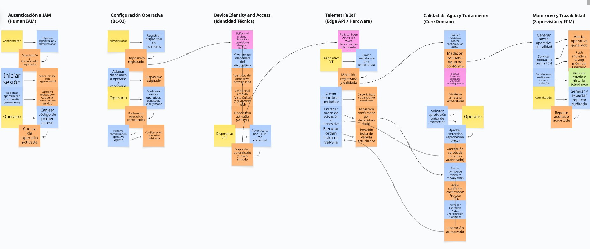
</p>

## 2.5. Ubiquitous Language

El Ubiquitous Language establece un vocabulario común entre los integrantes del equipo y los stakeholders involucrados en el dominio del tratamiento y monitoreo de la calidad del agua. Su propósito es asegurar que los conceptos utilizados para describir el problema, los procesos del negocio y la solución propuesta tengan un significado único y compartido, evitando ambigüedades durante el análisis y desarrollo del proyecto.

| Término (English) | Término (Español) | Definición |
| :--- | :--- | :--- |
| **Water Quality** | Calidad del agua | Condición del agua determinada a partir de características y parámetros que permiten establecer si es adecuada para el proceso o disposición correspondiente. |
| **Wastewater** | Agua residual | Agua que ha sido utilizada durante un proceso productivo y que contiene sustancias o características que requieren evaluación antes de su descarga o reutilización. |
| **Textile Wastewater** | Agua residual textil | Agua residual generada como consecuencia de procesos industriales textiles, especialmente actividades como teñido, lavado o acabado de tejidos. |
| **Dyeing Process** | Proceso de teñido | Proceso industrial donde se modifica el color de un textil, requiriendo homogenización del agua resultante. |
| **Effluent** | Efluente | Flujo de agua proveniente de un proceso productivo que es conducido hacia una etapa de tratamiento, reutilización o disposición. |
| **Treatment Process** | Proceso de tratamiento | Conjunto de actividades destinadas a modificar las condiciones del agua para alcanzar los parámetros de calidad establecidos antes de su disposición o reutilización. |
| **Treatment Tank** | Tanque de tratamiento | Recipiente donde se concentra temporalmente el agua para realizar su monitoreo, tratamiento y posterior evaluación. |
| **Water Sample** | Muestra de agua | Porción de agua obtenida de un punto determinado con el propósito de evaluar sus características y parámetros de calidad. |
| **Water Quality Parameter** | Parámetro de calidad del agua | Característica medible utilizada para determinar el estado o condición del agua. |
| **pH Level** | Nivel de pH | Medida que representa el grado de acidez o alcalinidad del agua y que permite determinar si se encuentra dentro del rango establecido. |
| **Temperature** | Temperatura | Medida de la condición térmica del agua, utilizada como uno de los parámetros para evaluar su estado durante el proceso. |
| **Permitted Range** | Rango permitido | Intervalo de valores establecido para determinar si un parámetro de calidad se encuentra dentro de las condiciones aceptables. |
| **Quality Threshold** | Umbral de calidad | Valor límite utilizado como referencia para determinar si un parámetro requiere una acción de control o tratamiento. |
| **Water Measurement** | Medición del agua | Obtención de los valores correspondientes a los parámetros de calidad de una muestra de agua. |
| **Quality Assessment** | Evaluación de calidad | Proceso mediante el cual se analizan las mediciones obtenidas para determinar la condición del agua respecto a los rangos establecidos. |
| **Compliant Water** | Agua conforme | Agua cuyos parámetros evaluados se encuentran dentro de los rangos establecidos para el proceso o disposición correspondiente. |
| **Non-Compliant Water** | Agua no conforme | Agua cuyos parámetros evaluados se encuentran fuera de los rangos establecidos y que requiere una acción antes de continuar con el proceso. |
| **Correction Strategy** | Estrategia de corrección | Regla configurada de pH o temperatura que determina la sustancia o actuación, la dosificación o intensidad y las condiciones para corregir una desviación. |
| **Correction Approval** | Aprobación de corrección | Autorización que el Operario concede una sola vez a la estrategia seleccionada al comenzar el tratamiento. Tras aprobarla, los ciclos restantes pueden continuar automáticamente hasta conformidad o fallo. |
| **Device** | Dispositivo | Equipo IoT identificado que mide pH y temperatura, recibe configuraciones y ejecuta o representa órdenes de actuación y control de flujo. |
| **Device Identity** | Identidad del dispositivo | Identidad técnica independiente de las cuentas humanas que vincula de forma segura un `deviceId`, una organización y una credencial. |
| **Device Credential** | Credencial del dispositivo | Secreto propio del dispositivo, mostrado una sola vez durante el provisionamiento y almacenado únicamente como hash en el backend. |
| **Device Provisioning** | Provisionamiento del dispositivo | Creación de la identidad técnica después de registrar el dispositivo, incluyendo la emisión inicial de su credencial. |
| **Device Principal** | Principal del dispositivo | Identidad autenticada que Edge obtiene del token y utiliza como fuente confiable de `deviceId`, `organizationId` y permisos. |
| **Device Revocation** | Revocación del dispositivo | Invalidación administrativa de su identidad técnica, que impide enviar telemetría y consultar o confirmar comandos. |
| **Edge API** | API Edge | Frontera HTTPS/REST utilizada por dispositivos autenticados para enviar telemetría y heartbeat, consultar comandos y confirmar su ejecución. |
| **Operating Environment** | Entorno de operación | Entorno físico o simulado en el que opera el dispositivo y que determina cómo se ejecutan o representan las actuaciones. |
| **Device Capability** | Capacidad del dispositivo | Actuación que un dispositivo declara poder ejecutar físicamente o representar de forma visible en el prototipo académico. |
| **Operational Configuration** | Configuración operativa | Versión vigente de rangos, estrategia correctiva, dosificación o intensidad, tiempo de espera, límite de ciclos y modo de liberación aplicable a un dispositivo. |
| **Dosing Setting** | Configuración de dosificación | Sustancia, cantidad o intensidad definida para una actuación correctiva. En el prototipo académico se conserva como parte de la decisión del sistema aunque su ejecución física sea reemplazada por un LED y una intervención manual. |
| **Corrective Actuation** | Actuación correctiva | Ejecución de la dosificación o acción térmica ordenada por el sistema durante el paso de corrección de un ciclo; no constituye una actuación continua. |
| **Actuation Confirmation** | Confirmación de actuación | Evidencia de que la orden correctiva fue ejecutada o representada; no demuestra por sí sola que el agua ya sea conforme. |
| **Process State** | Estado del proceso | Situación vigente del tratamiento que restringe las transiciones y acciones permitidas, como evaluación, corrección, espera, listo, fallo o emergencia. |
| **Release Mode** | Modo de liberación | Configuración manual o automática que determina cómo se confirma la liberación después de alcanzar el estado listo. |
| **Release Authorization** | Autorización de liberación | Decisión vigente del sistema que habilita la apertura de la válvula únicamente cuando el proceso cumple las condiciones de seguridad. |
| **Corrective Treatment** | Tratamiento correctivo | Acción aplicada al agua cuando uno o más parámetros se encuentran fuera de los rangos establecidos, con el objetivo de llevarlos nuevamente a condiciones aceptables. |
| **Treatment Cycle** | Ciclo de tratamiento | Secuencia que comprende la evaluación del agua, la aplicación de una acción correctiva cuando es necesaria y una nueva evaluación para verificar sus resultados. |
| **Useful Variation** | Variación útil | Cambio medible y favorable en los parámetros del agua detectado tras finalizar el tiempo de espera de un ciclo de tratamiento. |
| **Absolute Limit** | Límite absoluto | Cantidad máxima de ciclos de tratamiento permitidos sin éxito antes de declarar el proceso en estado de fallo. |
| **Reassessment** | Reevaluación | Nueva evaluación realizada después de una acción de tratamiento para comprobar si el agua cumple con los parámetros establecidos. |
| **Discharge** | Descarga | Destino o acción externa mediante la cual un efluente textil ya autorizado sale hacia el alcantarillado u otra disposición permitida. No es sinónimo de la decisión interna de liberación. |
| **Water Retention** | Retención del agua | Acción de mantener el agua dentro del sistema de tratamiento cuando sus parámetros no cumplen las condiciones necesarias para su descarga. |
| **Water Flow** | Flujo de agua | Movimiento o circulación del agua entre las diferentes etapas del proceso de tratamiento o disposición. |
| **Flow Control** | Control del flujo | Gestión de la circulación del agua para permitir, restringir o detener su paso durante las diferentes etapas del proceso. |
| **Operator** | Operario | Usuario que supervisa el dispositivo asignado, configura los parámetros operativos permitidos, atiende las indicaciones del sistema y actúa ante una emergencia. |
| **Administrator** | Administrador | Usuario que administra cuentas, roles, dispositivos, asignaciones y perfiles base, y que puede supervisar la información de todos los dispositivos sin tener uno propio. |
| **Emergency Stop** | Parada de emergencia | Orden prioritaria que interrumpe la liberación y obliga a mantener la válvula cerrada hasta un restablecimiento autorizado. |
| **Device Availability** | Disponibilidad del dispositivo | Condición que indica si el dispositivo mantiene comunicación dentro del intervalo esperado y puede participar de forma confiable en el proceso. |
| **Quality Alert** | Alerta de calidad | Aviso generado cuando un parámetro del agua presenta una condición que requiere atención o una acción correctiva. |
| **Quality Incident** | Incidente de calidad | Situación en la que el agua presenta una condición no esperada o fuera de los parámetros establecidos y requiere una acción de control. |
| **Monitoring Loss** | Pérdida de monitoreo | Evento en el que el sistema deja de recibir lecturas de telemetría del dispositivo durante un intervalo de tiempo esperado. |
| **Quality Record** | Registro de calidad | Registro histórico de mediciones, evaluaciones y resultados relacionados con la calidad del agua. |
| **Treatment Result** | Resultado del tratamiento | Resultado obtenido después de aplicar un tratamiento al agua y realizar una nueva evaluación de sus parámetros. |
| **Water Release** | Liberación del agua | Decisión y transición interna que habilita el flujo del agua conforme; puede conducir a una descarga textil o al suministro de riego hidropónico. |

# Capítulo III: Requirements Specification

## 3.1. User Stories

| EPIC | USER STORY |
| :--- | :--- |
| **EP-01: Gestión de Cuentas y Dispositivos**<br>Administración de perfiles de operarios y administradores, autenticación y asignación de dispositivos IoT a los operarios responsables de su monitoreo. | • US-01: Registro de operario<br>• US-02: Autenticación de usuario<br>• US-03: Asignación de dispositivo a operario<br>• US-04: Supervisión de operarios y dispositivos<br>• US-39: Asignación automática de rol según el flujo de alta. |
| **EP-02: Configuración de Parámetros y Reglas Operativas**<br>Definición del segmento y perfil base de cada dispositivo por parte del administrador, y ajuste operativo de rangos, tiempos de espera, límite de ciclos y modo de liberación por parte del operario responsable de cada dispositivo. | • US-05: Asignación de segmento y perfil base al dispositivo<br>• US-06: Configuración de rangos de calidad del dispositivo<br>• US-07: Configuración del límite de ciclos de corrección<br>• US-08: Configuración del tiempo de espera entre ciclos<br>• US-09: Configuración del modo de liberación<br>• US-10: Consulta de configuración de cualquier dispositivo<br>• US-40: Configuración de estrategia correctiva |
| **EP-03: Monitoreo de Calidad del Agua**<br>Adquisición, visualización y consulta histórica de las mediciones de pH y temperatura provenientes del dispositivo. | • US-11: Monitoreo de mediciones en tiempo real<br>• US-12: Monitoreo desde aplicación móvil |
| **EP-04: Evaluación y Tratamiento Correctivo del Agua**<br>Gestión de la conformidad del agua, dosificación correctiva por ciclos, comprobación de variación útil y límites absolutos para definir el estado del proceso. | • US-13: Evaluación de conformidad<br>• US-14: Retención de agua no conforme<br>• US-15: Ejecución de la acción correctiva<br>• US-16: Inicio de un ciclo de corrección<br>• US-17: Bloqueo por límite de ciclos sin conformidad<br>• US-18: Reevaluación posterior al tratamiento |
| **EP-05: Control de Válvula y Liberación**<br>Gestión de la apertura, cierre y parada de emergencia de la válvula según el modo de liberación configurado y el estado de conformidad del agua, aplicando siempre la regla de apertura solo desde el estado listo. | • US-19: Liberación automática<br>• US-20: Liberación manual<br>• US-21: Parada de emergencia |
| **EP-06: Monitoreo y Trazabilidad**<br>Creación y administración de alertas operativas, registro de incidentes, correlación de eventos y vistas de estado del sistema. | • US-22: Alerta por parámetro fuera de rango<br>• US-23: Alerta por bloqueo del proceso<br>• US-24: Registro de incidente de calidad<br>• US-25: Alerta por pérdida de monitoreo |
| **EP-07: Historial, Reportes y Trazabilidad**<br>Consulta y exportación de la información histórica de mediciones, alertas y liberaciones para su análisis y auditoría. | • US-26: Consulta del historial de mi dispositivo<br>• US-27: Consulta del historial de cualquier dispositivo<br>• US-28: Generación de reporte de calidad<br>• US-29: Exportación de reporte<br>• US-30: Trazabilidad de tratamiento y liberación |
| **EP-08: Aplicaciones Digitales para Supervisión**<br>Capacidades web y móviles que permiten a operarios y administradores supervisar el estado, las alertas y los resultados del proceso. | • US-31: Supervisión operativa<br>• US-32: Gestión de alertas operativas<br>• US-33: Consulta de resultados desde la aplicación móvil |
| **EP-09: Landing Page y Comunicación de la Propuesta de Valor**<br>Sitio web estático de HydroGuard orientado a comunicar el problema, la propuesta de valor y los beneficios de la solución frente a alternativas existentes. | • US-34: Comprensión de la propuesta de valor<br>• US-35: Explicación del funcionamiento de la solución<br>• US-36: Segmentos y casos de uso<br>• US-37: Solicitud de contacto o demostración<br>• US-38: Acceso a la plataforma |
| **EP-10: Integración IoT, Edge y Servicios Digitales**<br>Comunicación técnica entre el dispositivo, el servicio Edge y los servicios digitales, incluyendo telemetría, ejecución y confirmación de actuaciones correctivas, control del flujo y adaptación al producto integral, la simulación y el prototipo académico mediante contratos comunes. | • TS-01: Registro y autenticación del dispositivo<br>• TS-02: Identificación del entorno de origen del dispositivo<br>• TS-03: Adquisición y validación de mediciones<br>• TS-04: Ingesta de telemetría en el Edge API<br>• TS-05: Sincronización de parámetros vigentes<br>• TS-06: Exposición de servicios de consulta de mediciones y resultados<br>• TS-07: Control del actuador de flujo<br>• TS-08: Ejecución de la parada de emergencia en el dispositivo<br>• TS-09: Almacenamiento temporal ante pérdida de conexión<br>• TS-10: Estado de disponibilidad del dispositivo<br>• TS-11: Integración con servicio externo de notificaciones<br>• TS-12: Exposición de configuración mediante API RESTful<br>• TS-13: Ejecución y confirmación de la actuación correctiva |

### Reglas verificables compartidas

Las expresiones “válido”, “completo”, “reciente” y “variación útil” utilizadas en los criterios de aceptación se interpretan mediante reglas configurables y comprobables:

| Regla | Condición verificable para el alcance académico |
|:--|:--|
| Alta de Operario | `displayName` entre 2 y 100 caracteres, `identifier` no vacío (correo o nombre de usuario), normalizado mediante recorte de espacios y minúsculas y único globalmente, y contraseña permanente entre 8 y 72 caracteres. El Administrador utiliza su correo como identificador. |
| Medición válida | Incluye `measurementId`, `measuredAt`, pH y temperatura; pH entre 0 y 14 y temperatura entre 0 °C y 100 °C. |
| Medición reciente | Treatment exige una lectura de los últimos 60 segundos; el contrato expone `freshnessSeconds=60`. Este umbral no es un campo editable del formulario. Una fecha futura con más de 30 segundos de adelanto no es válida para la evaluación. |
| Tiempo de espera | `waitingMinutes` es un entero entre 1 y 30, inclusive. La espera comienza con la confirmación de la corrección y solo una medición posterior a su vencimiento permite reevaluar. |
| Variación útil | La distancia al rango disminuye al menos 0.1 pH o 0.5 °C según la estrategia. Estos umbrales están definidos en el backend; se registra el resultado sin confundir mejoría con conformidad. El máximo absoluto de ciclos se aplica aunque exista mejoría parcial. |
| Disponibilidad | El dispositivo envía heartbeat cada 30 segundos. Tres intervalos consecutivos sin heartbeat o medición válida —90 segundos— producen pérdida de monitoreo. |
| Configuración completa | Contiene `phMin`, `phMax`, `temperatureMin`, `temperatureMax`, `correctionAction`, `waitingMinutes`, `maximumCycles` y `releaseMode`; el sistema asigna `configurationVersion`. Los límites inferiores son estrictamente menores que los superiores; pH está entre 0–14, temperatura entre 0–100 °C, ciclos es un entero positivo y modo es `MANUAL` o `AUTOMATIC`. Dosis, sustancia e intensidad no son campos configurables del contrato actual. |

Los rangos, la espera, el máximo de ciclos, la indicación correctiva y el modo de liberación son configurables. La vigencia y los umbrales de variación útil descritos son reglas actuales del backend, no parámetros libremente ajustables por el usuario. Guardar crea o actualiza un borrador; publicar y confirmar su aplicación son pasos distintos. No se modifica la configuración de una unidad con proceso activo. Una medición inválida o antigua no habilita evaluación ni liberación.

| Epic / Story ID | Título | Descripción | Criterios de Aceptación | Relacionado con (Epic ID) |
| :--- | :--- | :--- | :--- | :--- |
| **EP-01** | **Gestión de Cuentas y Dispositivos** | Administración de perfiles de operarios y administradores, autenticación y asignación de dispositivos IoT a los operarios responsables de su monitoreo. | N/A | - |
| **US-01** | Registro de operario | Como Administrador, quiero registrar una cuenta de Operario con identificador, nombre y contraseña definitiva y habilitar su primer acceso después de completar su perfil y asignación, para incorporarlo a mi organización. | **Escenario 1:** Given que el Administrador está autenticado y proporciona datos válidos del Operario, When registra la cuenta, Then el sistema crea una cuenta con rol Operario dentro de su organización. <br><br>**Escenario 2:** Given que los datos son inválidos o el identificador ya está registrado, When el Administrador solicita el registro, Then el sistema rechaza la solicitud e informa el motivo. <br><br>**Escenario 3:** Given que el Operario tiene su perfil y asignación completos, When el Administrador solicita generar el código de primer acceso, Then el sistema genera un código asociado al Operario autorizado. <br><br>**Escenario 4:** Given que el Operario dispone de un código de primer acceso válido y no utilizado, When completa el proceso de primer acceso desde la aplicación móvil, Then el sistema habilita su acceso e impide reutilizar el código. | EP-01 |
| **US-02** | Autenticación de usuario | Como usuario registrado, quiero iniciar y cerrar sesión con mis credenciales desde la aplicación correspondiente a mi rol, para acceder únicamente a las funciones y datos que tengo autorizados. | **Escenario 1:** Given un usuario con cuenta habilitada y credenciales válidas, When solicita iniciar sesión, Then el sistema autentica al usuario y establece una sesión válida. <br><br>**Escenario 2:** Given un usuario con credenciales inválidas, When solicita iniciar sesión, Then el sistema rechaza la autenticación y no concede acceso a operaciones protegidas. <br><br>**Escenario 3:** Given un usuario autenticado, When solicita una operación que no corresponde a su rol, Then el sistema rechaza la operación. <br><br>**Escenario 4:** Given un usuario autenticado como Administrador u Operario, When utiliza la aplicación web administrativa o móvil, Then solo puede acceder a las funciones autorizadas para su rol. <br><br>**Escenario 5:** Given un usuario con sesión iniciada, When solicita cerrar sesión, Then la aplicación finaliza la sesión local y elimina los datos de sesión y la información operativa asociada al usuario. | EP-01 |
| **US-03** | Asignación de dispositivo a operario | Como Administrador, quiero asignar a un Operario los pares reservorio/dispositivo correspondientes a su grupo, para establecer un responsable exclusivo por cada unidad y controlar su acceso. | **Escenario 1:** Given que el Administrador está autenticado y existe un par reservorio/dispositivo sin responsable asignado, When lo asigna a un Operario habilitado del grupo correspondiente, Then el sistema registra la asignación y autoriza al Operario a consultar únicamente las unidades que le corresponden. <br><br>**Escenario 2:** Given que un par reservorio/dispositivo ya tiene una asignación activa, When el Administrador intenta asignarlo a otro Operario sin cerrar la asignación anterior, Then el sistema rechaza la solicitud y conserva al responsable actual. <br><br>**Escenario 3:** Given que un Operario pertenece a un grupo distinto o a otra organización, When el Administrador intenta asignarle el par reservorio/dispositivo, Then el sistema rechaza la solicitud. <br><br>**Escenario 4:** Given que existe una asignación activa, When el Administrador la cierra mediante el procedimiento autorizado, Then el sistema conserva el historial de responsabilidad y deja el par disponible para una nueva asignación manual. | EP-01 |
| **US-04** | Supervisión de operarios y dispositivos | Como Administrador, quiero consultar los operarios, dispositivos, asignaciones y disponibilidad de mi organización desde la aplicación web, para supervisar las unidades a cargo de mi equipo. | **Escenario 1:** Given que el Administrador tiene una sesión válida y existen operarios y dispositivos registrados en su organización, When consulta la información de supervisión, Then el sistema muestra los operarios, dispositivos y asignaciones vigentes correspondientes a su organización. <br><br>**Escenario 2:** Given que un dispositivo no tiene un Operario asignado, When el Administrador consulta su información, Then el sistema identifica el dispositivo como pendiente de asignación. <br><br>**Escenario 3:** Given que el Administrador consulta una organización sin registros disponibles, When solicita la información de supervisión, Then el sistema informa que no existen datos para mostrar. <br><br>**Escenario 4:** Given que un dispositivo no registra una comunicación reciente según las reglas de disponibilidad, When el Administrador consulta su estado, Then el sistema informa su indisponibilidad y no lo presenta como conectado. <br><br>**Escenario 5:** Given que un Administrador intenta consultar operarios, dispositivos o asignaciones de otra organización, When realiza la solicitud, Then el sistema rechaza el acceso a dicha información. | EP-01 |
| **US-39** | Asignación automática de rol según el flujo de alta | Como sistema, quiero asignar el rol Administrador únicamente durante el registro inicial de la organización y el rol Operario durante el alta administrativa de un operario, para impedir cambios manuales de rol y conservar un solo Administrador por organización. | **Escenario 1:** Given una organización nueva, When se completa su registro público, Then el sistema crea su única cuenta con rol Administrador. <br><br>**Escenario 2:** Given el Administrador registra una cuenta de operario, When el alta se completa, Then el sistema asigna el rol Operario sin permitir seleccionar otro rol. <br><br>**Escenario 3:** Given una cuenta existente, When se intenta modificar manualmente su rol, Then el sistema rechaza la operación. | EP-01 |
| **EP-02** | **Configuración de Parámetros y Reglas Operativas** | Definición del segmento y perfil base de cada dispositivo por parte del administrador, y ajuste operativo de rangos, tiempos de espera, límite de ciclos y modo de liberación por parte del operario responsable de cada dispositivo. | N/A | - |
| **US-05** | Vinculación de dispositivo y configuración base | Como Administrador, quiero vincular un dispositivo a un reservorio de un grupo de mi organización y establecer un contexto base compatible, para que el Operario pueda configurar las condiciones de funcionamiento de la unidad asignada. | **Escenario 1:** Given que el Administrador tiene una sesión válida y existe un dispositivo disponible y un reservorio de su organización, When vincula el dispositivo al reservorio correspondiente, Then el sistema registra el vínculo respetando el segmento del grupo y la organización. <br><br>**Escenario 2:** Given que un dispositivo ya está vinculado a otro reservorio o pertenece a una organización ajena, When el Administrador intenta establecer un vínculo no autorizado, Then el sistema rechaza la solicitud. <br><br>**Escenario 3:** Given que el dispositivo tiene capacidades registradas, When el sistema valida su compatibilidad con el contexto operativo requerido, Then solo admite configuraciones compatibles con dichas capacidades. <br><br>**Escenario 4:** Given que el dispositivo tiene un contexto base registrado, When el Operario desea establecer sus parámetros operativos, Then el sistema permite gestionar la configuración de su asignación según las reglas de autorización, sin considerar automáticamente publicada o aplicada una configuración por el solo hecho de vincular el dispositivo. | EP-02 |
| **US-06** | Configuración de rangos de calidad del dispositivo | Como operario, quiero configurar los rangos permitidos de pH y temperatura de mi dispositivo dentro del perfil habilitado para mi segmento, para establecer las condiciones que determinan la conformidad del agua en mi proceso. | **Escenario 1:** Given un Operario autorizado y rangos numéricos finitos de pH entre 0 y 14 y temperatura entre 0 y 100 °C, con mínimo estrictamente menor que máximo, When guarda la configuración sin un proceso activo, Then el sistema conserva un borrador versionado, sin considerarlo publicado ni aplicado. <br><br>**Escenario 2:** Given límites invertidos, iguales, ausentes o fuera de los intervalos admitidos, When intenta guardarlos, Then el sistema rechaza la operación sin activar valores parciales. <br><br>**Escenario 3:** Given una configuración publicada, When el dispositivo confirma esa misma versión, Then el sistema la identifica como aplicada y permite utilizarla en un nuevo proceso autorizado. | EP-02 |
| **US-07** | Configuración del límite de ciclos de corrección | Como operario, quiero establecer el número máximo de ciclos de corrección permitidos para mi dispositivo, para detectar correcciones que no producen un cambio útil. | **Escenario 1:** Given un Operario autorizado y un entero positivo para `maximumCycles`, When guarda y posteriormente publica la configuración, Then el sistema conserva el límite en esa versión para su aplicación al dispositivo. <br><br>**Escenario 2:** Given cero, un número negativo o no entero, When intenta guardar el límite, Then el sistema rechaza la configuración. <br><br>**Escenario 3:** Given el último ciclo permitido y una nueva lectura aún no conforme, When se reevalúa el proceso, Then este pasa a fallo aunque haya mejoría parcial. | EP-02 |
| **US-08** | Configuración del tiempo de espera entre ciclos | Como operario, quiero configurar el tiempo de espera antes de reevaluar el agua tras una corrección, para dar tiempo suficiente a que la dosificación produzca un efecto medible. | **Escenario 1:** Given un Operario autorizado y `waitingMinutes` entero entre 1 y 30, When guarda la configuración, Then el sistema conserva la espera en minutos en el borrador. <br><br>**Escenario 2:** Given un valor menor que 1, mayor que 30 o no entero, When intenta guardarlo, Then rechaza la configuración. <br><br>**Escenario 3:** Given la versión aplicada y una corrección confirmada, When vence la espera configurada, Then el sistema exige una medición posterior a ese vencimiento antes de reevaluar. | EP-02 |
| **US-09** | Configuración del modo de liberación | Como operario, quiero configurar el modo de liberación de mi dispositivo como manual o automático, para adaptar la operación a mi contexto sin quedar limitado a un único modo por segmento. | **Escenario 1:** Given un Operario autorizado y un modo `MANUAL` o `AUTOMATIC`, When guarda y publica la configuración y el dispositivo confirma la versión, Then el modo queda disponible para un nuevo proceso de esa unidad. <br><br>**Escenario 2:** Given un proceso conforme con lectura reciente y modo automático, When se autoriza la liberación, Then no se exige confirmación humana de apertura. <br><br>**Escenario 3:** Given el mismo estado conforme en modo manual, When todavía no existe autorización del Operario responsable, Then no se ordena abrir la válvula. El modo determina quién autoriza la apertura, no un cierre manual ordinario. | EP-02 |
| **US-10** | Consulta de configuración de dispositivos | Como Administrador, quiero consultar los parámetros, las versiones y el estado de configuración de los dispositivos de mi organización, para supervisar las condiciones operativas establecidas por los Operarios. | **Escenario 1:** Given que el Administrador tiene una sesión válida y existe una configuración registrada para un dispositivo de su organización, When consulta la configuración, Then el sistema muestra los rangos de pH y temperatura, el tiempo de espera con su unidad, el límite de ciclos, la estrategia de corrección, el modo de liberación y la versión registrada. <br><br>**Escenario 2:** Given que un dispositivo de su organización no tiene una configuración registrada, When el Administrador consulta su configuración, Then el sistema informa que no existe una configuración disponible. <br><br>**Escenario 3:** Given que existen versiones de configuración para un dispositivo de su organización, When el Administrador consulta su estado, Then el sistema distingue la versión guardada, publicada y aplicada según la información registrada por el sistema. <br><br>**Escenario 4:** Given que un Administrador solicita consultar la configuración de un dispositivo de otra organización, When realiza la solicitud, Then el sistema rechaza el acceso a dicha información. | EP-02 |
| **US-40** | Configuración de estrategia correctiva | Como Operario, quiero registrar una indicación correctiva para mi unidad, para documentar la intervención prevista sin sustituir la estrategia seleccionada por el sistema. | **Escenario 1:** Given una asignación autorizada sin proceso activo y una indicación de 1 a 500 caracteres, When guarda `correctionAction`, Then queda registrada en el borrador. <br><br>**Escenario 2:** Given una lectura no conforme, When Treatment selecciona `PH_MINUS`, `PH_PLUS`, `COOLING` o `HEATING` según la desviación, Then comprueba la capacidad necesaria y exige aprobación antes de actuar, sin convertir el texto libre en una dosis física. | EP-02 |
| **EP-03** | **Monitoreo de Calidad del Agua** | Adquisición, visualización y consulta histórica de las mediciones de pH y temperatura provenientes del dispositivo, durante el estado de lectura del proceso. | N/A | - |
| **US-11** | Monitoreo de pH y temperatura | Como Operario, quiero consultar las mediciones recientes de pH y temperatura de los dispositivos que tengo asignados, junto con su fecha y estado de disponibilidad, para conocer las condiciones del agua antes de tomar decisiones operativas. | **Escenario 1:** Given que el Operario tiene una sesión válida y dispone de dispositivos asignados con mediciones registradas, When consulta el monitoreo, Then el sistema muestra los valores de pH y temperatura junto con la fecha de medición de cada unidad autorizada. <br><br>**Escenario 2:** Given que un dispositivo asignado no tiene mediciones disponibles o sus lecturas no son recientes, When el Operario consulta su monitoreo, Then el sistema informa la ausencia o antigüedad de los datos sin presentarlos como mediciones actuales. <br><br>**Escenario 3:** Given que un Operario solicita mediciones de un dispositivo que no tiene asignado, When realiza la consulta, Then el sistema rechaza el acceso a la información. <br><br>**Escenario 4:** Given que existe una medición registrada con su origen y fecha, When el Operario consulta sus detalles, Then el sistema presenta la información disponible sobre la medición sin atribuirle una precisión instrumental que no haya sido validada. | EP-03 |
| **US-12** | Monitoreo desde aplicación móvil | Como operario, quiero consultar el estado de mi dispositivo desde una aplicación móvil, para supervisar el proceso cuando no me encuentro frente al panel principal. | **Escenario 1:** Given existe una medición con identificador, fecha, pH y temperatura dentro de sus límites físicos, When el operario consulta el estado mediante la aplicación móvil, Then el sistema entrega los mismos valores y la misma vigencia disponibles en los servicios de consulta. <br><br>**Escenario 2:** Given no existe conexión con el servicio, When el operario intenta consultar el estado desde la aplicación móvil, Then el sistema informa que la información no pudo actualizarse. | EP-03 |
| **EP-04** | **Evaluación y Tratamiento Correctivo del Agua** | Determinación de la conformidad del agua respecto a los rangos configurados y gestión del ciclo de corrección (lectura, corrección, espera, reevaluación) cuando los parámetros se encuentran fuera de rango, hasta alcanzar el estado listo o el estado de fallo. | N/A | - |
| **US-13** | Evaluación de conformidad | Como operario, quiero que el sistema evalúe cada medición respecto a los rangos configurados, para conocer si el agua es conforme o requiere tratamiento. | **Escenario 1:** Given los valores de pH y temperatura están dentro de los rangos configurados, When se evalúa la medición, Then el sistema clasifica el agua como conforme y el proceso pasa al estado listo. <br><br>**Escenario 2:** Given uno o más valores están fuera de los rangos configurados y el tratamiento todavía no fue aprobado, When el sistema selecciona la estrategia, Then clasifica el agua como no conforme y pasa el proceso a pendiente de aprobación de corrección. <br><br>**Escenario 3:** Given la corrección ya fue aprobada para el proceso y una reevaluación continúa fuera de rango, When quedan ciclos disponibles, Then el sistema continúa automáticamente con el siguiente ciclo sin solicitar una nueva aprobación. | EP-04 |
| **US-14** | Retención de agua no conforme | Como operario, quiero que el agua no conforme permanezca retenida, para evitar que continúe hacia la liberación antes de completar el tratamiento correspondiente. | **Escenario 1:** Given el agua es clasificada como no conforme, When se confirma la clasificación, Then el sistema mantiene la válvula cerrada. <br><br>**Escenario 2:** Given el agua pasa al estado listo, When se confirma el cumplimiento de los rangos, Then el sistema libera la condición de retención. | EP-04 |
| **US-15** | Aprobación y ejecución de la acción correctiva | Como operario, quiero revisar y aprobar una sola vez la estrategia seleccionada por el sistema antes de comenzar el tratamiento, para autorizar los ciclos correctivos de ese proceso. | **Escenario 1:** Given el agua es no conforme y el sistema seleccionó una estrategia válida, When todavía no existe aprobación, Then el proceso permanece pendiente, la válvula continúa cerrada y no se emite ninguna orden correctiva. <br><br>**Escenario 2:** Given el proceso está pendiente de aprobación, When el operario responsable aprueba la estrategia, Then el sistema registra actor y fecha, ordena la primera actuación y considera autorizados los ciclos restantes del mismo proceso. <br><br>**Escenario 3:** Given la actuación fue confirmada, When finaliza el tiempo de espera y una nueva medición posterior a la espera continúa fuera de rango con ciclos disponibles y requiere la misma estrategia aprobada, Then el sistema inicia automáticamente otro ciclo sin pedir una nueva aprobación. <br><br>**Escenario 4:** Given el prototipo académico ejecuta una orden aprobada, When comienza la corrección, Then activa el LED mientras una persona del equipo realiza la corrección manual sustitutiva. | EP-04 |
| **US-16** | Inicio de un ciclo de corrección | Como operario, quiero que el sistema registre el inicio de cada ciclo cuando acepta una actuación correctiva, para llevar un conteo inequívoco de los intentos realizados. | **Escenario 1:** Given el agua está clasificada como no conforme y no se ha alcanzado el límite configurado, When Treatment crea la actuación correctiva del proceso aprobado, Then el sistema registra el inicio del ciclo y su número de intento. <br><br>**Escenario 2:** Given finaliza el tiempo de espera y se registra una nueva medición, When el sistema la reevalúa, Then cierra el ciclo vigente y decide si inicia otro o detiene el tratamiento. <br><br>**Escenario 3:** Given el agua se encuentra en estado listo, When se evalúa una nueva medición, Then el sistema no inicia un ciclo de corrección. | EP-04 |
| **US-17** | Bloqueo por límite de ciclos sin conformidad | Como Operario, quiero que el proceso se detenga al alcanzar el máximo de ciclos sin conformidad, para evitar intentos indefinidos aunque haya mejoría parcial. | **Escenario 1:** Given el número de ciclos alcanza `maximumCycles` y la nueva medición sigue fuera de rango, When Treatment reevalúa el ciclo, Then pasa a fallo y ordena cierre seguro. <br><br>**Escenario 2:** Given quedan ciclos y la desviación requiere la misma estrategia aprobada, When se recibe una nueva medición válida posterior a la espera, Then inicia otro ciclo sin nueva aprobación, registrando si hubo variación útil. <br><br>**Escenario 3:** Given una medición conforme en el último ciclo, When se reevalúa, Then el proceso pasa a listo en lugar de fallar por el contador. <br><br>**Escenario 4:** Given la desviación requiere otra estrategia, When se reevalúa, Then el proceso falla y requiere restablecimiento e inicio autorizado, sin cambiar silenciosamente la estrategia aprobada. | EP-04 |
| **US-18** | Reevaluación posterior al tratamiento | Como operario, quiero que el sistema reevalúe el agua después de cada tiempo de espera, para comprobar si los parámetros cumplen las condiciones establecidas. | **Escenario 1:** Given finaliza el tiempo de espera configurado tras una corrección, When se registra una nueva medición, Then el sistema determina nuevamente el estado de conformidad del agua. <br><br>**Escenario 2:** Given la nueva medición cumple los rangos configurados, When finaliza la reevaluación, Then el agua queda clasificada como conforme y el proceso pasa al estado listo. | EP-04 |
| **EP-05** | **Control de Válvula y Liberación** | Gestión de la apertura, cierre y parada de emergencia de la válvula según el modo de liberación configurado y el estado de conformidad del agua, aplicando siempre la regla de apertura solo desde el estado listo. | N/A | - |
| **US-19** | Liberación automática | Como operario, quiero que la válvula se abra automáticamente cuando el agua alcanza el estado listo y el modo automático está configurado, para agilizar el proceso sin intervención manual. | **Escenario 1:** Given el modo automático está configurado y el agua se encuentra en estado listo, When se confirma dicho estado, Then el sistema autoriza y ejecuta la apertura de la válvula. <br><br>**Escenario 2:** Given el agua no se encuentra en estado listo, When se evalúa el estado, Then el sistema no autoriza la apertura de la válvula aunque el modo automático esté configurado. | EP-05 |
| **US-20** | Liberación manual | Como operario, quiero confirmar manualmente la liberación del agua cuando esta se encuentra en estado listo y el modo manual está configurado, para decidir el momento adecuado de inicio del riego o la descarga. | **Escenario 1:** Given el modo manual está configurado y el agua se encuentra en estado listo, When el operario confirma la liberación, Then el sistema autoriza y ejecuta la apertura de la válvula. <br><br>**Escenario 2:** Given el agua no se encuentra en estado listo, When el operario intenta confirmar la liberación, Then el sistema rechaza la operación. | EP-05 |
| **US-21** | Parada de emergencia | Como operario, quiero accionar una parada de emergencia en cualquier momento, para detener de inmediato cualquier liberación de agua ante errores o situaciones extraordinarias. | **Escenario 1:** Given el sistema recibe una orden de parada de emergencia, When la procesa, Then cierra la válvula de inmediato e ignora las rutinas automáticas de liberación en curso, sin importar el modo de liberación configurado. <br><br>**Escenario 2:** Given la válvula fue cerrada por una parada de emergencia o por un estado de fallo, When el ciclo automático intenta continuar, Then el sistema mantiene la válvula cerrada hasta que el operario responsable restablece el proceso. | EP-05 |
| **EP-06** | **Monitoreo y Trazabilidad** | Administración de alertas, incidentes y vistas de estado. | N/A | - |
| **US-22** | Alerta por parámetro fuera de rango | Como operario, quiero recibir una alerta cuando una medición se encuentre fuera del rango configurado, para actuar antes de una liberación no conforme. | **Escenario 1:** Given existe una configuración vigente, When una medición presenta un parámetro fuera del rango establecido, Then el sistema genera una alerta de calidad dirigida al operario. <br><br>**Escenario 2:** Given todos los parámetros se encuentran dentro de los rangos establecidos, When se procesa la medición, Then el sistema no genera una alerta. | EP-06 |
| **US-23** | Alerta por bloqueo del proceso | Como operario, quiero recibir una alerta crítica cuando el proceso pasa al estado de fallo por alcanzar el límite de ciclos sin efecto, para identificar una posible falla del sensor o del tratamiento. | **Escenario 1:** Given el proceso alcanza el estado de fallo por límite de ciclos, When el sistema registra el bloqueo, Then genera una alerta crítica dirigida al operario y al administrador. | EP-06 |
| **US-24** | Gestión y consulta de incidentes | Como Administrador, quiero consultar y gestionar los incidentes de mi organización, distinguiendo aquellos generados automáticamente por el sistema de los registrados manualmente, para mantener la trazabilidad de situaciones que requieren intervención. | **Escenario 1:** Given que el sistema detecta una condición que requiere registrar un incidente, When genera el registro, Then almacena el dispositivo, el momento de detección, el origen automático y la causa o parámetro afectado cuando corresponda. <br><br>**Escenario 2:** Given que el Administrador está autenticado y proporciona información válida de un incidente manual de su organización, When solicita registrarlo, Then el sistema almacena el incidente con origen manual, fecha y dispositivo relacionado. <br><br>**Escenario 3:** Given que existen incidentes registrados en la organización del Administrador, When consulta el historial de incidentes, Then el sistema muestra la información disponible, incluyendo origen, estado y datos de trazabilidad correspondientes. <br><br>**Escenario 4:** Given que un Administrador solicita consultar o gestionar un incidente de otra organización, When realiza la solicitud, Then el sistema rechaza el acceso. <br><br>**Escenario 5:** Given que existe un incidente registrado y el Administrador está autorizado para cerrarlo, When solicita su cierre, Then el sistema actualiza su estado y conserva el registro histórico y su relación con el evento que lo originó. | EP-06 |
| **US-25** | Alerta por pérdida de monitoreo | Como Administrador, quiero consultar una alerta cuando un dispositivo de mi organización deje de enviar información durante el intervalo esperado, para identificar oportunamente una interrupción del monitoreo y conocer cuándo se restablece la comunicación. | **Escenario 1:** Given que un dispositivo debe enviar heartbeat cada 30 segundos, When transcurren tres intervalos consecutivos (90 segundos) sin heartbeat ni medición válida, Then el sistema genera una alerta activa de pérdida de monitoreo asociada al dispositivo. <br><br>**Escenario 2:** Given que existe una alerta activa de pérdida de monitoreo para un dispositivo, When la interrupción continúa y el sistema vuelve a comprobar su disponibilidad, Then el sistema conserva una única alerta activa para esa condición sin generar duplicados. <br><br>**Escenario 3:** Given que existe una alerta activa de pérdida de monitoreo, When el sistema recibe un nuevo heartbeat o una medición válida, Then registra la recuperación y relaciona la resolución con la alerta original. <br><br>**Escenario 4:** Given que un Administrador solicita consultar una alerta de un dispositivo perteneciente a otra organización, When realiza la solicitud, Then el sistema rechaza el acceso a dicha información. | EP-06 |
| **EP-07** | **Historial, Reportes y Trazabilidad** | Consulta y exportación de la información histórica de mediciones, evaluaciones, tratamientos, alertas y liberaciones para su análisis y seguimiento, tanto a nivel de un dispositivo como del conjunto del sistema. | N/A | - |
| **US-26** | Consulta del historial de mi dispositivo | Como operario, quiero consultar el historial de lecturas, ciclos y liberaciones de mi dispositivo, para evaluar el rendimiento del proceso o sustentar una auditoría interna. | **Escenario 1:** Given existen mediciones y eventos registrados para mi dispositivo, When el operario consulta el historial, Then el sistema entrega los registros manteniendo su relación temporal. <br><br>**Escenario 2:** Given no existen registros en el periodo solicitado, When el operario consulta el historial, Then el sistema informa que no existen datos disponibles. | EP-07 |
| **US-27** | Consulta del historial de dispositivos | Como Administrador, quiero consultar el historial persistente de los dispositivos de mi organización, para conocer la evolución de las mediciones y los eventos operativos registrados. | **Escenario 1:** Given que existen mediciones y eventos registrados para un dispositivo de la organización, When el Administrador consulta su historial, Then el sistema devuelve los registros disponibles con sus fechas y en el orden temporal solicitado. <br><br>**Escenario 2:** Given que el Administrador selecciona un periodo de consulta, When solicita el historial de un dispositivo autorizado, Then el sistema devuelve únicamente los registros correspondientes al periodo y aplica los filtros y la paginación disponibles. <br><br>**Escenario 3:** Given que no existen registros en el periodo solicitado, When el Administrador consulta el historial, Then el sistema informa que no existen datos disponibles. <br><br>**Escenario 4:** Given que un Administrador solicita el historial de un dispositivo perteneciente a otra organización, When realiza la consulta, Then el sistema rechaza el acceso a dicha información. | EP-07 |
| **US-28** | Generación de reporte de calidad | Como administrador, quiero generar un reporte del estado y evolución de la calidad del agua de un dispositivo, para utilizarlo en la toma de decisiones o en la sustentación de una auditoría. | **Escenario 1:** Given existen mediciones y evaluaciones registradas para el periodo solicitado, When el administrador solicita el reporte, Then el sistema lo genera con los datos correspondientes. <br><br>**Escenario 2:** Given el periodo seleccionado no contiene registros, When el administrador solicita el reporte, Then el sistema informa que no existe información suficiente. | EP-07 |
| **US-29** | Exportación de reporte | Como administrador, quiero exportar un reporte generado, para conservarlo o compartirlo con otros responsables autorizados. | **Escenario 1:** Given existe un reporte generado correctamente, When el administrador solicita su exportación, Then el sistema produce un archivo con la información del reporte. <br><br>**Escenario 2:** Given no existe información suficiente para generar el reporte, When el administrador solicita la exportación, Then el sistema rechaza la operación. | EP-07 |
| **US-30** | Trazabilidad de tratamiento y liberación | Como Administrador, quiero consultar la relación entre mediciones, configuraciones aplicadas, evaluaciones, ciclos correctivos y liberaciones de los dispositivos de mi organización, para comprender y supervisar las decisiones tomadas durante cada tratamiento. | **Escenario 1:** Given que existe un tratamiento asociado a una medición no conforme, When el Administrador consulta su trazabilidad, Then el sistema muestra la medición, la evaluación y los ciclos correctivos registrados, conservando sus relaciones e identificadores. <br><br>**Escenario 2:** Given que existe una liberación autorizada, When el Administrador consulta la trazabilidad del tratamiento, Then el sistema identifica la reevaluación y la configuración aplicada que sustentaron la autorización. <br><br>**Escenario 3:** Given que un tratamiento registra actuaciones, evaluaciones o cambios de estado, When el Administrador consulta su trazabilidad, Then el sistema presenta los eventos disponibles con sus fechas y referencias correspondientes, sin atribuir al hardware actuaciones físicas no verificadas. <br><br>**Escenario 4:** Given que un Administrador solicita la trazabilidad de un dispositivo perteneciente a otra organización, When realiza la consulta, Then el sistema rechaza el acceso a dicha información. | EP-07 |
| **EP-08** | **Aplicaciones Digitales para Supervisión** | Capacidades web y móviles que permiten a operarios y administradores supervisar el estado, las alertas y los resultados del proceso. | N/A | - |
| **US-31** | Supervisión operativa | Como operario, quiero consultar el estado actual del proceso de mi dispositivo, para conocer si debo aprobar el tratamiento, si está ejecutándose o si puede continuar hacia la liberación. | **Escenario 1:** Given existe una medición reciente, When el operario consulta el estado operativo, Then el sistema informa el estado actual del proceso, incluyendo pendiente de aprobación, corrección, espera, reevaluación, listo, fallo o emergencia. <br><br>**Escenario 2:** Given el proceso espera aprobación, When el operario consulta su detalle, Then la aplicación muestra la estrategia seleccionada, sus parámetros y una única acción de aprobación. <br><br>**Escenario 3:** Given el tratamiento ya fue aprobado, When se ejecutan ciclos posteriores, Then la aplicación muestra su progreso sin volver a solicitar aprobación. <br><br>**Escenario 4:** Given el dispositivo pertenece al prototipo académico, When el sistema ordena la corrección, Then la interfaz identifica que el LED representa el proceso y que la intervención manual del equipo es una sustitución demostrativa, no el comportamiento del producto integral. | EP-08 |
| **US-32** | Gestión de alertas operativas | Como operario, quiero consultar las alertas activas de mi dispositivo, para priorizar las situaciones que requieren atención. | **Escenario 1:** Given existen alertas activas, When el operario las consulta, Then el sistema entrega las alertas pendientes de atención. <br><br>**Escenario 2:** Given una alerta fue generada por una condición fuera de rango, When la condición se corrige, Then el sistema asocia la alerta con la resolución correspondiente. | EP-08 |
| **US-33** | Consulta de resultados desde la aplicación móvil | Como operario, quiero consultar evaluaciones y alertas de los dispositivos que tengo asignados desde la aplicación móvil, para supervisar mis procesos sin depender de inspecciones presenciales. | **Escenario 1:** Given existen resultados registrados para una asignación del operario, When consulta el proceso desde la aplicación móvil, Then el sistema entrega su estado y resultado más reciente. <br><br>**Escenario 2:** Given el operario intenta consultar un dispositivo no asignado, When realiza la solicitud, Then el sistema rechaza el acceso. <br><br>**Escenario 3:** Given no existe información reciente disponible, When el operario realiza la consulta, Then el sistema informa que los datos no están actualizados. | EP-08 |
| **EP-09** | **Landing Page y Comunicación de la Propuesta de Valor** | Sitio web estático de HydroGuard orientado a comunicar el problema, la propuesta de valor y los beneficios de la solución frente a alternativas existentes. | N/A | - |
| **US-34** | Comprensión de la propuesta de valor | Como visitante, quiero comprender el problema que enfrenta el control de calidad del agua en los procesos productivos, para conocer la necesidad que aborda HydroGuard. | **Escenario 1:** Given el visitante accede al sitio web, When consulta la información principal, Then encuentra una explicación del problema y de la propuesta de valor. <br><br>**Escenrio 2:** Given el visitante revisa la propuesta de valor, When explora la información presentada, Then puede identificar los principales beneficios de la solución frente a alternativas de medición no conectadas. | EP-09 |
| **US-35** | Explicación del funcionamiento de la solución | Como visitante, quiero conocer cómo funciona la solución, para comprender su propuesta tecnológica y operativa. | **Escenario 1:** Given el visitante consulta la información del producto, When explora el funcionamiento, Then identifica las etapas de lectura, evaluación, corrección, espera y liberación del proceso. | EP-09 |
| **US-36** | Segmentos y casos de uso | Como visitante, quiero conocer los segmentos y casos de aplicación de la solución, para determinar si responde a una necesidad de mi organización. | **Escenario 1:** Given el visitante consulta los casos de aplicación, When explora la información, Then identifica los segmentos textil e hidropónico a los que se dirige la solución. <br><br>**Escenario 2:** Given el visitante pertenece a uno de los segmentos objetivo, When consulta la información correspondiente, Then encuentra beneficios relacionados con sus necesidades de monitoreo. | EP-09 |
| **US-37** | Solicitud de contacto o demostración | Como visitante, quiero solicitar información o una demostración de HydroGuard, para conocer con mayor detalle las capacidades de la solución antes de adoptarla. | **Escenario 1:** Given que el visitante proporciona un nombre, un correo con formato válido y un mensaje no vacío, When envía la solicitud de contacto, Then el sistema registra o entrega la solicitud mediante el mecanismo de recepción establecido y confirma su recepción únicamente cuando la operación se completa correctamente. <br><br>**Escenario 2:** Given que el visitante omite un campo obligatorio o proporciona un correo con formato inválido, When intenta enviar la solicitud, Then el sistema rechaza el envío e identifica los campos que deben corregirse. <br><br>**Escenario 3:** Given que el visitante proporciona datos válidos, pero ocurre un error durante el envío o registro de la solicitud, When el sistema procesa la operación, Then informa que no fue posible completar la solicitud y no muestra una confirmación de recepción exitosa. | EP-09 |
| **US-38** | Acceso a la plataforma | Como visitante, quiero dirigirme desde el sitio web hacia el ingreso a mi cuenta operativa, para continuar hacia el proceso de autenticación. | **Escenario 1:** Given el visitante posee una cuenta registrada, When solicita el ingreso a la plataforma, Then el sistema lo dirige al proceso de autenticación. | EP-09 |
| **EP-10** | **Integración IoT, Edge y Servicios Digitales** | Comunicación técnica entre el dispositivo (físico o simulado en Wokwi), el servicio Edge y los servicios digitales, incluyendo la ejecución de acciones sobre el actuador de flujo bajo un mismo contrato de telemetría. | N/A | - |
| **TS-01** | Provisionamiento y autenticación del dispositivo | Como Developer, quiero que cada dispositivo disponga de una identidad y credencial únicas vinculadas con su organización, para permitir únicamente comunicaciones autorizadas. | **Escenario 1:** Given un Administrador registra un dispositivo válido, When el backend completa el provisionamiento, Then crea su identidad en estado activo, vincula `deviceId` con `organizationId` y entrega la credencial original una sola vez. <br><br>**Escenario 2:** Given el dispositivo presenta una credencial válida por HTTPS, When solicita autenticación, Then el servicio emite un token de corta duración con su identidad, organización, audiencia y permisos. <br><br>**Escenario 3:** Given la identidad no existe, está revocada o la credencial es inválida, When solicita autenticación, Then el servicio rechaza la solicitud sin revelar información sensible. <br><br>**Escenario 4:** Given el Administrador revoca la identidad, When el dispositivo intenta enviar telemetría o consultar comandos, Then Edge rechaza la operación. | EP-10 |
| **TS-02** | Identificación del entorno de origen del dispositivo | Como Developer, quiero que el sistema identifique si una medición proviene del dispositivo físico (ESP32) o del entorno simulado (Wokwi), para mantener trazabilidad diferenciada bajo un mismo contrato de telemetría. | **Escenario 1:** Given un identificador de dispositivo correspondiente al entorno físico, When el API recibe la medición, Then la registra con el origen físico correspondiente. <br><br>**Escenario 2:** Given un identificador de dispositivo correspondiente al entorno simulado, When el API recibe la medición, Then la registra con el origen simulado correspondiente. | EP-10 |
| **TS-03** | Adquisición y validación de mediciones | Como Developer, quiero que el dispositivo obtenga y valide las lecturas de pH y temperatura, para entregar únicamente mediciones utilizables por el proceso de calidad del agua. | **Escenario 1:** Given los sensores entregan un valor de pH entre 0 y 14 y una temperatura entre 0 °C y 100 °C, When el dispositivo realiza una medición, Then genera un registro completo con ambos valores. <br><br>**Escenario 2:** Given un sensor entrega un valor fuera de esos límites físicos, When el dispositivo procesa la lectura, Then la descarta como medición no válida. | EP-10 |
| **TS-04** | Ingesta HTTPS de telemetría en Edge API | Como Developer, quiero que Edge API reciba por HTTPS/REST las mediciones de dispositivos autenticados, para procesarlas con una identidad confiable. | **Escenario 1:** Given un token válido y un payload con temperatura, pH, marca temporal e identificador idempotente, When el dispositivo realiza `POST /edge/v1/telemetry`, Then Edge obtiene `deviceId` y `organizationId` del token y confirma la recepción. <br><br>**Escenario 2:** Given el token falta, venció o pertenece a una identidad revocada, When se intenta enviar la medición, Then Edge rechaza la solicitud. <br><br>**Escenario 3:** Given se reintenta una medición ya aceptada, When Edge valida su identificador, Then devuelve el resultado previo sin duplicar el registro. | EP-10 |
| **TS-05** | Sincronización de parámetros vigentes | Como Developer, quiero sincronizar los rangos, la indicación correctiva, la espera en minutos, el máximo de ciclos y el modo de liberación de la versión publicada, para que el dispositivo opere con parámetros identificables. | **Escenario 1:** Given una configuración publicada, When el dispositivo autorizado la consulta, Then recibe sus parámetros y `configurationVersion`. <br><br>**Escenario 2:** Given el dispositivo confirma esa versión, When el backend registra su aplicación, Then distingue la configuración aplicada de un borrador o una publicación pendiente de confirmar. <br><br>**Escenario 3:** Given no hay versión publicada o se confirma una sustituida, When solicita aplicar la configuración, Then no habilita un proceso nuevo con versión inexistente o incorrecta. | EP-10 |
| **TS-06** | Exposición de servicios de consulta de mediciones y resultados | Como Developer, quiero exponer servicios RESTful para consultar mediciones, evaluaciones y reportes, para que las aplicaciones web y móvil consuman la información del dominio. | **Escenario 1:** Given una sesión autorizada, un `deviceId` perteneciente a su organización, fechas ISO 8601 coherentes y paginación positiva, When el servicio procesa la consulta, Then responde con los registros correspondientes y sus marcas temporales. <br><br>**Escenario 2:** Given el dispositivo pertenece a otra organización, la fecha inicial supera a la final o la paginación no es positiva, When el servicio procesa la solicitud, Then responde con `403` o `422` según corresponda. | EP-10 |
| **TS-07** | Control del actuador de flujo | Como Developer, quiero emitir una orden de apertura o cierre hacia el actuador de la válvula (servomotor físico o representación en Wokwi), para ejecutar la decisión de liberación o retención del agua. | **Escenario 1:** Given el agua posee una autorización de liberación vigente, When el sistema emite la orden de apertura, Then el dispositivo ejecuta la acción sobre el actuador (o su representación visual mediante LED en el entorno simulado) y confirma el resultado. <br><br>**Escenario 2:** Given el agua no posee autorización de liberación, When se intenta emitir una orden de apertura, Then la orden es rechazada. | EP-10 |
| **TS-08** | Ejecución de la parada de emergencia en el dispositivo | Como Developer, quiero que el dispositivo priorice y ejecute de inmediato una orden de parada de emergencia, para garantizar el cierre de la válvula ante cualquier rutina en curso. | **Escenario 1:** Given el dispositivo recibe una orden de parada de emergencia, When la procesa, Then interrumpe cualquier rutina automática en ejecución y ejecuta el cierre del actuador. <br><br>**Escenario 2:** Given el actuador fue cerrado por una parada de emergencia, When se recibe una nueva orden automática de apertura, Then el dispositivo la ignora hasta recibir una orden explícita de restablecimiento por parte del operario. | EP-10 |
| **TS-09** | Almacenamiento temporal ante pérdida de conexión | Como Developer, quiero retener una medición pendiente en el firmware y encolar en Edge las entregas aceptadas que no llegan al backend, para reintentar sin alterar fechas ni duplicar el historial. | **Escenario 1:** Given una medición válida pendiente de envío, When no puede entregarse a Edge, Then el firmware conserva ese registro en RAM con su identificador y fecha originales; no lo reemplaza por una muestra nueva mientras está pendiente. <br><br>**Escenario 2:** Given Edge acepta un registro y el backend no está disponible, When almacena la entrega en SQLite, Then conserva su identidad y fecha para reintentar. <br><br>**Escenario 3:** Given se recupera la comunicación, When se reenvía un registro aceptado anteriormente, Then no se duplica su persistencia. <br><br>**Escenario 4:** Given un reinicio del ESP32 o la pérdida del disco efímero de Edge, When existían datos pendientes en ese almacenamiento, Then no se presupone su recuperación: la retención RAM y la cola local no garantizan conservar todas las muestras durante cualquier interrupción. | EP-10 |
| **TS-10** | Estado de disponibilidad del dispositivo | Como Developer, quiero que el dispositivo comunique periódicamente su disponibilidad, para detectar interrupciones en el monitoreo. | **Escenario 1:** Given el dispositivo está operativo y conectado, When transcurren 30 segundos, Then envía un heartbeat autenticado con `deviceId`, marca temporal e identificador idempotente. <br><br>**Escenario 2:** Given transcurren 90 segundos sin heartbeat ni medición válida, When el servicio evalúa la disponibilidad, Then identifica al dispositivo como no disponible sin duplicar la alerta activa. | EP-10 |
| **TS-11** | Integración de notificaciones con FCM | Como Developer, quiero integrar Firebase Cloud Messaging, para comunicar oportunamente las alertas a la aplicación móvil del Operario. | **Escenario 1:** Given existe una alerta persistida y un token FCM vigente, When Monitoring solicita el envío, Then FCM acepta la notificación y se registra el resultado. <br><br>**Escenario 2:** Given FCM rechaza o no entrega la solicitud, When Monitoring procesa el fallo, Then conserva la alerta como fuente de verdad y registra el intento para reintento. <br><br>**Escenario 3:** Given el Operario abre una notificación, When la aplicación procesa sus datos, Then navega al proceso o alerta correspondiente dentro de sus asignaciones. | EP-10 |
| **TS-12** | Exposición de configuración mediante API RESTful | Como Developer, quiero disponer de servicios RESTful para consultar y modificar las configuraciones del dispositivo, para integrar las aplicaciones digitales con el dominio de calidad del agua. | **Escenario 1:** Given una sesión autorizada y una configuración completa con rangos coherentes, espera entera entre 1 y 30 minutos, límite de ciclos positivo, indicación correctiva no vacía y modo de liberación válido, When el servicio valida los datos, Then persiste el borrador y devuelve su versión; la publicación y aplicación requieren operaciones posteriores. <br><br>**Escenario 2:** Given falta un campo, los rangos se invierten o la espera no es entera o está fuera de sus límites, When el servicio procesa la solicitud, Then rechaza la solicitud con un error de validación sin activar una configuración parcial. | EP-10 |
| **TS-13** | Ejecución y confirmación de la actuación correctiva | Como Developer, quiero que el dispositivo procese de manera idempotente una orden correctiva con estrategia, duración de representación, proceso, ejecución y versión correspondientes, para ejecutar la dosificación física o su representación académica y devolver un resultado verificable. | **Escenario 1:** Given una orden `CORRECT` válida con duración de representación entre 1 y 5000 ms, When el firmware la ejecuta sin bloqueo, Then activa el indicador y confirma el resultado con el mismo identificador, sin acreditar una dosis química física. <br><br>**Escenario 2:** Given el simulador recibe una orden válida, When la procesa, Then activa el indicador correspondiente y confirma la representación; una modificación posterior del sensor representa el efecto para la siguiente medición. <br><br>**Escenario 3:** Given el prototipo académico recibe una orden válida, When la procesa, Then mantiene encendido el LED durante la corrección manual sustitutiva realizada por el equipo y confirma la representación al finalizar. <br><br>**Escenario 4:** Given el dispositivo recibe nuevamente un identificador de comando ya procesado, When valida la orden, Then devuelve el resultado registrado sin repetir la actuación. <br><br>**Escenario 5:** Given la orden es incompatible, inválida o no puede ejecutarse, When el dispositivo la procesa, Then no inicia la actuación y responde con estado rechazado o fallido y un código de error. | EP-10 |


## 3.2. Impact Mapping.

<p align="center">
  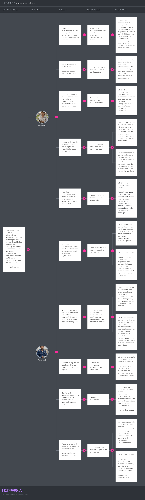
</p>

## 3.3. Product Backlog.

A continuación se detalla la prioridad de producto. Los primeros cinco elementos validan comunicación y acceso desde el Landing Page; a partir de allí, la ejecución técnica no sigue libremente el número de la lista, sino las dependencias habilitadoras que se indican a continuación. De esta manera, una capacidad de negocio puede conservar una prioridad alta sin implementarse antes de la identidad, configuración o comunicación que necesita.

| Secuencia técnica mínima | Capacidades habilitadoras | Capacidades que habilita |
|:--:|:--|:--|
| 1 | Registro inicial, rol de Administrador y autenticación (`US-39`, `US-02`) | Acceso seguro a cualquier función administrativa. |
| 2 | Alta de Operarios, identidad del dispositivo y asignación (`US-01`, `TS-01`, `US-03`, `US-05`) | Asociación inequívoca entre organización, responsable, reservorio y dispositivo. |
| 3 | Configuración y sincronización (`US-06` a `US-10`, `US-40`, `TS-05`, `TS-12`) | Reglas vigentes para evaluar mediciones y decidir actuaciones. |
| 4 | Adquisición e ingesta (`TS-03`, `TS-04`, `US-11`) | Telemetría válida, autenticada y visible. |
| 5 | Evaluación, tratamiento y liberación (`US-13` a `US-21`, `TS-07`, `TS-13`) | Ciclos correctivos y liberación segura. |
| 6 | Alertas, monitoreo, historial y reportes (`US-22` a `US-33`, `TS-10`, `TS-11`) | Supervisión y trazabilidad sobre eventos ya producidos. |

La prioridad visual utilizada en la presentación debe mostrar esta misma secuencia técnica cuando explique implementación. La rentabilidad y la accesibilidad económica no se presentan como resultados demostrados: `BA-05` continúa siendo un supuesto que se validará comparando el costo del prototipo y del producto mínimo con alternativas del mercado y con la disposición de pago de los segmentos.

El orden expresa prioridad de producto según valor de negocio, no una cronología de implementación ni una declaración de historias terminadas. Cada ID conserva el objetivo y los criterios definidos en 3.1; la asignación de tareas, el alcance entregado y las evidencias de aceptación se documentan en el Sprint Backlog correspondiente.

| # Orden | User Story Id | Título | Descripción | Story Points (1/2/3/5/8) |
|:--:|:--|:--|:--|:--:|
| 1 | US-34 | Comprensión de la propuesta de valor | Como visitante, quiero comprender el problema que enfrenta el control de calidad del agua en los procesos productivos, para conocer la necesidad que aborda HydroGuard. | 2 |
| 2 | US-35 | Explicación del funcionamiento de la solución | Como visitante, quiero conocer cómo funciona la solución, para comprender su propuesta tecnológica y operativa. | 2 |
| 3 | US-36 | Segmentos y casos de uso | Como visitante, quiero conocer los segmentos y casos de aplicación de la solución, para determinar si responde a una necesidad de mi organización. | 2 |
| 4 | US-37 | Solicitud de contacto o demostración | Como visitante, quiero solicitar información o una demostración de HydroGuard, para conocer con mayor detalle las capacidades de la solución antes de adoptarla. | 3 |
| 5 | US-38 | Acceso a la plataforma | Como visitante, quiero dirigirme desde el sitio web hacia el ingreso a mi cuenta operativa, para continuar hacia el proceso de autenticación. | 1 |
| 6 | TS-03 | Adquisición y validación de mediciones | Como Developer, quiero que el dispositivo obtenga y valide las lecturas de pH y temperatura, para entregar únicamente mediciones utilizables por el proceso de calidad del agua. | 3 |
| 7 | TS-04 | Ingesta de telemetría en el Edge API | Como Developer, quiero que el Edge API reciba las mediciones del dispositivo, para procesarlas y entregarlas a los servicios digitales. | 8 |
| 8 | US-11 | Monitoreo de pH y temperatura | Como Operario, quiero consultar las mediciones recientes de pH y temperatura de los dispositivos que tengo asignados, junto con su fecha y estado de disponibilidad, para conocer las condiciones del agua antes de tomar decisiones operativas. | 3 |
| 9 | US-06 | Configuración de rangos de calidad del dispositivo | Como operario, quiero configurar los rangos permitidos de pH y temperatura de mi dispositivo dentro del perfil habilitado para mi segmento, para establecer las condiciones que determinan la conformidad del agua en mi proceso. | 3 |
| 10 | US-13 | Evaluación de conformidad | Como operario, quiero que el sistema evalúe cada medición respecto a los rangos configurados, para conocer si el agua es conforme (estado listo) o no conforme (estado de corrección). | 5 |
| 11 | US-15 | Aprobación y ejecución de la acción correctiva | Como operario, quiero revisar y aprobar una sola vez la estrategia seleccionada antes de que el sistema ejecute automáticamente los ciclos del tratamiento. | 5 |
| 12 | TS-13 | Ejecución y confirmación de la actuación correctiva | Como Developer, quiero que el dispositivo procese de manera idempotente la orden correctiva, para ejecutar la dosificación física o su representación académica y confirmar su resultado sin repetir actuaciones. | 5 |
| 13 | TS-07 | Control del actuador de flujo | Como Developer, quiero emitir una orden de apertura o cierre hacia el actuador de la válvula (servomotor físico o representación en Wokwi), para ejecutar la decisión de liberación o retención del agua. | 5 |
| 14 | US-19 | Liberación automática | Como operario, quiero que la válvula se abra automáticamente cuando el agua alcanza el estado listo y el modo automático está configurado, para agilizar el proceso sin intervención manual. | 5 |
| 15 | US-20 | Liberación manual | Como operario, quiero confirmar manualmente la liberación del agua cuando esta se encuentra en estado listo y el modo manual está configurado, para decidir el momento adecuado de inicio del riego o la descarga. | 3 |
| 16 | US-14 | Retención de agua no conforme | Como operario, quiero que el agua no conforme permanezca retenida, para evitar que continúe hacia la liberación antes de completar el tratamiento correspondiente. | 3 |
| 17 | US-16 | Inicio de un ciclo de corrección | Como operario, quiero que el sistema registre el inicio de cada ciclo cuando acepta una actuación correctiva, para llevar un conteo inequívoco de los intentos realizados. | 5 |
| 18 | US-18 | Reevaluación posterior al tratamiento | Como operario, quiero que el sistema reevalúe el agua después de cada tiempo de espera, para comprobar si los parámetros cumplen las condiciones establecidas. | 3 |
| 19 | US-07 | Configuración del límite de ciclos de corrección | Como operario, quiero establecer el número máximo de ciclos de corrección permitidos para mi dispositivo, para detectar correcciones que no producen un cambio útil. | 2 |
| 20 | US-08 | Configuración del tiempo de espera entre ciclos | Como operario, quiero configurar el tiempo de espera antes de reevaluar el agua tras una corrección, para dar tiempo suficiente a que la dosificación produzca un efecto medible. | 2 |
| 21 | US-17 | Bloqueo por límite de ciclos sin conformidad | Como Operario, quiero que el proceso se detenga al alcanzar el máximo de ciclos sin conformidad, para evitar intentos indefinidos aunque haya mejoría parcial. | 5 |
| 22 | US-21 | Parada de emergencia | Como operario, quiero accionar una parada de emergencia en cualquier momento, para detener de inmediato cualquier liberación de agua ante errores o situaciones extraordinarias. | 5 |
| 23 | TS-08 | Ejecución de la parada de emergencia en el dispositivo | Como Developer, quiero que el dispositivo priorice y ejecute de inmediato una orden de parada de emergencia, para garantizar el cierre de la válvula ante cualquier rutina en curso. | 3 |
| 24 | US-09 | Configuración del modo de liberación | Como operario, quiero configurar el modo de liberación de mi dispositivo como manual o automático, para adaptar la operación a mi contexto sin quedar limitado a un único modo por segmento. | 2 |
| 25 | US-22 | Alerta por parámetro fuera de rango | Como operario, quiero recibir una alerta cuando una medición se encuentre fuera del rango configurado, para actuar antes de una liberación no conforme. | 3 |
| 26 | US-23 | Alerta por bloqueo del proceso | Como operario, quiero recibir una alerta crítica cuando el proceso pasa al estado de fallo por alcanzar el límite de ciclos sin efecto, para identificar una posible falla del sensor o del tratamiento. | 2 |
| 27 | US-25 | Alerta por pérdida de monitoreo | Como Administrador, quiero consultar una alerta cuando un dispositivo de mi organización deje de enviar información durante el intervalo esperado, para identificar oportunamente una interrupción del monitoreo y conocer cuándo se restablece la comunicación. | 3 |
| 28 | TS-10 | Estado de disponibilidad del dispositivo | Como Developer, quiero que el dispositivo comunique periódicamente su disponibilidad, para detectar interrupciones en el monitoreo. | 3 |
| 29 | TS-11 | Integración con servicio externo de notificaciones | Como Developer, quiero integrar un servicio externo de notificaciones, para comunicar oportunamente las alertas generadas por el dominio de calidad del agua. | 5 |
| 30 | US-24 | Gestión y consulta de incidentes | Como Administrador, quiero consultar y gestionar los incidentes de mi organización, distinguiendo aquellos generados automáticamente por el sistema de los registrados manualmente, para mantener la trazabilidad de situaciones que requieren intervención. | 3 |
| 31 | US-32 | Gestión de alertas operativas | Como operario, quiero consultar las alertas activas de mi dispositivo, para priorizar las situaciones que requieren atención. | 3 |
| 32 | US-31 | Supervisión operativa | Como operario, quiero consultar el estado actual del proceso de mi dispositivo, para conocer si el agua requiere corrección, está en espera de reevaluación o puede continuar hacia la liberación. | 3 |
| 33 | US-12 | Monitoreo desde aplicación móvil | Como operario, quiero consultar el estado de mi dispositivo desde una aplicación móvil, para supervisar el proceso cuando no me encuentro frente al panel principal. | 5 |
| 34 | US-33 | Consulta de resultados desde la aplicación móvil | Como operario, quiero consultar evaluaciones y alertas de los dispositivos que tengo asignados desde la aplicación móvil, para supervisar mis procesos sin depender de inspecciones presenciales. | 5 |
| 35 | US-01 | Registro de operario | Como Administrador, quiero registrar una cuenta de Operario con identificador, nombre y contraseña definitiva y habilitar su primer acceso después de completar su perfil y asignación, para incorporarlo a mi organización. | 2 |
| 36 | US-02 | Autenticación de usuario | Como usuario registrado, quiero iniciar y cerrar sesión con mis credenciales desde la aplicación correspondiente a mi rol, para acceder únicamente a las funciones y datos que tengo autorizados. | 3 |
| 37 | US-03 | Asignación de dispositivo a operario | Como Administrador, quiero asignar a un Operario los pares reservorio/dispositivo correspondientes a su grupo, para establecer un responsable exclusivo por cada unidad y controlar su acceso. | 2 |
| 38 | US-39 | Asignación automática de rol según el flujo de alta | Como sistema, quiero asignar Administrador únicamente en el alta inicial de la organización y Operario en el alta administrativa de cuentas, para impedir cambios manuales de rol y conservar un solo Administrador por organización. | 2 |
| 39 | US-04 | Supervisión de operarios y dispositivos | Como Administrador, quiero consultar los operarios, dispositivos, asignaciones y disponibilidad de mi organización desde la aplicación web, para supervisar las unidades a cargo de mi equipo. | 3 |
| 40 | US-05 | Vinculación de dispositivo y configuración base | Como Administrador, quiero vincular un dispositivo a un reservorio de un grupo de mi organización y establecer un contexto base compatible, para que el Operario pueda configurar las condiciones de funcionamiento de la unidad asignada. | 3 |
| 41 | US-10 | Consulta de configuración de dispositivos | Como Administrador, quiero consultar los parámetros, las versiones y el estado de configuración de los dispositivos de mi organización, para supervisar las condiciones operativas establecidas por los Operarios. | 2 |
| 42 | US-40 | Configuración de estrategia correctiva | Como Operario, quiero registrar una indicación correctiva para mi unidad, para documentar la intervención prevista sin sustituir la estrategia seleccionada por el sistema. | 3 |
| 43 | TS-01 | Provisionamiento y autenticación del dispositivo | Como Developer, quiero provisionar una identidad y credencial únicas vinculadas con el dispositivo y su organización, para autorizar su comunicación HTTPS con Edge. | 5 |
| 44 | TS-02 | Identificación del entorno de origen del dispositivo | Como Developer, quiero que el sistema identifique si una medición proviene del dispositivo físico (ESP32) o del entorno simulado (Wokwi), para mantener trazabilidad diferenciada bajo un mismo contrato de telemetría. | 2 |
| 45 | TS-05 | Sincronización de parámetros vigentes | Como Developer, quiero que el dispositivo consulte la versión vigente de rangos, estrategia correctiva, dosis o intensidad, espera, límite de ciclos y modo de liberación, para operar con una configuración completa y compatible. | 3 |
| 46 | TS-06 | Exposición de servicios de consulta de mediciones y resultados | Como Developer, quiero exponer servicios RESTful para consultar mediciones, evaluaciones y reportes, para que las aplicaciones web y móvil consuman la información del dominio. | 5 |
| 47 | TS-12 | Exposición de configuración mediante API RESTful | Como Developer, quiero disponer de servicios RESTful para consultar y modificar las configuraciones del dispositivo, para integrar las aplicaciones digitales con el dominio de calidad del agua. | 3 |
| 48 | TS-09 | Almacenamiento temporal ante pérdida de conexión | Como Developer, quiero conservar temporalmente las mediciones cuando no exista comunicación con el servicio, para evitar la pérdida de información del proceso. | 8 |
| 49 | US-26 | Consulta del historial de mi dispositivo | Como operario, quiero consultar el historial de lecturas, ciclos y liberaciones de mi dispositivo, para evaluar el rendimiento del proceso o sustentar una auditoría interna. | 3 |
| 50 | US-27 | Consulta del historial de dispositivos | Como Administrador, quiero consultar el historial persistente de los dispositivos de mi organización, para conocer la evolución de las mediciones y los eventos operativos registrados. | 3 |
| 51 | US-30 | Trazabilidad de tratamiento y liberación | Como Administrador, quiero consultar la relación entre mediciones, configuraciones aplicadas, evaluaciones, ciclos correctivos y liberaciones de los dispositivos de mi organización, para comprender y supervisar las decisiones tomadas durante cada tratamiento. | 8 |
| 52 | US-28 | Generación de reporte de calidad | Como administrador, quiero generar un reporte del estado y evolución de la calidad del agua de un dispositivo, para utilizarlo en la toma de decisiones o en la sustentación de una auditoría. | 5 |
| 53 | US-29 | Exportación de reporte | Como administrador, quiero exportar un reporte generado, para conservarlo o compartirlo con otros responsables autorizados. | 3 |

<p align="center">
  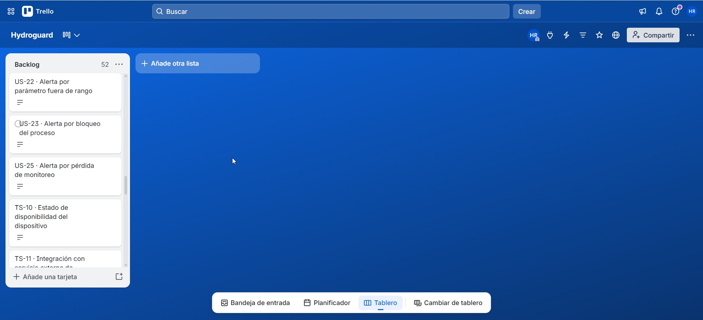
</p>

# Capítulo IV: Solution Software Design

## 4.1. Strategic-Level Domain-Driven Design

En esta sección se define el diseño estratégico del dominio mediante Domain-Driven Design. A partir del lenguaje ubicuo, los eventos y las capacidades del negocio se delimitan los bounded contexts, sus responsabilidades y sus relaciones. Las decisiones de arquitectura de software y atributos de calidad se desarrollan posteriormente en la sección 4.1.3.


### 4.1.1. Design-Level EventStorming

El EventStorming de Nivel de Diseño es la evolución directa del modelo de Big Picture. Su objetivo es pasar del entendimiento general a un modelo de diseño que exponga actores, comandos, eventos, políticas y reglas relevantes. Los artefactos siguientes incorporan la identidad técnica del dispositivo, la aprobación única del tratamiento y la comunicación HTTPS/REST.

Para mantener una lectura uniforme en todos los diagramas se aplica una misma convención: actores en amarillo, comandos en azul, eventos de dominio en naranja y redactados en pasado, políticas o decisiones automáticas en lila, restricciones o puntos críticos en rojo y límites de agregado mediante un contenedor rotulado. Cuando un elemento externo aparece en el flujo, se representa fuera del límite del bounded context correspondiente.

| Flujo de diseño | Agregado que controla la consistencia |
|:--|:--|
| Autenticación y acceso humano | `UserAccount` |
| Provisionamiento y autenticación técnica | `DeviceIdentity` |
| Asignación y configuración operativa | `IoTDevice` y `DeviceConfiguration` |
| Recepción y disponibilidad | `MeasurementStream` y `DeviceAvailability` |
| Evaluación, corrección y liberación | `WaterTreatmentProcess` |
| Alertas, incidentes y trazabilidad | `OperationalAlert`, `QualityIncident` y `EventCorrelation` |

**Autenticación y acceso**
Inicio de sesión, validación de credenciales y control de acceso por rol

<p align="center">
  
</p>

**Provisionamiento y Autenticación del Dispositivo**
Representa el registro del dispositivo, el provisionamiento de su identidad técnica y su autenticación mediante una credencial propia para obtener un token de acceso.
<p align="center">
  
</p>


**Asignación y configuración operativa**
Asignación del dispositivo al operario y configuración completa de parámetros de tratamiento, hasta su publicación y sincronización.
<p align="center">
  
</p>

**Recepción y evaluación de una medición**
Validación técnica de la telemetría entrante y evaluación de negocio contra la configuración efectiva.
<p align="center">
  
</p>

**Selección, aprobación y ejecución de la corrección**
Treatment selecciona la estrategia y el Operario la aprueba una sola vez antes de la primera actuación. Desde ese momento, el sistema puede continuar automáticamente los ciclos del mismo proceso. En el producto integral la orden representa una actuación física; en el prototipo el LED acompaña la corrección manual sustitutiva y en la simulación se modifica posteriormente el sensor.
<p align="center">
  
</p>

**Espera, reevaluación y ciclos**
Tiempo de espera tras la corrección, nueva medición y decisión sobre continuar, reintentar o bloquear el proceso.
<p align="center">
  
</p>

**Liberación manual y automática**
Autorización de la liberación del agua conforme, en modo automático o con confirmación del operario, y apertura de la válvula.
<p align="center">
  
</p>

**Fallo, pérdida de monitoreo y emergencia**
Bloqueo seguro del proceso ante fallos o pérdida de monitoreo, registro del incidente y restablecimiento.
<p align="center">
  
</p>

**Monitoreo, trazabilidad y reporte**
Reacciones automáticas de trazabilidad/alertas y consultas de supervisión disponibles para operario y administrador.

<p align="center">
  
</p>

#### 4.1.1.1 Candidate Context Discovery

Una vez establecido el modelo de diseño mediante EventStorming, el siguiente paso fue aislar las fronteras de los bounded contexts. Estos límites separan modelos y responsabilidades; orientan la separación de servicios, pero no obligan por sí mismos a que cada contexto sea un despliegue independiente.

La línea base vigente contiene seis contextos: `Identity and Access Management`, `Device Identity and Access`, `Device and Operational Configuration`, `IoT Telemetry and Device Integration`, `Water Quality Treatment and Release` y `Operational Monitoring and Traceability`. `Edge API` y Firebase Cloud Messaging son componentes de integración, no bounded contexts.

Se usaron las siguientes técnicas:

Start-with-Value: Esta técnica permitió identificar los BCs Core (Núcleo), que son la fuente de valor diferenciador del negocio.

Start-with-Simple: Se utilizó esta técnica para dividir el timeline en flujos de trabajo secuenciales, creando modelos con un propósito único.

<p align="center">
  
</p>

<p align="center">
  
</p>
<p align="center">
  
</p>

#### 4.1.1.2 Domain Message Flows Modeling

##### Caso 0: Registro y autenticación técnica del dispositivo

1. El Administrador registra el dispositivo con su inventario, entorno y capacidades en Device and Operational Configuration.
2. El backend solicita a Device Identity and Access el provisionamiento de una identidad vinculada con `deviceId` y `organizationId`.
3. La credencial original se muestra una sola vez al Administrador; el servicio conserva únicamente su hash.
4. El dispositivo presenta `deviceId` y credencial mediante HTTPS para obtener un token de corta duración.
5. Edge API valida el token y utiliza sus claims como identidad confiable para aceptar telemetría, heartbeat, consulta de comandos y acknowledgements.

<p align="center">
  
</p>

##### Caso 1: Configuración y sincronización del dispositivo

1. El operario configura los parámetros operativos desde la aplicación:
   - Rangos permitidos.
   - Estrategia de operación.
   - Dosificación.
   - Tiempos de espera.
   - Modo de liberación.

2. El contexto de Configuración valida los datos y publica la configuración.

3. Se emite el evento `ConfiguracionPublicada`.

4. El contexto de Telemetría IoT recibe el evento y sincroniza la configuración con el dispositivo físico.

5. El contexto de Monitoreo y Trazabilidad registra la actualización en la línea temporal del dispositivo.

<p align="center">
  
</p>

##### Caso 2: Recepción y evaluación de una medición

1. El dispositivo IoT envía una medición de pH y temperatura del agua.

2. Edge API valida el token con Device Identity and Access y obtiene de él `deviceId` y `organizationId`; Telemetría IoT valida que el mensaje no sea duplicado.

3. Se registra la medición y se emite el evento `MedicionRegistrada`.

4. El contexto de Calidad de agua y tratamiento evalúa la medición contra la configuración efectiva.

5. El contexto de Monitoreo y Trazabilidad actualiza la vista de estado del dispositivo.

<p align="center">
  
</p>

##### Caso 3: Selección, aprobación única y primera actuación

1. Water Quality Treatment and Release detecta agua no conforme y selecciona la estrategia adecuada según la configuración vigente.

2. Se emite `EstrategiaCorrectivaSeleccionada` y el proceso pasa a `PENDIENTE_APROBACION_CORRECCION`.

3. El Operario responsable revisa y aprueba una sola vez la estrategia para ese proceso.

4. Treatment registra `CorreccionAprobada` y ordena la primera actuación. Sin aprobación no existe orden de actuación y la válvula permanece cerrada.

5. IoT Telemetry entrega el comando al dispositivo mediante Edge API; el dispositivo ejecuta la actuación física o su representación correspondiente.

6. Monitoring registra el cambio de estado y, cuando corresponda, solicita a FCM la notificación móvil.
<p align="center">
  
</p>


##### Caso 4: Confirmación de la corrección e inicio de espera

1. El dispositivo ejecuta la orden según su entorno: dosificación o actuación física en el producto integral, indicador seguido de modificación del sensor en la simulación, o LED activo mientras el equipo realiza la corrección manual sustitutiva en el prototipo académico.

2. El contexto de Telemetría IoT confirma la ejecución técnica.

3. Se emite el evento `ActuacionCorrectivaConfirmada`.

4. El contexto de Calidad de agua y tratamiento inicia el tiempo de espera antes de reevaluar el agua.

5. Si la reevaluación continúa fuera de rango y existen ciclos disponibles, Treatment ordena el siguiente ciclo automáticamente porque la aprobación ya pertenece al proceso.

6. El contexto de Monitoreo y Trazabilidad actualiza el historial del proceso de tratamiento.

<p align="center">
  
</p>

##### Caso 5: Liberación del agua tratada

1. El contexto de Calidad de agua y tratamiento confirma que el agua está conforme mediante el evento `AguaConformeConfirmada`.

2. Si el modo es manual, el operario confirma la liberación. Si es automático, el sistema la autoriza directamente.

3. Se emite el evento `LiberacionAutorizada`.

4. El contexto de Telemetría IoT abre la válvula del dispositivo físico.

5. El contexto de Monitoreo y Trazabilidad registra el proceso como finalizado.

<p align="center">
  
</p>

##### Caso 6: Fallo, emergencia y restablecimiento

1. Un fallo automático se origina por el límite de ciclos alcanzado, una actuación fallida, una medición crítica o la pérdida de monitoreo. Treatment cambia el proceso a `FALLO`, ordena el cierre de la válvula y Monitoring registra el incidente y solicita la alerta correspondiente.

2. Una emergencia se origina exclusivamente cuando el Operario activa la parada de emergencia. Esta orden tiene prioridad, interrumpe cualquier actuación, cambia el proceso a `EMERGENCIA`, cierra la válvula y genera una alerta de emergencia.

3. Fallo y emergencia son estados diferentes, aunque ambos conservan la válvula cerrada e impiden nuevas órdenes automáticas.

4. Después de atender la causa, el Operario solicita un restablecimiento explícito. Treatment verifica que el dispositivo esté disponible y la válvula permanezca cerrada antes de volver a `SIN_INICIAR`.

5. El sistema exige una nueva medición después del restablecimiento; ninguna lectura anterior puede reutilizarse para liberar el agua.

<p align="center">
  
</p>


#### 4.1.1.3 Bounded Context Canvases

En esta sección se desarrollan los Bounded Context Canvases correspondientes a los contextos delimitados previamente durante el proceso de Candidate Context Discovery. El objetivo principal de este apartado es detallar, para cada contexto, los criterios de diseño que permitan comprender su propósito, límites de responsabilidad, capacidades clave, dependencias y reglas de negocio asociadas.

##### Human Identity and Access Management

<p align="center">
  
</p>


##### Device and Operational Configuration

<p align="center">
  
</p>

##### IoT Telemetry and Device Integration

<p align="center">
  
</p>
##### Water Quality Treatment and Release
<p align="center">
  
</p>
##### Operational Monitoring and Traceability
<p align="center">
  
</p>

##### Device Identity and Access

Este contexto administra exclusivamente la identidad técnica de los dispositivos, incluyendo su provisionamiento, autenticación, activación, revocación y regeneración manual de credenciales, sin asumir responsabilidades de inventario, configuración, telemetría ni cuentas humanas.

<p align="center">
  
</p>


### 4.1.2. Context Mapping

El Context Mapping se elaboró a partir de los eventos, comandos, políticas y capacidades identificados en EventStorming. El equipo agrupó inicialmente las capacidades por propósito y propiedad de datos, y después evaluó si moverlas, dividirlas o compartirlas reducía el acoplamiento sin fragmentar innecesariamente el flujo de tratamiento.

El refinamiento se realizó en cinco pasos: (1) se partió de los cinco grupos funcionales identificados en el Big Picture; (2) se protegió Treatment como Core Domain y se separaron configuración, telemetría y monitoreo; (3) se detectó que las credenciales técnicas no pertenecían a Human IAM ni a Configuration y se creó Device Identity and Access como sexto contexto; (4) se compararon las alternativas de división, unificación y duplicación mostradas en la tabla siguiente; y (5) se seleccionaron relaciones DDD explícitas y contratos HTTPS/REST. Durante la revisión se corrigió la asignación de responsabilidades entre `Water Quality Treatment and Release` y `Operational Monitoring and Traceability`: Treatment decide y cambia el proceso; Monitoring observa, proyecta y reporta.

Para comparar los diseños candidatos se utilizaron cuatro criterios: protección del Core Domain, coherencia del lenguaje ubicuo, propiedad exclusiva de los datos y simplicidad operativa para el alcance académico. Se analizaron únicamente alternativas que podían modificar de forma relevante los límites ya identificados.

| Alternativa evaluada | Cambio considerado | Consecuencia principal | Decisión |
|:--|:--|:--|:--|
| Unificar Human IAM y Device Identity and Access | Gestionar usuarios y dispositivos dentro de un mismo contexto de identidad. | Mezcla credenciales humanas con credenciales técnicas, ciclos de vida y superficies de ataque diferentes. | Rechazada. Se mantienen contextos separados. |
| Mantener la identidad técnica dentro de Configuration | Hacer que el registro de inventario también genere, valide y revoque credenciales. | Configuration asumiría responsabilidades de seguridad y expondría detalles que no pertenecen a su modelo operativo. | Rechazada. Configuration solicita el provisionamiento mediante un contrato explícito. |
| Dividir Treatment en evaluación, corrección y liberación | Crear contextos independientes para cada etapa del proceso. | Introduce coordinación distribuida sobre un mismo estado, ciclos y reglas de seguridad sin aportar valor suficiente al prototipo. | Rechazada para el alcance actual. Treatment conserva el proceso completo. |
| Duplicar alertas e historial dentro de cada contexto de origen | Permitir que cada contexto genere sus propias vistas y reportes. | Duplica lógica, dificulta una trazabilidad transversal y puede producir estados contradictorios. | Rechazada. Monitoring consume eventos publicados y construye sus proyecciones. |
| Crear un modelo compartido entre Telemetry y Treatment | Compartir entidades internas para evitar traducciones. | Aumenta el acoplamiento del Core Domain con detalles técnicos del dispositivo. | Rechazada. Se conservan contratos versionados y una relación Customer/Supplier. |
| Aislar el núcleo de tratamiento y separar capacidades de soporte | Mantener Treatment como Core y separar identidad humana, identidad técnica, configuración, telemetría y monitoreo. | Protege las reglas diferenciadoras y permite que cada contexto evolucione con su propio modelo. | Seleccionada. |

<p align="center">
  
</p>

La alternativa seleccionada establece seis bounded contexts. `Water Quality Treatment and Release` conserva las decisiones de evaluación, corrección por ciclos y liberación. Los demás contextos ofrecen capacidades de soporte claramente delimitadas. Edge API es un componente de integración y Firebase Cloud Messaging es una extensión externa pendiente; ninguno se modela como bounded context.


<p align="center">
  
</p>


| Contexto A | Contexto B | Relación (DDD) | Justificación |
|:--|:--|:--|:--|
| IAM | Device and Operational Configuration | Conformist | Configuration conforma su modelo de sesión y permisos al que define IAM, sin negociar cambios en el contrato de autenticación. |
| IAM | Water Quality Treatment and Release | Conformist | Treatment solo necesita saber si la sesión es válida y qué rol la autoriza; adopta el modelo de IAM tal como se publica, sin influir en su diseño. |
| IAM | Operational Monitoring and Traceability | Conformist | Monitoring adopta la identidad humana, organización y rol validados del contrato IAM. No consume actualmente eventos de acceso de IAM para su línea temporal. |
| Device and Operational Configuration | Device Identity and Access | Customer / Supplier | Configuration solicita el provisionamiento al registrar un dispositivo y conserva solo el estado público de identidad; Device Identity and Access controla las credenciales. |
| Device Identity and Access | Edge API | Open Host Service / Published Language | Expone autenticación y validación de tokens de dispositivo. Edge obtiene de los claims el dispositivo, la organización y sus permisos. |
| Device Identity and Access | IoT Telemetry and Device Integration | Anticorruption Layer | Telemetry recibe de Edge un principal autenticado y evita incorporar el modelo interno de credenciales en su dominio. |
| Device and Operational Configuration | IoT Telemetry and Device Integration | Customer / Supplier | Telemetry depende de que Configuration le entregue una configuración publicada y válida para poder sincronizarla con el dispositivo; sus necesidades de formato condicionan el contrato de Configuration. |
| Device and Operational Configuration | Water Quality Treatment and Release | Customer / Supplier | El Core Domain exige que la configuración efectiva cumpla reglas estrictas (rangos, dosificación, tiempos) antes de poder evaluarla, lo que condiciona el contrato que expone Configuration. |
| Device and Operational Configuration | Operational Monitoring and Traceability | Open Host Service / Published Language | Configuration expone consultas REST internas de unidades y autorización. Monitoring las consume para contexto y permisos; no recibe actualmente eventos publicados de Configuration. |
| IoT Telemetry and Device Integration | Water Quality Treatment and Release | Customer / Supplier | Treatment, como Core Domain, define qué datos de telemetría necesita (medición válida, confirmaciones de actuación) y Telemetry ajusta su contrato para satisfacerlos. |
| Water Quality Treatment and Release | IoT Telemetry and Device Integration | Conformist | Telemetry ejecuta los comandos que Treatment le envía —actuación correctiva física o representada, apertura, cierre y parada— según las capacidades declaradas por el dispositivo; es un ejecutor técnico que no redefine las decisiones del Core. |
| IoT Telemetry and Device Integration | Operational Monitoring and Traceability | Open Host Service / Published Language | Telemetry emite eventos técnicos (Medición Registrada, Monitoreo Perdido) como lenguaje publicado, consumidos por Monitoring para trazabilidad. |
| Water Quality Treatment and Release | Operational Monitoring and Traceability | Open Host Service / Published Language | El Core Domain publica sus eventos de negocio (Agua Conforme, Proceso Bloqueado, Liberación Autorizada) como lenguaje publicado; Monitoring los consume para alertas e historial. |
| Operational Monitoring and Traceability | Firebase Cloud Messaging | Anti-corruption Layer propuesta | Integración prevista por TS-11, todavía no implementada. No se considera que las alertas consultables por REST sean notificaciones push. |

Firebase Cloud Messaging es una integración externa propuesta, no activa. Edge API es la frontera HTTP/REST del dispositivo, con HTTPS en el despliegue y HTTP en la prueba LAN autorizada. Ninguno constituye un bounded context adicional. Las flechas del mapa señalan influencia o suministro de contratos, no necesariamente el iniciador de una conexión de red; OHS/Published Language puede describir una API de consulta y no implica por sí solo publicación de eventos.

#### 4.1.2.1. Línea base de implementación

Esta línea base establece las decisiones que deben compartir los servicios de backend, el Edge API, el firmware, el simulador y las aplicaciones cliente. Su propósito es impedir que cada componente interprete de forma diferente los ciclos, las actuaciones o las condiciones de seguridad. Los cambios posteriores deberán registrarse como una decisión arquitectónica y reflejarse en las historias, contratos y pruebas afectadas.

Los nombres en español de estados y mensajes siguientes expresan el modelo conceptual, no identificadores literales de la API. `TreatmentRun` utiliza `PREPARING`, `PENDING_CORRECTION_APPROVAL`, `CORRECTING`, `WAITING`, `REEVALUATING`, `READY`, `RELEASING`, `COMPLETED`, `FAILED`, `EMERGENCY` y `NOT_STARTED`; la medición y evaluación también ocurren como operaciones, sin exigir un estado persistido por cada paso conceptual. Las aplicaciones consultan `allowedActions` para ofrecer únicamente comandos autorizados por el backend.

##### Estados y transiciones del proceso

| Estado | Entrada válida | Responsabilidad | Salida permitida |
|:--|:--|:--|:--|
| `SIN_INICIAR` | Dispositivo disponible y configuración vigente | Mantener la válvula cerrada y esperar el inicio del proceso. | `MIDIENDO` o `EMERGENCIA` |
| `MIDIENDO` | Inicio o solicitud de nueva lectura | Obtener una medición identificada de pH y temperatura. | `EVALUANDO`, `FALLO` o `EMERGENCIA` |
| `EVALUANDO` | Medición válida y no duplicada | Comparar la lectura con la versión de configuración asociada al proceso y seleccionar la estrategia cuando sea no conforme. | `PENDIENTE_APROBACION_CORRECCION`, `CORRIGIENDO`, `LISTO`, `FALLO` o `EMERGENCIA` |
| `PENDIENTE_APROBACION_CORRECCION` | Agua no conforme, estrategia válida y tratamiento todavía no aprobado | Mantener la válvula cerrada y esperar la aprobación única del Operario responsable. No emitir órdenes correctivas. | `CORRIGIENDO`, `FALLO` o `EMERGENCIA` |
| `CORRIGIENDO` | Estrategia aprobada para el proceso y ciclos disponibles | Ordenar una única actuación correctiva para el ciclo. | `ESPERANDO`, `FALLO` o `EMERGENCIA` |
| `ESPERANDO` | Actuación confirmada | Mantener la actuación detenida y esperar el intervalo configurado. | `REEVALUANDO`, `FALLO` o `EMERGENCIA` |
| `REEVALUANDO` | Tiempo de espera finalizado y nueva medición válida | Cerrar el ciclo y decidir automáticamente si el agua está lista, requiere otro ciclo ya autorizado o debe bloquearse. | `CORRIGIENDO`, `LISTO`, `FALLO` o `EMERGENCIA` |
| `LISTO` | Medición conforme | Mantener disponible la autorización de liberación conforme al modo configurado. | `LIBERANDO`, `MIDIENDO` o `EMERGENCIA` |
| `LIBERANDO` | Autorización vigente | Abrir la válvula, confirmar la operación y finalizar la liberación. | `FINALIZADO`, `FALLO` o `EMERGENCIA` |
| `FALLO` | Límite alcanzado, actuación rechazada o fallida, configuración inválida o pérdida crítica de monitoreo | Detener actuaciones, cerrar la válvula y exigir atención y restablecimiento autorizado. | `SIN_INICIAR` o `EMERGENCIA` |
| `EMERGENCIA` | Parada de emergencia desde cualquier estado activo | Interrumpir la actuación, cerrar la válvula e impedir órdenes automáticas. | `SIN_INICIAR`, únicamente mediante restablecimiento autorizado |
| `FINALIZADO` | Liberación confirmada | Cerrar el proceso y conservar su trazabilidad. | `SIN_INICIAR` para un proceso nuevo |

Una medición inválida, duplicada o anterior al fin del tiempo de espera no permite avanzar ni cerrar un ciclo. Ante incertidumbre, el proceso conserva la válvula cerrada.

##### Inicio y cierre de un ciclo correctivo

1. Treatment selecciona la estrategia y, si el proceso aún no está autorizado, pasa a `PENDIENTE_APROBACION_CORRECCION`.
2. El Operario responsable aprueba una sola vez. Treatment registra `approvedAt`, `approvedByOperatorId` y la versión de configuración; repetir la misma aprobación es idempotente.
3. Treatment crea una orden con `commandId`, `processId`, número de ciclo y versión de configuración. Ninguna orden se crea antes de la aprobación.
4. Treatment incrementa el ciclo al crear la actuación correctiva y registra la orden para su entrega reintentable. La recepción repetida de una confirmación no vuelve a incrementar el contador.
5. El dispositivo ejecuta una sola actuación por orden. La representación correctiva actual activa el LED durante cinco segundos; en el montaje físico la adición y mezcla las realiza una persona. No existe una bomba dosificadora automática en este incremento y el indicador no permanece activo durante la espera.
6. Una confirmación prueba que la orden fue ejecutada o representada, pero no que el agua ya sea conforme.
7. Después de la confirmación, el proceso pasa a `ESPERANDO`. Al vencer el intervalo solicita una nueva medición y pasa a `REEVALUANDO`.
8. El ciclo se reevalúa con esa nueva medición válida. Si está conforme pasa a `LISTO`; si continúa fuera de rango, conserva la estrategia aprobada y quedan intentos, inicia otro ciclo. La implementación registra la variación útil (0.1 pH o 0.5 °C), pero no falla exclusivamente por un ciclo sin esa variación. Falla al alcanzar el máximo sin conformidad, al requerir una estrategia distinta o ante una condición de seguridad.

##### Contrato común de mensajes

El siguiente sobre es una convención de diseño para la trazabilidad. No todos los DTO REST implementados contienen literalmente todos estos campos: los contratos concretos se verifican en los controladores y OpenAPI de cada servicio. No se exige `processId` a operaciones de identidad o telemetría anteriores al inicio de un proceso.

| Campo | Regla |
|:--|:--|
| `messageId` | Identificador único del mensaje. |
| `messageType` | Nombre estable del comando o evento. |
| `schemaVersion` | Versión explícita del contrato. |
| `occurredAt` | Fecha y hora en UTC con formato ISO 8601. |
| `correlationId` | Identificador común del proceso completo. |
| `causationId` | Identificador del mensaje que produjo el mensaje actual. |
| `organizationId` | Organización propietaria obtenida de la identidad autenticada. |
| `deviceId` | Dispositivo al que pertenece la operación. |
| `processId` | Proceso de tratamiento asociado. |
| `payload` | Datos propios del comando o evento. |

Los consumidores deben ser idempotentes mediante `messageId` o `commandId`. Reintentar un mensaje no puede repetir una dosificación, incrementar nuevamente el ciclo ni abrir dos veces la válvula.

| Mensaje | Emisor → receptor | Contenido mínimo del `payload` |
|:--|:--|:--|
| `EvaluarMedicion` | IoT Telemetry → Treatment | `measurementId`, pH, temperatura, unidad, `measuredAt`, `configurationVersion`. |
| `CorreccionPropuesta` | Treatment → aplicación móvil / Monitoring | `strategy`, parámetros de actuación, `configurationVersion` y resumen de la desviación. |
| `AprobarCorreccion` | Operario autorizado → Treatment | `operatorId`, `processId`, `configurationVersion` y fecha de aprobación. |
| `CorreccionAprobada` | Treatment → IoT Telemetry / Monitoring | `operatorId`, `approvedAt`, estrategia y versión aprobadas. |
| `EjecutarActuacionCorrectiva` | Treatment → IoT Telemetry | `commandId`, `cycleNumber`, parámetro objetivo, tipo de actuación, sustancia o acción, dosis o intensidad y duración cuando corresponda. |
| `ActuacionCorrectivaConfirmada` | IoT Telemetry → Treatment | `commandId`, `cycleNumber`, entorno, modo de ejecución, inicio, fin y resultado `COMPLETADA`. |
| `ActuacionCorrectivaRechazada` | IoT Telemetry → Treatment | `commandId`, `cycleNumber`, resultado `RECHAZADA` o `FALLIDA`, `errorCode` y detalle seguro. |
| `SolicitarNuevaMedicion` | Treatment → IoT Telemetry | `cycleNumber`, instante mínimo permitido y motivo `REEVALUACION`. |
| `AutorizarLiberacion` | Treatment → IoT Telemetry | `authorizationId`, `measurementId` conforme, modo de liberación y vencimiento. |
| `AbrirValvula` / `CerrarValvula` | Treatment → IoT Telemetry | `commandId`, `authorizationId` cuando se abre y motivo de la operación. |
| `ActivarParadaEmergencia` | Usuario autorizado o Treatment → IoT Telemetry | `commandId`, actor, motivo y fecha. |
| `RestablecerProceso` | Operario autorizado → Treatment | `commandId`, actor, causa atendida y evidencia o nota operativa. |

##### Entornos y capacidades del dispositivo

El entorno no altera las decisiones de Treatment; solamente determina cómo IoT Telemetry adapta la ejecución.

| Entorno | Capacidades mínimas | Ejecución de la actuación correctiva |
|:--|:--|:--|
| `PRODUCTO_INTEGRAL` | Telemetría, dosificación física, actuación térmica cuando corresponda y control de flujo. | Ejecuta físicamente la sustancia, dosis, intensidad o acción ordenada y confirma el resultado técnico. |
| `SIMULACION` | Telemetría simulada, indicador visual y representación del control de flujo. | Activa el indicador; posteriormente una persona modifica el sensor simulado para representar el efecto que será evaluado en la siguiente medición. |
| `PROTOTIPO_ACADEMICO` | Sensores de pH y temperatura, LED de actuación y servomotor de válvula. | Representa la corrección con LED; una persona realiza la adición y mezcla. El firmware admite confirmación local y finalización temporal según el modo; la confirmación no acredita una dosis física medida. |

Los códigos implementados de capacidades incluyen `PH_SENSOR`, `TEMPERATURE_SENSOR`, `DOSING`, `COOLING`, `HEATING` y `RELEASE_VALVE`; los entornos se expresan en los contratos como `SIMULATION`, `ACADEMIC_PROTOTYPE` y `INTEGRAL_PRODUCT`. Registrar `DOSING` en un entorno representado no acredita la presencia de una bomba, ni declarar `COOLING` añade un sistema físico de enfriamiento. Configuration exige sensores y válvula al publicar; Treatment valida la capacidad necesaria para la estrategia seleccionada. Estas declaraciones deben corresponder al alcance que se está probando.

##### Reglas de seguridad obligatorias

- La válvula permanece cerrada en `SIN_INICIAR`, `MIDIENDO`, `EVALUANDO`, `PENDIENTE_APROBACION_CORRECCION`, `CORRIGIENDO`, `ESPERANDO`, `REEVALUANDO`, `FALLO` y `EMERGENCIA`.
- Ninguna actuación correctiva se ordena antes de la aprobación única del Operario responsable. La aprobación solo sirve para el proceso y la versión de configuración registrados.
- Solo una autorización vigente, asociada a una medición conforme y al proceso actual, permite abrir la válvula desde `LISTO`.
- La parada de emergencia tiene prioridad sobre cualquier orden pendiente y cancela la autorización de liberación.
- Una actuación rechazada, fallida o sin confirmación dentro del tiempo permitido detiene el ciclo y lleva el proceso a `FALLO`; no se reintenta físicamente sin una nueva decisión de Treatment.
- Una configuración no puede modificarse dentro de un proceso activo. El proceso conserva su `configurationVersion`; la nueva versión se aplica al siguiente proceso.
- Ninguna confirmación de actuador sustituye la reevaluación mediante una nueva medición.
- Los registros de actuación, transición, autorización y emergencia son inmutables para fines de trazabilidad.

##### Propiedad de datos e integración

| Bounded context | Datos que posee | Integración autorizada |
|:--|:--|:--|
| Identity and Access Management | Cuentas, credenciales, roles y estado del usuario. | Token o identidad validada y eventos de acceso; ningún otro contexto consulta directamente su base de datos. |
| Device Identity and Access | Identidades técnicas, hash de credenciales, estado de activación o revocación y permisos de dispositivos. | Provisionamiento administrativo y autenticación de dispositivos; publica un principal validado para Edge. |
| Device and Operational Configuration | Dispositivos, asignaciones, perfiles, capacidades declaradas y versiones de configuración. | API para comandos y consultas; evento versionado `ConfiguracionPublicada`. |
| IoT Telemetry and Device Integration | Mediciones recibidas, disponibilidad y resultado técnico de comandos. | Recibe de Edge un principal ya autenticado y usa mensajes versionados de telemetría, actuación y válvula. |
| Water Quality Treatment and Release | Proceso, estado, ciclos, decisiones, fallos y autorizaciones de liberación. | Comandos hacia IoT y eventos de negocio publicados para Monitoring. |
| Operational Monitoring and Traceability | Alertas, incidentes, proyecciones de consulta, historial y reportes. | Consume eventos publicados; no modifica los agregados ni las bases de los otros contextos. |

Cada contexto mantiene su propia base lógica y migraciones. No se permiten tablas compartidas, uniones directas entre bases ni escritura en datos ajenos. Se utiliza HTTP/REST: HTTPS para los accesos desplegados y HTTP en la LAN local expresamente configurada para el prototipo físico. No se incorpora un broker MQTT ni un service bus. Los servicios emplean llamadas REST e integración mediante registros de entrega/outbox y reintentos; esto no equivale a un broker externo de mensajería.

##### Manejadores de integración entre contextos

| Evento o solicitud | Consumidor y manejador | Resultado |
|:--|:--|:--|
| `DeviceRegistered` | `ProvisionDeviceIdentityHandler` en Device Identity and Access | Crea la identidad técnica y devuelve la credencial una sola vez. |
| `ConfiguracionPublicada` | `SynchronizeDeviceConfigurationHandler` en IoT Telemetry | Conserva la versión vigente que el dispositivo puede consultar mediante Edge. |
| `MedicionRegistrada` | `EvaluateMeasurementHandler` en Treatment | Inicia o continúa la evaluación utilizando la versión de configuración del proceso. |
| `ActuacionCorrectivaConfirmada` o `ActuacionCorrectivaRechazada` | `HandleCorrectiveActionResultHandler` en Treatment | Inicia la espera o lleva el proceso a fallo sin duplicar el ciclo. |
| Eventos de Treatment y Telemetry | `ProjectOperationalEventHandler` en Monitoring | Actualiza estado, historial, correlaciones, alertas e incidentes. |
| `AlertaGenerada` (extensión pendiente de TS-11) | Adaptador de notificaciones propuesto para Monitoring | La integración FCM está pendiente; las alertas se consultan desde las aplicaciones mediante REST. |

Los nombres de manejadores de esta tabla expresan responsabilidades de diseño, no garantizan clases homónimas en el código. Los adaptadores implementados conservan la identidad y referencias necesarias y aplican deduplicación según el contrato; los reintentos no deben repetir una actuación ni duplicar la medición histórica.

##### Contratos HTTPS/REST para dispositivos

- `POST /api/v1/device-identities/provision`: operación técnica de provisionamiento coordinada por Configuration; no es un alta libre desde el firmware. El alta administrativa del dispositivo entrega la credencial original una sola vez.
- `POST /edge/v1/device-auth/token`: valida `deviceId` y credencial y emite un token de corta duración con `deviceId`, `organizationId`, audiencia `hydroguard-edge` y scopes mínimos.
- `POST /api/v1/device-identities/{deviceId}/revoke`: revoca la identidad e invalida nuevas operaciones Edge.
- `POST /api/v1/device-identities/{deviceId}/regenerate-credential`: regeneración manual administrativa; no se requiere rotación automática en el alcance académico.
- `POST /edge/v1/telemetry`: recibe pH y temperatura con identificador idempotente y obtiene la identidad desde el token.
- `POST /edge/v1/heartbeat`: actualiza la disponibilidad técnica del dispositivo.
- `GET /edge/v1/commands/next`: permite al dispositivo consultar la siguiente orden pendiente.
- `POST /edge/v1/commands/{commandId}/acknowledgements`: confirma o rechaza la ejecución sin duplicarla.

Los scopes mínimos son `telemetry:write`, `commands:read` y `commands:ack`. Un token ausente, vencido, con audiencia incorrecta o vinculado a una identidad revocada debe ser rechazado. El `deviceId` recibido en un payload nunca sustituye la identidad derivada del token.

En el flujo simplificado implementado, el firmware presenta `deviceId` y credencial mediante autenticación Basic a Edge y consulta `GET /edge/v1/device-auth/session`. Edge obtiene y renueva el JWT técnico para sus llamadas al backend; el usuario no tiene que copiar tokens periódicamente. Edge también admite Bearer para el contrato técnico. La configuración se consulta mediante `GET /edge/v1/configuration` y su aplicación se confirma con `POST /edge/v1/configuration/acknowledgements`. Basic sobre HTTP queda limitado a la prueba LAN autorizada; el despliegue virtual usa HTTPS y no deben publicarse las credenciales en el sketch.


### 4.1.3. Software Architecture

#### 4.1.3.1. Software Architecture System Landscape Diagram
<p align="center">
  
</p>

#### 4.1.3.2. Software Architecture Context Level Diagrams
<p align="center">
  
</p>

#### 4.1.3.3. Software Architecture Container Level Diagrams
<p align="center">
  
</p>

#### 4.1.3.4. Software Architecture Deployment Diagrams
<p align="center">
  
</p>

#### 4.1.3.5. Responsabilidades e interacciones de los contenedores

La arquitectura separa las interfaces de usuario, el ingreso a los servicios, los contextos de negocio y la integración con el dispositivo. Cada contenedor ejecuta responsabilidades delimitadas y se comunica mediante contratos explícitos.

| Unidad ejecutable | Implementación y responsabilidad |
|:--|:--|
| Frontend administrativo | Angular y Angular Material; consume el Gateway con sesión humana y permisos de Administrador. Se publica en Vercel. |
| Frontend del Operario | Flutter con DDD por contexto, BLoC/Cubit, `http` y caché Drift. Consume el Gateway, no las bases de datos ni Edge directamente. |
| API Gateway | Aplicación Spring Boot independiente; enruta las APIs de producto y bloquea `/internal/**` en el acceso público. No reemplaza la autorización de cada servicio. |
| Seis microservicios | Human IAM, Device Identity, Configuration, Telemetry, Treatment y Monitoring. Residen en `services/` del monorepo; cada uno tiene su Dockerfile, proceso, migraciones y base PostgreSQL independiente. Se despliegan como servicios separados en Render con bases en Supabase. |
| Edge del prototipo físico | Aplicación Flask en la laptop, en repositorio separado; autentica el dispositivo, adapta contratos y conserva entregas pendientes en SQLite. Se comunica con el backend desplegado por HTTPS. |
| Edge del prototipo virtual | Despliegue separado orientado a Wokwi y acceso HTTPS. No sustituye el papel de la laptop en la prueba física ni convierte el disco efímero del alojamiento en almacenamiento durable. |
| Firmware ESP32 | Lee sensores, consulta configuración y comandos mediante Edge, confirma ejecución y aplica cierres locales de seguridad. No decide por sí solo la conformidad del proceso. |

El flujo de datos es **ESP32 → Edge → Gateway/servicios → aplicaciones**. Los comandos siguen **Operario → Gateway → Treatment → Telemetry → Edge → ESP32**, y la confirmación vuelve por la ruta inversa. Configuration publica parámetros; Telemetry registra mediciones y entrega actuaciones; Treatment decide el proceso; Monitoring proyecta eventos y permite consultar su trazabilidad. Las bases no se consultan directamente entre contextos.

Cada microservicio se despliega como un proceso independiente y se conecta únicamente a su base de datos mediante credenciales limitadas. Las variables de entorno y los archivos secretos separan la configuración del código fuente. Swagger UI y OpenAPI describen los contratos de cada servicio; las operaciones conservan sus requisitos de JWT o credencial interna. El Gateway concentra el ingreso de las aplicaciones y no expone las rutas internas entre servicios.

## 4.2. Tactical-Level Domain-Driven Design

Los seis bounded contexts de backend se implementarán como microservicios Spring Boot independientes dentro de un monorepo, detrás de un API Gateway. Cada servicio administra sus migraciones y almacenamiento; no comparte entidades JPA, tablas ni consultas SQL con otros servicios. Un mismo servidor PostgreSQL puede alojar sus bases o esquemas aislados. La laptop ejecuta el servicio Edge en un repositorio separado y se comunica con la nube por HTTPS/REST, sin MQTT.

Convenciones comunes de implementación: los identificadores de recursos son UUID en Java/PostgreSQL y cadenas en JSON; los números de versión y ciclo son enteros. Los identificadores de origen `measurementId`, `commandId` y `eventId` son cadenas estables para reintentos. Las fechas de negocio se representan con `Instant`, se almacenan como `TIMESTAMPTZ` y se devuelven en ISO 8601 UTC. Si un contrato de ingesta utiliza `timestamp`, expresa milisegundos Unix y se convierte a `Instant` al recibirlo. Los comandos internos pueden incluir el actor y la organización, pero estos se obtienen de la autenticación y no se confían al cuerpo enviado por el cliente.

### 4.2.1. Bounded Context: Human Identity and Access Management

#### 4.2.1.1. Domain Layer

##### A. Aggregates (Agregados)

* **`Organization` (Agregado Principal del Tenant)**
  * **Descripción:** Encapsula la identidad de la empresa: nombre, RUC, teléfono, segmento organizacional y estado.
  * **Comportamiento y Reglas de Negocio:**
    * Rechaza RUC duplicado (restricción única).
    * Garantiza exactamente una cuenta administradora por organización (índice parcial por rol `ADMINISTRATOR`).
    * El segmento (`TEXTILE` / `HYDROPONIC`) condiciona reglas operativas en otros bounded contexts.

* **`User` (Agregado de Cuenta de Acceso)**
  * **Descripción:** Encapsula la cuenta humana (Administrador u Operario): identificador de login, nombre visible, correo, contraseña cifrada, rol y estado.
  * **Comportamiento y Reglas de Negocio:**
    * Validar los datos durante la creación/registro.
    * Autenticar credenciales mediante la verificación del hash de contraseña.
    * Mantener exactamente un rol por cuenta (`ADMINISTRATOR` u `OPERATOR`). El flujo público solo permite crear Administradores junto con la organización.
    * El `identifier` (correo/username de login) se normaliza mediante recorte de espacios y minúsculas y es único globalmente. El login conserva únicamente identificador y contraseña, sin selector de organización.
    * El `email` se almacena por separado para notificaciones y puede diferir del `identifier`.

* **`FirstAccessCode` (Agregado de Código de Primer Acceso)**
  * **Descripción:** Encapsula un código de un solo uso que permite al Operario activar su cuenta desde la aplicación móvil.
  * **Comportamiento y Reglas de Negocio:**
    * Se genera únicamente cuando el perfil del Operario está completo (perfil, grupo, asignaciones).
    * Solo puede generarse si el perfil está en estado `PENDING_FIRST_ACCESS`.
    * Puede estar en estado `ACTIVE`, `USED` (consumido una sola vez) o `REVOKED`.
    * Se vincula a un `operatorProfileId` (referencia lógica a `cfg.operator_profiles`) y a un `operatorAccountId` (FK a `iam.users`).
    * Una vez usado o revocado, no puede reutilizarse.

---

##### B. Value Objects (Objetos de Valor)
* **`Role`**: Representa el rol dentro del sistema (`ADMINISTRATOR`, `OPERATOR`).
* **`OrganizationId`**: Límite de autorización obtenido de la sesión y nunca confiado desde el cuerpo de una petición.
* **`AccountStatus`**: Estado de la cuenta (`ACTIVE`, `INACTIVE`).
* **`FirstAccessCodeStatus`**: Estado del código (`ACTIVE`, `USED`, `REVOKED`).

---

##### C. Commands (Comandos - CQRS)
Representan las intenciones del usuario o sistema para modificar el estado del dominio:
* **`RegisterOrganizationAdministratorCommand(OrganizationData organization, String identifier, String displayName, String email, String rawPassword)`**: Crea una organización y su único Administrador de manera atómica.
* **`CreateOperatorAccountCommand(String organizationId, String displayName, String identifier, String rawPassword)`**: Crea una cuenta de Operario con contraseña permanente desde la sesión del Administrador.
* **`SignInCommand(String identifier, String rawPassword)`**: Intención de iniciar sesión en el sistema.
* **`SignOutCommand(String sessionToken)`**: Invalida la sesión del administrador (revoca el token).
* **`DeactivateOperatorAccountCommand(String organizationId, String operatorId)`**: Desactiva la cuenta de un operario (`status → INACTIVE`).
* **`GenerateFirstAccessCodeCommand(String operatorId, String operatorProfileId)`**: Genera un código de primer acceso cuando el perfil está completo.
* **`RevokeFirstAccessCodeCommand(String codeId)`**: Revoca un código de primer acceso activo.

---

##### D. Queries (Consultas - CQRS)
Abstracciones para la lectura de información del dominio sin alterar su estado:
* **`GetUserByIdQuery(String userId)`**
* **`ListOperatorAccountsQuery(String organizationId, String searchTerm, String status, int page, int pageSize)`**
* **`GetOperatorAccessSummaryQuery(String operatorId)`**
* **`GetFirstAccessCodeQuery(String operatorId, String operatorProfileId)`**

---

##### E. Services (Servicios de Comando y Consulta)

* **`UserCommandService` (Interfaz de Servicio de Dominio / Aplicación)**
  * **Descripción:** Coordina las operaciones que modifican el estado del dominio procesando los *Commands*.
  * **Métodos principales:**
    * `Optional<User> handle(RegisterOrganizationAdministratorCommand command)`: Crea conjuntamente la organización y su única cuenta administradora durante el alta inicial.
    * `Optional<User> handle(CreateOperatorAccountCommand command)`: Permite al Administrador crear una cuenta de Operario con contraseña permanente.
    * `Optional<AuthenticatedUser> handle(SignInCommand command)`: Valida las credenciales e inicia la sesión generando el token de autenticación.
    * `void handle(SignOutCommand command)`: Invalida la sesión del administrador.
    * `void handle(DeactivateOperatorAccountCommand command)`: Desactiva la cuenta de un operario.

* **`UserQueryService` (Interfaz de Servicio de Dominio / Aplicación)**
  * **Descripción:** Atiende únicamente las operaciones de lectura recibiendo objetos *Query*.
  * **Métodos principales:**
    * `Optional<User> handle(GetUserByIdQuery query)`: Retorna el usuario por su `UserId`.
    * `Page<User> handle(ListOperatorAccountsQuery query)`: Lista paginada de operarios con filtros.
    * `Optional<OperatorAccessSummary> handle(GetOperatorAccessSummaryQuery query)`: Retorna el resumen de acceso del operario (perfil, grupo, asignaciones).

* **`FirstAccessCodeCommandService` (Interfaz de Servicio de Dominio / Aplicación)**
  * **Descripción:** Coordina la generación y revocación de códigos de primer acceso.
  * **Métodos principales:**
    * `FirstAccessCode handle(GenerateFirstAccessCodeCommand command)`: Genera un código de primer acceso cuando el perfil está completo.
    * `void handle(RevokeFirstAccessCodeCommand command)`: Revoca un código activo.

* **`FirstAccessCodeQueryService` (Interfaz de Servicio de Dominio / Aplicación)**
  * **Descripción:** Atiende la consulta de códigos de primer acceso.
  * **Métodos principales:**
    * `Optional<FirstAccessCode> handle(GetFirstAccessCodeQuery query)`: Retorna el código activo o null.


#### 4.2.1.2. Interface Layer

##### A. Controllers (Controladores REST)

Son los puntos de entrada HTTP (Inbound Adapters) que exponen los endpoints de la API REST del Bounded Context.

* **`AuthenticationController`**
  * **Descripción:** Expone el inicio de sesión, el cierre de sesión y el alta inicial conjunta de organización y Administrador. Los Operarios no disponen de registro público.
  * **Endpoints:**
    * `POST /api/v1/authentication/sign-in`: Recibe un `SignInResource`, lo transforma a `SignInCommand`, lo envía a `UserCommandService` y retorna un `AuthenticatedUserResource` con el token generado.
    * `POST /api/v1/authentication/sign-out`: Recibe el token de sesión, lo invalida y retorna `204 No Content`.
    * `POST /api/v1/organization-registrations`: Crea la organización y su única cuenta administradora de manera atómica.

* **`UsersController`**
  * **Descripción:** Gestiona las operaciones de administración sobre la entidad de usuarios y operarios.
  * **Endpoints:**
    * `GET /api/v1/operators`: Lista paginada de operarios con filtros opcionales (`searchTerm`, `status`, `page`, `pageSize`).
    * `GET /api/v1/operators/{operatorId}`: Recibe el ID, ejecuta `GetUserByIdQuery` mediante `UserQueryService` y retorna un `UserResource`.
    * `POST /api/v1/operators`: Permite al único Administrador crear la cuenta de un Operario con contraseña permanente.
    * `PATCH /api/v1/operators/{operatorId}/status`: Desactiva la cuenta de un Operario (`status → INACTIVE`).
    * `GET /api/v1/operators/{operatorId}/access-summary`: Retorna el resumen de acceso del operario (perfil, grupo, asignaciones).

* **`FirstAccessCodesController`**
  * **Descripción:** Gestiona la generación, consulta y revocación de códigos de primer acceso para Operarios.
  * **Endpoints:**
    * `GET /api/v1/operators/{operatorId}/first-access-code`: Retorna el código activo o `404` si no existe / fue revocado.
    * `POST /api/v1/operators/{operatorId}/first-access-code`: Genera el código sin caducidad únicamente cuando su perfil, grupo, reservorio y dispositivo estén completos.
    * `POST /api/v1/first-access-codes/{codeId}/revoke`: Revoca un código de primer acceso activo.

---

##### B. Resources / DTOs (Objetos de Transferencia de Datos)

Definen las estructuras de datos aceptadas en las peticiones (Requests) y enviadas en las respuestas (Responses) de la API REST:

* **`SignInResource(String identifier, String password)`**: DTO de entrada con las credenciales enviadas en el login.
* **`RegisterOrganizationAdministratorResource(OrganizationData organization, String displayName, String email, String password)`**: DTO del alta inicial; el rol resultante siempre es `ADMINISTRATOR`. Incluye datos de la organización (nombre, RUC, teléfono, segmento) y del administrador (nombre, correo, contraseña).
* **`CreateOperatorAccountResource(String displayName, String identifier, String password)`**: DTO administrativo; la contraseña es permanente y no exige cambio en el primer acceso.
* **`UserResource(String id, String displayName, String identifier, String status)`**: DTO de salida que expone la información pública del usuario (sin `organizationId` ni `role` en la respuesta). El identificador representa un UUID.
* **`AuthenticatedUserResource(String id, String organizationId, String identifier, String role, String token, Instant expiresAt)`**: DTO de salida que retorna la sesión humana; `expiresAt` es obligatorio y se serializa en ISO 8601 UTC. La organización y el rol también forman parte de los claims firmados. El mismo contrato de sesión se utiliza al completar el primer acceso móvil.
* **`OperatorAccountPageResource(List<UserResource> items, int total, int page, int pageSize)`**: DTO de salida paginado para la lista de operarios.
* **`OperatorAccessSummaryResource(String operatorAccountId, String operatorProfileId, String profileStatus, String groupId, String groupName, List<OperatorAssignmentResource> assignments)`**: DTO de salida que expone el resumen de acceso del operario.
* **`OperatorAssignmentResource(String assignmentId, String reservoirId, String reservoirName, String deviceId, String deviceSerialNumber, String status)`**: DTO de salida de una asignación operativa.
* **`FirstAccessCodeResource(String id, String code, String status, String operatorProfileId, String operatorAccountId, String generatedAt, String usedAt, String revokedAt)`**: DTO de salida que expone el código de primer acceso.
* **`GenerateFirstAccessCodeResource(String operatorProfileId)`**: DTO de entrada para generar un código de primer acceso.
* **`DeactivateOperatorAccountResource(String status)`**: DTO de entrada para desactivar un operario (`status = 'INACTIVE'`).

---

##### C. Transformers / Mappers

Clases de transformación encargadas de mapear entre los DTOs/Resources de la capa de interfaz y los objetos de la capa de aplicación/dominio (Commands, Queries y Agregados).

* **`SignInCommandFromResourceAssembler`**: Transforma un `SignInResource` a un `SignInCommand`.
* **`RegisterOrganizationAdministratorCommandFromResourceAssembler`**: Transforma el alta pública en el comando conjunto de organización y Administrador.
* **`CreateOperatorAccountCommandFromResourceAssembler`**: Transforma la solicitud administrativa en el comando de creación de Operario.
* **`SignOutCommandFromResourceAssembler`**: Transforma el token de sesión en un `SignOutCommand`.
* **`DeactivateOperatorAccountCommandFromResourceAssembler`**: Transforma la solicitud de desactivación en un `DeactivateOperatorAccountCommand`.
* **`UserResourceFromEntityAssembler`**: Transforma la entidad/agregado `User` a un `UserResource`.
* **`OperatorAccountPageResourceFromEntityAssembler`**: Transforma una página de `User` a un `OperatorAccountPageResource`.
* **`OperatorAccessSummaryResourceFromEntityAssembler`**: Transforma un `OperatorAccessSummary` a un `OperatorAccessSummaryResource`.
* **`FirstAccessCodeResourceFromEntityAssembler`**: Transforma un `FirstAccessCode` a un `FirstAccessCodeResource`.
* **`GenerateFirstAccessCodeCommandFromResourceAssembler`**: Transforma un `GenerateFirstAccessCodeResource` en un `GenerateFirstAccessCodeCommand`.

#### 4.2.1.3. Application Layer

##### A. Command Services & Handlers (Servicios de Comandos)

Procesan las intenciones de cambio de estado recibiendo *Commands*, orquestando la lógica de negocio junto con los agregados del dominio y persistiendo los cambios mediante los repositorios.

* **`UserCommandServiceImpl`**
  * **Descripción:** Implementación principal de la interfaz `UserCommandService`. Coordina las mutaciones del dominio y la publicación de eventos tras cambios exitosos.
  * **Flujos de trabajo / Handlers:**
    * **`handle(RegisterOrganizationAdministratorCommand command)`**: Verifica la unicidad de la organización (RUC) y crea su única cuenta administradora de manera atómica.
    * **`handle(CreateOperatorAccountCommand command)`**: Verifica que el actor sea el Administrador de la organización, cifra la contraseña permanente y crea la cuenta con rol `OPERATOR`.
    * **`handle(SignInCommand command)`**: Recupera el usuario por su `identifier`, valida la coincidencia de las credenciales mediante el servicio de hashing/seguridad, genera el token de acceso JWT y publica el evento `UserSignedInEvent`.
    * **`handle(SignOutCommand command)`**: Invalida la sesión del administrador (revoca el token). En modo stateless, responde `204 No Content`.
    * **`handle(DeactivateOperatorAccountCommand command)`**: Verifica que el actor sea el Administrador de la organización y desactiva la cuenta del operario (`status → INACTIVE`).

* **`FirstAccessCodeCommandServiceImpl`**
  * **Descripción:** Implementación de la interfaz `FirstAccessCodeCommandService`. Coordina la generación y revocación de códigos de primer acceso.
  * **Flujos de trabajo / Handlers:**
    * **`handle(GenerateFirstAccessCodeCommand command)`**: Verifica que el perfil del Operario esté completo (perfil, grupo, asignaciones) y en estado `PENDING_FIRST_ACCESS`; genera un código único de un solo uso.
    * **`handle(RevokeFirstAccessCodeCommand command)`**: Revoca un código activo, cambiando su estado a `REVOKED` y registrando `revokedAt`.

---

##### B. Query Services & Handlers (Servicios de Consulta)

Atienden las lecturas de información recibiendo objetos *Query*, optimizando el acceso a los datos sin alterar el estado del dominio.

* **`UserQueryServiceImpl`**
  * **Descripción:** Implementación de la interfaz `UserQueryService` enfocada exclusivamente en la recuperación eficiente de datos.
  * **Flujos de trabajo / Handlers:**
    * **`handle(GetUserByIdQuery query)`**: Consulta la persistencia para recuperar el agregado `User` correspondiente al identificador provisto.
    * **`handle(ListOperatorAccountsQuery query)`**: Lista paginada de operarios con filtros opcionales (`searchTerm`, `status`, `page`, `pageSize`).
    * **`handle(GetOperatorAccessSummaryQuery query)`**: Retorna el resumen de acceso del operario (perfil, grupo, asignaciones activas).

* **`FirstAccessCodeQueryServiceImpl`**
  * **Descripción:** Implementación de la interfaz `FirstAccessCodeQueryService` enfocada en la consulta de códigos de primer acceso.
  * **Flujos de trabajo / Handlers:**
    * **`handle(GetFirstAccessCodeQuery query)`**: Retorna el código activo del operario o `null` si no existe o fue revocado.

---

##### C. Outbound Services / Ports (Servicios de Salida)

Interfaces y abstracciones requeridas por la capa de aplicación para comunicarse con el exterior sin acoplarse a tecnologías específicas.

* **`HashingService`**: Puerto para la delegación del cifrado y verificación de contraseñas de manera segura.
* **`TokenVerificationService`**: Puerto para la generación y firma de tokens de autenticación (JWT).

#### 4.2.1.4. Infrastructure Layer

##### A. Persistence & Repositories (Persistencia y Repositorios)

Proporciona las implementaciones concretas para el almacenamiento y recuperación de agregados mediante Spring Data JPA y la base de datos relacional.

* **`UserRepository` (JPA Repository)**
  * **Descripción:** Interfaz que extiende de `JpaRepository` para la gestión directa de las operaciones CRUD y consultas personalizadas sobre la entidad `User`.
  * **Métodos principales:**
    * `Optional<User> findByIdentifier(String identifier)`: Recupera un usuario por su identificador normalizado y globalmente único (correo/username).
    * `boolean existsByIdentifier(String identifier)`: Verifica la existencia global del identificador normalizado antes del registro; la restricción SQL también evita duplicados concurrentes.
    * `Page<User> findByOrganizationIdAndStatusAndIdentifierContaining(UUID organizationId, String status, String searchTerm, Pageable pageable)`: Lista paginada de operarios con filtros opcionales (`searchTerm`, `status`) para una organización.
    * `Optional<User> findByIdAndOrganizationId(UUID userId, UUID organizationId)`: Recupera un usuario por su ID dentro de su organización.

* **`FirstAccessCodeRepository` (JPA Repository)**
  * **Descripción:** Interfaz que extiende de `JpaRepository` para la gestión de códigos de primer acceso.
  * **Métodos principales:**
    * `Optional<FirstAccessCode> findByOperatorAccountIdAndStatus(UUID operatorAccountId, FirstAccessCodeStatus status)`: Recupera el código activo de un operario.
    * `Optional<FirstAccessCode> findByIdAndOperatorAccountId(UUID codeId, UUID operatorAccountId)`: Recupera un código por su ID y operario.
    * `List<FirstAccessCode> findByOperatorAccountId(UUID operatorAccountId)`: Lista todos los códigos de un operario (historial).

* **`OrganizationRepository` (JPA Repository)**
  * **Descripción:** Interfaz para la gestión de organizaciones.
  * **Métodos principales:**
    * `boolean existsByRuc(String ruc)`: Verifica la existencia de una organización por RUC antes del registro.
    * `Optional<Organization> findById(UUID organizationId)`: Recupera una organización por su ID.

---

##### B. Security & Cryptography Adapters (Adaptadores de Seguridad)

Implementa los puertos de la capa de aplicación destinados al cifrado de contraseñas y la gestión de tokens de seguridad para la autenticación REST.

* **`BCryptHashingServiceImpl`**
  * **Descripción:** Implementación del puerto `HashingService` utilizando el algoritmo BCrypt para el encriptado y verificación segura de credenciales.
  * **Métodos:**
    * `encode(CharSequence rawPassword)`: Retorna el hash cifrado de la contraseña.
    * `matches(CharSequence rawPassword, String encodedPassword)`: Valida la autenticidad de la contraseña en texto plano contra el hash almacenado.

* **`JwtTokenServiceImpl`**
  * **Descripción:** Implementación del puerto `TokenVerificationService` encargada del ciclo de vida de los tokens JWT.
  * **Métodos:**
    * `generateToken(User user)`: Construye, firma y emite el JWT con los *claims* (roles e identidad) del usuario.
    * `validateToken(String token)`: Comprueba la validez técnica y firma del token recibido en las peticiones HTTP.

---

##### C. Configuration & OpenAPI (Configuración de Infraestructura)

Clases que configuran componentes del framework y la documentación del microservicio.

* **`SecurityConfiguration`**: Define la cadena de filtros de seguridad (`SecurityFilterChain`), reglas de acceso a endpoints HTTP (CORS, CSRF) y la gestión de sesiones *stateless*.

---

#### 4.2.1.5. Bounded Context Software Architecture Component Level Diagrams

[](https://postimg.cc/Kkwy011M)

*Figura: Diagrama de componentes del bounded context IAM. Muestra los componentes del backend Spring Boot (controllers, services, repositories, adapters) y sus relaciones con las bases de datos PostgreSQL por microservicio. El API Gateway enruta las peticiones únicamente a los controllers de cada microservicio.*

#### 4.2.1.6. Bounded Context Software Architecture Code Level Diagrams

##### 4.2.1.6.1. Bounded Context Domain Layer Class Diagrams

A continuación se presenta el diagrama de clases correspondiente a la capa de dominio del Bounded Context de Identity and Access Management, donde se estructuran los agregados, objetos de valor, comandos, consultas y servicios bajo el patrón CQRS y DDD:

[](https://postimg.cc/K3GzB9Hx)

* **`Organization` (Agregado Principal del Tenant)**: Encapsula la identidad de la empresa (nombre, RUC, teléfono, segmento, estado). Rechaza RUC duplicado y garantiza un solo Administrador por organización.
* **`User` (Agregado de Cuenta de Acceso)**: Encapsula la cuenta humana (Administrador u Operario) con identificador de login, nombre visible, correo, hash de contraseña, rol y estado. El `identifier` normalizado es único globalmente.
* **`FirstAccessCode` (Agregado de Código de Primer Acceso)**: Encapsula un código de un solo uso (ACTIVE/USED/REVOKED) vinculado a un perfil operativo y a una cuenta de operario.
* **Value Objects**: `Role` (ADMINISTRATOR, OPERATOR), `AccountStatus` (ACTIVE, INACTIVE), `FirstAccessCodeStatus` (ACTIVE, USED, REVOKED).
* **Commands (7)**: RegisterOrganizationAdministrator, CreateOperatorAccount, SignIn, SignOut, DeactivateOperatorAccount, GenerateFirstAccessCode, RevokeFirstAccessCode.
* **Queries (4)**: GetUserById, ListOperatorAccounts, GetOperatorAccessSummary, GetFirstAccessCode.
* **Services**: UserCommandService, UserQueryService, FirstAccessCodeCommandService, FirstAccessCodeQueryService.

##### 4.2.1.6.2. Bounded Context Database Design Diagram

Para respaldar el modelo relacional de Human IAM, la base de datos utiliza tres tablas en el schema `iam`: `organizations` (raíz del tenant), `users` (cuentas de administrador y operario) y `first_access_codes` (códigos de primer acceso). Cada cuenta pertenece a una organización y posee un único rol. La base refuerza la regla de una sola cuenta Administradora por organización, incluso si se desactiva (el reemplazo queda fuera del alcance actual) mediante un índice parcial. Los campos `external_id` y `username` fueron eliminados por normalización; el `organization_id` de `first_access_codes` se deriva de `users`.

[](https://postimg.cc/bDbb3FgR)

---

```sql
CREATE TABLE organizations
(
  id UUID NOT NULL,
  name VARCHAR(200) NOT NULL,
  ruc VARCHAR(20) NOT NULL,
  phone VARCHAR(30),
  segment VARCHAR(20) NOT NULL,
  status VARCHAR(20) NOT NULL,
  created_at TIMESTAMPTZ NOT NULL,
  updated_at TIMESTAMPTZ NOT NULL,
  PRIMARY KEY (id),
  UNIQUE (ruc)
);

CREATE TABLE users
(
  id UUID NOT NULL,
  organization_id UUID NOT NULL,
  identifier VARCHAR(200) NOT NULL,
  display_name VARCHAR(200) NOT NULL,
  password_hash VARCHAR(255) NOT NULL,
  email VARCHAR(200),
  role VARCHAR(30) NOT NULL,
  status VARCHAR(20) NOT NULL,
  created_at TIMESTAMPTZ NOT NULL,
  updated_at TIMESTAMPTZ NOT NULL,
  PRIMARY KEY (id),
  UNIQUE (identifier),
  CHECK (identifier = lower(btrim(identifier)) AND length(identifier) > 0),
  FOREIGN KEY (organization_id) REFERENCES organizations(id),
  CHECK (role IN ('ADMINISTRATOR', 'OPERATOR'))
);

CREATE UNIQUE INDEX ux_one_admin_per_organization
ON users (organization_id)
WHERE role = 'ADMINISTRATOR';

CREATE TABLE first_access_codes
(
  id UUID NOT NULL,
  code VARCHAR(40) NOT NULL,
  status VARCHAR(20) NOT NULL,
  operator_profile_id UUID,
  operator_account_id UUID NOT NULL,
  generated_at TIMESTAMPTZ,
  used_at TIMESTAMPTZ,
  revoked_at TIMESTAMPTZ,
  created_at TIMESTAMPTZ NOT NULL,
  updated_at TIMESTAMPTZ NOT NULL,
  PRIMARY KEY (id),
  FOREIGN KEY (operator_account_id) REFERENCES users(id)
);

CREATE INDEX ix_first_access_codes_operator
ON first_access_codes (operator_account_id);
```

---

* **`organizations`**: Mantiene el límite de pertenencia, la unicidad del RUC y el segmento organizacional.
* **`users`**: Almacena credenciales humanas con identificador de login, rol y estado. La restricción garantiza un solo Administrador activo por organización.
* **`first_access_codes`**: Almacena códigos de primer acceso de un solo uso vinculados a un operario y su perfil operativo (referencia lógica a `cfg.operator_profiles`). Se generan, consultan y revocan desde el frontend.


### 4.2.2. Bounded Context: Configuration

#### 4.2.2.1. Domain Layer

##### A. Aggregates (Agregados)

* **`WorkGroup` (Agregado)**
  * **Descripción:** Encapsula un grupo operativo dentro de una organización: nombre, propósito, clasificación y estado.
  * **Comportamiento y Reglas de Negocio:**
    * Rechaza nombres duplicados dentro de la misma organización.
    * No puede desactivarse si tiene reservorios o perfiles activos.
    * El segmento se deriva de la organización (no se almacena en la tabla).

* **`Reservoir` (Agregado)**
  * **Descripción:** Encapsula un reservorio dentro de un grupo: nombre, código, tipo, ubicación, capacidad y estado.
  * **Comportamiento y Reglas de Negocio:**
    * El código es único dentro del grupo.
    * No puede desactivarse si tiene asignaciones activas o un dispositivo vinculado.
    * Se vincula con un dispositivo (0..1).

* **`Device` (Agregado Principal)**
  * **Descripción:** Encapsula el dispositivo IoT: número de serie, alias, modelo, entorno operativo, capacidades, estado de ciclo de vida, disponibilidad, vínculo con reservorio, última comunicación.
  * **Comportamiento y Reglas de Negocio:**
    * El número de serie es único por organización.
    * Un dispositivo puede estar sin reservorio (`reservoirId` null).
    * La disponibilidad y última comunicación son snapshots proporcionados por Telemetry a partir de la comunicación con Edge.
    * `configurationStatus` y `currentConfigurationVersion` se derivan de `configuration_versions` (no se almacenan).
    * Solicita el aprovisionamiento a Device Identity and Access al registrarse; no contiene la identidad técnica ni persiste hashes o secretos. `identityStatus` es un dato de consulta obtenido del servicio propietario.

* **`OperatorProfile` (Agregado)**
  * **Descripción:** Encapsula el perfil operativo: vincula una cuenta de operario con un grupo y sus asignaciones.
  * **Comportamiento y Reglas de Negocio:**
    * Un operario pertenece a un solo grupo.
    * El `displayName` se denormaliza de `iam.users` para autonomía de `cfg`.
    * Pasa de `PENDING_FIRST_ACCESS` a `ACTIVE` al consumir el código de primer acceso.
    * Contiene a `DeviceAssignment` como entidad interna (se gestionan desde el perfil).

* **`ConfigurationVersion` (Agregado)**
  * **Descripción:** Encapsula una versión de configuración de un dispositivo: rangos de pH/temperatura, acción correctiva, parámetros de dosis o intensidad según la estrategia, espera, máximo de ciclos, frescura, umbrales de variación útil, modo de liberación, compatibilidad y estado.
  * **Comportamiento y Reglas de Negocio:**
    * El número de versión es único por dispositivo.
    * Una versión publicada es inmutable (no se modifica).
    * Se valida la compatibilidad con las capacidades del dispositivo.
    * Conserva los campos móviles `correctionAction`, `waitingMinutes` y `maximumCycles`. La espera debe ser positiva y no superar 30 minutos; `correctionWaitSeconds = waitingMinutes * 60` es una conversión, no otro parámetro editable.
    * Los valores iniciales del perfil académico son 15 minutos de espera, 60 segundos de frescura y umbrales de variación útil de 0.1 pH y 0.5 °C. Se exige un máximo de ciclos positivo y parámetros correctivos compatibles antes de publicar. Los parámetros aún no expuestos por Flutter se completan y validan en backend, sin inventar campos obligatorios nuevos para el cliente actual.
    * `SUPERSEDED` identifica una versión sustituida por otra publicada: su contenido permanece inmutable. Treatment conserva la versión y una copia de las reglas aprobadas al iniciar el proceso; no consulta rangos cambiantes durante los ciclos.

---

##### B. Entities (Entidades dentro de Agregados)

* **`DeviceAssignment` (Entity dentro de `OperatorProfile`)**
  * **Descripción:** Encapsula una asignación exclusiva de un par reservorio-dispositivo a un perfil de operario.
  * **Comportamiento y Reglas de Negocio:**
    * Solo una asignación activa por par reservorio-dispositivo (índice parcial).
    * Al cerrar, el par queda libre para reasignarse.
    * Se conserva el historial (no se borra).
    * Se gestiona desde el perfil (agregar/cerrar). No tiene invariantes independientes del `OperatorProfile`.

---

##### C. Value Objects (Objetos de Valor)
* **`ResourceStatus`**: Estado del recurso (`ACTIVE`, `INACTIVE`).
* **`ReservoirType`**: Tipo de reservorio (`SUMP`, `TANK`, `RESERVOIR`).
* **`OperatingEnvironment`**: Entorno operativo (`INTEGRAL_PRODUCT`, `SIMULATION`, `ACADEMIC_PROTOTYPE`).
* **`DeviceLifecycleStatus`**: Estado del ciclo de vida (`ACTIVE_UNLINKED`, `ACTIVE_UNASSIGNED`, `ACTIVE_ASSIGNED`, `MAINTENANCE`, `INACTIVE`).
* **`DeviceAvailability`**: Disponibilidad (`ONLINE`, `DELAYED`, `OFFLINE`, `UNKNOWN`).
* **`DeviceCapability`**: Capacidad del dispositivo (`PH_SENSOR`, `TEMPERATURE_SENSOR`, `DOSING`, `HEATING`, `COOLING`, `RELEASE_VALVE`).
* **`DeviceIdentityStatus` (dato de integración)**: Estado público de la identidad técnica (`PENDING`, `ACTIVE`, `REVOKED`), consultado a Device Identity and Access; no implica propiedad del agregado en Configuration.
* **`ConfigurationVersionStatus`**: Estado de la versión (`DRAFT`, `PUBLISHED`, `SUPERSEDED`).
* **`OperatorProfileStatus`**: Estado del perfil (`PENDING_FIRST_ACCESS`, `ACTIVE`, `INACTIVE`).
* **`AssignmentStatus`**: Estado de la asignación (`ACTIVE`, `CLOSED`).
* **`ReleaseMode`**: Modo de liberación (`MANUAL`, `AUTOMATIC`).
* **`ConfigurationStatus`**: Estado de compatibilidad (`MISSING`, `COMPATIBLE`, `INCOMPATIBLE`) — derivado, no almacenado.

---

##### D. Commands (Comandos - CQRS)
Representan las intenciones del usuario o sistema para modificar el estado del dominio:
* **`CreateWorkGroupCommand(String organizationId, String name, String purpose, String classification)`**: Crea un grupo operativo.
* **`DeactivateWorkGroupCommand(String organizationId, String groupId)`**: Desactiva un grupo (solo si no tiene reservorios ni perfiles activos).
* **`CreateReservoirCommand(String organizationId, String groupId, String name, String code, ReservoirType reservoirType, String location, BigDecimal capacityLiters)`**: Crea un reservorio dentro de un grupo.
* **`DeactivateReservoirCommand(String organizationId, String reservoirId)`**: Desactiva un reservorio (solo si no tiene asignaciones ni dispositivo vinculado).
* **`RegisterDeviceCommand(String organizationId, String serialNumber, String alias, String deviceModel, OperatingEnvironment environment, Set<DeviceCapability> capabilities)`**: Registra el inventario y solicita su credencial a Device Identity and Access. Un fallo de aprovisionamiento se comunica como reintentable, sin duplicar el dispositivo ni presentarlo como listo para operar.
* **`LinkDeviceCommand(String organizationId, String deviceId, String reservoirId)`**: Vincula un dispositivo libre con un reservorio libre.
* **`UnlinkDeviceCommand(String organizationId, String deviceId)`**: Desvincula un dispositivo de su reservorio.
* **`DeactivateDeviceCommand(String organizationId, String deviceId)`**: Desactiva un dispositivo.
* **`CreateOperatorProfileCommand(String organizationId, String userId, String groupId, List<String> reservoirIds)`**: Crea un perfil de operario con asignaciones.
* **`AddAssignmentsCommand(String organizationId, String profileId, List<String> reservoirIds)`**: Agrega asignaciones a un perfil.
* **`CloseAssignmentCommand(String organizationId, String assignmentId)`**: Cierra una asignación activa.
* **`DeactivateOperatorProfileCommand(String organizationId, String profileId)`**: Desactiva un perfil de operario.

---

##### E. Queries (Consultas - CQRS)
Abstracciones para la lectura de información del dominio sin alterar su estado:
* **`ListWorkGroupsQuery(String organizationId, String searchTerm, String status, int page, int pageSize)`**
* **`GetWorkGroupByIdQuery(String organizationId, String groupId)`**
* **`ListReservoirsQuery(String organizationId, String searchTerm, String status, int page, int pageSize)`**
* **`GetReservoirByIdQuery(String organizationId, String reservoirId)`**
* **`ListDevicesQuery(String organizationId, String searchTerm, String status, String availability, String operatingEnvironment, String configurationStatus, int page, int pageSize)`**
* **`GetDeviceByIdQuery(String organizationId, String deviceId)`**
* **`GetDeviceConfigurationsQuery(String organizationId, String deviceId)`**
* **`ListOperatorProfilesQuery(String organizationId, String searchTerm, String status, int page, int pageSize)`**
* **`GetOperatorProfileByIdQuery(String organizationId, String profileId)`**
* **`GetOrganizationContextQuery()`**: Retorna la organización actual (id, name, segment).
* **`GetOperationalOptionsQuery()`**: Retorna grupos, reservorios y operarios disponibles.
* **`GetAvailablePairsQuery(String organizationId, String groupId)`**: Retorna pares reservorio-dispositivo libres por grupo.

---

##### F. Services (Servicios de Comando y Consulta)

* **`WorkGroupCommandService` (Interfaz de Servicio de Dominio / Aplicación)**
  * **Descripción:** Coordina las operaciones que modifican el estado de los grupos operativos.
  * **Métodos principales:**
    * `Optional<WorkGroup> handle(CreateWorkGroupCommand command)`: Crea un grupo operativo.
    * `void handle(DeactivateWorkGroupCommand command)`: Desactiva un grupo (solo si no tiene reservorios ni perfiles activos).

* **`WorkGroupQueryService` (Interfaz de Servicio de Dominio / Aplicación)**
  * **Descripción:** Atiende las lecturas de grupos operativos.
  * **Métodos principales:**
    * `Page<WorkGroup> handle(ListWorkGroupsQuery query)`: Lista paginada de grupos con filtros.
    * `Optional<WorkGroupDetail> handle(GetWorkGroupByIdQuery query)`: Retorna el grupo con miembros y reservorios.

* **`ReservoirCommandService` (Interfaz de Servicio de Dominio / Aplicación)**
  * **Descripción:** Coordina las operaciones que modifican el estado de los reservorios.
  * **Métodos principales:**
    * `Optional<Reservoir> handle(CreateReservoirCommand command)`: Crea un reservorio dentro de un grupo.
    * `void handle(DeactivateReservoirCommand command)`: Desactiva un reservorio (solo si no tiene asignaciones ni dispositivo vinculado).

* **`ReservoirQueryService` (Interfaz de Servicio de Dominio / Aplicación)**
  * **Descripción:** Atiende las lecturas de reservorios.
  * **Métodos principales:**
    * `Page<Reservoir> handle(ListReservoirsQuery query)`: Lista paginada de reservorios con filtros.
    * `Optional<ReservoirDetail> handle(GetReservoirByIdQuery query)`: Retorna el reservorio con dispositivo vinculado.

* **`DeviceCommandService` (Interfaz de Servicio de Dominio / Aplicación)**
  * **Descripción:** Coordina las operaciones del inventario de dispositivos y solicita el aprovisionamiento al servicio de identidad técnica mediante un puerto de salida.
  * **Métodos principales:**
    * `RegisteredDevice handle(RegisterDeviceCommand command)`: Registra el dispositivo y obtiene del propietario la credencial de entrega única.
    * `void handle(LinkDeviceCommand command)`: Vincula un dispositivo libre con un reservorio libre.
    * `void handle(UnlinkDeviceCommand command)`: Desvincula un dispositivo de su reservorio.
    * `void handle(DeactivateDeviceCommand command)`: Desactiva un dispositivo.

* **`DeviceQueryService` (Interfaz de Servicio de Dominio / Aplicación)**
  * **Descripción:** Atiende las lecturas de dispositivos.
  * **Métodos principales:**
    * `Page<Device> handle(ListDevicesQuery query)`: Lista paginada de dispositivos con filtros.
    * `Optional<DeviceDetail> handle(GetDeviceByIdQuery query)`: Retorna el dispositivo con reservorio y responsable.
    * `DeviceConfigurations handle(GetDeviceConfigurationsQuery query)`: Retorna las versiones de configuración del dispositivo.

* **`OperatorProfileCommandService` (Interfaz de Servicio de Dominio / Aplicación)**
  * **Descripción:** Coordina las operaciones que modifican el estado de los perfiles operativos y sus asignaciones.
  * **Métodos principales:**
    * `Optional<OperatorProfile> handle(CreateOperatorProfileCommand command)`: Crea un perfil con asignaciones iniciales.
    * `void handle(AddAssignmentsCommand command)`: Agrega asignaciones a un perfil.
    * `void handle(CloseAssignmentCommand command)`: Cierra una asignación activa.
    * `void handle(DeactivateOperatorProfileCommand command)`: Desactiva un perfil de operario.

* **`OperatorProfileQueryService` (Interfaz de Servicio de Dominio / Aplicación)**
  * **Descripción:** Atiende las lecturas de perfiles operativos.
  * **Métodos principales:**
    * `Page<OperatorProfile> handle(ListOperatorProfilesQuery query)`: Lista paginada de perfiles.
    * `Optional<OperatorProfileDetail> handle(GetOperatorProfileByIdQuery query)`: Retorna el perfil con sus asignaciones.

* **`OperationalCatalogQueryService` (Interfaz de Servicio de Dominio / Aplicación)**
  * **Descripción:** Atiende las consultas del catálogo operativo (organización, opciones, pares disponibles).
  * **Métodos principales:**
    * `OrganizationContext handle(GetOrganizationContextQuery query)`: Retorna la organización actual.
    * `OperationalOptions handle(GetOperationalOptionsQuery query)`: Retorna grupos, reservorios y operarios disponibles.
    * `List<AvailablePair> handle(GetAvailablePairsQuery query)`: Retorna pares reservorio-dispositivo libres por grupo.


#### 4.2.2.2. Interface Layer

##### A. Controllers (Controladores REST)

Son los puntos de entrada HTTP (Inbound Adapters) que exponen los endpoints de la API REST del Bounded Context.

* **`WorkGroupsController`**
  * **Descripción:** Gestiona las operaciones sobre grupos operativos.
  * **Endpoints:**
    * `GET /api/v1/groups`: Lista paginada de grupos con filtros opcionales (`searchTerm`, `status`, `page`, `pageSize`).
    * `GET /api/v1/groups/{groupId}`: Retorna el grupo con sus miembros y reservorios.
    * `POST /api/v1/groups`: Crea un grupo operativo (`name`, `purpose`, `classification`).
    * `PATCH /api/v1/groups/{groupId}/status`: Desactiva un grupo (`status → INACTIVE`).

* **`ReservoirsController`**
  * **Descripción:** Gestiona las operaciones sobre reservorios.
  * **Endpoints:**
    * `GET /api/v1/reservoirs`: Lista paginada de reservorios con filtros opcionales (`searchTerm`, `status`, `page`, `pageSize`).
    * `GET /api/v1/reservoirs/{reservoirId}`: Retorna el reservorio con su grupo y dispositivo vinculado.
    * `POST /api/v1/reservoirs`: Crea un reservorio (`groupId`, `name`, `code`, `reservoirType`, `location`, `capacityLiters`).
    * `PATCH /api/v1/reservoirs/{reservoirId}/status`: Desactiva un reservorio (`status → INACTIVE`).

* **`DevicesController`**
  * **Descripción:** Gestiona el inventario de dispositivos y coordina su aprovisionamiento, sin administrar el almacenamiento de identidades técnicas.
  * **Endpoints:**
    * `GET /api/v1/devices`: Lista paginada de dispositivos con filtros (`searchTerm`, `status`, `availability`, `operatingEnvironment`, `configurationStatus`, `page`, `pageSize`).
    * `GET /api/v1/devices/{deviceId}`: Retorna el dispositivo con su reservorio y responsable.
    * `POST /api/v1/devices`: Registra el dispositivo y solicita su credencial a Device Identity and Access (entregada una sola vez). Se conserva la respuesta `{ device, activationCredential }` de la web.
    * `POST /api/v1/devices/{deviceId}/link`: Vincula un dispositivo libre con un reservorio libre (`{ reservoirId }`).
    * `POST /api/v1/devices/{deviceId}/unlink`: Desvincula un dispositivo de su reservorio.
    * `PATCH /api/v1/devices/{deviceId}/status`: Desactiva un dispositivo (`status → INACTIVE`).
    * `GET /api/v1/devices/{deviceId}/configurations`: Retorna las versiones de configuración del dispositivo.

* **`OperatorProfilesController`**
  * **Descripción:** Gestiona las operaciones sobre perfiles de operario y asignaciones.
  * **Endpoints:**
    * `GET /api/v1/operator-profiles`: Lista paginada de perfiles con filtros (`searchTerm`, `status`, `page`, `pageSize`).
    * `GET /api/v1/operator-profiles/{profileId}`: Retorna el perfil con sus asignaciones.
    * `POST /api/v1/operator-profiles`: Crea un perfil de operario (`userId`, `groupId`, `reservoirIds`).
    * `POST /api/v1/operator-profiles/{profileId}/assignments`: Agrega asignaciones a un perfil (`{ reservoirIds }`).
    * `POST /api/v1/assignments/{assignmentId}/close`: Cierra una asignación activa.
    * `PATCH /api/v1/operator-profiles/{profileId}/status`: Desactiva un perfil (`status → INACTIVE`).

* **`OperationalCatalogController`**
  * **Descripción:** Expone el catálogo operativo para formularios y selección.
  * **Endpoints:**
    * `GET /api/v1/organizations/current`: Retorna el contexto de la organización actual (`id`, `name`, `segment`).
    * `GET /api/v1/operational-options`: Retorna grupos, reservorios y operarios disponibles.
    * `GET /api/v1/available-pairs`: Retorna pares reservorio-dispositivo libres por grupo (`?groupId=...`).

---

##### B. Resources / DTOs (Objetos de Transferencia de Datos)

Definen las estructuras de datos aceptadas en las peticiones (Requests) y enviadas en las respuestas (Responses) de la API REST:

* **`WorkGroupResource(String name, String purpose, String classification)`**: DTO de entrada para crear un grupo.
* **`WorkGroupResponseResource(String id, String name, String purpose, String classification, String segment, String status)`**: DTO de salida de un grupo.
* **`WorkGroupDetailResource(WorkGroupResponseResource group, List<GroupMemberResource> members, List<ReservoirResponseResource> reservoirs)`**: DTO de salida del detalle de un grupo.
* **`ReservoirResource(String groupId, String name, String code, String reservoirType, String location, BigDecimal capacityLiters)`**: DTO de entrada para crear un reservorio.
* **`ReservoirResponseResource(String id, String groupId, String name, String code, String reservoirType, String location, BigDecimal capacityLiters, String status)`**: DTO de salida de un reservorio.
* **`ReservoirDetailResource(ReservoirResponseResource reservoir, String groupName, DeviceResponseResource device)`**: DTO de salida del detalle de un reservorio.
* **`RegisterDeviceResource(String serialNumber, String alias, String deviceModel, String operatingEnvironment, Set<String> capabilities)`**: DTO de entrada para registrar un dispositivo.
* **`DeviceResponseResource(String id, String serialNumber, String alias, String deviceModel, String operatingEnvironment, Set<String> capabilities, String lifecycleStatus, String availability, String reservoirId, String lastCommunicationAt, String configurationStatus, Integer currentConfigurationVersion, String identityStatus)`**: DTO de salida de un dispositivo.
* **`DeviceDetailResource(DeviceResponseResource device, String reservoirName, String responsibleProfileId)`**: DTO de salida del detalle de un dispositivo.
* **`RegisteredDeviceResource(DeviceResponseResource device, String activationCredential)`**: DTO de salida del registro (credencial entregada una sola vez).
* **`ConfigurationVersionResource(String id, String deviceId, Integer configurationVersion, String status, Boolean compatible, List<String> incompatibilityReasons, Instant createdAt, Instant publishedAt, Double phMin, Double phMax, Double temperatureMin, Double temperatureMax, String correctionAction, Double waitingMinutes, Integer maximumCycles, String releaseMode)`**: DTO de salida de una versión de configuración. Conserva los nombres de los rangos usados por la consulta administrativa; el adaptador del Operario mantiene `tempMin`/`tempMax` y los campos `correctionAction`, `waitingMinutes` y `maximumCycles` de su contrato. Ambos representan la misma versión persistida.
* **`ConfigurationVersionsResource(DeviceResponseResource device, List<ConfigurationVersionResource> versions)`**: DTO de salida de las versiones de un dispositivo.
* **`OperatorProfileResource(String userId, String groupId, List<String> reservoirIds)`**: DTO de entrada para crear un perfil.
* **`OperatorProfileResponseResource(String id, String userId, String groupId, String displayName, String groupName, String status)`**: DTO de salida de un perfil.
* **`OperatorProfileDetailResource(OperatorProfileResponseResource profile, List<AssignmentResource> assignments)`**: DTO de salida del detalle de un perfil.
* **`AssignmentResource(String id, String operatorProfileId, String reservoirId, String reservoirName, String deviceId, String deviceSerialNumber, String status, Instant assignedAt, Instant closedAt)`**: DTO de salida de una asignación.
* **`AddAssignmentsResource(List<String> reservoirIds)`**: DTO de entrada para agregar asignaciones.
* **`CloseAssignmentResource()`**: Sin cuerpo (void).
* **`DeactivateResource(String status)`**: DTO de entrada para desactivar (`status = 'INACTIVE'`).
* **`OrganizationContextResource(String id, String name, String segment)`**: DTO de salida del contexto de organización.
* **`OperationalOptionsResource(List<CatalogOptionResource> groups, List<ReservoirOptionResource> reservoirs, List<CatalogOptionResource> operators)`**: DTO de salida de opciones operativas.
* **`AvailablePairResource(String reservoirId, String reservoirName, String deviceId, String deviceSerialNumber)`**: DTO de salida de un par disponible.

---

##### C. Transformers / Mappers

Clases de transformación encargadas de mapear entre los DTOs/Resources de la capa de interfaz y los objetos de la capa de aplicación/dominio (Commands, Queries y Agregados).

* **`CreateWorkGroupCommandFromResourceAssembler`**: Mapea `WorkGroupResource` a `CreateWorkGroupCommand`.
* **`DeactivateWorkGroupCommandFromResourceAssembler`**: Mapea `DeactivateResource` a `DeactivateWorkGroupCommand`.
* **`CreateReservoirCommandFromResourceAssembler`**: Mapea `ReservoirResource` a `CreateReservoirCommand`.
* **`DeactivateReservoirCommandFromResourceAssembler`**: Mapea `DeactivateResource` a `DeactivateReservoirCommand`.
* **`RegisterDeviceCommandFromResourceAssembler`**: Mapea `RegisterDeviceResource` a `RegisterDeviceCommand`.
* **`LinkDeviceCommandFromResourceAssembler`**: Mapea `{ reservoirId }` a `LinkDeviceCommand`.
* **`UnlinkDeviceCommandFromResourceAssembler`**: Mapea el path param a `UnlinkDeviceCommand`.
* **`DeactivateDeviceCommandFromResourceAssembler`**: Mapea `DeactivateResource` a `DeactivateDeviceCommand`.
* **`CreateOperatorProfileCommandFromResourceAssembler`**: Mapea `OperatorProfileResource` a `CreateOperatorProfileCommand`.
* **`AddAssignmentsCommandFromResourceAssembler`**: Mapea `AddAssignmentsResource` a `AddAssignmentsCommand`.
* **`CloseAssignmentCommandFromResourceAssembler`**: Mapea el path param a `CloseAssignmentCommand`.
* **`DeactivateOperatorProfileCommandFromResourceAssembler`**: Mapea `DeactivateResource` a `DeactivateOperatorProfileCommand`.
* **`WorkGroupResponseResourceFromEntityAssembler`**: Mapea `WorkGroup` a `WorkGroupResponseResource`.
* **`WorkGroupDetailResourceFromEntityAssembler`**: Mapea `WorkGroupDetail` a `WorkGroupDetailResource`.
* **`ReservoirResponseResourceFromEntityAssembler`**: Mapea `Reservoir` a `ReservoirResponseResource`.
* **`ReservoirDetailResourceFromEntityAssembler`**: Mapea `ReservoirDetail` a `ReservoirDetailResource`.
* **`DeviceResponseResourceFromEntityAssembler`**: Mapea `Device` a `DeviceResponseResource`.
* **`DeviceDetailResourceFromEntityAssembler`**: Mapea `DeviceDetail` a `DeviceDetailResource`.
* **`RegisteredDeviceResourceFromEntityAssembler`**: Mapea `RegisteredDevice` a `RegisteredDeviceResource`.
* **`ConfigurationVersionResourceFromEntityAssembler`**: Mapea `ConfigurationVersion` a `ConfigurationVersionResource`.
* **`OperatorProfileResponseResourceFromEntityAssembler`**: Mapea `OperatorProfile` a `OperatorProfileResponseResource`.
* **`OperatorProfileDetailResourceFromEntityAssembler`**: Mapea `OperatorProfileDetail` a `OperatorProfileDetailResource`.
* **`AssignmentResourceFromEntityAssembler`**: Mapea `Assignment` a `AssignmentResource`.
* **`OrganizationContextResourceFromEntityAssembler`**: Mapea `OrganizationContext` a `OrganizationContextResource`.
* **`OperationalOptionsResourceFromEntityAssembler`**: Mapea `OperationalOptions` a `OperationalOptionsResource`.
* **`AvailablePairResourceFromEntityAssembler`**: Mapea `AvailablePair` a `AvailablePairResource`.

#### 4.2.2.3. Application Layer

##### A. Command Services & Handlers (Servicios de Comandos)

Procesan las intenciones de cambio de estado recibiendo *Commands*, orquestando la lógica de negocio junto con los agregados del dominio y persistiendo los cambios mediante los repositorios.

* **`WorkGroupCommandServiceImpl`**
  * **Descripción:** Implementación de la interfaz `WorkGroupCommandService`. Coordina la creación y desactivación de grupos operativos.
  * **Flujos de trabajo / Handlers:**
    * **`handle(CreateWorkGroupCommand command)`**: Verifica la unicidad del nombre dentro de la organización y crea el grupo.
    * **`handle(DeactivateWorkGroupCommand command)`**: Verifica que no tenga reservorios ni perfiles activos y desactiva el grupo.

* **`ReservoirCommandServiceImpl`**
  * **Descripción:** Implementación de la interfaz `ReservoirCommandService`. Coordina la creación y desactivación de reservorios.
  * **Flujos de trabajo / Handlers:**
    * **`handle(CreateReservoirCommand command)`**: Verifica que el grupo esté activo, valida la capacidad y crea el reservorio.
    * **`handle(DeactivateReservoirCommand command)`**: Verifica que no tenga asignaciones ni dispositivo vinculado y desactiva el reservorio.

* **`DeviceCommandServiceImpl`**
  * **Descripción:** Implementación de la interfaz `DeviceCommandService`. Coordina el registro, vinculación y desactivación de dispositivos.
  * **Flujos de trabajo / Handlers:**
    * **`handle(RegisterDeviceCommand command)`**: Valida la unicidad del serial, crea el dispositivo y solicita el aprovisionamiento a Device Identity and Access por HTTP. El reintento utiliza el mismo `deviceId`; Configuration no genera ni almacena el secreto.
    * **`handle(LinkDeviceCommand command)`**: Vincula un dispositivo libre con un reservorio libre.
    * **`handle(UnlinkDeviceCommand command)`**: Desvincula un dispositivo de su reservorio.
    * **`handle(DeactivateDeviceCommand command)`**: Desactiva un dispositivo.

* **`OperatorProfileCommandServiceImpl`**
  * **Descripción:** Implementación de la interfaz `OperatorProfileCommandService`. Coordina la creación de perfiles y la gestión de asignaciones.
  * **Flujos de trabajo / Handlers:**
    * **`handle(CreateOperatorProfileCommand command)`**: Crea un perfil de operario con asignaciones iniciales.
    * **`handle(AddAssignmentsCommand command)`**: Agrega asignaciones a un perfil existente.
    * **`handle(CloseAssignmentCommand command)`**: Cierra una asignación activa.
    * **`handle(DeactivateOperatorProfileCommand command)`**: Desactiva un perfil de operario.

---

##### B. Query Services & Handlers (Servicios de Consulta)

Atienden las lecturas de información recibiendo objetos *Query*, optimizando el acceso a los datos sin alterar el estado del dominio.

* **`WorkGroupQueryServiceImpl`**
  * **Descripción:** Implementación de la interfaz `WorkGroupQueryService`.
  * **Flujos de trabajo / Handlers:**
    * **`handle(ListWorkGroupsQuery query)`**: Lista paginada de grupos con filtros.
    * **`handle(GetWorkGroupByIdQuery query)`**: Retorna el grupo con miembros y reservorios.

* **`ReservoirQueryServiceImpl`**
  * **Descripción:** Implementación de la interfaz `ReservoirQueryService`.
  * **Flujos de trabajo / Handlers:**
    * **`handle(ListReservoirsQuery query)`**: Lista paginada de reservorios con filtros.
    * **`handle(GetReservoirByIdQuery query)`**: Retorna el reservorio con dispositivo vinculado.

* **`DeviceQueryServiceImpl`**
  * **Descripción:** Implementación de la interfaz `DeviceQueryService`.
  * **Flujos de trabajo / Handlers:**
    * **`handle(ListDevicesQuery query)`**: Lista paginada de dispositivos con filtros.
    * **`handle(GetDeviceByIdQuery query)`**: Retorna el dispositivo con reservorio y responsable.
    * **`handle(GetDeviceConfigurationsQuery query)`**: Retorna las versiones de configuración del dispositivo.

* **`OperatorProfileQueryServiceImpl`**
  * **Descripción:** Implementación de la interfaz `OperatorProfileQueryService`.
  * **Flujos de trabajo / Handlers:**
    * **`handle(ListOperatorProfilesQuery query)`**: Lista paginada de perfiles.
    * **`handle(GetOperatorProfileByIdQuery query)`**: Retorna el perfil con sus asignaciones.

* **`OperationalCatalogQueryServiceImpl`**
  * **Descripción:** Implementación de la interfaz `OperationalCatalogQueryService`.
  * **Flujos de trabajo / Handlers:**
    * **`handle(GetOrganizationContextQuery query)`**: Retorna la organización actual.
    * **`handle(GetOperationalOptionsQuery query)`**: Retorna grupos, reservorios y operarios disponibles.
    * **`handle(GetAvailablePairsQuery query)`**: Retorna pares reservorio-dispositivo libres por grupo.

---

##### C. Outbound Services / Ports (Servicios de Salida)

Interfaces y abstracciones requeridas por la capa de aplicación para comunicarse con el exterior sin acoplarse a tecnologías específicas.

* **`DeviceIdentityProvisioningService`**: Puerto HTTP hacia Device Identity and Access para solicitar el aprovisionamiento y consultar el estado público. La generación, autenticación y revocación pertenecen exclusivamente al servicio remoto.
* **`HumanIdentityCatalogPort`**: Puerto HTTP hacia Human IAM para consultar la organización y las cuentas autorizadas; Configuration no incorpora repositorios JPA de `Organization` o `User`.
* **`OperationalCatalogService`**: Puerto para la consulta del catálogo operativo (organización, opciones, pares disponibles).

#### 4.2.2.4. Infrastructure Layer

##### A. Persistence & Repositories (Persistencia y Repositorios)

Proporciona las implementaciones concretas para el almacenamiento y recuperación de agregados mediante Spring Data JPA y la base de datos relacional (schema `cfg`).

* **`WorkGroupRepository` (JPA Repository)**
  * **Descripción:** Interfaz que extiende de `JpaRepository` para la gestión de grupos operativos.
  * **Métodos principales:**
    * `Page<WorkGroup> findByOrganizationIdAndStatusAndNameContaining(UUID organizationId, String status, String searchTerm, Pageable pageable)`: Lista paginada de grupos con filtros.
    * `Optional<WorkGroup> findByIdAndOrganizationId(UUID groupId, UUID organizationId)`: Recupera un grupo por su ID dentro de su organización.
    * `boolean existsByOrganizationIdAndNameAndStatus(UUID organizationId, String name, ResourceStatus status)`: Verifica la existencia de un grupo activo con el mismo nombre.
    * `List<WorkGroup> findByOrganizationIdAndStatus(UUID organizationId, ResourceStatus status)`: Lista grupos activos de una organización.

* **`ReservoirRepository` (JPA Repository)**
  * **Descripción:** Interfaz para la gestión de reservorios.
  * **Métodos principales:**
    * `Page<Reservoir> findByOrganizationIdAndStatusAndNameContaining(UUID organizationId, String status, String searchTerm, Pageable pageable)`: Lista paginada de reservorios con filtros.
    * `Optional<Reservoir> findByIdAndOrganizationId(UUID reservoirId, UUID organizationId)`: Recupera un reservorio por su ID.
    * `Optional<Reservoir> findByGroupIdAndCode(UUID groupId, String code)`: Verifica la unicidad del código dentro del grupo.
    * `List<Reservoir> findByOrganizationIdAndGroupIdAndStatus(UUID organizationId, UUID groupId, ResourceStatus status)`: Lista reservorios activos de un grupo.
    * `boolean existsByReservoirIdAndStatus(UUID reservoirId, ResourceStatus status)`: Verifica si un reservorio tiene asignaciones activas.

* **`DeviceRepository` (JPA Repository)**
  * **Descripción:** Interfaz para la gestión de dispositivos.
  * **Métodos principales:**
    * `Page<Device> findByOrganizationIdAndFilters(UUID organizationId, String status, String availability, String operatingEnvironment, String searchTerm, Pageable pageable)`: Lista paginada de dispositivos con filtros múltiples.
    * `Optional<Device> findByIdAndOrganizationId(UUID deviceId, UUID organizationId)`: Recupera un dispositivo por su ID.
    * `Optional<Device> findByOrganizationIdAndSerialNumber(UUID organizationId, String serialNumber)`: Verifica la unicidad del serial por organización.
    * `List<Device> findByOrganizationIdAndLifecycleStatus(UUID organizationId, DeviceLifecycleStatus status)`: Lista dispositivos por estado de ciclo de vida.
    * `Optional<Device> findByReservoirIdAndLifecycleStatusNot(UUID reservoirId, DeviceLifecycleStatus status)`: Busca dispositivo vinculado a un reservorio (excluyendo inactivos).
    * `List<Device> findByOrganizationIdAndReservoirId(UUID organizationId, UUID reservoirId)`: Lista dispositivos vinculados a un reservorio.

* **`OperatorProfileRepository` (JPA Repository)**
  * **Descripción:** Interfaz para la gestión de perfiles operativos.
  * **Métodos principales:**
    * `Page<OperatorProfile> findByOrganizationIdAndStatusAndDisplayNameContaining(UUID organizationId, String status, String searchTerm, Pageable pageable)`: Lista paginada de perfiles con filtros.
    * `Optional<OperatorProfile> findByIdAndOrganizationId(UUID profileId, UUID organizationId)`: Recupera un perfil por su ID.
    * `Optional<OperatorProfile> findByUserId(UUID userId)`: Recupera el perfil de un usuario.
    * `List<OperatorProfile> findByOrganizationIdAndGroupIdAndStatus(UUID organizationId, UUID groupId, OperatorProfileStatus status)`: Lista perfiles activos de un grupo.

* **`DeviceAssignmentRepository` (JPA Repository)**
  * **Descripción:** Interfaz para la gestión de asignaciones.
  * **Métodos principales:**
    * `List<DeviceAssignment> findByOperatorProfileIdAndStatus(UUID profileId, AssignmentStatus status)`: Lista asignaciones activas/cerradas de un perfil.
    * `Optional<DeviceAssignment> findByIdAndStatus(UUID assignmentId, AssignmentStatus status)`: Recupera una asignación por su ID.
    * `boolean existsByReservoirIdAndDeviceIdAndStatus(UUID reservoirId, UUID deviceId, AssignmentStatus status)`: Verifica si existe una asignación activa para un par.
    * `List<DeviceAssignment> findByReservoirIdAndStatus(UUID reservoirId, AssignmentStatus status)`: Lista asignaciones activas de un reservorio.

* **`ConfigurationVersionRepository` (JPA Repository)**
  * **Descripción:** Interfaz para la gestión de versiones de configuración.
  * **Métodos principales:**
    * `List<ConfigurationVersion> findByDeviceId(UUID deviceId)`: Lista todas las versiones de un dispositivo.
    * `Optional<ConfigurationVersion> findByDeviceIdAndConfigurationVersion(UUID deviceId, Integer version)`: Recupera una versión específica.
    * `Optional<ConfigurationVersion> findTopByDeviceIdAndStatusOrderByConfigurationVersionDesc(UUID deviceId, ConfigurationVersionStatus status)`: Recupera la última versión publicada.
    * `Optional<ConfigurationVersion> findByIdAndDeviceId(UUID versionId, UUID deviceId)`: Recupera una versión por su ID.

---

##### B. Device Identity HTTP Adapter (Adaptador de integración con identidad de dispositivo)

Implementa el puerto de salida hacia el propietario de la identidad técnica. La revocación administrativa se enruta desde el Gateway directamente al controlador de Device Identity and Access descrito en 4.2.6, no a `DevicesController`.

* **`DeviceIdentityProvisioningServiceImpl`**
  * **Descripción:** Cliente HTTP del puerto `DeviceIdentityProvisioningService`; no tiene acceso a la base de identidad técnica ni registra secretos en logs o tablas locales.
  * **Métodos:**
    * `DeviceCredentialIssuedResource provision(UUID organizationId, UUID deviceId)`: Solicita el alta al propietario y transmite la credencial únicamente en la respuesta inmediata del registro.
    * `DeviceIdentityStatus getStatus(UUID organizationId, UUID deviceId)`: Consulta el estado público sin hashes ni secretos.

* **`HumanIdentityCatalogHttpAdapter`**: Implementa `HumanIdentityCatalogPort` con llamadas autenticadas a Human IAM; consulta organización y cuentas sin SQL entre servicios.

---

##### C. Catalog Adapters (Adaptadores de Catálogo Operativo)

Implementa el puerto `OperationalCatalogService` de la capa de aplicación para la consulta del catálogo operativo filtrado por organización.

* **`OperationalCatalogServiceImpl`**
  * **Descripción:** Implementación del puerto `OperationalCatalogService`. Consulta grupos, reservorios, perfiles y pares mediante repositorios JPA locales, y organización y cuentas mediante `HumanIdentityCatalogPort`, siempre filtrando por la organización del token.
  * **Métodos:**
    * `OrganizationContext getOrganizationContext()`: Retorna la organización actual (id, name, segment) derivada del token.
    * `OperationalOptions getOperationalOptions()`: Retorna grupos activos, reservorios activos (con su grupo) y operarios activos.
    * `List<AvailablePair> getAvailablePairs(UUID groupId)`: Retorna pares reservorio-dispositivo libres dentro de un grupo.

---

##### D. Configuration & OpenAPI (Configuración de Infraestructura)

Clases que configuran componentes del framework y la documentación del microservicio.

* **`SecurityConfiguration`**: Define la cadena de filtros de seguridad (`SecurityFilterChain`), reglas de acceso a endpoints HTTP (CORS, CSRF) y la gestión de sesiones *stateless*.

#### 4.2.2.5. Bounded Context Software Architecture Component Level Diagrams

[](https://postimg.cc/zVsfkS3q)

*Figura: Diagrama de componentes del bounded context Configuration. Muestra los componentes del backend Spring Boot (controllers, services, repositories, adapters) y sus relaciones con las bases de datos PostgreSQL por microservicio. El API Gateway enruta las peticiones únicamente a los controllers de cada microservicio.*

#### 4.2.2.6. Bounded Context Software Architecture Code Level Diagrams

##### 4.2.2.6.1. Bounded Context Domain Layer Class Diagrams

A continuación se presenta el diagrama de clases correspondiente a la capa de dominio del Bounded Context de Configuration, donde se estructuran los agregados, entidades, objetos de valor, comandos, consultas y servicios bajo el patrón CQRS y DDD:

---

[](https://postimg.cc/yJrtFnYJ)

---

* **`WorkGroup` (Agregado)**: Encapsula un grupo operativo dentro de una organización. Rechaza nombres duplicados y no se desactiva si tiene reservorios o perfiles activos.
* **`Reservoir` (Agregado)**: Encapsula un reservorio dentro de un grupo. El código es único por grupo y no se desactiva si tiene asignaciones o dispositivo vinculado.
* **`Device` (Agregado)**: Encapsula el inventario IoT (serial, alias, modelo, entorno, capacidades, estado y disponibilidad). Su identidad técnica se aprovisiona en otro bounded context.
* **`OperatorProfile` (Agregado)**: Vincula una cuenta de operario con un grupo y sus asignaciones. Contiene a `DeviceAssignment` como entidad interna.
* **`ConfigurationVersion` (Agregado)**: Encapsula rangos, acción y parámetros correctivos, espera, ciclos, frescura, variación útil, modo de liberación, compatibilidad y estado. Su contenido es inmutable una vez publicado.
* **`DeviceAssignment` (Entity)**: Asignación exclusiva de un par reservorio-dispositivo a un perfil. Se gestiona desde el perfil.
* **Value Objects y datos de integración**: `ResourceStatus`, `ReservoirType`, `OperatingEnvironment`, `DeviceLifecycleStatus`, `DeviceAvailability`, `DeviceCapability`, `DeviceIdentityStatus` (dato remoto, sin agregado local), `ConfigurationVersionStatus`, `OperatorProfileStatus`, `AssignmentStatus`, `ReleaseMode`, `ConfigurationStatus` (derivado).
* **Commands de administración (12)**: CreateWorkGroup, DeactivateWorkGroup, CreateReservoir, DeactivateReservoir, RegisterDevice, LinkDevice, UnlinkDevice, DeactivateDevice, CreateOperatorProfile, AddAssignments, CloseAssignment, DeactivateOperatorProfile. La revocación de identidad pertenece a Device Identity and Access.
* **Queries (12)**: ListWorkGroups, GetWorkGroupById, ListReservoirs, GetReservoirById, ListDevices, GetDeviceById, GetDeviceConfigurations, ListOperatorProfiles, GetOperatorProfileById, GetOrganizationContext, GetOperationalOptions, GetAvailablePairs.
* **Services (9)**: WorkGroupCommand/Query, ReservoirCommand/Query, DeviceCommand/Query, OperatorProfileCommand/Query, OperationalCatalogQuery.

##### 4.2.2.6.2. Bounded Context Database Design Diagram

A continuación se detalla la definición DDL de la base de datos relacional encargada del almacenamiento de los dispositivos IoT y sus respectivas configuraciones operativas:

---

[](https://postimg.cc/0z77GNkS)

---

```sql
CREATE TABLE work_groups
(
  id UUID NOT NULL,
  organization_id UUID NOT NULL,
  name VARCHAR(200) NOT NULL,
  purpose TEXT,
  classification VARCHAR(100),
  status VARCHAR(20) NOT NULL,
  created_at TIMESTAMPTZ NOT NULL,
  updated_at TIMESTAMPTZ NOT NULL,
  PRIMARY KEY (id),
  CHECK (status IN ('ACTIVE', 'INACTIVE'))
);

CREATE TABLE reservoirs
(
  id UUID NOT NULL,
  group_id UUID NOT NULL,
  name VARCHAR(200) NOT NULL,
  code VARCHAR(60) NOT NULL,
  reservoir_type VARCHAR(20) NOT NULL,
  location VARCHAR(200),
  capacity_liters DECIMAL(12,2),
  status VARCHAR(20) NOT NULL,
  created_at TIMESTAMPTZ NOT NULL,
  updated_at TIMESTAMPTZ NOT NULL,
  PRIMARY KEY (id),
  UNIQUE (group_id, code),
  FOREIGN KEY (group_id) REFERENCES work_groups(id)
);

CREATE TABLE devices
(
  id UUID NOT NULL,
  organization_id UUID NOT NULL,
  serial_number VARCHAR(100) NOT NULL,
  alias VARCHAR(200),
  device_model VARCHAR(100),
  operating_environment VARCHAR(30) NOT NULL,
  capabilities TEXT[] NOT NULL,
  lifecycle_status VARCHAR(30) NOT NULL,
  availability VARCHAR(20) NOT NULL,
  reservoir_id UUID,
  last_communication_at TIMESTAMPTZ,
  created_at TIMESTAMPTZ NOT NULL,
  updated_at TIMESTAMPTZ NOT NULL,
  PRIMARY KEY (id),
  UNIQUE (organization_id, serial_number),
  FOREIGN KEY (reservoir_id) REFERENCES reservoirs(id)
);

CREATE TABLE operator_profiles
(
  id UUID NOT NULL,
  user_id UUID NOT NULL,
  group_id UUID NOT NULL,
  display_name VARCHAR(200) NOT NULL,
  status VARCHAR(30) NOT NULL,
  created_at TIMESTAMPTZ NOT NULL,
  updated_at TIMESTAMPTZ NOT NULL,
  PRIMARY KEY (id),
  UNIQUE (user_id),
  FOREIGN KEY (group_id) REFERENCES work_groups(id)
);

CREATE TABLE device_assignments
(
  id UUID NOT NULL,
  operator_profile_id UUID NOT NULL,
  reservoir_id UUID NOT NULL,
  device_id UUID NOT NULL,
  status VARCHAR(20) NOT NULL,
  assigned_at TIMESTAMPTZ NOT NULL,
  closed_at TIMESTAMPTZ,
  created_at TIMESTAMPTZ NOT NULL,
  updated_at TIMESTAMPTZ NOT NULL,
  PRIMARY KEY (id),
  FOREIGN KEY (operator_profile_id) REFERENCES operator_profiles(id),
  FOREIGN KEY (reservoir_id) REFERENCES reservoirs(id),
  FOREIGN KEY (device_id) REFERENCES devices(id)
);

CREATE TABLE configuration_versions
(
  id UUID NOT NULL,
  device_id UUID NOT NULL,
  configuration_version INT NOT NULL,
  status VARCHAR(20) NOT NULL,
  compatible BOOLEAN NOT NULL,
  incompatibility_reasons TEXT[],
  ph_min DECIMAL(6,2),
  ph_max DECIMAL(6,2),
  temperature_min DECIMAL(6,2),
  temperature_max DECIMAL(6,2),
  correction_action VARCHAR(50) NOT NULL,
  correction_parameters JSONB NOT NULL DEFAULT '{}'::jsonb,
  waiting_minutes NUMERIC(8,2) NOT NULL DEFAULT 15,
  maximum_cycles INT NOT NULL,
  measurement_freshness_seconds INT NOT NULL DEFAULT 60,
  useful_ph_variation NUMERIC(6,2) NOT NULL DEFAULT 0.1,
  useful_temperature_variation NUMERIC(6,2) NOT NULL DEFAULT 0.5,
  release_mode VARCHAR(20) NOT NULL,
  created_at TIMESTAMPTZ NOT NULL,
  published_at TIMESTAMPTZ,
  updated_at TIMESTAMPTZ NOT NULL,
  PRIMARY KEY (id),
  UNIQUE (device_id, configuration_version),
  CHECK (status IN ('DRAFT', 'PUBLISHED', 'SUPERSEDED')),
  CHECK (waiting_minutes > 0 AND waiting_minutes <= 30),
  CHECK (maximum_cycles > 0 AND measurement_freshness_seconds > 0),
  CHECK (useful_ph_variation > 0 AND useful_temperature_variation > 0),
  FOREIGN KEY (device_id) REFERENCES devices(id)
);

CREATE UNIQUE INDEX ux_device_per_reservoir
ON devices (reservoir_id) WHERE reservoir_id IS NOT NULL;

CREATE UNIQUE INDEX ux_active_assignment_device
ON device_assignments (device_id) WHERE status = 'ACTIVE';

CREATE UNIQUE INDEX ux_active_assignment_reservoir
ON device_assignments (reservoir_id) WHERE status = 'ACTIVE';

CREATE UNIQUE INDEX ux_current_configuration_per_device
ON configuration_versions (device_id) WHERE status = 'PUBLISHED';
```

---

* **`work_groups`**: Almacena grupos operativos por organización. El segmento se deriva de la organización (no se almacena).
* **`reservoirs`**: Almacena reservorios vinculados a un grupo. El código es único por grupo.
* **`devices`**: Almacena dispositivos IoT con su número de serie (único por organización), entorno operativo y capacidades. `configuration_status` y `current_configuration_version` se derivan de `configuration_versions`.
* **Referencias externas**: `organization_id` y `user_id` se validan mediante Human IAM, sin claves foráneas a sus tablas. Configuration no crea `device_identities` ni índices sobre `users`; estos pertenecen a Device Identity and Access y Human IAM, respectivamente.
* **`operator_profiles`**: Vincula una cuenta de operario con un grupo y sus asignaciones.
* **`device_assignments`**: Registra asignaciones exclusivas de pares reservorio-dispositivo a perfiles, conservando historial.
* **`configuration_versions`**: Almacena todas las reglas de cada versión. `correction_parameters` conserva dosis/unidad o intensidad según la estrategia; los campos de frescura y variación útil completan las reglas verificables compartidas. Los borradores pueden tener rangos pendientes, pero la publicación exige límites completos y ordenados (pH entre 0 y 14 y temperatura entre 0 y 100 °C), compatibilidad y parámetros correctivos válidos. Publicar sustituye la versión vigente en una transacción local, conservando su contenido y su historial.

Las consultas de reservorios y perfiles filtran la organización mediante sus grupos y relaciones **locales**, sin consultas a la base de Human IAM. La unicidad de los códigos de reservorio se aplica por grupo mediante `UNIQUE (group_id, code)`.

### 4.2.3. Bounded Context: IOT Telemetry

#### 4.2.3.1. Domain Layer

##### A. Aggregates (Agregados)

* **`WaterMeasurement` (Agregado)**
  * **Descripción:** Representa el registro inmutable del sensado de las variables del agua enviadas por un dispositivo IoT.
  * **Comportamiento y Reglas de Negocio:**
    * Capturar e interpretar las lecturas enviadas por los sensores del dispositivo.
    * Validar la integridad de los datos de la medición (rangos físicos válidos para pH y temperatura).
    * Registrar la fecha y hora precisa de la captura.
    * Conservar el `measurementId` de origen además del UUID interno. La combinación de organización, dispositivo e identificador de origen es única: un reintento idéntico devuelve el registro original sin repetir efectos; reutilizar el identificador con otros datos se rechaza con conflicto.
    * El `source` distingue mediciones del dispositivo físico (`DEVICE`) de las del simulador (`SIMULATOR`).

---

##### B. Value Objects (Objetos de Valor)
* **`MeasurementSource`**: Origen de la medición (`DEVICE`, `SIMULATOR`).
* **`TelemetryAvailability`**: Disponibilidad del dispositivo (`ONLINE`, `DELAYED`, `OFFLINE`, `UNKNOWN`).

---

##### C. Commands (Comandos - CQRS)

* **`RecordWaterMeasurementCommand(String deviceId, String organizationId, String measurementId, Double ph, Double temperature, Long timestamp)`**: Intención creada por Edge a partir de una solicitud HTTPS autenticada para registrar una nueva lectura de agua. Se valida el identificador idempotente y se invoca `TelemetryCommandService`.

---

##### D. Queries (Consultas - CQRS)
Abstracciones para la lectura de información del dominio sin alterar su estado:
* **`ListMeasurementsQuery(String deviceId, String from, String to, String source, int page, int pageSize, String sortBy, String sortDirection)`**: Lista paginada de mediciones de un dispositivo con filtros por rango de fechas y origen.
* **`GetLatestMeasurementQuery(String deviceId)`**: Retorna la última medición de un dispositivo o null si no tiene.
* **`ListDeviceSummariesQuery(String searchTerm, String status, String availability, String operatingEnvironment, int page, int pageSize, String sortBy, String sortDirection)`**: Lista paginada de resúmenes de telemetría de dispositivos con filtros.
* **`GetDeviceSummaryQuery(String deviceId)`**: Retorna el resumen de telemetría de un dispositivo (snapshot + última medición).

---

##### E. Services (Servicios de Comando y Consulta)

* **`TelemetryCommandService` (Interfaz de Servicio de Dominio / Aplicación)**
  * **Descripción:** Atiende el registro de mediciones de agua recibidas desde el Edge Agent.
  * **Métodos principales:**
    * `Optional<WaterMeasurement> handle(RecordWaterMeasurementCommand command)`: Procesa y persiste la lectura recibida desde los sensores.

* **`TelemetryQueryService` (Interfaz de Servicio de Dominio / Aplicación)**
  * **Descripción:** Atiende las operaciones de lectura de telemetría.
  * **Métodos principales:**
    * `Page<WaterMeasurement> handle(ListMeasurementsQuery query)`: Lista paginada de mediciones de un dispositivo.
    * `Optional<WaterMeasurement> handle(GetLatestMeasurementQuery query)`: Retorna la última medición o null.
    * `Page<DeviceTelemetrySummary> handle(ListDeviceSummariesQuery query)`: Lista paginada de resúmenes de dispositivos.
    * `DeviceTelemetrySummary handle(GetDeviceSummaryQuery query)`: Retorna el resumen de un dispositivo.

---

##### F. Read Models (Modelos de Lectura)

Modelos de lectura que componen mediciones locales con el inventario consultado por HTTP a Configuration. No son agregados ni vistas SQL entre esquemas. Para este alcance no se requiere una infraestructura adicional de proyecciones distribuidas.

* **`DeviceTelemetrySummary`**: Combina `TelemetryDeviceSnapshot` (DTO obtenido de Configuration por API) con `latestMeasurement` y disponibilidad de Telemetry. La aplicación consulta el inventario autorizado para incluir también dispositivos sin mediciones, cuya disponibilidad inicial es `UNKNOWN`.
* **`TelemetryDeviceSnapshot`**: Snapshot del dispositivo (id, serialNumber, alias, deviceModel, operatingEnvironment, availability, reservoirName, lastCommunicationAt).

#### 4.2.3.2. Interface Layer

##### A. Controllers (Controladores REST)

Son los puntos de entrada HTTP (Inbound Adapters) que exponen los endpoints de la API REST del Bounded Context.

* **`WaterMeasurementsController`**
  * **Descripción:** Expone los endpoints de consulta de mediciones de agua de un dispositivo.
  * **Endpoints:**
    * `GET /api/v1/devices/{deviceId}/water-measurements`: Lista paginada de mediciones con filtros opcionales (`from`, `to`, `source`, `page`, `pageSize`, `sortBy`, `sortDirection`).
    * `GET /api/v1/devices/{deviceId}/water-measurements/latest`: Obtiene la última medición registrada o `404` si no tiene.

* **`TelemetryDevicesController`**
  * **Descripción:** Expone los endpoints de resumen de telemetría de dispositivos.
  * **Endpoints:**
    * `GET /api/v1/telemetry/devices`: Lista paginada de resúmenes de telemetría de dispositivos con filtros (`searchTerm`, `status`, `availability`, `operatingEnvironment`, `page`, `pageSize`).
    * `GET /api/v1/telemetry/devices/{deviceId}`: Retorna el resumen de telemetría de un dispositivo (snapshot + última medición).

* **`EdgeTelemetryController` (Inbound Adapter)**
  * **Descripción:** Recibe `POST /edge/v1/telemetry` por HTTPS/REST después de que Edge autentica el token del dispositivo.
  * **Acción:** Construye el comando con `deviceId` y `organizationId` obtenidos del principal autenticado, valida el identificador idempotente e invoca `TelemetryCommandService`.

---

##### B. Resources / DTOs (Objetos de Transferencia de Datos)

Definen las estructuras de datos aceptadas en las peticiones (Requests) y enviadas en las respuestas (Responses) de la API REST:

* **`RecordWaterMeasurementResource(String measurementId, Double ph, Double temperature, Long timestamp)`**: DTO de entrada para registrar una medición desde Edge.
* **`WaterMeasurementResource(String id, String deviceId, Double ph, Double temperature, String measuredAt, String source)`**: DTO de salida que expone una medición de agua.
* **`WaterMeasurementPageResource(List<WaterMeasurementResource> items, int total, int page, int pageSize)`**: DTO de salida paginado para la lista de mediciones.
* **`TelemetryDeviceResource(String id, String serialNumber, String alias, String deviceModel, String operatingEnvironment, String availability, String reservoirName, String lastCommunicationAt)`**: DTO de salida que expone el snapshot de un dispositivo en telemetría.
* **`DeviceTelemetrySummaryResource(TelemetryDeviceResource device, WaterMeasurementResource latestMeasurement)`**: DTO de salida que combina el snapshot del dispositivo con su última medición.

---

##### C. Transformers / Mappers

Clases de transformación encargadas de mapear entre los DTOs/Resources de la capa de interfaz y los objetos de la capa de aplicación/dominio (Commands, Queries y Agregados).

* **`RecordWaterMeasurementCommandFromResourceAssembler`**: Transforma el payload REST y el principal autenticado en `RecordWaterMeasurementCommand`.
* **`WaterMeasurementResourceFromEntityAssembler`**: Mapea la entidad `WaterMeasurement` hacia `WaterMeasurementResource`.
* **`WaterMeasurementPageResourceFromEntityAssembler`**: Mapea una página de `WaterMeasurement` hacia `WaterMeasurementPageResource`.
* **`TelemetryDeviceResourceFromEntityAssembler`**: Mapea el snapshot del dispositivo hacia `TelemetryDeviceResource`.
* **`DeviceTelemetrySummaryResourceFromEntityAssembler`**: Mapea un `DeviceTelemetrySummary` hacia `DeviceTelemetrySummaryResource`.

#### 4.2.3.3. Application Layer

##### A. Command Services & Handlers (Servicios de Comandos)

Procesan las intenciones de cambio de estado recibiendo *Commands*, orquestando la lógica de negocio junto con los agregados del dominio y persistiendo los cambios mediante los repositorios.

* **`TelemetryCommandServiceImpl`**
  * **Descripción:** Implementación de la interfaz `TelemetryCommandService`. Procesa y persiste las lecturas de agua recibidas desde el Edge Agent.
  * **Flujos de trabajo / Handlers:**
    * **`handle(RecordWaterMeasurementCommand command)`**: Verifica la correspondencia entre organización y dispositivo, valida el identificador idempotente, persiste la medición y actualiza la disponibilidad del dispositivo.

---

##### B. Query Services & Handlers (Servicios de Consulta)

Atienden las lecturas de información recibiendo objetos *Query*, optimizando el acceso a los datos sin alterar el estado del dominio.

* **`TelemetryQueryServiceImpl`**
  * **Descripción:** Implementación de la interfaz `TelemetryQueryService` enfocada en la recuperación eficiente de mediciones y resúmenes.
  * **Flujos de trabajo / Handlers:**
    * **`handle(ListMeasurementsQuery query)`**: Lista paginada de mediciones de un dispositivo con filtros por rango de fechas y origen.
    * **`handle(GetLatestMeasurementQuery query)`**: Retorna la última medición de un dispositivo o null.
    * **`handle(ListDeviceSummariesQuery query)`**: Lista paginada de resúmenes de telemetría de dispositivos con filtros.
    * **`handle(GetDeviceSummaryQuery query)`**: Retorna el resumen de telemetría de un dispositivo (snapshot + última medición).

---

##### C. Outbound Services / Ports (Servicios de Salida)

Interfaces y abstracciones requeridas por la capa de aplicación para comunicarse con el exterior sin acoplarse a tecnologías específicas.

* **`TelemetryIngestionService`**: Puerto para la recepción de mediciones desde el Edge Agent (validación idempotente, persistencia).
* **`ConfigurationDeviceCatalogPort`**: Puerto HTTP para consultar y filtrar el inventario autorizado por organización; los resúmenes se componen en aplicación, sin JOIN a `cfg.devices`.

#### 4.2.3.4. Infrastructure Layer

##### A. Persistence & Repositories (Persistencia y Repositorios)

Proporciona las implementaciones concretas para el almacenamiento y recuperación de mediciones mediante Spring Data JPA y la base de datos relacional (schema `tel`).

* **`WaterMeasurementRepository` (JPA Repository)**
  * **Descripción:** Interfaz que extiende de `JpaRepository` para la gestión de mediciones de agua.
  * **Métodos principales:**
    * `Page<WaterMeasurement> findByDeviceIdAndMeasuredAtBetweenAndSource(UUID deviceId, Instant from, Instant to, String source, Pageable pageable)`: Lista paginada de mediciones con filtros por rango de fechas y origen.
    * `Optional<WaterMeasurement> findTopByDeviceIdOrderByMeasuredAtDesc(UUID deviceId)`: Retorna la última medición de un dispositivo.
    * `List<WaterMeasurement> findByOrganizationIdAndDeviceIdIn(UUID organizationId, Collection<UUID> deviceIds)`: Consulta mediciones locales de los dispositivos autorizados obtenidos mediante el catálogo HTTP. `TelemetryQueryService` compone y pagina el resumen; no utiliza un repositorio con JOIN a Configuration.
    * `Optional<WaterMeasurement> findByOrganizationIdAndDeviceIdAndId(UUID organizationId, UUID deviceId, UUID id)`: Recupera una medición por su UUID interno dentro de la organización autorizada.
    * `Optional<WaterMeasurement> findByOrganizationIdAndDeviceIdAndMeasurementId(UUID organizationId, UUID deviceId, String measurementId)`: Recupera la lectura por su identificador de origen para controlar reintentos.

---

##### B. Edge REST Adapter (Adaptador de Edge)

Implementa el puerto de entrada para la recepción de mediciones desde el Edge Agent.

* **`AuthenticatedEdgeRequestAdapter`**
  * **Descripción:** Convierte el principal autenticado y la solicitud HTTPS en comandos del contexto, aplica control de idempotencia y no permite que el payload reemplace la identidad validada.
  * **Métodos:**
    * `RecordWaterMeasurementCommand toCommand(Principal principal, WaterMeasurementPayload payload)`: Construye el comando con `deviceId` y `organizationId` del principal autenticado.
    * `boolean isIdempotent(UUID organizationId, UUID deviceId, String measurementId)`: Comprueba el identificador de origen en el ámbito autenticado; la restricción única de persistencia resuelve también solicitudes concurrentes.

---

##### C. Telemetry Ingestion Adapter (Adaptador de Ingesta)

Implementa el puerto `TelemetryIngestionService` para la persistencia de mediciones.

* **`TelemetryIngestionServiceImpl`**
  * **Descripción:** Implementación del puerto `TelemetryIngestionService`. Persiste la medición y actualiza la disponibilidad del dispositivo.
  * **Métodos:**
    * `Optional<WaterMeasurement> ingest(RecordWaterMeasurementCommand command)`: Persiste la medición si no existe (idempotente) y actualiza `last_communication_at` y `availability` en el almacenamiento local de Telemetry. Configuration recibe la actualización por su integración HTTP; Telemetry nunca escribe en `cfg.devices`. La llegada de una medición antigua no se confunde con una lectura reciente apta para liberar agua.

---

##### D. Configuration & OpenAPI (Configuración de Infraestructura)

Clases que configuran componentes del framework y la documentación del microservicio.

* **`SecurityConfiguration`**: Define la cadena de filtros de seguridad (`SecurityFilterChain`), reglas de acceso a endpoints HTTP (CORS, CSRF) y la gestión de sesiones *stateless*.

#### 4.2.3.5. Bounded Context Software Architecture Component Level Diagrams

[](https://postimg.cc/K48gHNf8)

*Figura: Diagrama de componentes del bounded context Telemetry. El API Gateway enruta las peticiones a los controladores `WaterMeasurementsController`, `TelemetryDevicesController` y `EdgeTelemetryController`; estos invocan los servicios de aplicación `TelemetryQueryServiceImpl` y `TelemetryCommandServiceImpl`, que operan sobre el agregado `WaterMeasurement` y persisten a través del puerto `TelemetryIngestionService` y del `WaterMeasurementRepository` en la base de datos PostgreSQL del schema `tel`.*

#### 4.2.3.6. Bounded Context Software Architecture Code Level Diagrams

##### 4.2.3.6.1. Bounded Context Domain Layer Class Diagrams

A continuación se presenta el diagrama de clases correspondiente a la capa de dominio del Bounded Context de Telemetría IoT, donde se estructuran el agregado, los objetos de valor, el comando, las consultas, los modelos de lectura y los servicios bajo el patrón CQRS:

---

[](https://postimg.cc/bGvhhsBn)

---

* **`WaterMeasurement` (Agregado)**: Entidad raíz que representa el registro inmutable de las lecturas de pH y temperatura enviadas por un dispositivo IoT. Valida la integridad de los datos y distingue el origen de la medición (`DEVICE` o `SIMULATOR`).
* **`MeasurementSource` / `TelemetryAvailability`**: Objetos de valor que garantizan la inmutabilidad del origen de la medición y del estado de disponibilidad del dispositivo.
* **`RecordWaterMeasurementCommand`**: Comando que permite registrar una nueva medición recibida desde el Edge Agent, procesada por `TelemetryCommandService`.
* **Queries (`ListMeasurementsQuery`, `GetLatestMeasurementQuery`, `ListDeviceSummariesQuery`, `GetDeviceSummaryQuery`)**: Abstracciones para la consulta paginada de mediciones históricas y de resúmenes de telemetría de dispositivos.
* **Read Models (`TelemetryDeviceSnapshot`, `DeviceTelemetrySummary`)**: Proyecciones que combinan información del dispositivo (desde `cfg`) con la última medición registrada (desde `tel`).
* **`TelemetryCommandService` / `TelemetryQueryService`**: Interfaces de servicio que desacoplan la ingesta de lecturas de las operaciones de consulta, siguiendo el patrón CQRS.

##### 4.2.3.6.2. Bounded Context Database Design Diagram

Para la persistencia de las métricas enviadas por los dispositivos IoT, se establece el siguiente esquema relacional DDL diseñado para almacenar registros inmutables de telemetría en el esquema `tel`:

---

[](https://postimg.cc/grs1YY3H)

---

```sql
CREATE TABLE tel.water_measurements
(
  id UUID PRIMARY KEY DEFAULT gen_random_uuid(),
  organization_id UUID NOT NULL,
  device_id UUID NOT NULL,
  measurement_id VARCHAR(128) NOT NULL,
  ph NUMERIC(6,2) NOT NULL,
  temperature NUMERIC(6,2) NOT NULL,
  measured_at TIMESTAMPTZ NOT NULL,
  source VARCHAR(20) NOT NULL,
  created_at TIMESTAMPTZ NOT NULL DEFAULT NOW(),
  UNIQUE (organization_id, device_id, measurement_id),
  CHECK (ph BETWEEN 0 AND 14),
  CHECK (temperature BETWEEN 0 AND 100)
);

CREATE INDEX idx_wm_device_measured ON tel.water_measurements (device_id, measured_at);

CREATE TABLE tel.device_status
(
  device_id UUID PRIMARY KEY,
  organization_id UUID NOT NULL,
  availability VARCHAR(20) NOT NULL DEFAULT 'UNKNOWN',
  last_communication_at TIMESTAMPTZ,
  CHECK (availability IN ('ONLINE', 'DELAYED', 'OFFLINE', 'UNKNOWN'))
);
```

---

* **`tel.water_measurements`**: Almacena las lecturas inmutables de pH y temperatura enviadas por los dispositivos IoT. Incluye `organization_id` como *snapshot* cross-BC para mantener la autonomía del microservicio de Telemetría. El campo `source` distingue el origen de la medición (`DEVICE` | `SIMULATOR`).
* **`measured_at` vs `created_at`**: `measured_at` registra el momento exacto de captura por el dispositivo, mientras que `created_at` registra el momento de ingesta en el sistema.
* **Inmutabilidad e Indexación**: Los registros no se actualizan. Las consultas históricas y la obtención de la última medición se optimizan mediante el índice compuesto `(device_id, measured_at)`.

### 4.2.4. Bounded Context: Treatment

#### 4.2.4.1. Domain Layer

##### A. Aggregates (Agregados)

* **`WaterTreatmentProcess` (Agregado Principal)**
  * **Descripción:** Cabecera del proceso de tratamiento. Orquesta el ciclo de vida de evaluación, corrección, espera, reevaluación y liberación (o retención) del agua para un dispositivo, manteniendo `organization_id` como *snapshot* del tenant y `configuration_versions_id` como referencia lógica a la versión de configuración de `cfg`, desde la cual se enriquecen los rangos de pH/temperatura y el modo de liberación.
  * **Comportamiento y Reglas de Negocio:**
    * Iniciar el proceso en estado `NOT_STARTED` para un dispositivo de la organización, fijando `maximum_cycles` como límite absoluto de ciclos.
    * Validar las precondiciones de creación: dispositivo existente, activo y vinculado a un reservorio; versión de configuración publicada vigente en `cfg`; y ausencia de otro proceso activo para el mismo dispositivo (garantiza idempotencia de la creación).
    * Registrar la medición inicial y la última medición (entidades `TreatmentMeasurement`) y determinar su conformidad contra los rangos (`ph_min`, `ph_max`, `temperature_min`, `temperature_max`) de la versión de configuración asociada.
    * Evaluar la conformidad del agua y decidir si requiere corrección (`EVALUATING` → `READY`).
    * Registrar en `strategy` la estrategia correctiva determinada por el motor y exigir la aprobación única del operario responsable antes de la primera actuación (`approval_status`).
    * Ejecutar y numerar los ciclos de corrección (`treatment_cycles`), incrementando `current_cycle` hasta alcanzar la conformidad o agotar `maximum_cycles`.
    * Respetar el intervalo de espera (`waiting_minutes`) antes de reevaluar el agua (`WAITING` → `REEVALUATING`).
    * Gestionar la elegibilidad de liberación (`release_eligibility`: `NOT_ELIGIBLE` | `PENDING_CONFIRMATION` | `AUTHORIZED`); el modo de liberación (`MANUAL` | `AUTOMATIC`) no se persiste en el proceso, se enriquece desde `cfg.configuration_versions`.
    * Pasar a estado `FAILED` (con `failure_reason`) o `EMERGENCY` (con `emergency_reason`) ante fallo, exceso de ciclos o parada de emergencia, manteniendo la válvula cerrada.
    * Permitir el restablecimiento explícito del proceso tras revisión del operario.
    * Registrar toda la cronología en `treatment_events` (`INFO` | `SUCCESS` | `WARNING` | `FAILURE`) y sellar `completed_at` al finalizar el proceso.

##### B. Entities (Entidades)

* **`TreatmentMeasurement`**: Medición del proceso (`INITIAL` | `LATEST`). Almacena `ph`, `temperature`, `measured_at` y `conforming` (calculado con los rangos de la versión de configuración). Solo puede existir una medición por tipo y proceso.
* **`TreatmentCycle`**: Ciclo de corrección ejecutado dentro del proceso (`PENDING` | `EXECUTING` | `CONFIRMED` | `FAILED`). Contiene `number` (secuencial y único por proceso), `action`, `started_at`, `confirmed_at` y `result`.
* **`TreatmentEvent`**: Evento de trazabilidad del proceso. Captura `title`, `description`, `outcome` (`INFO` | `SUCCESS` | `WARNING` | `FAILURE`) y `occurred_at`, ordenado cronológicamente para reconstruir la historia del proceso.

##### C. Value Objects (Objetos de Valor)

* **`TreatmentState`**: Estado del proceso (`NOT_STARTED` | `MEASURING` | `EVALUATING` | `PENDING_CORRECTION_APPROVAL` | `CORRECTING` | `WAITING` | `REEVALUATING` | `READY` | `RELEASING` | `FAILED` | `EMERGENCY` | `COMPLETED`).
* **`ApprovalStatus`**: Estado de aprobación de la corrección (`NOT_REQUIRED` | `PENDING` | `APPROVED`).
* **`ReleaseEligibility`**: Elegibilidad para liberación (`NOT_ELIGIBLE` | `PENDING_CONFIRMATION` | `AUTHORIZED`).
* **`MeasurementType`**: Tipo de medición del proceso (`INITIAL` | `LATEST`).
* **`CycleStatus`**: Estado del ciclo de corrección (`PENDING` | `EXECUTING` | `CONFIRMED` | `FAILED`).
* **`EventOutcome`**: Resultado del evento de trazabilidad (`INFO` | `SUCCESS` | `WARNING` | `FAILURE`).

##### D. Commands (Comandos - CQRS)

El único comando de escritura del contexto es el de creación del proceso; el resto de transiciones de estado (`MEASURING`, `EVALUATING`, `PENDING_CORRECTION_APPROVAL`, `CORRECTING`, `WAITING`, `REEVALUATING`, `READY`, `RELEASING`, `FAILED`, `EMERGENCY`, `COMPLETED`) las ejecuta internamente el motor de tratamiento a partir de las mediciones y confirmaciones del dispositivo, por lo que no se exponen como endpoints del frontend administrativo.

* **`StartTreatmentProcessCommand(String deviceId, Integer maximumCycles, Integer waitingMinutes)`**: Abre un nuevo proceso de tratamiento para el dispositivo indicado. La organización se toma del principal autenticado y la versión de configuración vigente (`configuration_versions_id`) se resuelve internamente contra `cfg`; `maximumCycles` y `waitingMinutes` son parámetros operativos opcionales que, si no se envían, toman el valor por defecto de la política (3 ciclos y 15 minutos).

---

##### E. Queries (Consultas - CQRS)

Abstracciones para la lectura de información del dominio sin alterar su estado:

* **`ListTreatmentsQuery(String searchTerm, String status, int page, int pageSize, String sortBy, String sortDirection)`**
* **`GetTreatmentProcessByIdQuery(UUID processId)`**

---

##### F. Services (Servicios de Comando y Consulta)

* **`TreatmentCommandService` (Interfaz)**
  * **Métodos principales:**
    * `WaterTreatmentProcess handle(StartTreatmentProcessCommand command)`: Valida las precondiciones de creación, resuelve la versión de configuración publicada del dispositivo y registra el proceso en estado `NOT_STARTED`.

* **`TreatmentQueryService` (Interfaz)**
  * **Métodos principales:**
    * `Page<TreatmentProcessSummary> handle(ListTreatmentsQuery query)`: Retorna la página de resúmenes de procesos, enriquecidos con el serial del dispositivo, el reservorio y el operario responsable obtenidos de `cfg`.
    * `Optional<TreatmentProcessDetail> handle(GetTreatmentProcessByIdQuery query)`: Retorna el detalle del proceso (mediciones inicial/última, ciclos y eventos) enriquecido con los rangos y el modo de liberación de la versión de configuración.

#### 4.2.4.2. Interface Layer

##### A. Controllers (Controladores REST)

Son los puntos de entrada HTTP (Inbound Adapters) que exponen los endpoints de la API REST del Bounded Context.

* **`TreatmentsController`**
  * **Descripción:** Expone la creación y la consulta de procesos de tratamiento. El `organizationId` se obtiene del principal autenticado, nunca del cuerpo de la petición.
  * **Endpoints:**
    * `POST /api/v1/treatments`: Inicia un proceso de tratamiento para un dispositivo y retorna `201 Created` con el detalle del proceso creado. Es un endpoint de escritura del contexto que no consume el frontend administrativo: lo invoca el motor de tratamiento cuando la telemetría reporta agua no conforme.
    * `GET /api/v1/treatments`: Lista paginada de procesos de tratamiento con filtros (`searchTerm`, `status`, `page`, `pageSize`, `sortBy`, `sortDirection`).
    * `GET /api/v1/treatments/{processId}`: Obtiene el detalle completo de un proceso (mediciones, ciclos, eventos y rangos de la versión de configuración) o `404` si no existe.

Las consultas administrativas `GET /api/v1/treatments` y `GET /api/v1/treatments/{processId}` se conservan como adaptadores de lectura del mismo servicio. No son otro microservicio ni deben renombrarse por coexistir con `/quality/processes`. La guía de endpoints del Administrador describe ese cliente; los contratos del Operario y del Edge deben documentarse adicionalmente, sin interpretar su ausencia en esa guía como un error ni sustituir las rutas ya utilizadas por las aplicaciones.

---

##### B. Resources / DTOs (Objetos de Transferencia de Datos)

Definen las estructuras de datos aceptadas en las peticiones (Requests) y enviadas en las respuestas (Responses) de la API REST:

* **`StartTreatmentProcessResource(String deviceId, Integer maximumCycles, Integer waitingMinutes)`**: DTO de entrada para crear un proceso. `maximumCycles` y `waitingMinutes` son opcionales; si se omiten, el backend aplica los valores por defecto de la política operativa.
* **`TreatmentProcessSummaryResource(String id, String deviceId, String deviceSerialNumber, String reservoirName, String operatorName, String state, String strategy, String approvalStatus, int currentCycle, int maximumCycles, String releaseMode, String releaseEligibility, TreatmentMeasurementResource latestMeasurement, String startedAt, String updatedAt)`**: DTO de salida para cada proceso de la lista.
* **`TreatmentProcessPageResource(List<TreatmentProcessSummaryResource> items, int total, int page, int pageSize)`**: DTO de salida paginado para la lista de procesos.
* **`TreatmentProcessDetailResource(...)`**: DTO de salida del detalle; extiende el resumen con `configurationVersion`, `phMin`, `phMax`, `temperatureMin`, `temperatureMax`, `waitingMinutes`, `initialMeasurement`, `cycles`, `events`, `failureReason`, `emergencyReason` y `completedAt`.
* **`TreatmentMeasurementResource(Double ph, Double temperature, String measuredAt, boolean conforming)`**: DTO de salida de una medición del proceso (inicial o última).
* **`TreatmentCycleResource(int number, String action, String status, String startedAt, String confirmedAt, String result)`**: DTO de salida de un ciclo de corrección.
* **`TreatmentEventResource(String id, String title, String description, String outcome, String occurredAt)`**: DTO de salida de un evento de trazabilidad del proceso.

---

##### C. Transformers / Mappers

Clases de transformación encargadas de mapear entre los DTOs/Resources de la capa de interfaz y los objetos de la capa de aplicación/dominio (Commands, Queries, Read Models y Agregados).

* **`StartTreatmentProcessCommandFromResourceAssembler`**: Transforma el payload REST y el principal autenticado en `StartTreatmentProcessCommand`.
* **`TreatmentProcessSummaryResourceFromReadModelAssembler`**: Mapea un `TreatmentProcessSummary` (read model enriquecido con datos de `cfg`) hacia `TreatmentProcessSummaryResource`.
* **`TreatmentProcessPageResourceFromReadModelAssembler`**: Mapea una página de resúmenes hacia `TreatmentProcessPageResource`.
* **`TreatmentProcessDetailResourceFromReadModelAssembler`**: Mapea un `TreatmentProcessDetail` hacia `TreatmentProcessDetailResource`, incluyendo sus ciclos y eventos.
* **`TreatmentMeasurementResourceFromEntityAssembler`**: Mapea la entidad `TreatmentMeasurement` hacia `TreatmentMeasurementResource`.
* **`TreatmentCycleResourceFromEntityAssembler`**: Mapea la entidad `TreatmentCycle` hacia `TreatmentCycleResource`.
* **`TreatmentEventResourceFromEntityAssembler`**: Mapea la entidad `TreatmentEvent` hacia `TreatmentEventResource`.

#### 4.2.4.3. Application Layer

##### A. Command Services & Handlers (Servicios de Comandos)

Procesan las intenciones de cambio de estado recibiendo *Commands*, orquestando la lógica de negocio junto con los agregados del dominio y persistiendo los cambios mediante los repositorios.

* **`TreatmentCommandServiceImpl`**
  * **Descripción:** Implementación de la interfaz `TreatmentCommandService`. Es el único servicio de escritura del contexto y concentra la creación del proceso; las transiciones posteriores las ejecuta el motor de tratamiento sobre el agregado ya persistido.
  * **Flujos de trabajo / Handlers:**
    * **`handle(StartTreatmentProcessCommand command)`**: Obtiene el `organizationId` del principal autenticado; consulta al puerto `DeviceOperationalContextService` el dispositivo (existencia, estado activo y reservorio vinculado) y al puerto `ConfigurationSnapshotService` la versión de configuración publicada vigente; verifica que no exista otro proceso activo para el mismo dispositivo; instancia el agregado `WaterTreatmentProcess` en estado `NOT_STARTED` con `maximumCycles` y `waitingMinutes` provistos (o los valores por defecto de la política: 3 ciclos y 15 minutos), persiste y retorna el proceso creado.

---

##### B. Query Services & Handlers (Servicios de Consulta)

Atienden las lecturas de información recibiendo objetos *Query*, optimizando el acceso a los datos sin alterar el estado del dominio.

* **`TreatmentQueryServiceImpl`**
  * **Descripción:** Implementación de la interfaz `TreatmentQueryService`. Combina la información persistida en `trt` con el snapshot operativo obtenido de Configuration para construir los *read models* de supervisión.
  * **Flujos de trabajo / Handlers:**
    * **`handle(ListTreatmentsQuery query)`**: Lista paginada de procesos de la organización filtrando por `searchTerm` (serial del dispositivo, reservorio u operario) y `status` (estado del proceso), con ordenamiento por `sortBy` y `sortDirection`. Enriquece cada `TreatmentProcessSummary` con `deviceSerialNumber`, `reservoirName` y `operatorName` desde `DeviceOperationalContextService`, con `releaseMode` desde `ConfigurationSnapshotService` y con la última medición del proceso.
    * **`handle(GetTreatmentProcessByIdQuery query)`**: Recupera el proceso con sus mediciones inicial/última, ciclos y eventos; enriquece el `TreatmentProcessDetail` con `configurationVersion`, rangos de pH y temperatura y `releaseMode` de la versión de configuración asociada. Retorna `Optional.empty()` cuando el proceso no existe o no pertenece a la organización, lo que la capa de interfaz traduce en `404 Not Found`.

---

##### C. Outbound Services / Ports (Servicios de Salida)

Interfaces y abstracciones requeridas por la capa de aplicación para comunicarse con el exterior sin acoplarse a tecnologías específicas.

* **`DeviceOperationalContextService`**: Puerto hacia Configuration para obtener el snapshot operativo del dispositivo (existencia, estado activo, reservorio vinculado, serial, nombre del reservorio y operario responsable).
* **`ConfigurationSnapshotService`**: Puerto hacia Configuration para obtener la versión de configuración publicada vigente del dispositivo (rangos de pH y temperatura, modo de liberación y parámetros operativos) y para resolver el `configuration_versions_id` que se almacena en el proceso.

#### 4.2.4.4. Infrastructure Layer

##### A. Persistence & Repositories (Persistencia y Repositorios)

Proporciona las implementaciones concretas para el almacenamiento y recuperación del agregado `WaterTreatmentProcess` y de sus entidades internas mediante Spring Data JPA y la base de datos relacional (schema `trt`).

* **`TreatmentProcessRepository` (JPA Repository)**
  * **Descripción:** Interfaz que extiende de `JpaRepository` para la gestión de procesos de tratamiento.
  * **Métodos principales:**
    * `Page<WaterTreatmentProcess> findByOrganizationIdAndFilters(UUID organizationId, String state, String searchTerm, Pageable pageable)`: Lista paginada de procesos con filtros por estado y término de búsqueda (requiere JOIN de solo lectura con `cfg.devices`, `cfg.reservoirs` y los perfiles de operario para resolver serial, reservorio y operario).
    * `Optional<WaterTreatmentProcess> findByIdAndOrganizationId(UUID processId, UUID organizationId)`: Recupera un proceso por su ID dentro de su organización.
    * `boolean existsByOrganizationIdAndDeviceIdAndStateNotIn(UUID organizationId, UUID deviceId, List<TreatmentState> finishedStates)`: Verifica si el dispositivo ya tiene un proceso no finalizado (estado distinto de `COMPLETED`), lo que impide abrir un segundo proceso sobre el mismo dispositivo.

* **`TreatmentMeasurementRepository` (JPA Repository)**
  * **Descripción:** Interfaz para la gestión de las mediciones `INITIAL` y `LATEST` del proceso.
  * **Métodos principales:**
    * `Optional<TreatmentMeasurement> findByProcessIdAndType(UUID processId, MeasurementType type)`: Recupera la medición inicial o la última medición, respetando la unicidad `(process_id, type)`.
    * `List<TreatmentMeasurement> findByProcessId(UUID processId)`: Recupera las mediciones registradas del proceso para el detalle.

* **`TreatmentCycleRepository` (JPA Repository)**
  * **Descripción:** Interfaz para la gestión de los ciclos de corrección del proceso.
  * **Métodos principales:**
    * `List<TreatmentCycle> findByProcessIdOrderByNumberAsc(UUID processId)`: Recupera los ciclos ordenados por número secuencial (único por proceso).

* **`TreatmentEventRepository` (JPA Repository)**
  * **Descripción:** Interfaz para la gestión de los eventos de trazabilidad del proceso.
  * **Métodos principales:**
    * `List<TreatmentEvent> findByProcessIdOrderByOccurredAtAsc(UUID processId)`: Recupera la cronología de eventos del proceso.

---

##### B. Configuration Context Adapters (Adaptadores hacia Configuration)

Implementan los puertos de salida de la capa de aplicación mediante consultas de solo lectura sobre el schema `cfg`, sin incorporar entidades de Configuration al dominio de Treatment. En un despliegue de microservicios estos adaptadores se sustituyen por clientes HTTPS contra la API de Configuration, conservando los mismos puertos.

* **`DeviceOperationalContextServiceImpl`**
  * **Descripción:** Implementación del puerto `DeviceOperationalContextService`. Construye el snapshot operativo del dispositivo a partir de `cfg.devices`, `cfg.reservoirs`, `cfg.device_assignments` y `cfg.operator_profiles`.
  * **Métodos:**
    * `Optional<DeviceOperationalSnapshot> findDevice(UUID organizationId, UUID deviceId)`: Retorna `deviceSerialNumber`, `reservoirName`, `operatorName`, si el dispositivo está activo (`lifecycle_status` distinto de `INACTIVE`) y si tiene reservorio vinculado; el operario se resuelve por la asignación `ACTIVE` del dispositivo. Retorna vacío si el dispositivo no existe en la organización.
    * `Map<UUID, DeviceOperationalSnapshot> findDevices(UUID organizationId, Collection<UUID> deviceIds)`: Resuelve el snapshot de varios dispositivos en una sola consulta para enriquecer la lista paginada.

* **`ConfigurationSnapshotServiceImpl`**
  * **Descripción:** Implementación del puerto `ConfigurationSnapshotService`. Obtiene la versión de configuración publicada desde `cfg.configuration_versions`.
  * **Métodos:**
    * `Optional<ConfigurationSnapshot> findPublishedByDeviceId(UUID organizationId, UUID deviceId)`: Retorna la última versión con `status = PUBLISHED` del dispositivo, validando que este pertenezca a la organización, con `id`, `configurationVersion`, `phMin`, `phMax`, `temperatureMin`, `temperatureMax` y `releaseMode`; es la versión que se persiste en `configuration_versions_id` al crear el proceso.
    * `Optional<ConfigurationSnapshot> findById(UUID configurationVersionId)`: Retorna la versión referenciada por `configuration_versions_id` para enriquecer el detalle del proceso.

---

##### C. Configuration & OpenAPI (Configuración de Infraestructura)

Clases que configuran componentes del framework y la documentación del microservicio.

* **`SecurityConfiguration`**: Define la cadena de filtros de seguridad (`SecurityFilterChain`), reglas de acceso a endpoints HTTP (CORS, CSRF) y la gestión de sesiones *stateless*.

#### 4.2.4.5. Bounded Context Software Architecture Component Level Diagrams

[](https://postimg.cc/sGQ8BgnR)

*Figura: Diagrama de componentes del bounded context Treatment. El API Gateway enruta las peticiones a `TreatmentsController`, que invoca los servicios de aplicación `TreatmentCommandServiceImpl` y `TreatmentQueryServiceImpl`; el primero crea y valida el agregado `WaterTreatmentProcess`, mientras que el segundo lee los procesos, mediciones, ciclos y eventos a través de `TreatmentProcessRepository`, `TreatmentMeasurementRepository`, `TreatmentCycleRepository` y `TreatmentEventRepository`, que persisten en la base de datos PostgreSQL del schema `trt`.*

#### 4.2.4.6. Bounded Context Software Architecture Code Level Diagrams

##### 4.2.4.6.1. Bounded Context Domain Layer Class Diagrams

A continuación se presenta el diagrama de clases correspondiente a la capa de dominio del Bounded Context de Tratamiento y Calidad del Agua, donde se estructuran el agregado, sus entidades, los objetos de valor, el comando, las consultas, los modelos de lectura y los servicios bajo el patrón CQRS:

---

[](https://postimg.cc/TL7VzjJ1)

---

* **`WaterTreatmentProcess` (Agregado)**: Entidad raíz que orquesta el ciclo de vida del tratamiento —evaluación, corrección, espera, reevaluación y liberación o retención del agua—. Mantiene `organization_id` como *snapshot* del tenant y `configuration_versions_id` como referencia lógica a Configuration, y aplica las precondiciones de creación: dispositivo existente, activo y vinculado a un reservorio, configuración publicada vigente y ausencia de otro proceso activo para el mismo dispositivo.
* **`TreatmentMeasurement` / `TreatmentCycle` / `TreatmentEvent` (Entidades)**: Registran la medición inicial y la última medición con su resultado de conformidad, los ciclos de corrección numerados con su acción, estado y resultado, y la cronología de eventos del proceso con su resultado (`INFO` | `SUCCESS` | `WARNING` | `FAILURE`).
* **Objetos de Valor (`TreatmentState`, `ApprovalStatus`, `ReleaseEligibility`, `MeasurementType`, `CycleStatus`, `EventOutcome`)**: Enumeraciones inmutables que tipan los doce estados del proceso, la aprobación única del operario, la elegibilidad de liberación y los estados de mediciones, ciclos y eventos. La estrategia correctiva (`strategy`) se modela como texto libre porque la determina el motor de tratamiento.
* **`StartTreatmentProcessCommand`**: Comando que abre un proceso para un dispositivo con `maximumCycles` y `waitingMinutes` opcionales, atendido por `TreatmentCommandService`. El resto de transiciones de estado las ejecuta internamente el motor de tratamiento, por lo que no se exponen como comandos HTTP.
* **Queries (`ListTreatmentsQuery`, `GetTreatmentProcessByIdQuery`)**: Abstracciones para la consulta paginada de procesos con filtros por estado y término de búsqueda, y para la obtención del detalle de un proceso.
* **Read Models (`TreatmentProcessSummary`, `TreatmentProcessDetail`)**: Proyecciones que combinan el proceso persistido en `trt` con el serial del dispositivo, el reservorio y el operario obtenidos de `cfg`, y con los rangos y el modo de liberación de `configuration_versions`. El detalle extiende el resumen con las mediciones, los ciclos y los eventos del proceso.
* **`TreatmentCommandService` / `TreatmentQueryService`**: Interfaces de servicio que desacoplan la creación del proceso de las operaciones de consulta, siguiendo el patrón CQRS.

##### 4.2.4.6.2. Bounded Context Database Design Diagram

Para la persistencia del ciclo de tratamiento se establece el siguiente esquema relacional DDL, diseñado para almacenar los procesos, sus mediciones, ciclos y eventos en el esquema `trt`:

---

[](https://postimg.cc/6T1s0DRY)

---

```sql
CREATE TABLE trt.treatment_processes
(
  id UUID PRIMARY KEY DEFAULT gen_random_uuid(),
  organization_id UUID NOT NULL,
  device_id UUID NOT NULL,
  configuration_versions_id UUID,
  state VARCHAR(40) NOT NULL DEFAULT 'NOT_STARTED',
  strategy VARCHAR(200),
  approval_status VARCHAR(20) NOT NULL DEFAULT 'NOT_REQUIRED',
  current_cycle INTEGER NOT NULL DEFAULT 0,
  maximum_cycles INTEGER NOT NULL DEFAULT 0,
  release_eligibility VARCHAR(30) NOT NULL DEFAULT 'NOT_ELIGIBLE',
  waiting_minutes INTEGER,
  failure_reason TEXT,
  emergency_reason TEXT,
  started_at TIMESTAMPTZ,
  updated_at TIMESTAMPTZ NOT NULL DEFAULT NOW(),
  completed_at TIMESTAMPTZ,
  created_at TIMESTAMPTZ NOT NULL DEFAULT NOW()
);

CREATE INDEX idx_tp_org ON trt.treatment_processes (organization_id);
CREATE INDEX idx_tp_device ON trt.treatment_processes (device_id);
CREATE INDEX idx_tp_state ON trt.treatment_processes (state);

CREATE TABLE trt.treatment_measurements
(
  id UUID PRIMARY KEY DEFAULT gen_random_uuid(),
  process_id UUID NOT NULL REFERENCES trt.treatment_processes (id) ON DELETE CASCADE,
  type VARCHAR(10) NOT NULL,
  ph NUMERIC(6,2) NOT NULL,
  temperature NUMERIC(6,2) NOT NULL,
  measured_at TIMESTAMPTZ NOT NULL,
  conforming BOOLEAN NOT NULL DEFAULT FALSE,
  created_at TIMESTAMPTZ NOT NULL DEFAULT NOW(),
  UNIQUE (process_id, type)
);

CREATE TABLE trt.treatment_cycles
(
  id UUID PRIMARY KEY DEFAULT gen_random_uuid(),
  process_id UUID NOT NULL REFERENCES trt.treatment_processes (id) ON DELETE CASCADE,
  number INTEGER NOT NULL,
  action TEXT,
  status VARCHAR(20) NOT NULL DEFAULT 'PENDING',
  started_at TIMESTAMPTZ,
  confirmed_at TIMESTAMPTZ,
  result TEXT,
  created_at TIMESTAMPTZ NOT NULL DEFAULT NOW(),
  UNIQUE (process_id, number)
);

CREATE TABLE trt.treatment_events
(
  id UUID PRIMARY KEY DEFAULT gen_random_uuid(),
  process_id UUID NOT NULL REFERENCES trt.treatment_processes (id) ON DELETE CASCADE,
  title VARCHAR(200) NOT NULL,
  description TEXT,
  outcome VARCHAR(20) NOT NULL,
  occurred_at TIMESTAMPTZ NOT NULL,
  created_at TIMESTAMPTZ NOT NULL DEFAULT NOW()
);

CREATE INDEX idx_te_process ON trt.treatment_events (process_id);
```

---

* **`trt.treatment_processes`**: Cabecera del proceso de tratamiento. Conserva `organization_id` como *snapshot* del tenant, `device_id` y `configuration_versions_id` como referencias lógicas a `cfg`, y el estado vigente del proceso (`state`, `strategy`, `approval_status`, `current_cycle`, `maximum_cycles`, `release_eligibility`), junto con `waiting_minutes` y los motivos de fallo o emergencia. Los rangos de pH/temperatura y el modo de liberación no se duplican: se enriquecen por JOIN con `cfg.configuration_versions`.
* **`trt.treatment_measurements`**: Almacena la medición `INITIAL` y la `LATEST` de cada proceso, con la unicidad `(process_id, type)`. `ph` y `temperature` usan `NUMERIC(6,2)` y `conforming` se calcula contra los rangos de la versión de configuración; `measured_at` registra la captura y `created_at` la persistencia.
* **`trt.treatment_cycles`**: Registra los ciclos de corrección con numeración única por proceso (`UNIQUE (process_id, number)`), su acción, estado, tiempos de inicio y confirmación, y el resultado.
* **`trt.treatment_events`**: Conserva la cronología del proceso (`title`, `description`, `outcome`, `occurred_at`) para reconstruir sus decisiones y transiciones; `outcome` distingue `INFO`, `SUCCESS`, `WARNING` y `FAILURE`.
* **Integridad e indexación**: Las tres tablas hijas referencian `treatment_processes` con `ON DELETE CASCADE`, y las consultas se optimizan con índices por organización, dispositivo y estado del proceso, más el índice por proceso en los eventos.

### 4.2.5. Bounded Context: Monitoring

#### 4.2.5.1. Domain Layer

##### A. Aggregates (Agregados)

* **`OperationalAlert` (Agregado)**
  * **Descripción:** Alerta operativa generada cuando una medición, un proceso o una pérdida de monitoreo requiere atención. Conserva `organization_id` como *snapshot* del tenant, `device_id` como referencia lógica a `cfg` y los *snapshots* `device_serial_number` y `reservoir_name` para resolver la alerta sin depender de Configuration.
  * **Comportamiento y Reglas de Negocio:**
    * Registrar la alerta en estado `ACTIVE` con su `severity`, `description` y `source`.
    * Permitir la atención únicamente desde `ACTIVE` (`ACTIVE` → `ACKNOWLEDGED`), sellando `attended_at` y `updated_at`; una alerta ya atendida no puede volver a marcarse.
    * Mantener el estado `RESOLVED` para el cierre definitivo de la alerta cuando la condición que la originó desaparece.
    * Reflejar el conteo de alertas `ACTIVE` del dispositivo en la vista consolidada de monitoreo.

* **`QualityIncident` (Agregado)**
  * **Descripción:** Registro de un incidente de calidad o de una pérdida de monitoreo observada en un dispositivo. Se vincula a la línea temporal mediante `correlation_id` y conserva los *snapshots* de serial y reservorio.
  * **Comportamiento y Reglas de Negocio:**
    * Registrarse en estado `OPEN` con `incident_type` (`QUALITY_INCIDENT` | `MONITORING_LOSS`), `description` y un `correlation_id` que agrupa los eventos asociados.
    * Cerrarse únicamente desde `OPEN` (`OPEN` → `CLOSED`), sellando `closed_at` y `updated_at`.
    * Generar los eventos de trazabilidad `INCIDENT_REGISTERED` (`WARNING`) al abrirse e `INCIDENT_CLOSED` (`SUCCESS`) al cerrarse, ambos bajo el mismo `correlation_id`.

* **`TraceabilityEvent` (Agregado)**
  * **Descripción:** Registro de solo adición (*append-only*) de la línea temporal de un dispositivo. Pertenece a una organización, se agrupa por `correlation_id` y opcionalmente por `cycle_id` de tratamiento.
  * **Comportamiento y Reglas de Negocio:**
    * Registrarse con `event_type`, `title`, `description`, `actor`, `outcome` y `occurred_at`; `ph` y `temperature` son opcionales y reproducen la lectura asociada al evento.
    * Ser inmutable: no se actualiza ni se elimina; `occurred_at` ordena la cronología y `created_at` registra la persistencia.
    * Aceptar `event_type` como texto libre (`MEASUREMENT_RECORDED`, `INCIDENT_REGISTERED`, `INCIDENT_CLOSED`, `ALERT_CREATED`, `RELEASE_AUTHORIZED`, entre otros).
    * Servir de fuente para la consulta de trazabilidad por dispositivo y para el *snapshot* de eventos de los reportes.

* **`TraceabilityReport` (Agregado)**
  * **Descripción:** Reporte materializado de un dispositivo para un período (`from_date`–`to_date`), con conteos por tipo de evento y un *snapshot* de los eventos en `events` (`JSONB`).
  * **Comportamiento y Reglas de Negocio:**
    * Generarse solo si el período es válido (`from_date` ≤ `to_date`) y existe al menos un evento del dispositivo dentro del rango.
    * Calcular `measurements` (eventos `MEASUREMENT_RECORDED`), `correction_cycles` (ciclos distintos por `cycle_id`), `alerts` (`ALERT_CREATED`), `incidents` (`INCIDENT_REGISTERED`) y `releases` (`RELEASE_AUTHORIZED`).
    * Congelar en `generated_at` el *snapshot* de eventos y los datos de contexto del dispositivo (`device_serial_number`, `reservoir_name`).

---

##### B. Value Objects (Objetos de Valor)

* **`AlertSeverity`**: Nivel de severidad de la alerta (`LOW` | `MEDIUM` | `HIGH` | `CRITICAL`).
* **`AlertStatus`**: Estado de la alerta (`ACTIVE` | `ACKNOWLEDGED` | `RESOLVED`).
* **`IncidentType`**: Tipo de incidente (`QUALITY_INCIDENT` | `MONITORING_LOSS`).
* **`IncidentStatus`**: Estado del incidente (`OPEN` | `CLOSED`).
* **`EventOutcome`**: Resultado del evento de trazabilidad (`INFO` | `SUCCESS` | `WARNING` | `FAILURE`).
* **`StatusView`**: Estado proyectado de la vista de monitoreo (`UPDATED` | `OUTDATED`), derivado de la disponibilidad del dispositivo y de la frescura de su última medición; no se persiste.

---

##### C. Commands (Comandos - CQRS)

Los cuatro comandos de escritura cubren los endpoints de mutación del contexto. La creación de alertas y la escritura de eventos de trazabilidad no se exponen como comandos HTTP: las produce el propio contexto a partir de sus reglas y de los hechos de otros bounded contexts.

* **`AcknowledgeOperationalAlertCommand(String alertId)`**: Marca una alerta como atendida. Solo admite la transición `ACTIVE` → `ACKNOWLEDGED`, sella `attended_at` y `updated_at`, y rechaza con `409` cualquier alerta que ya no esté activa.
* **`RegisterIncidentCommand(String deviceId, String incidentType, String description)`**: Abre un incidente de calidad o de pérdida de monitoreo (`QUALITY_INCIDENT` | `MONITORING_LOSS`). Genera el `correlation_id` que agrupará sus eventos, registra el incidente en estado `OPEN` y emite el evento `INCIDENT_REGISTERED` con `outcome` `WARNING`.
* **`CloseIncidentCommand(String incidentId)`**: Cierra un incidente. Solo admite la transición `OPEN` → `CLOSED`, sella `closed_at` y `updated_at` y emite el evento `INCIDENT_CLOSED` con `outcome` `SUCCESS` bajo el mismo `correlation_id`.
* **`GenerateTraceabilityReportCommand(String deviceId, Instant from, Instant to)`**: Genera el reporte de trazabilidad de un dispositivo para un período. Valida que `from` ≤ `to` y que exista al menos un evento en el rango; luego calcula los conteos y congela el *snapshot* de eventos junto con los datos de contexto del dispositivo.

---

##### D. Queries (Consultas - CQRS)

Abstracciones para la lectura de información del dominio sin alterar su estado. Las dos consultas paginadas comparten el objeto de filtros `MonitoringListQuery`, pero cada recurso aplica solo los criterios que le corresponden.

* **`GetMonitoringOverviewQuery()`**: Retorna el resumen operacional de la organización: totales de dispositivos, dispositivos en línea y que requieren atención, alertas activas, incidentes abiertos, la vista consolidada por dispositivo y las últimas alertas activas.
* **`ListOperationalAlertsQuery(String searchTerm, String status, String severity, String deviceId, int page, int pageSize, String sortBy, String sortDirection)`**
* **`ListQualityIncidentsQuery(String searchTerm, String status, String incidentType, String deviceId, int page, int pageSize, String sortBy, String sortDirection)`**
* **`GetDeviceTraceabilityQuery(String deviceId, Instant from, Instant to)`**

---

##### E. Services (Servicios de Comando y Consulta)

* **`MonitoringCommandService` (Interfaz)**
  * **Métodos principales:**
    * `Optional<OperationalAlert> handle(AcknowledgeOperationalAlertCommand command)`: Valida el estado actual de la alerta y persiste la atención con su marca de tiempo.
    * `QualityIncident handle(RegisterIncidentCommand command)`: Verifica que el dispositivo pertenezca a la organización, abre el incidente y registra su evento de apertura.
    * `Optional<QualityIncident> handle(CloseIncidentCommand command)`: Verifica que el incidente esté abierto, lo cierra y registra su evento de cierre.
    * `TraceabilityReport handle(GenerateTraceabilityReportCommand command)`: Valida el período, consolida los eventos del dispositivo y persiste el reporte con sus conteos.

* **`MonitoringQueryService` (Interfaz)**
  * **Métodos principales:**
    * `MonitoringOverview handle(GetMonitoringOverviewQuery query)`: Compone la vista consolidada de dispositivos (`DeviceStatusView`) a partir de la disponibilidad, la última medición, el estado del proceso y las alertas activas, y devuelve los totales y las alertas recientes.
    * `Page<OperationalAlertView> handle(ListOperationalAlertsQuery query)`: Retorna la página de alertas enriquecidas con el serial del dispositivo y el reservorio.
    * `Page<QualityIncidentView> handle(ListQualityIncidentsQuery query)`: Retorna la página de incidentes enriquecidos con el serial del dispositivo y el reservorio.
    * `Optional<DeviceTraceabilityDetail> handle(GetDeviceTraceabilityQuery query)`: Retorna la vista del dispositivo y sus eventos de trazabilidad ordenados cronológicamente dentro del rango solicitado.

#### 4.2.5.2. Interface Layer

##### A. Controllers (Controladores REST)

Son los puntos de entrada HTTP (Inbound Adapters) que exponen los endpoints de la API REST del Bounded Context. El `organizationId` se obtiene del principal autenticado y nunca del cuerpo ni de los parámetros de la petición.

* **`MonitoringOverviewController`**
  * **Descripción:** Expone la vista consolidada del monitoreo operacional de la organización.
  * **Endpoints:**
    * `GET /api/v1/monitoring/overview`: Retorna los totales de dispositivos (total, en línea y con atención requerida), alertas activas, incidentes abiertos, la vista por dispositivo (`DeviceStatusViewResource`) y las últimas alertas activas.

* **`OperationalAlertsController`**
  * **Descripción:** Expone la consulta y la atención de alertas operativas.
  * **Endpoints:**
    * `GET /api/v1/monitoring/alerts`: Lista paginada de alertas con filtros (`searchTerm`, `status`, `severity`, `deviceId`, `page`, `pageSize`, `sortBy`, `sortDirection`) y `200 OK` con `OperationalAlertPageResource`.
    * `PATCH /api/v1/monitoring/alerts/{alertId}/status`: Atiende una alerta (`{ "status": "ACKNOWLEDGED" }`) y retorna `200 OK` con la alerta actualizada; responde `404` si no existe y `409` si ya no está en estado `ACTIVE`.

* **`QualityIncidentsController`**
  * **Descripción:** Expone el registro, la consulta y el cierre de incidentes de calidad o de pérdida de monitoreo.
  * **Endpoints:**
    * `GET /api/v1/monitoring/incidents`: Lista paginada de incidentes con filtros (`searchTerm`, `status`, `type`, `deviceId`, `page`, `pageSize`, `sortBy`, `sortDirection`) y `200 OK` con `QualityIncidentPageResource`.
    * `POST /api/v1/monitoring/incidents`: Registra un incidente en estado `OPEN` y retorna `201 Created` con `QualityIncidentResource`; responde `404` si el dispositivo no pertenece a la organización y `422` si el tipo o la descripción no son válidos.
    * `PATCH /api/v1/monitoring/incidents/{incidentId}/status`: Cierra un incidente (`{ "status": "CLOSED" }`) y retorna `200 OK` con el incidente actualizado y su `closedAt`; responde `404` si no existe y `409` si no está en estado `OPEN`.

* **`TraceabilityController`**
  * **Descripción:** Expone la línea temporal de un dispositivo y la generación de su reporte de trazabilidad.
  * **Endpoints:**
    * `GET /api/v1/monitoring/devices/{deviceId}/traceability`: Retorna la vista del dispositivo y sus eventos de trazabilidad ordenados del más reciente al más antiguo, con filtros opcionales `from` y `to`.
    * `POST /api/v1/monitoring/reports/generate`: Genera un reporte de trazabilidad para un período y retorna `201 Created` con `TraceabilityReportResource`; responde `422` si el período no es válido o no existen eventos en el rango.

---

##### B. Resources / DTOs (Objetos de Transferencia de Datos)

Definen las estructuras de datos aceptadas en las peticiones (Requests) y enviadas en las respuestas (Responses) de la API REST:

* **`DeviceStatusViewResource(String deviceId, String serialNumber, String alias, String reservoirName, String operatorName, String availability, String processState, String statusView, Double ph, Double temperature, String measuredAt, int activeAlertCount)`**: DTO de salida de la vista consolidada de un dispositivo.
* **`MonitoringOverviewResource(int totalDevices, int onlineDevices, int devicesRequiringAttention, int activeAlerts, int openIncidents, List<DeviceStatusViewResource> devices, List<OperationalAlertResource> recentAlerts)`**: DTO de salida del resumen operacional.
* **`OperationalAlertResource(String id, String deviceId, String deviceSerialNumber, String reservoirName, String severity, String description, String source, String status, String createdAt, String attendedAt)`**: DTO de salida de una alerta operativa.
* **`OperationalAlertPageResource(List<OperationalAlertResource> items, int total, int page, int pageSize)`**: DTO de salida paginado para la lista de alertas.
* **`QualityIncidentResource(String id, String deviceId, String deviceSerialNumber, String reservoirName, String incidentType, String description, String status, String correlationId, String createdAt, String closedAt)`**: DTO de salida de un incidente de calidad o de pérdida de monitoreo.
* **`QualityIncidentPageResource(List<QualityIncidentResource> items, int total, int page, int pageSize)`**: DTO de salida paginado para la lista de incidentes.
* **`RegisterIncidentResource(String deviceId, String incidentType, String description)`**: DTO de entrada para registrar un incidente.
* **`UpdateStatusResource(String status)`**: DTO de entrada de los dos endpoints de cambio de estado; cada uno admite un único valor (`ACKNOWLEDGED` para alertas, `CLOSED` para incidentes).
* **`TraceabilityEventResource(String id, String deviceId, String correlationId, String cycleId, String eventType, String title, String description, String actor, String outcome, Double ph, Double temperature, String occurredAt)`**: DTO de salida de un evento de trazabilidad; `cycleId`, `ph` y `temperature` son opcionales.
* **`DeviceTraceabilityResource(DeviceStatusViewResource device, List<TraceabilityEventResource> events)`**: DTO de salida de la trazabilidad de un dispositivo.
* **`GenerateReportResource(String deviceId, String from, String to)`**: DTO de entrada para generar un reporte de trazabilidad.
* **`TraceabilityReportResource(String id, String deviceId, String deviceSerialNumber, String reservoirName, String from, String to, String generatedAt, int measurements, int correctionCycles, int alerts, int incidents, int releases, List<TraceabilityEventResource> events)`**: DTO de salida del reporte generado, con sus conteos y el *snapshot* de eventos.

---

##### C. Transformers / Mappers

Clases de transformación encargadas de mapear entre los DTOs/Resources de la capa de interfaz y los objetos de la capa de aplicación/dominio (Commands, Queries, Read Models y Agregados).

* **`AcknowledgeOperationalAlertCommandFromResourceAssembler`**: Combina el path param `alertId` y `UpdateStatusResource` para construir `AcknowledgeOperationalAlertCommand`, validando que el estado solicitado sea `ACKNOWLEDGED`.
* **`RegisterIncidentCommandFromResourceAssembler`**: Transforma `RegisterIncidentResource` y el principal autenticado en `RegisterIncidentCommand`.
* **`CloseQualityIncidentCommandFromResourceAssembler`**: Combina el path param `incidentId` y `UpdateStatusResource` para construir `CloseIncidentCommand`, validando que el estado solicitado sea `CLOSED`.
* **`GenerateTraceabilityReportCommandFromResourceAssembler`**: Transforma `GenerateReportResource` en `GenerateTraceabilityReportCommand`.
* **`MonitoringOverviewResourceFromReadModelAssembler`**: Mapea el read model `MonitoringOverview` hacia `MonitoringOverviewResource`.
* **`DeviceStatusViewResourceFromReadModelAssembler`**: Mapea el read model `DeviceStatusView` hacia `DeviceStatusViewResource`.
* **`OperationalAlertResourceFromReadModelAssembler`**: Mapea el read model `OperationalAlertView` hacia `OperationalAlertResource`.
* **`OperationalAlertPageResourceFromReadModelAssembler`**: Mapea una página de `OperationalAlertView` hacia `OperationalAlertPageResource`.
* **`QualityIncidentResourceFromReadModelAssembler`**: Mapea el read model `QualityIncidentView` hacia `QualityIncidentResource`.
* **`QualityIncidentPageResourceFromReadModelAssembler`**: Mapea una página de `QualityIncidentView` hacia `QualityIncidentPageResource`.
* **`TraceabilityEventResourceFromEntityAssembler`**: Mapea el agregado `TraceabilityEvent` hacia `TraceabilityEventResource`.
* **`DeviceTraceabilityResourceFromReadModelAssembler`**: Mapea el read model `DeviceTraceabilityDetail` hacia `DeviceTraceabilityResource`, incluyendo la vista del dispositivo y su lista de eventos.
* **`TraceabilityReportResourceFromReadModelAssembler`**: Mapea el read model `TraceabilityReport` hacia `TraceabilityReportResource`, incluyendo sus conteos y el *snapshot* de eventos.

#### 4.2.5.3. Application Layer

##### A. Command Services & Handlers (Servicios de Comandos)

Procesan las intenciones de cambio de estado recibiendo *Commands*, orquestando la lógica de negocio junto con los agregados del dominio y persistiendo los cambios mediante los repositorios.

* **`MonitoringCommandServiceImpl`**
  * **Descripción:** Implementación de la interfaz `MonitoringCommandService`. Concentra la atención de alertas, el ciclo de vida de los incidentes y la generación de reportes. Los eventos de trazabilidad que producen estos flujos se escriben dentro del mismo contexto, por lo que no requieren un puerto adicional.
  * **Flujos de trabajo / Handlers:**
    * **`handle(AcknowledgeOperationalAlertCommand command)`**: Recupera la alerta por `alertId` y la organización del principal; retorna `Optional.empty()` si no existe (404) y lanza la excepción de conflicto si su estado no es `ACTIVE` (409). Invoca `alert.acknowledge()`, persiste y retorna la alerta actualizada con `attended_at`.
    * **`handle(RegisterIncidentCommand command)`**: Valida el dispositivo mediante `DeviceOperationalContextService` —debe existir y pertenecer a la organización— y toma de allí `deviceSerialNumber` y `reservoirName`. Crea el agregado `QualityIncident` en estado `OPEN` con un `correlation_id` nuevo, lo persiste y registra el evento `INCIDENT_REGISTERED` (`WARNING`) con el actor del principal autenticado.
    * **`handle(CloseIncidentCommand command)`**: Recupera el incidente por `incidentId` y organización; retorna `Optional.empty()` si no existe (404) y rechaza con conflicto (409) si no está en `OPEN`. Invoca `incident.close()`, persiste y registra el evento `INCIDENT_CLOSED` (`SUCCESS`) reutilizando el `correlation_id` del incidente.
    * **`handle(GenerateTraceabilityReportCommand command)`**: Valida que `from` ≤ `to` y obtiene el serial y el reservorio del dispositivo desde `DeviceOperationalContextService`. Recupera los eventos del rango, rechaza con `422` si no existe ninguno, calcula los conteos (`MEASUREMENT_RECORDED`, `cycle_id` distintos, `ALERT_CREATED`, `INCIDENT_REGISTERED` y `RELEASE_AUTHORIZED`) y persiste el `TraceabilityReport` con el *snapshot* de eventos en `generated_at`.

---

##### B. Query Services & Handlers (Servicios de Consulta)

Atienden las lecturas de información recibiendo objetos *Query*, optimizando el acceso a los datos sin alterar el estado del dominio.

* **`MonitoringQueryServiceImpl`**
  * **Descripción:** Implementación de la interfaz `MonitoringQueryService`. Combina la información persistida en `mon` con los datos operativos de Configuration, de la última medición de Telemetry y del estado del proceso de Treatment para construir los *read models* de supervisión.
  * **Flujos de trabajo / Handlers:**
    * **`handle(GetMonitoringOverviewQuery query)`**: Obtiene de `DeviceOperationalContextService` los dispositivos no inactivos de la organización y resuelve, en lote, la última medición de cada uno con `TelemetrySnapshotService` y su estado de proceso con `TreatmentStateService`. Cuenta las alertas `ACTIVE` por dispositivo desde `OperationalAlertRepository` y deriva `statusView` como `OUTDATED` cuando no hay medición o la disponibilidad es `DELAYED`, `OFFLINE` o `UNKNOWN`. Calcula `totalDevices`, `onlineDevices` y `devicesRequiringAttention` (`OUTDATED`, proceso en `FAILURE` o alertas activas), y retorna el `MonitoringOverview` con la vista por dispositivo y las cinco alertas activas más recientes.
    * **`handle(ListOperationalAlertsQuery query)`**: Lista paginada de alertas de la organización filtrando por `searchTerm` (serial, reservorio, descripción y origen), `status`, `severity` y `deviceId`, con ordenamiento por `sortBy` y `sortDirection`. Retorna `Page<OperationalAlertView>` con los *snapshots* de serial y reservorio ya persistidos.
    * **`handle(ListQualityIncidentsQuery query)`**: Lista paginada de incidentes filtrando por `searchTerm`, `status`, `incidentType` y `deviceId`, con ordenamiento configurable y `createdAt` descendente por defecto. Retorna `Page<QualityIncidentView>`.
    * **`handle(GetDeviceTraceabilityQuery query)`**: Valida el dispositivo con `DeviceOperationalContextService`, compone su `DeviceStatusView` con la última medición y el estado del proceso, y recupera los eventos del rango `from`–`to` ordenados del más reciente al más antiguo. Retorna `DeviceTraceabilityDetail`; si el dispositivo no pertenece a la organización, retorna `Optional.empty()` (404).

---

##### C. Outbound Services / Ports (Servicios de Salida)

Interfaces y abstracciones requeridas por la capa de aplicación para comunicarse con otros bounded contexts. `mon` no declara claves foráneas físicas hacia `cfg`, `tel` ni `trt`, de modo que en microservicios estos puertos se resuelven por API o por eventos.

* **`DeviceOperationalContextService`**: Puerto hacia Configuration para obtener el dispositivo (existencia, estado de ciclo de vida, serial, alias, reservorio vinculado, operario responsable y disponibilidad). Expone `Optional<DeviceOperationalSnapshot> findDevice(UUID organizationId, UUID deviceId)` y `List<DeviceOperationalSnapshot> findActiveDevices(UUID organizationId)`.
* **`TelemetrySnapshotService`**: Puerto hacia Telemetry para obtener la última medición de pH y temperatura. Expone `Optional<MeasurementSnapshot> findLatestMeasurement(UUID organizationId, UUID deviceId)` y `Map<UUID, MeasurementSnapshot> findLatestMeasurements(UUID organizationId, Collection<UUID> deviceIds)`, esta última para evitar consultas por dispositivo en el resumen operacional.
* **`TreatmentStateService`**: Puerto hacia Treatment para obtener el estado vigente del proceso de tratamiento del dispositivo. Expone `Optional<String> findCurrentProcessState(UUID organizationId, UUID deviceId)` y `Map<UUID, String> findCurrentProcessStates(UUID organizationId, Collection<UUID> deviceIds)`.

#### 4.2.5.4. Infrastructure Layer

##### A. Persistence & Repositories (Persistencia y Repositorios)

Proporciona las implementaciones concretas para el almacenamiento y recuperación de los cuatro agregados mediante Spring Data JPA y la base de datos relacional (schema `mon`). Cada raíz de agregado tiene su propio repositorio; no existen repositorios para entidades hijas porque el contexto no las define.

* **`OperationalAlertRepository` (JPA Repository)**
  * **Descripción:** Interfaz que extiende de `JpaRepository` para la gestión de alertas operativas.
  * **Métodos principales:**
    * `Page<OperationalAlert> findByOrganizationIdAndFilters(UUID organizationId, String status, String severity, UUID deviceId, String searchTerm, Pageable pageable)`: Lista paginada de alertas con filtros por estado, severidad y dispositivo; `searchTerm` busca sobre `device_serial_number`, `reservoir_name`, `description` y `source`.
    * `Optional<OperationalAlert> findByIdAndOrganizationId(UUID alertId, UUID organizationId)`: Recupera una alerta por su ID dentro de su organización.
    * `List<OperationalAlert> findByOrganizationIdAndStatusOrderByCreatedAtDesc(UUID organizationId, AlertStatus status, Pageable pageable)`: Retorna las alertas activas más recientes para el resumen operacional.
    * `long countByOrganizationIdAndStatus(UUID organizationId, AlertStatus status)`: Cuenta las alertas activas de la organización.
    * `List<DeviceAlertCount> countActiveByDevice(UUID organizationId, Collection<UUID> deviceIds)`: Proyección con el conteo de alertas `ACTIVE` por dispositivo, en una sola consulta, para la vista consolidada.

* **`QualityIncidentRepository` (JPA Repository)**
  * **Descripción:** Interfaz para la gestión de incidentes de calidad y de pérdida de monitoreo.
  * **Métodos principales:**
    * `Page<QualityIncident> findByOrganizationIdAndFilters(UUID organizationId, String status, String incidentType, UUID deviceId, String searchTerm, Pageable pageable)`: Lista paginada de incidentes con filtros por estado, tipo y dispositivo; `searchTerm` busca sobre `device_serial_number`, `reservoir_name` y `description`.
    * `Optional<QualityIncident> findByIdAndOrganizationId(UUID incidentId, UUID organizationId)`: Recupera un incidente por su ID dentro de su organización.
    * `long countByOrganizationIdAndStatus(UUID organizationId, IncidentStatus status)`: Cuenta los incidentes abiertos de la organización.

* **`TraceabilityEventRepository` (JPA Repository)**
  * **Descripción:** Interfaz para la gestión de la línea temporal de eventos de trazabilidad.
  * **Métodos principales:**
    * `List<TraceabilityEvent> findByOrganizationIdAndDeviceIdAndOccurredAtBetweenOrderByOccurredAtDesc(UUID organizationId, UUID deviceId, Instant from, Instant to)`: Recupera los eventos de un dispositivo en el rango, del más reciente al más antiguo, para la consulta de trazabilidad.
    * `List<TraceabilityEvent> findByOrganizationIdAndDeviceIdAndOccurredAtBetweenOrderByOccurredAtAsc(UUID organizationId, UUID deviceId, Instant from, Instant to)`: Recupera los mismos eventos en orden cronológico ascendente para congelarlos como *snapshot* del reporte.

* **`TraceabilityReportRepository` (JPA Repository)**
  * **Descripción:** Interfaz para la persistencia de los reportes de trazabilidad generados.
  * **Métodos principales:**
    * `save(TraceabilityReport report)`: Heredado de `JpaRepository`; es la única operación que utiliza el contexto, porque ningún endpoint recupera reportes por ID.

> **Vista de desarrollo:** `mon.device_status_view_dev` consolida dispositivo, última medición, estado del proceso y alertas activas en la base unificada de desarrollo. No la consume el código de aplicación: en microservicios la vista se compone con los puertos `DeviceOperationalContextService`, `TelemetrySnapshotService` y `TreatmentStateService`, y el dominio no la trata como entidad.

---

##### B. Configuration Context Adapter (Adaptador hacia Configuration)

Implementa el puerto de salida de la capa de aplicación mediante consultas de solo lectura sobre el schema `cfg`, sin incorporar entidades de Configuration al dominio de Monitoring. En un despliegue de microservicios este adaptador se sustituye por un cliente HTTPS contra la API de Configuration, conservando el mismo puerto.

* **`DeviceOperationalContextServiceImpl`**
  * **Descripción:** Implementación del puerto `DeviceOperationalContextService`. Construye el snapshot operativo del dispositivo a partir de `cfg.devices`, `cfg.reservoirs`, `cfg.device_assignments` y `cfg.operator_profiles`.
  * **Métodos:**
    * `Optional<DeviceOperationalSnapshot> findDevice(UUID organizationId, UUID deviceId)`: Retorna `deviceSerialNumber`, `alias`, `reservoirName`, `operatorName`, `availability` y `lifecycleStatus`; el operario se resuelve por la asignación `ACTIVE` del dispositivo. Retorna vacío si el dispositivo no existe en la organización.
    * `List<DeviceOperationalSnapshot> findActiveDevices(UUID organizationId)`: Retorna los dispositivos con `lifecycle_status` distinto de `INACTIVE` para alimentar el resumen operacional.

---

##### C. Telemetry Context Adapter (Adaptador hacia Telemetry)

Implementa el puerto `TelemetrySnapshotService` con consultas de solo lectura sobre `tel.water_measurements`. En microservicios se sustituye por un cliente contra la API de Telemetry sin cambiar el contrato del puerto.

* **`TelemetrySnapshotServiceImpl`**
  * **Descripción:** Implementación del puerto `TelemetrySnapshotService`. Obtiene la última medición registrada por dispositivo.
  * **Métodos:**
    * `Optional<MeasurementSnapshot> findLatestMeasurement(UUID organizationId, UUID deviceId)`: Retorna `ph`, `temperature` y `measuredAt` de la medición más reciente del dispositivo; vacío si no tiene mediciones.
    * `Map<UUID, MeasurementSnapshot> findLatestMeasurements(UUID organizationId, Collection<UUID> deviceIds)`: Resuelve la última medición de varios dispositivos con una consulta `DISTINCT ON (device_id)` ordenada por `measured_at DESC`, evitando el acceso por dispositivo en el resumen operacional.

---

##### D. Treatment Context Adapter (Adaptador hacia Treatment)

Implementa el puerto `TreatmentStateService` mediante consultas de solo lectura sobre `trt.treatment_processes`. En microservicios se sustituye por un cliente contra la API de Treatment.

* **`TreatmentStateServiceImpl`**
  * **Descripción:** Implementación del puerto `TreatmentStateService`. Obtiene el estado vigente del proceso de tratamiento del dispositivo.
  * **Métodos:**
    * `Optional<String> findCurrentProcessState(UUID organizationId, UUID deviceId)`: Retorna el `state` del proceso más reciente del dispositivo (ordenado por `updated_at` y `created_at` descendente); vacío si el dispositivo nunca tuvo un proceso, caso en el que el resumen operacional asume `READING`.
    * `Map<UUID, String> findCurrentProcessStates(UUID organizationId, Collection<UUID> deviceIds)`: Resuelve el estado vigente de varios dispositivos en una sola consulta.

---

##### E. Configuration & OpenAPI (Configuración de Infraestructura)

Clases que configuran componentes del framework y la documentación del microservicio.

* **`SecurityConfiguration`**: Define la cadena de filtros de seguridad (`SecurityFilterChain`), reglas de acceso a los endpoints `/api/v1/monitoring/**`, CORS, CSRF y la gestión de sesiones *stateless*. El `organization_id` se deriva del token autenticado y nunca se acepta desde el cuerpo o los parámetros de la petición.

#### 4.2.5.5. Bounded Context Software Architecture Component Level Diagrams

[](https://postimg.cc/Hjpc5P1v)

*Figura: Diagrama de componentes del bounded context Monitoring. El API Gateway enruta las peticiones a `MonitoringOverviewController`, `OperationalAlertsController`, `QualityIncidentsController` y `TraceabilityController`, que invocan `MonitoringQueryServiceImpl` para las lecturas y `MonitoringCommandServiceImpl` para los cambios de estado, la apertura de incidentes y la generación de reportes. El servicio de comandos opera sobre los agregados `OperationalAlert`, `QualityIncident`, `TraceabilityEvent` y `TraceabilityReport`, mientras que el de consultas compone la vista general, la bandeja de alertas, los incidentes y la línea temporal del dispositivo. Ambos servicios acceden a la persistencia mediante `OperationalAlertRepository`, `QualityIncidentRepository`, `TraceabilityEventRepository` y `TraceabilityReportRepository`, que escriben y leen en la base de datos PostgreSQL del schema `mon`. Los tres puertos de salida que conectan este contexto con Configuration, Telemetry y Treatment se detallan en las secciones 4.2.5.3 y 4.2.5.4.*

#### 4.2.5.6. Bounded Context Software Architecture Code Level Diagrams

##### 4.2.5.6.1. Bounded Context Domain Layer Class Diagrams

A continuación se presenta el diagrama de clases correspondiente a la capa de dominio del Bounded Context de Monitoreo y Trazabilidad, donde se estructuran los cuatro agregados `OperationalAlert`, `QualityIncident`, `TraceabilityEvent` y `TraceabilityReport`, sus seis objetos de valor, los cuatro comandos y cuatro consultas del patrón CQRS, los cinco modelos de lectura y las dos interfaces de servicio:

---

[](https://postimg.cc/7CRpMR5Y)

---

* **`OperationalAlert` (Agregado)**: Alerta operativa que conserva `organization_id` como *snapshot* del tenant, `device_id` como referencia lógica a `cfg` y los *snapshots* `device_serial_number` y `reservoir_name` para resolver la alerta sin depender de Configuration. Nace en estado `ACTIVE` y solo admite la atención `ACTIVE` → `ACKNOWLEDGED`, sellando `attended_at`; el estado `RESOLVED` representa el cierre definitivo de la condición que la originó.
* **`QualityIncident` (Agregado)**: Incidente de calidad o de pérdida de monitoreo (`QUALITY_INCIDENT` | `MONITORING_LOSS`) que se abre en estado `OPEN` con un `correlation_id` que agrupa sus eventos y solo puede cerrarse `OPEN` → `CLOSED`. Genera los eventos de trazabilidad `INCIDENT_REGISTERED` (`WARNING`) al abrirse e `INCIDENT_CLOSED` (`SUCCESS`) al cerrarse, ambos bajo el mismo `correlation_id`.
* **`TraceabilityEvent` (Agregado)**: Evento inmutable y de solo adición (*append-only*) de la línea temporal del dispositivo; registra `event_type` como texto libre, `actor`, `outcome` y la lectura opcional de pH y temperatura asociada al evento. `occurred_at` ordena la cronología y no admite actualización ni borrado.
* **`TraceabilityReport` (Agregado)**: Reporte materializado de un dispositivo para un período (`from_date`–`to_date`) que valida el rango y la existencia de eventos, calcula los conteos por tipo de evento y congela en `generated_at` el *snapshot* de eventos (`JSONB`) junto con el serial del dispositivo y el reservorio.
* **Objetos de Valor (`AlertSeverity`, `AlertStatus`, `IncidentType`, `IncidentStatus`, `EventOutcome`, `StatusView`)**: Enumeraciones inmutables que tipan la severidad y el estado de las alertas, el tipo y el estado de los incidentes, el resultado de los eventos de trazabilidad y el estado proyectado de la vista de monitoreo. `StatusView` no se persiste: se deriva de la disponibilidad del dispositivo y de la frescura de su última medición.
* **Commands (`AcknowledgeOperationalAlertCommand`, `RegisterIncidentCommand`, `CloseIncidentCommand`, `GenerateTraceabilityReportCommand`)**: Comandos que cubren los cuatro endpoints de escritura del contexto: atención de alertas, apertura y cierre de incidentes y generación de reportes. La creación de alertas y la escritura de eventos de trazabilidad no se exponen como comandos HTTP porque las produce el propio contexto.
* **Queries (`GetMonitoringOverviewQuery`, `ListOperationalAlertsQuery`, `ListQualityIncidentsQuery`, `GetDeviceTraceabilityQuery`)**: Consultas de solo lectura para el resumen operacional, la bandeja paginada de alertas e incidentes con filtros y la línea temporal de un dispositivo dentro de un rango de fechas.
* **Read Models (`DeviceStatusView`, `MonitoringOverview`, `OperationalAlertView`, `QualityIncidentView`, `DeviceTraceabilityDetail`)**: Proyecciones que combinan lo persistido en `mon` con la disponibilidad y el estado del proceso de `cfg`/`trt` y con la última medición de `tel`. `MonitoringOverview` consolida los totales, la vista por dispositivo y las alertas recientes; `DeviceTraceabilityDetail` compone la vista del dispositivo con sus eventos.
* **`MonitoringCommandService` / `MonitoringQueryService`**: Interfaces de servicio que separan la escritura de la lectura siguiendo el patrón CQRS; la primera atiende los cuatro comandos y la segunda compone los modelos de lectura.

##### 4.2.5.6.2. Bounded Context Database Design Diagram

Para la persistencia del contexto de monitoreo se establece el siguiente esquema relacional DDL, diseñado para almacenar las alertas operativas, los incidentes de calidad, la línea temporal de eventos y los reportes materializados en el esquema `mon`:

[](https://postimg.cc/dLkmhtCd)

---

```sql
CREATE TABLE mon.operational_alerts (
    id                   uuid PRIMARY KEY DEFAULT gen_random_uuid(),
    organization_id      uuid NOT NULL,
    device_id            uuid NOT NULL,
    device_serial_number varchar(100),
    reservoir_name       varchar(200),
    severity             varchar(20) NOT NULL CHECK (severity IN ('LOW','MEDIUM','HIGH','CRITICAL')),
    description          text NOT NULL,
    source               varchar(100),
    status               varchar(20) NOT NULL DEFAULT 'ACTIVE' CHECK (status IN ('ACTIVE','ACKNOWLEDGED','RESOLVED')),
    created_at           timestamptz NOT NULL DEFAULT now(),
    attended_at          timestamptz,
    updated_at           timestamptz NOT NULL DEFAULT now()
);

CREATE TABLE mon.quality_incidents (
    id                   uuid PRIMARY KEY DEFAULT gen_random_uuid(),
    organization_id      uuid NOT NULL,
    device_id            uuid NOT NULL,
    device_serial_number varchar(100),
    reservoir_name       varchar(200),
    incident_type        varchar(30) NOT NULL CHECK (incident_type IN ('QUALITY_INCIDENT','MONITORING_LOSS')),
    description          text NOT NULL,
    status               varchar(20) NOT NULL DEFAULT 'OPEN' CHECK (status IN ('OPEN','CLOSED')),
    correlation_id       varchar(100),
    created_at           timestamptz NOT NULL DEFAULT now(),
    closed_at            timestamptz,
    updated_at           timestamptz NOT NULL DEFAULT now()
);

CREATE TABLE mon.traceability_events (
    id              uuid PRIMARY KEY DEFAULT gen_random_uuid(),
    organization_id uuid NOT NULL,
    device_id       uuid NOT NULL,
    correlation_id  varchar(100) NOT NULL,
    cycle_id        varchar(100),
    event_type      varchar(60) NOT NULL,
    title           varchar(200) NOT NULL,
    description     text,
    actor           varchar(100),
    outcome         varchar(20) NOT NULL CHECK (outcome IN ('INFO','SUCCESS','WARNING','FAILURE')),
    ph              numeric(6,2),
    temperature     numeric(6,2),
    occurred_at     timestamptz NOT NULL,
    created_at      timestamptz NOT NULL DEFAULT now()
);

CREATE TABLE mon.traceability_reports (
    id                   uuid PRIMARY KEY DEFAULT gen_random_uuid(),
    organization_id      uuid NOT NULL,
    device_id            uuid NOT NULL,
    device_serial_number varchar(100),
    reservoir_name       varchar(200),
    from_date            timestamptz NOT NULL,
    to_date              timestamptz NOT NULL DEFAULT now(),
    generated_at         timestamptz NOT NULL DEFAULT now(),
    measurements         integer NOT NULL DEFAULT 0,
    correction_cycles    integer NOT NULL DEFAULT 0,
    alerts               integer NOT NULL DEFAULT 0,
    incidents            integer NOT NULL DEFAULT 0,
    releases             integer NOT NULL DEFAULT 0,
    events               jsonb NOT NULL DEFAULT '[]'::jsonb,
    created_at           timestamptz NOT NULL DEFAULT now()
);

```

---

* **`mon.operational_alerts`**: Registra las alertas dirigidas a los operadores cuando una medición, un proceso o una pérdida de monitoreo requiere atención. Conserva `organization_id` como *snapshot* del tenant, `device_id` como referencia lógica a `cfg` y los *snapshots* `device_serial_number` y `reservoir_name` para consultar la alerta sin acoplamiento físico con Configuration. Registra su ciclo de vida desde `ACTIVE` hasta `ACKNOWLEDGED` (atención) o `RESOLVED` (cierre definitivo de la condición que la originó).


* **`mon.quality_incidents`**: Almacena las incidencias técnicas y de calidad detectadas (`QUALITY_INCIDENT` | `MONITORING_LOSS`). Se abren en estado `OPEN` asociadas a un `correlation_id` que agrupa los eventos de origen y se cierran de forma explícita a estado `CLOSED` registrando `closed_at`.


* **`mon.traceability_events`**: Persiste la línea temporal inmutable y de solo adición (*append-only*) de las operaciones del dispositivo. Registra `event_type` como texto libre, `title`, `description`, `actor`, `outcome`, junto a los valores opcionales de `ph` y `temperature` asociados al instante de la captura. Se indexa por `occurred_at` para reconstruir la cronología completa.


* **`mon.traceability_reports`**: Mantiene los reportes materializados para auditoría y consulta en un período (`from_date`–`to_date`). Congela los conteos de `measurements`, `correction_cycles`, `alerts`, `incidents` y `releases`, almacenando un *snapshot* inmutable de los eventos en formato `JSONB` en la columna `events`.

### 4.2.6. Bounded Context: Device Identity and Access

Este bounded context administra exclusivamente la identidad técnica de los dispositivos. Human IAM continúa siendo responsable de Administradores y Operarios; Configuration conserva el inventario, las capacidades, el reservorio y las asignaciones.

#### 4.2.6.1. Domain Layer

* **`DeviceIdentity` (Agregado principal):** vincula `deviceId`, `organizationId`, `credentialHash`, estado, fechas de activación y revocación. Un dispositivo solo posee una identidad vigente.
* **`DeviceIdentityStatus`:** `PENDING`, `ACTIVE` o `REVOKED`.
* **`DeviceCredentialHash`:** hash irreversible del secreto; la credencial original nunca se vuelve a consultar.
* **`DeviceScopes`:** permisos mínimos `telemetry:write`, `commands:read` y `commands:ack`.

Comandos principales:

- `ProvisionDeviceIdentityCommand(deviceId, organizationId)`.
- `AuthenticateDeviceCommand(deviceId, rawCredential)`.
- `RevokeDeviceIdentityCommand(deviceId, administratorId)`.
- `RegenerateDeviceCredentialCommand(deviceId, administratorId)` como operación manual opcional.

Consultas principales:

- `GetDeviceIdentityStatusQuery(deviceId, organizationId)`.
- `ValidateDevicePrincipalQuery(deviceId, organizationId, scopes)`.

#### 4.2.6.2. Interface Layer

- `POST /api/v1/device-identities/provision`: operación interna o administrativa coordinada con el registro de Configuration.
- `POST /edge/v1/device-auth/token`: intercambio de credencial por token de corta duración.
- `POST /api/v1/device-identities/{deviceId}/revoke`: revocación administrativa.
- `POST /api/v1/device-identities/{deviceId}/regenerate-credential`: regeneración manual y entrega única del nuevo secreto.
- `GET /api/v1/device-identities/{deviceId}/status`: consulta del estado sin exponer hashes ni secretos.

`DeviceCredentialIssuedResource` contiene `deviceId`, `identityStatus` y `activationCredential`. Este recurso solo se devuelve como resultado inmediato del provisionamiento o la regeneración; listados y detalles posteriores nunca contienen la credencial.

#### 4.2.6.3. Application Layer

`DeviceIdentityCommandService` genera una credencial aleatoria, persiste únicamente su hash, emite `DeviceIdentityProvisioned` y devuelve el secreto una sola vez. La autenticación compara el secreto mediante un algoritmo de hashing resistente y emite un token con audiencia `hydroguard-edge`, duración limitada y claims de dispositivo, organización y scopes. Revocar impide nuevas autenticaciones y operaciones Edge.

El registro se coordina desde backend: Configuration crea el dispositivo y solicita el provisionamiento. Si el provisionamiento falla, el dispositivo no debe presentarse como listo para operar; la aplicación recibe un resultado coherente y reintentable, sin ejecutar una segunda alta de inventario.

#### 4.2.6.4. Infrastructure Layer

- `DeviceIdentityRepository`: acceso exclusivo al almacenamiento del contexto.
- `SecureCredentialGenerator`: generación criptográficamente segura del secreto.
- `DeviceCredentialHashingService`: hash y verificación de credenciales.
- `DeviceTokenService`: firma y validación de tokens con audiencia y expiración.
- `EdgeDeviceAuthenticationFilter`: entrega a Edge un `DevicePrincipal` autenticado.

Esquema lógico mínimo:

```sql
CREATE TABLE device_identities
(
  device_id UUID NOT NULL,
  organization_id UUID NOT NULL,
  credential_hash VARCHAR(255) NOT NULL,
  status VARCHAR(16) NOT NULL,
  activated_at TIMESTAMPTZ NULL,
  revoked_at TIMESTAMPTZ NULL,
  created_at TIMESTAMPTZ NOT NULL,
  updated_at TIMESTAMPTZ NOT NULL,
  PRIMARY KEY (device_id),
  UNIQUE (organization_id, device_id)
);
```

No se requiere rotación automática para el alcance académico. La regeneración manual invalida la credencial anterior. Los diagramas de componentes, clases y base de datos de este contexto quedan pendientes de elaboración y no forman parte de esta actualización textual.

# Capítulo V: Solution UI/UX Design

## 5.1. Style Guidelines

Las guías de estilo de HydroGuard distinguen la Landing Page comercial de las aplicaciones operativas de administración web, móvil e IoT. Comparten el nombre del producto, los segmentos atendidos, el lenguaje del dominio y el significado de los estados, pero no una paleta o tipografía idéntica. La landing utiliza una variante editorial propia, implementada con HTML, CSS y JavaScript, sin adoptar Material Design; sus valores se detallan en 5.1.2. Los tokens de cada experiencia se centralizan en su respectivo repositorio.

La aplicación web administrativa es la referencia visual de las áreas operativas: navegación lateral oscura, azul como color de acción y tarjetas blancas sobre fondo neutro. El diseño del bounded context **Operational Monitoring and Traceability** reutiliza los patrones de **Device and Operational Configuration**: encabezados, filtros, indicadores, tablas, tarjetas, chips y estados de carga, vacío y error. Esta referencia no debe confundirse con la variante comercial verde y crema de la landing.

### 5.1.1. General Style Guidelines

#### Identidad y principios

La identidad de HydroGuard comunica **control, confianza, trazabilidad y cuidado del agua**. Las decisiones de interfaz se evalúan con los siguientes principios:

1. **El estado debe entenderse primero.** La condición del agua, del dispositivo o de una operación crítica debe identificarse antes que los detalles secundarios.
2. **La seguridad prevalece sobre la estética.** Las alertas, liberaciones y fallas se comunican con texto, icono y color; nunca únicamente mediante color.
3. **Una acción debe producir retroalimentación.** Toda consulta, actualización o exportación muestra carga, resultado satisfactorio o explicación del error.
4. **La trazabilidad no debe ocultarse.** Las fechas, responsables, dispositivos y relaciones entre mediciones, correcciones y liberaciones permanecen visibles y utilizan términos del lenguaje ubicuo.
5. **Consistencia antes que novedad.** Un mismo concepto conserva significado y comportamiento; los colores de acción y las tipografías pueden variar entre la landing comercial y las aplicaciones, de acuerdo con las variantes documentadas.
6. **Divulgación progresiva.** Los tableros presentan primero indicadores y excepciones; el detalle técnico se ofrece bajo demanda.

#### Logotipo y marca

El nombre visible del producto es **HydroGuard** y la organización responsable es **HydroLink**. La landing utiliza la firma HydroGuard con tres barras ascendentes inclinadas en verde y tinta; las aplicaciones conservan su identificador visual operativo. Estas variantes se documentan explícitamente: no se presentan como un único isotipo idéntico. Cada firma se utiliza sin deformar, recortar ni rotar y conserva separación respecto a otros elementos. Los enlaces de marca disponen de un nombre accesible.

#### Tipografía

| Uso | Familia | Peso recomendado | Aplicación |
|:--|:--|:--|:--|
| Web administrativa: interfaz y contenido | Plus Jakarta Sans | 400, 500, 600, 700 y 800 | Títulos, etiquetas, botones, tablas y texto descriptivo. |
| Web administrativa: datos técnicos | JetBrains Mono | 400 a 600 | Identificadores, códigos, marcas de tiempo y valores técnicos. |
| Aplicación Flutter | Tipografía predeterminada de Material según plataforma | 400, 600 y 700 | `AppTypography` centraliza tamaños y pesos; el proyecto no declara fuentes personalizadas en `pubspec.yaml`. |
| Landing Page: interfaz y contenido | Manrope | 400, 500, 600, 700 y 800 | Navegación, títulos, textos, campos y botones; los énfasis editoriales de títulos emplean la variante serif definida en CSS. |
| Landing Page: datos y etiquetas técnicas | DM Mono | 400 y 500 | Panel ilustrativo, etiquetas y datos técnicos. |
| Reserva del sistema | Segoe UI, Roboto, sans-serif | Según plataforma | Se utiliza cuando la fuente principal no se encuentra disponible. |

Los títulos se escriben en estilo oración, evitando bloques completos en mayúsculas. El cuerpo debe conservar una altura de línea aproximada de 1.5 y un tamaño mínimo equivalente a 16 px en contenido principal. La tipografía monoespaciada se reserva para datos técnicos; no se emplea en párrafos extensos.

#### Paleta cromática de las aplicaciones operativas

| Rol | Valor principal | Uso |
|:--|:--:|:--|
| Acción primaria | `#0284C7` | Botones principales, enlaces activos y selección. |
| Información/acento | `#0EA5E9` | Indicadores, gráficos y elementos informativos. |
| Navegación | `#0F172A` | Barra lateral y superficies de alto contraste. |
| Fondo general | `#F8FAFC` | Lienzo de las aplicaciones. |
| Superficie | `#FFFFFF` | Tarjetas, formularios y tablas. |
| Texto principal | `#0F172A` | Títulos, datos y contenido de alta prioridad. |
| Texto secundario | `#475569` | Ayudas, descripciones y metadatos. |
| Borde | `#E2E8F0` | Separadores y contornos. |
| Correcto | `#047857` sobre `#ECFDF5` | Estado normal, liberado o completado. |
| Advertencia | `#C2410C` sobre `#FFF7ED` | Desviación, espera o atención requerida. |
| Crítico | `#BE123C` sobre `#FFF1F2` | Error, peligro, bloqueo o incidencia crítica. |

Cada combinación debe alcanzar, como mínimo, los criterios de contraste de **WCAG 2.2 nivel AA**. En las aplicaciones, rojo indica una condición crítica y verde confirma un resultado válido. En la landing, el verde/aqua también forma parte de la identidad comercial; los estados del panel ilustrativo incluyen texto y no dependen únicamente del color. La implementación de ayudas accesibles no sustituye una evaluación completa de conformidad.

La tabla anterior corresponde a la guía web, no a valores idénticos en todos los canales. Flutter utiliza `AppColors`: primario `#0284C7`, acento `#38BDF8`, éxito `#10B981`, advertencia `#F59E0B` y error `#EF4444`, con temas claro y oscuro Material 3. Compartir significado de estados no implica compartir todos los códigos hexadecimales ni demuestra una auditoría de contraste ya aprobada.

#### Espaciado, formas e iconografía

Las aplicaciones operativas utilizan una retícula base de 4 px, con espacios habituales de 8, 12, 16, 24 y 32 px y radios de 6, 10 y 16 px según el componente. La landing tiene su propia composición fluida y radios definidos en CSS, descritos en 5.1.2; no se le atribuyen automáticamente los radios de las aplicaciones. En todos los canales, la proximidad agrupa controles relacionados y las sombras ayudan a separar superficies.

Los iconos pertenecen a una misma familia visual, se muestran junto a una etiqueta cuando representan acciones importantes y disponen de nombre accesible. Los iconos de estado se acompañan con términos como **Operativo**, **Advertencia**, **Crítico**, **Sin conexión** o **Liberado**.

#### Voz, tono y redacción

La interfaz se dirige al usuario de forma directa, profesional y calmada. Se prefieren verbos de acción —**Guardar configuración**, **Ver trazabilidad**, **Exportar reporte**— y mensajes que indiquen causa y recuperación. Por ejemplo: “No se pudieron cargar las alertas. Verifica la conexión y vuelve a intentarlo”. Las confirmaciones describen el resultado; las operaciones irreversibles explican su alcance antes de ejecutarse. Las unidades (`pH`, `°C`, minutos y ciclos) siempre acompañan al valor correspondiente.

#### Accesibilidad y estados de interacción

La navegación debe ser posible mediante teclado y mantener un foco visible. Los formularios asocian cada campo con su etiqueta y expresan los errores cerca del control. El orden visual coincide con el orden de lectura. Las tablas emplean encabezados semánticos y ofrecen una representación por tarjetas en pantallas angostas. Las animaciones son breves, no bloquean la interacción y respetan la preferencia de movimiento reducido. Toda vista contempla al menos los estados de carga, sin resultados, error, contenido disponible y permisos insuficientes.

### 5.1.2. Web, Mobile and IoT Style Guidelines

#### Landing Page: variante comercial responsive

La landing se implementa como sitio estático con `index.html`, `terms.html`, `styles.css`, `i18n.js` y `script.js`. No utiliza un framework visual ni Material Design. Su tono es directo, profesional, respetuoso y sereno, con énfasis cercano en el cuidado del agua. Se dirige explícitamente a pequeñas operaciones textiles e hidropónicas.

| Token o elemento | Valor aplicado |
|:--|:--|
| Ink / texto y superficies oscuras | `#0E2729` |
| Ink 2 | `#163B3D` |
| Aqua / acento y superficies de acción | `#48E1C2` |
| Aqua Deep / acento decorativo | `#00B996` |
| Cream / fondo alternativo | `#F4F1E8` |
| Paper / fondo principal | `#FBFAF5` |
| Texto secundario | `#5C7372` |
| Foco y enlaces de alto contraste | `#006B58` sobre superficies claras; Aqua sobre oscuras |
| Bordes | `rgba(14, 39, 41, 0.15)` |
| Contenido y datos | Manrope y DM Mono, respectivamente |
| Composición | Ancho máximo de 1360 px, márgenes fluidos en `vw` y títulos con `clamp()` |
| Adaptación responsive | Reorganización principal a 800 px y ajustes compactos a 490 px; ajuste adicional de cabecera entre 801 y 1100 px |
| Formas | Botón principal y selector con radio de 4 px; panel ilustrativo con 6 px; llamadas de navegación redondeadas tipo píldora |

El recorrido conserva `Inicio → Solución → Producto → Sectores → Capacidades → Equipo → Contacto`. Cada segmento tiene un CTA al mismo login administrativo porque ambos utilizan la plataforma compartida. La presentación detallada de las aplicaciones y el acceso móvil quedan pendientes de sus evidencias; los videos About-the-Product y About-the-Team conservan espacios identificados como próximos, sin presentarse como videos ya incrustados.

La interfaz y los mensajes se ofrecen en **inglés de Estados Unidos (`en-US`)**, predeterminado sin preferencia guardada, y **español latinoamericano (`es-419`)**. El selector conserva la preferencia en almacenamiento local cuando el navegador lo permite y la comparte con la página de términos. Se traducen contenido, etiquetas, textos alternativos, mensajes y metadatos; `lang` cambia con el idioma. Las anclas internas mantienen identificadores estables entre idiomas.

La accesibilidad incluye enlace para saltar al contenido, estructura semántica, etiquetas de formularios, nombres accesibles, foco visible, controles de al menos 44 px donde se han definido, menú con `aria-expanded` y `aria-controls`, cierre con Escape, diálogo con título y descripción asociados, restauración del foco y mensajes con `aria-live`. La preferencia de movimiento reducido desactiva animaciones, transiciones y desplazamiento suave; el contenido permanece visible sin JavaScript. El panel de telemetría es una ilustración, no una fuente de lecturas reales. Estas medidas están implementadas; la evaluación heurística y una auditoría completa de accesibilidad continúan siendo evidencias pendientes.

El footer enlaza a términos y condiciones bilingües para el alcance académico. No son una política comercial definitiva ni una certificación de seguridad del agua. El formulario informa antes de completarlo que todavía no envía mensajes; el contacto disponible es el enlace de correo. No se añadió envío de consultas ni descarga móvil en esta actualización.

#### Aplicación web administrativa

La aplicación web está orientada a administradores que supervisan múltiples dispositivos. Mantiene una barra lateral de 250 px en escritorio y una navegación compacta por debajo de 900 px. El contenido utiliza encabezados, tarjetas y separación visual para conservar legibilidad. Los tableros priorizan indicadores resumen, alertas activas y excepciones; las tablas permiten comparar entidades mediante encabezados, controles de búsqueda y filtros específicos de cada vista.

Las acciones principales aparecen una sola vez por vista y las acciones por registro se mantienen cerca del elemento afectado. En **Operational Monitoring and Traceability**, el patrón se concreta en cuatro vistas: tablero de monitoreo, alertas operativas, incidencias de calidad y trazabilidad. Los chips conservan la semántica `success`, `warning`, `danger` e `info`; las fechas se presentan en la zona horaria del usuario y los identificadores técnicos pueden copiarse sin ocupar la jerarquía principal.

#### Aplicación móvil del operario

La aplicación móvil está implementada en Flutter con Material 3 y temas claro y oscuro. `AppTheme`, `AppColors` y `AppTypography` centralizan su presentación. Utiliza una columna, tarjetas y listas para las asignaciones, mediciones, tratamientos y alertas; los botones principales tienen altura mínima de 48 unidades lógicas. No incorpora funciones de administración de empresas ni inventario.

La caché Drift conserva datos de perfil, grupo y asignaciones para consulta limitada; no autoriza tratamientos ni encola comandos críticos sin conexión. Las acciones dependen de la sesión, la asignación y `allowedActions` del backend. Las alertas se consultan en la aplicación; notificaciones push y navegación desde FCM siguen pendientes. Las confirmaciones deben identificar la unidad sobre la que se opera, sin atribuir un identificador de lote que el contrato no maneja.

#### Dispositivo IoT e interfaz física

La interfaz física usa tres indicadores: verde para pulso de adquisición de lecturas, amarillo para representación correctiva y rojo para fallo o bloqueo de seguridad. No hay LED azul en el montaje actual. El pulso verde no confirma autenticación, entrega al backend ni conformidad del agua. Los patrones se complementan con mensajes del monitor serie y los estados de las aplicaciones.

El prototipo actual no tiene LCD: el monitor serie presenta ADC, milivoltios, temperatura, conversión de pH y diagnósticos de conectividad, identidad y configuración. El firmware conserva entradas para confirmación y parada locales, además de los comandos remotos. Ante fallo se ordenan salidas seguras; esto es una protección de software y no una certificación mecánica de válvula cerrada. La persistencia local tiene el alcance limitado descrito en 5.6.

La siguiente correspondencia mantiene coherencia entre canales:

| Concepto | Web | Móvil | IoT físico |
|:--|:--|:--|:--|
| Operación normal | Chip y texto de estado | Tarjeta y estado textual | Pulso verde de adquisición; no equivale a “Listo”. |
| Desviación | Chip ámbar y valor fuera de rango | Alerta prioritaria con acción sugerida | Indicador ámbar y mensaje de corrección. |
| Falla crítica | Banner/chip rojo con detalle | Notificación crítica y acceso al incidente | Indicador rojo, señal diferenciada y estado seguro. |
| Sin conexión | Estado neutro y hora de última lectura | Modo sin conexión y control de reintento | Indicador de comunicación y almacenamiento temporal. |
| Liberación autorizada | Estado verde, responsable y fecha | Confirmación con lote/dispositivo | Confirmación visible y estado de válvula. |

## 5.2. Information Architecture

La arquitectura de información de HydroGuard se define para tres experiencias complementarias: la Landing Page pública, la aplicación web del Administrador y la aplicación móvil del Operario. Cada canal organiza y expone únicamente la información necesaria para su audiencia, evitando trasladar al usuario la estructura técnica de los bounded contexts.

La Landing Page guía al visitante desde la comprensión del problema hasta el contacto o acceso a la plataforma. La aplicación web permite que el único Administrador de cada empresa prepare y supervise los recursos de su organización. La aplicación móvil permite que el Operario configure y atienda exclusivamente los reservorios-dispositivos que tiene asignados. En las aplicaciones autenticadas, la organización se obtiene de la sesión y actúa como límite de navegación, búsqueda y consulta; ningún usuario puede explorar información de otra empresa.

La organización combina jerarquía visual para ubicar recursos y estados, recorridos secuenciales para incorporar usuarios y preparar tratamientos, y relaciones matriciales o cronológicas para comparar datos y reconstruir eventos. La navegación se define por los objetivos de cada rol, no por la distribución técnica de los servicios.

### 5.2.1. Organization Systems

HydroGuard empleará diferentes sistemas de organización según el volumen de información, la naturaleza de la tarea y el rol que utiliza cada producto.

| Experiencia o grupo de información | Organización visual | Esquema de categorización | Aplicación en HydroGuard |
|:--|:--|:--|:--|
| Landing Page | Jerárquica y secuencial | Por tópicos y audiencia | Presenta propuesta de valor, solución, producto, sectores, capacidades, equipo y contacto; los términos son un destino independiente. Los casos textil e hidropónico permiten identificar el contexto de cada visitante. |
| Registro de empresa y Administrador | Secuencial | Por tarea | Divide el alta en datos de la empresa y datos del Administrador. La organización y su única cuenta administradora se crean conjuntamente antes del primer inicio de sesión. |
| Incorporación de Operarios | Secuencial | Por tarea y estado | Sigue el orden cuenta → perfil → grupo → reservorio-dispositivo → código de primer acceso. No se habilita el código hasta completar las dependencias anteriores. |
| Estructura operativa administrativa | Jerárquica | Por tópicos | Organiza la información como empresa → grupos → reservorios → dispositivos y empresa → grupos → perfiles de Operario → asignaciones. Cada nivel conduce al detalle del recurso seleccionado. |
| Listados administrativos | Matricial | Alfabético, por estado y por tópicos | Las tablas permiten comparar Operarios, dispositivos, procesos, alertas o reportes mediante columnas, orden, filtros y acceso al detalle. Los nombres se ordenan alfabéticamente y los estados agrupan elementos que requieren acciones similares. |
| Telemetría, procesos y trazabilidad | Matricial y cronológica | Por fecha, dispositivo, estado y tópico | Las mediciones se muestran por periodo; los eventos de un proceso se presentan como una línea temporal; los paneles relacionan dispositivo, configuración, ciclos, actuaciones, alertas y liberaciones. |
| Inicio de la aplicación móvil | Jerárquica y contextual | Por audiencia y asignación | Prioriza el reservorio seleccionado, su estado actual, última medición, actuación vigente y acciones disponibles. Si el Operario administra varios reservorios, primero selecciona la asignación sobre la que trabajará. |
| Configuración móvil | Secuencial | Por tarea | Presenta la asignación, rangos de pH y temperatura, indicación correctiva, espera en minutos, máximo de ciclos y modo de liberación. Distingue guardar borrador, publicar y esperar aplicación por el dispositivo. La aprobación de la estrategia seleccionada pertenece al tratamiento; no se configuran dosis ni intensidad física. |
| Alertas e historial móvil | Cronológica | Por estado, severidad y periodo | Muestra primero alertas activas y críticas. El historial ordena los hechos más recientes y permite reconstruir mediciones, ciclos, actuaciones y liberaciones del dispositivo asignado. |

La organización por audiencia se aplica en el nivel superior: los visitantes acceden al contenido público, el Administrador trabaja sobre toda su empresa y el Operario solo sobre su grupo y asignaciones. La organización alfabética se reserva para directorios de personas o recursos; la cronológica se utiliza cuando el tiempo es indispensable para interpretar mediciones, alertas, procesos e incidentes; y la organización por tópicos estructura las capacidades principales sin exponer nombres técnicos como IAM, CQRS o bounded context en la interfaz.

### 5.2.2. Labeling Systems

Las etiquetas utilizarán el Ubiquitous Language del proyecto, se redactarán en español y emplearán el menor número de palabras que conserve un significado inequívoco. Los nombres visibles describirán conceptos y acciones del negocio; los identificadores técnicos, enumeraciones y nombres internos permanecerán en los contratos y no se mostrarán directamente al usuario.

#### Etiquetas principales por experiencia

| Experiencia | Conjuntos de información | Etiquetas principales |
|:--|:--|:--|
| Landing Page | Navegación y llamadas a la acción | `Solución`, `Sectores`, `Equipo`, `Contacto`, `Conoce HydroGuard`, `Ver el producto`, `Quiero saber más`, `Enviar mensaje`, `Acceder`. |
| Web pública | Acceso e incorporación | `Iniciar sesión`, `Registrar empresa`, `Datos de la empresa`, `Datos del Administrador`, `RUC`, `Teléfono`, `Segmento`, `Correo`, `Contraseña`. |
| Web administrativa | Navegación principal implementada | `Operarios`, `Grupos`, `Reservorios`, `Dispositivos`, `Perfiles`, `Estado operacional`, `Alertas`, `Incidentes`, `Trazabilidad`, `Telemetría`, `Tratamientos`, `Cerrar sesión`. |
| Estructura operativa | Recursos y relaciones | `Grupos`, `Reservorios`, `Dispositivos`, `Perfiles de Operario`, `Asignaciones`, `Configuraciones`, `Código de primer acceso`. |
| Aplicación móvil | Navegación y contexto | `Inicio`, `Mis reservorios`, `Mi grupo`, `Proceso`, `Alertas`, `Historial`, `Configuración`, `Perfil`, `Cerrar sesión`. |
| Operación móvil | Acciones críticas | `Iniciar proceso`, `Aprobar corrección`, `Confirmar liberación`, `Parada de emergencia`, `Restablecer proceso`, `Publicar configuración`. |

Para evitar ambigüedades se aplicarán las siguientes reglas:

- **Empresa** será el término visible; `Organization` y `organizationId` permanecerán como términos técnicos.
- **Operario** y **Administrador** serán los únicos roles visibles. No se emplearán `usuario`, `supervisor` u otros sinónimos cuando se necesite identificar el rol.
- **Reservorio** será la etiqueta canónica de navegación. `Fosa` o `tanque` se mostrarán como tipo del reservorio cuando corresponda al proceso, sin cambiar el significado de `reservoirId`.
- **Dispositivo** identificará la unidad IoT; **reservorio-dispositivo** describirá la unidad operativa vinculada.
- **Configuración operativa** identificará rangos, estrategia, dosis o intensidad, espera, ciclos y modo de liberación. **Estructura operativa** agrupará grupos, reservorios, dispositivos, perfiles y asignaciones en la web.
- Los botones utilizarán verbo y objeto: `Crear grupo`, `Registrar dispositivo`, `Asignar Operario`, `Generar código`, `Publicar configuración` y `Exportar reporte`.
- Una acción aceptada y una actuación completada no compartirán etiqueta. Se mostrarán estados diferenciados como `Aceptada`, `En ejecución`, `Completada`, `Rechazada` o `Fallida`.

#### Etiquetas de estado

| Grupo | Valores visibles |
|:--|:--|
| Cuenta | `Activa`, `Inactiva`. |
| Perfil de Operario | `Pendiente de primer acceso`, `Activo`, `Inactivo`. |
| Código de primer acceso | `Disponible`, `Utilizado`, `Revocado`. |
| Disponibilidad del dispositivo | `En línea`, `Con retraso`, `Sin conexión`, `Desconocida`. |
| Identidad técnica del dispositivo | `Pendiente`, `Activa`, `Revocada`. |
| Proceso | `Sin iniciar`, `Midiendo`, `Evaluando`, `Pendiente de aprobación`, `Corrigiendo`, `Esperando`, `Reevaluando`, `Listo`, `Liberando`, `Finalizado`, `Fallo`, `Emergencia`. |
| Alerta | `Activa`, `Atendida`, `Resuelta`; acompañada por severidad `Informativa`, `Advertencia` o `Crítica`. |

Las relaciones se expresarán mediante contexto y no mediante códigos aislados. Por ejemplo, el detalle de un Operario mostrará `Grupo` y `Reservorios asignados`; el detalle de un dispositivo mostrará `Reservorio`, `Operario responsable`, `Configuración vigente` y `Proceso actual`; y una alerta enlazará `Dispositivo`, `Proceso`, `Ciclo` y `Medición relacionada`.

### 5.2.3. SEO Tags and Meta Tags

La Landing Page es la única experiencia destinada a indexación pública. Las rutas de autenticación, registro y administración no deben aparecer en buscadores, porque su propósito es transaccional y pueden contener información privada. Los metadatos se declararán en UTF-8, se actualizará el `title` al cambiar de vista y nunca incluirán nombres de empresas, personas, dispositivos ni datos obtenidos de la sesión.

#### Landing Page

La Landing Page principal utiliza navegación mediante anclas. `Solución`, `Sectores`, `Equipo` y `Contacto` comparten sus metadatos; los términos y condiciones sí tienen una página independiente. Los siguientes valores corresponden al idioma inicial inglés; al seleccionar español latinoamericano se actualizan los textos y `lang` sin modificar la autoría.

| Elemento | Valor definido |
|:--|:--|
| Title | `HydroGuard — Water under control` |
| Description | `HydroGuard: smart, safe water monitoring for textile and hydroponic organizations.` |
| Keywords | `water monitoring, pH control, water temperature, IoT, textile industry, hydroponics, traceability` |
| Author | `HydroLink` |
| Robots | `index, follow` |
| Language | `en-US` por defecto; `es-419` al seleccionar español latinoamericano |
| Open Graph title | `HydroGuard — Water under control` |
| Open Graph description | `Water monitoring, controlled correction and traceability for small textile and hydroponic operations.` |

En español, el título es `HydroGuard — Agua bajo control`, la descripción es `HydroGuard: monitoreo inteligente y seguro del agua para organizaciones textiles e hidropónicas.`, y las palabras clave son `monitoreo de agua, control de pH, temperatura del agua, IoT, industria textil, hidroponía, trazabilidad`. La descripción Open Graph es `Monitoreo, corrección controlada y trazabilidad del agua para pequeñas operaciones textiles e hidropónicas.`. Los rastreadores sin ejecución de JavaScript reciben el inglés del HTML estático.

`terms.html` utiliza el título `Terms and conditions — HydroGuard` y la descripción `Terms of use for the HydroGuard landing page and academic prototype.`; en español: `Términos y condiciones — HydroGuard` y `Condiciones de uso de la landing y del prototipo académico HydroGuard.`. Conserva autoría `HydroLink`.

La URL canónica y la imagen social se configurarán con las direcciones definitivas del despliegue; no se publicarán valores de `localhost` ni rutas provisionales.

#### Aplicación web administrativa

| Página principal | Title | Description | Keywords | Author | Robots |
|:--|:--|:--|:--|:--|:--|
| Inicio de sesión | `Iniciar sesión — HydroGuard Admin` | `Acceso de administradores a la plataforma HydroGuard.` | `HydroGuard, acceso administrador` | `HydroLink` | `noindex, nofollow` |
| Registro | `Registrar empresa — HydroGuard Admin` | `Registro de una empresa y su única cuenta administradora en HydroGuard.` | `HydroGuard, registro de empresa` | `HydroLink` | `noindex, nofollow` |
| Operarios | `Operarios — HydroGuard Admin` | `Administración de Operarios de la empresa autenticada.` | `HydroGuard, Operarios` | `HydroLink` | `noindex, nofollow` |
| Estructura operativa | `Estructura operativa — HydroGuard Admin` | `Gestión de grupos, reservorios, dispositivos y asignaciones de la empresa.` | `HydroGuard, dispositivos, reservorios` | `HydroLink` | `noindex, nofollow` |
| Supervisión | `Supervisión — HydroGuard Admin` | `Consulta de telemetría, procesos y alertas de la empresa autenticada.` | `HydroGuard, telemetría, alertas` | `HydroLink` | `noindex, nofollow` |
| Historial y reportes | `Historial y reportes — HydroGuard Admin` | `Consulta de trazabilidad y reportes operativos de la empresa.` | `HydroGuard, trazabilidad, reportes` | `HydroLink` | `noindex, nofollow` |

Las páginas de detalle utilizarán títulos del tipo `Detalle del Operario | HydroGuard Admin` o `Detalle del dispositivo | HydroGuard Admin`, sin incorporar datos personales al marcado público. El servidor deberá acompañar esta decisión mediante encabezados y reglas que impidan indexar las rutas autenticadas.

#### ASO de la aplicación móvil

| Elemento ASO | Valor definido |
|:--|:--|
| App Title | `HydroGuard Operario` |
| App Subtitle | `Control de agua en campo` |
| App Keywords | `agua, pH, temperatura, reservorios, alertas, trazabilidad, IoT` |
| App Description | `Aplicación para Operarios de HydroGuard. Permite consultar los reservorios-dispositivos asignados, completar su configuración operativa, supervisar pH y temperatura, atender alertas y ejecutar acciones autorizadas de tratamiento y liberación.` |

La ficha de la aplicación no afirmará que el teléfono mide o corrige directamente el agua. Explicará que la app consulta el sistema HydroGuard y permite actuar sobre los dispositivos asignados conforme a los permisos y condiciones de seguridad.

### 5.2.4. Searching Systems

La búsqueda se utiliza según la tarea y el volumen de información. Las consultas están limitadas por organización, rol y asignación; los filtros del cliente no reemplazan la autorización del backend. La siguiente tabla describe los controles disponibles por experiencia, sin atribuir filtros adicionales a las listas y selectores móviles.

| Experiencia y conjunto | Búsqueda ofrecida | Filtros y orden | Presentación de resultados |
|:--|:--|:--|:--|
| Landing Page | No requiere buscador global por tratarse de una página breve. | Navegación por anclas temáticas. | Desplazamiento directo hacia la sección elegida y llamadas a la acción visibles. |
| Operarios — web | Nombre o identificador de acceso. | Estado de cuenta; orden alfabético. | Tabla paginada con nombre, identificador, estado y acción `Ver detalle`. La implementación inicial ya ofrece búsqueda por nombre o identificador y filtro por estado. |
| Grupos y reservorios — web | Campo Buscar del listado. | Estado activo/inactivo, orden y paginación. | Tabla con acceso al detalle; no hay un filtro independiente por cada dato descriptivo. |
| Dispositivos — web | Campo Buscar del listado. | Estado administrativo, disponibilidad, entorno y configuración. | Tabla paginada con serie, alias, vínculo, responsable y detalle; sin vistas guardadas. |
| Telemetría — web | Búsqueda de dispositivo. | Disponibilidad y entorno en el listado; origen y Desde/Hasta en detalle. | Tabla de unidades y mediciones cronológicas del dispositivo seleccionado. |
| Procesos — web | Campo Buscar. | Estado del proceso. | Tabla con dispositivo, ciclo y detalle; sin selector de periodo en este listado. |
| Alertas e incidentes — web | Campo Buscar en cada listado. | Alertas: estado y severidad. Incidentes: estado y tipo. | Tablas con datos del dispositivo y acciones autorizadas de atención o cierre. |
| Reportes — web | Selector de dispositivo desde Trazabilidad. | Desde/Hasta. | Línea temporal y generación de reporte en contexto; no existe un catálogo independiente de reportes. |
| Mis reservorios — móvil | Selección visual de unidad asignada, sin buscador. | Sin filtros independientes por estado. | Tarjetas con unidad, disponibilidad y última medición. |
| Alertas e historial — móvil | Historial permite seleccionar reservorio; Alertas muestra la lista autorizada. | Sin buscador de texto ni filtros completos de severidad o periodo. | Listas de alertas y eventos con información temporal. |
| Mi grupo — móvil | Consulta directa de integrantes, sin buscador. | Sin filtros operativos. | Información del grupo y miembros, sin habilitar operaciones sobre unidades ajenas. |

Los criterios de interacción de los listados son:

- Mostrar el número de resultados y los filtros aplicados.
- Permitir limpiar la consulta y cada filtro sin recargar toda la aplicación.
- Mantener visible el contexto del recurso seleccionado al abrir el detalle.
- Utilizar la paginación disponible en cada listado web; las listas móviles no se describen como carga incremental.
- Diferenciar `Sin resultados` de `No existen datos registrados` y de un error de conexión.
- No utilizar cero como sustituto de una medición inexistente.
- Diferenciar carga, ausencia de datos y error sin presentar un resultado anterior como recién actualizado.

La web prioriza comparar y filtrar conjuntos administrativos; el móvil prioriza seleccionar una unidad autorizada y consultar sus datos. Los filtros adicionales, las vistas guardadas y las búsquedas globales no forman parte de los recorridos descritos.

### 5.2.5. Navigation Systems

La navegación utilizará sistemas globales, locales, contextuales y suplementarios. Cada experiencia mantendrá rutas predecibles, indicará la ubicación actual y evitará ofrecer acciones que el rol no puede ejecutar.

#### Landing Page

La cabecera funciona como navegación global hacia las anclas de la landing; el recorrido completo incluye `Solución`, `Producto`, `Sectores`, `Capacidades`, `Equipo` y `Contacto`. El logotipo y `Volver arriba` conducen a `Inicio`. La página de términos es un destino independiente y el selector de idioma mantiene el mismo contenido en inglés o español. En pantallas pequeñas se utiliza un menú desplegable accesible.

El recorrido principal es secuencial:

```text
Inicio → Solución → Producto → Sectores → Capacidades → Equipo → Contacto
```

Las llamadas `Conoce HydroGuard`, `Ver el producto`, `Quiero saber más` y `Explorar aplicación` actúan como navegación contextual. El acceso a la plataforma deberá conducir a `Iniciar sesión`, mientras que una empresa nueva podrá continuar a `Registrar empresa`.

#### Aplicación web del Administrador

Las páginas públicas `Iniciar sesión` y `Registrar empresa` quedan fuera del contenedor administrativo. Después de autenticarse, el Administrador utiliza una navegación global persistente, agrupada según sus objetivos:

```text
Operarios
Grupos
Reservorios
Dispositivos
Perfiles
Estado operacional
Alertas
Incidentes
Trazabilidad
Telemetría
Tratamientos
Cerrar sesión
```

El acceso autenticado redirige inicialmente a Operarios (`/users`), no a una pantalla Resumen. Las vistas de detalle incluyen enlaces de retorno y vínculos contextuales a recursos relacionados. La incorporación se realiza mediante pantallas de cuenta, perfil, asignación y código; no se presenta como un único asistente implementado. Historial y generación de reportes se consultan desde sus vistas operativas, no desde todos los destinos independientes del diseño inicial.

El menú y los datos corresponden a la organización autenticada y las rutas administrativas utilizan guards de acceso. En el router actual la ruta comodín redirige al inicio; una pantalla específica de no encontrado es un comportamiento propuesto, no implementado.

#### Aplicación móvil del Operario

El primer acceso requiere identificador, contraseña definitiva y código entregado externamente; los accesos posteriores usan identificador y contraseña. La barra inferior tiene cinco destinos: `Inicio`, `Reservorios`, `Tratamiento`, `Alertas` e `Historial`. El menú lateral añade `Mi grupo`, `Configuración`, `Perfil` y `Cerrar sesión`. El router solo permite entrar a las vistas protegidas a una sesión con rol `OPERATOR`.

Tratamiento y Configuración son rutas accesibles desde la navegación, pero sus operaciones requieren seleccionar una asignación autorizada. El recorrido operativo es:

```text
Inicio
└── Seleccionar reservorio
    ├── Consultar estado y última medición
    ├── Completar o consultar configuración
    ├── Iniciar o supervisar proceso
    ├── Atender alerta
    └── Consultar historial
```

La acción `Aprobar corrección` solo aparecerá en `PENDIENTE_APROBACION_CORRECCION` y se ocultará después de la aprobación única. Los ciclos posteriores se mostrarán como continuación automática. `Parada de emergencia` permanecerá visible durante un proceso activo, pero requerirá confirmación. `Confirmar liberación` solo aparecerá cuando el backend informe que el proceso está listo y utiliza modo manual.

En todos los canales se respetará el comportamiento del botón Atrás, se conservará el foco visible para navegación por teclado en web, se utilizarán etiquetas accesibles para iconos y se informarán cambios de ruta o estado mediante títulos y encabezados consistentes.

## 5.3. Landing Page UI Design

El Landing Page demuestra el valor de HydroGuard mediante un breve recorrido para visitantes de los segmentos textil e hidropónico. La jerarquía conduce desde el problema y la solución hacia el funcionamiento, los sectores atendidos, los beneficios, el equipo y el contacto. Las llamadas a la acción permiten conocer el producto o acceder a la aplicación administrativa, manteniendo consistencia con el sistema de navegación definido en 5.2.5.

### 5.3.1. Landing Page Wireframe

El wireframe de escritorio debe evidenciar una cabecera con navegación global, una sección principal con propuesta de valor y llamada a la acción, bloques secuenciales para solución, producto, sectores, beneficios y equipo, y un cierre con contacto. La distribución emplea una retícula amplia y alterna texto con recursos visuales para facilitar el escaneo.

La versión móvil conserva la misma secuencia, transforma las composiciones horizontales en una sola columna y presenta la navegación mediante un control desplegable. Los botones mantienen un área táctil suficiente, el contenido esencial aparece antes de los elementos decorativos y los campos del formulario conservan etiqueta y mensaje de validación.

Estas decisiones aplican jerarquía visual, proximidad, alineación y repetición. El diseño inclusivo se sostiene mediante orden semántico, foco visible, navegación por teclado, etiquetas accesibles y contenido que no depende únicamente del color.

A continuación, se presentan las secciones que estructuran el wireframe del Landing Page:

#### Wireframe 01 - Hero y Propuesta de Solución

Muestra la barra de navegación superior, la propuesta de valor centrada en decisiones hídricas confiables, una demostración visual de telemetría y los tres pilares del flujo (detectar, orientar y proteger).

<p align="center">
  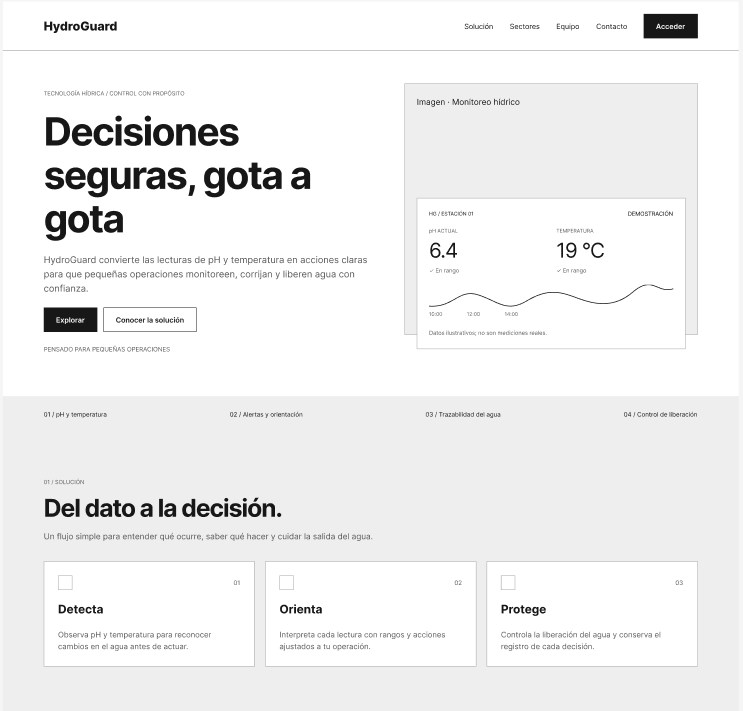
</p>

#### Wireframe 02 - Producto y Segmentación por Sectores

Estructura el bloque multimedia para el video explicativo de tecnología y detalla las propuestas adaptadas para los sectores textil (supervisión de descargas) e hidropónico (solución de riego).

<p align="center">
  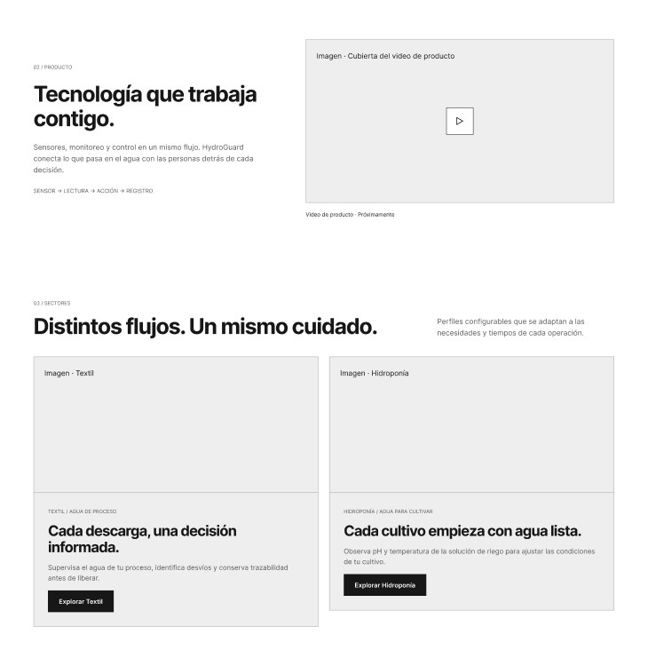
</p>

#### Wireframe 03 - Capacidades Operativas y Equipo

Presenta las funcionalidades esenciales del sistema (perfiles configurables, alertas, trazabilidad y cierre de emergencia) junto con el equipo de HydroLink y su propósito de impacto local.

<p align="center">
  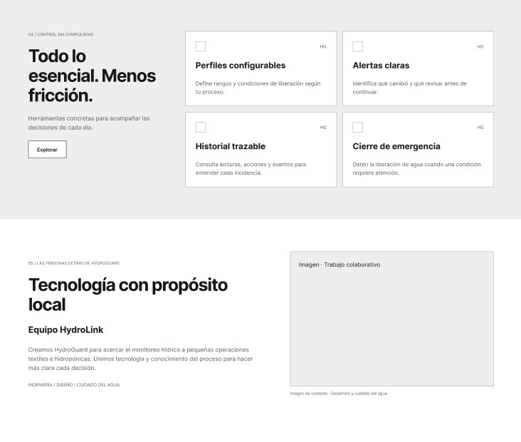
</p>

#### Wireframe 04 - Contacto y Pie de Página

Dispone el formulario interactivo para captar consultas operativas según el sector del usuario y consolida los enlaces de navegación global, políticas y créditos institucionales en el pie de página.

<p align="center">
  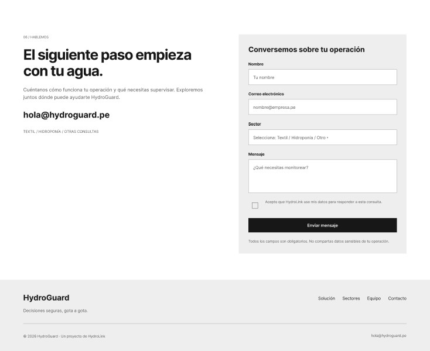
</p>

### 5.3.2. Landing Page Mock-up

Los mock-ups aplican la variante comercial de HydroGuard descrita en 5.1.2: fondos `Paper` y `Cream`, texto `Ink`, acentos `Aqua` y `Aqua Deep`, Manrope para contenido y DM Mono para datos. La implementación también utiliza Georgia en énfasis editoriales. Esta variante no sustituye la identidad azul de las aplicaciones ni exige Material Design en la landing. Los mock-ups mostrados representan la versión en español anterior a la incorporación del selector de idioma y del enlace a términos; no constituyen evidencia visual actualizada de esos nuevos elementos.

La versión de escritorio utiliza espacios amplios y contrastes de sección para separar la narrativa comercial. La versión móvil conserva contenido, etiquetas y acciones, reduce elementos secundarios y evita desplazamiento horizontal. Los estados interactivos deben incluir foco visible, mensajes comprensibles y contraste suficiente conforme con WCAG 2.2 AA.

A continuación, se presentan las vistas de alta fidelidad del Landing Page:

#### Mock-up 01 - Hero y Propuesta de Solución

Aplica el Design System con fondo Cream, tipografía Manrope y acento Aqua en llamadas a la acción, integrando la tarjeta interactiva de telemetría y los pilares del servicio.

<p align="center">
  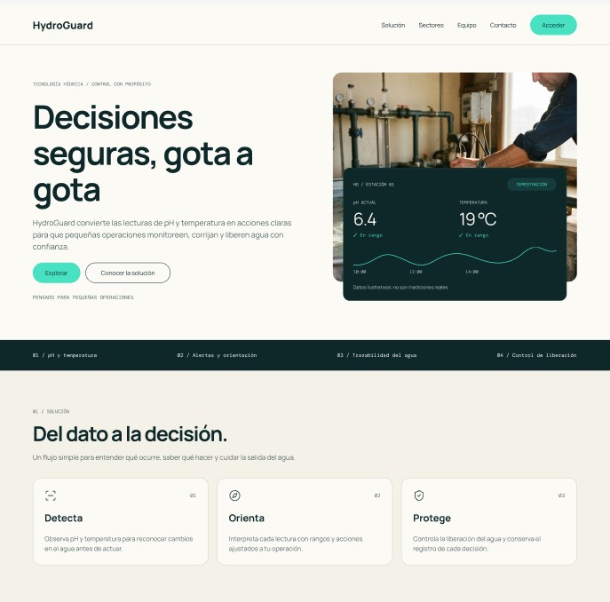
</p>

#### Mock-up 02 - Producto y Segmentación por Sectores

Presenta la sección multimedia con contraste en Ink para el hardware IoT y tarjetas visuales diferenciadas para operaciones textiles e hidropónicas.

<p align="center">
  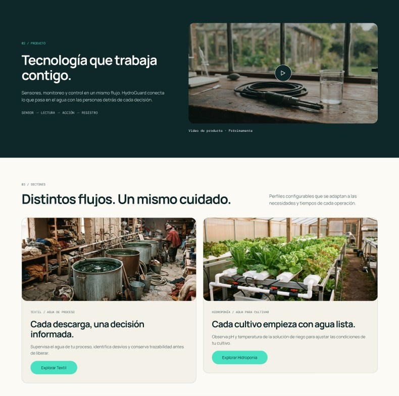
</p>

#### Mock-up 03 - Capacidades Operativas y Equipo

Organiza los módulos clave del sistema en tarjetas con bordes redondeados e introduce la narrativa del equipo fundador con fotografía de contexto.

<p align="center">
  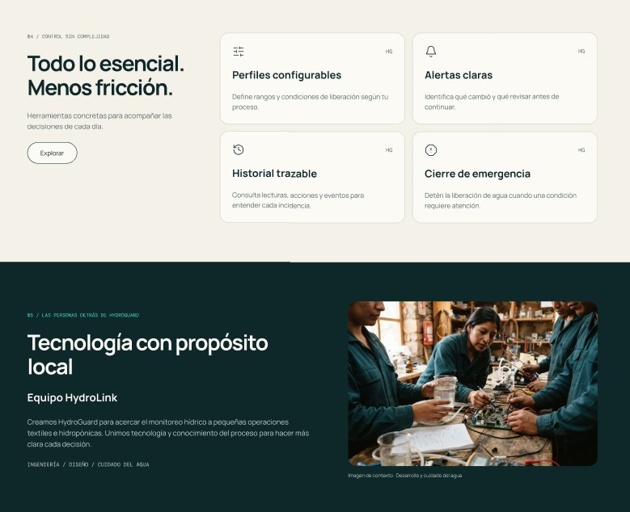
</p>

#### Mock-up 04 - Contacto y Pie de Página

Muestra el formulario de contacto con estados accesibles y botón de envío en Aqua, concluyendo con el footer institucional en contraste oscuro.

<p align="center">
  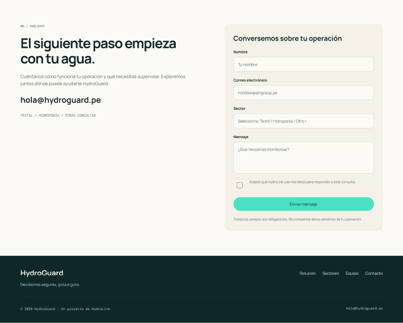
</p>

## 5.4. Applications UX/UI Design.

Esta sección presenta las decisiones visuales y de interacción de la aplicación administrativa y la aplicación del Operario mediante wireframes, wireflows, mock-ups y user flows. Los recorridos relacionan las metas de cada usuario con la organización del contenido, las acciones disponibles y sus resultados, siguiendo las guías de estilo y arquitectura de información de 5.1 y 5.2.

### 5.4.1. Applications Wireframes.

Los wireframes de HydroGuard representan, a nivel de baja fidelidad, la estructura, distribución de información y principales elementos de interacción de sus aplicaciones. Se presentan de manera separada la aplicación web orientada al Administrador y la aplicación móvil orientada al Operario. Todos los wireframes utilizan una representación en escala de grises con el propósito de priorizar la organización, jerarquía y navegación antes de desarrollar los mock-ups de alta fidelidad.

#### Web Application Wireframes - Administrator

La aplicación web está dirigida al Administrador de HydroGuard, quien dispone de una visión general de la organización y puede gestionar Operarios, dispositivos y estructuras operativas, además de supervisar procesos, telemetría, alertas, incidentes e información histórica.

#### W01 - Iniciar sesión

Esta vista permite al usuario ingresar sus credenciales para acceder a las funcionalidades correspondientes a su rol dentro de HydroGuard. También proporciona acceso al registro de una nueva empresa.

<p align="center">
  
</p>

#### W02 - Registrar empresa

Esta vista permite registrar una nueva empresa en HydroGuard junto con la información correspondiente a su cuenta administradora, constituyendo el punto de incorporación de una nueva organización a la plataforma.

<p align="center">
  
</p>

#### W03 - Resumen

La vista de resumen funciona como el panel principal del Administrador. Presenta una visión general del estado de los dispositivos, procesos, alertas e incidencias de la organización, facilitando el acceso a las principales funciones de supervisión.

<p align="center">
  
</p>

#### W04 - Operarios

Esta vista permite al Administrador consultar y gestionar los Operarios registrados en la empresa, visualizar su estado y revisar las asignaciones relacionadas con grupos, reservorios y dispositivos.

<p align="center">
  
</p>

#### W05 - Asignar Operario

Esta vista representa el proceso de incorporación y asignación de un Operario. El Administrador puede registrar su información y asociarlo con los recursos operativos correspondientes, finalizando con la generación del código de primer acceso.

<p align="center">
  
</p>

#### W06 - Estructura operativa

Esta vista permite administrar y consultar la estructura operativa de la organización, conformada por grupos, reservorios, dispositivos, perfiles y sus respectivas asignaciones.

<p align="center">
  
</p>

#### W07 - Detalle de dispositivo

La vista de detalle presenta la disponibilidad, asignación, configuración, última medición, estado operativo y estado de identidad técnica. Permite revocar la identidad con confirmación; la credencial original solo se muestra inmediatamente después del registro y nunca vuelve a aparecer en este detalle. También da acceso a telemetría, procesos, alertas e historial.

<p align="center">
  
</p>

#### W08 - Telemetría

Esta vista permite supervisar las mediciones registradas por los dispositivos de HydroGuard. Presenta información relacionada con el pH, temperatura, disponibilidad, última actualización y estado actual del proceso.

<p align="center">
  
</p>

#### W09 - Alertas e Incidentes

Esta vista centraliza las alertas operativas e incidentes detectados por el sistema. El Administrador puede utilizar filtros para localizar eventos específicos y acceder al detalle correspondiente para evaluar la situación.

<p align="center">
  
</p>

#### W10 - Historial y reportes

Esta vista permite consultar la trazabilidad histórica de las operaciones realizadas en HydroGuard. El Administrador puede revisar mediciones, procesos, correcciones, alertas y liberaciones, además de acceder a las opciones de generación y exportación de reportes.

<p align="center">
  
</p>

#### Mobile Application Wireframes - Operator

La aplicación móvil está orientada al Operario de HydroGuard y prioriza las actividades realizadas durante la supervisión del agua en campo. Sus vistas permiten acceder al sistema, consultar los reservorios asignados, revisar mediciones y estados operativos, configurar parámetros autorizados, supervisar procesos, atender alertas y consultar el historial de operaciones.

##### M01 - Primer acceso

Esta vista permite al Operario realizar su primer ingreso mediante el código proporcionado externamente por el Administrador. El código no caduca en el alcance actual y permite acceder a la cuenta ya creada con contraseña permanente; no se exige cambiarla durante el primer ingreso.

<p align="center">
  
</p>

##### M02 - Iniciar sesión

Esta vista permite al Operario autenticarse mediante sus credenciales para acceder a los reservorios, dispositivos y funcionalidades que le han sido asignados dentro de HydroGuard.

<p align="center">
  
</p>

##### M03 - Inicio

La vista de inicio presenta un resumen del estado operativo del Operario, incluyendo el reservorio seleccionado, las últimas mediciones de pH y temperatura, el estado del proceso, la conectividad y las alertas que requieren atención.

<p align="center">
  
</p>

##### M04 - Mis reservorios

Esta vista muestra los reservorios asignados al Operario. Cada elemento presenta información resumida sobre su dispositivo asociado, estado actual, últimas mediciones y disponibilidad, permitiendo acceder posteriormente a su detalle.

<p align="center">
  
</p>

##### M05 - Detalle de reservorio

Esta vista presenta la información principal del reservorio seleccionado, incluyendo el dispositivo asociado, las mediciones actuales de pH y temperatura, el estado del agua, la disponibilidad del dispositivo y la condición de la válvula. Desde esta pantalla también se puede acceder al proceso, configuración, alertas e historial relacionados.

<p align="center">
  
</p>

##### M06 - Configuración operativa

Esta vista permite al Operario consultar y modificar los parámetros operativos autorizados del dispositivo asignado. Entre ellos se incluyen los rangos de pH y temperatura, la estrategia correctiva, el tiempo de espera, el límite de ciclos y el modo de liberación.

<p align="center">
  
</p>

##### M07 - Proceso actual

Esta vista permite supervisar el proceso activo del reservorio, mostrando mediciones, estrategia propuesta, estado, ciclos, actuación y válvula. Cuando el proceso está pendiente permite aprobar una sola vez la estrategia seleccionada por el sistema; los ciclos posteriores continúan automáticamente. También incluye la confirmación de liberación manual únicamente desde `LISTO` y la parada de emergencia cuando corresponda.

<p align="center">
  
</p>

##### M08 - Alertas

Esta vista permite al Operario consultar las alertas asociadas a sus reservorios y dispositivos. Las alertas se presentan según su prioridad, estado y fecha, permitiendo acceder al detalle de aquellas situaciones que requieren atención.

<p align="center">
  
</p>

##### M09 - Historial

Esta vista presenta de manera cronológica los eventos registrados durante la operación de los dispositivos asignados. Permite consultar mediciones, ciclos de corrección, alertas, actuaciones y liberaciones anteriores para mantener la trazabilidad del proceso.

<p align="center">
  
</p>

##### M10 - Perfil y cuenta

Esta vista permite al Operario consultar la información asociada a su cuenta, grupo y asignaciones actuales. También proporciona acceso a las opciones relacionadas con su perfil y el cierre de sesión.

<p align="center">
  
</p>

### 5.4.2. Applications Wireflow Diagrams.

Los Wireflows se organizan alrededor de los objetivos indispensables de cada actor y muestran cómo cambia la interfaz después de cada acción. Para evitar recorridos redundantes, las operaciones relacionadas se agrupan en cinco flujos principales:

| Aplicación / User Persona | User Goal | Flujo representado |
|:--|:--|:--|
| Web / Administrador | Acceder o registrar una empresa | Inicio de sesión → validación → Operarios; como alternativa, registro de empresa y su único Administrador → inicio de sesión. |
| Web / Administrador | Preparar una unidad operativa y asignarla | Crear grupo → crear reservorio → registrar y vincular dispositivo → crear cuenta y perfil de Operario → asignar dispositivo y reservorio → generar código de acceso. |
| Web / Administrador | Supervisar la operación | Consultar telemetría → seleccionar dispositivo → revisar mediciones y tratamiento → consultar o atender alerta/incidente → revisar trazabilidad o generar reporte. |
| Móvil / Operario | Activar su acceso y completar la configuración | Ingresar identificador, contraseña y código recibido → activar acceso → seleccionar asignación → guardar parámetros → publicar → esperar confirmación de aplicación del dispositivo. |
| Móvil / Operario | Supervisar y autorizar un tratamiento | Seleccionar reservorio → revisar medición y estrategia → aprobar una vez la corrección → seguir ciclos automáticos → confirmar liberación cuando corresponda o ejecutar parada de emergencia. |

Cada Wireflow debe reflejar estados de carga, validación, vacío, error y confirmación cuando alteren la decisión del usuario. En el flujo operativo, el sistema no permite aprobar una corrección sin estrategia, liberar agua no apta ni operar un recurso fuera de las asignaciones vigentes.

### Aplicación web — Administrador

---

#### **WF-WEB-01 · Inicio de sesión y registro de empresa**
- User Goal: Iniciar sesión o registrar una empresa para acceder a la plataforma.
- User Persona: Administrador de empresa.

El administrador accede a la pantalla de inicio → si ya tiene una cuenta, ingresa sus credenciales y el sistema valida la información. Si son correctas → accede a Operarios; si son incorrectas → se muestra un mensaje de error con la opción de reintentar. Si no tiene una cuenta → inicia el registro de empresa y completa los datos de la organización y del Administrador. Al confirmar, el sistema valida los campos; si son válidos crea la cuenta y redirige al inicio de sesión. El panel Resumen del wireframe corresponde al diseño, no al destino inicial implementado.

<a href="./assets/wireframes/WF-WEB-01.png">
  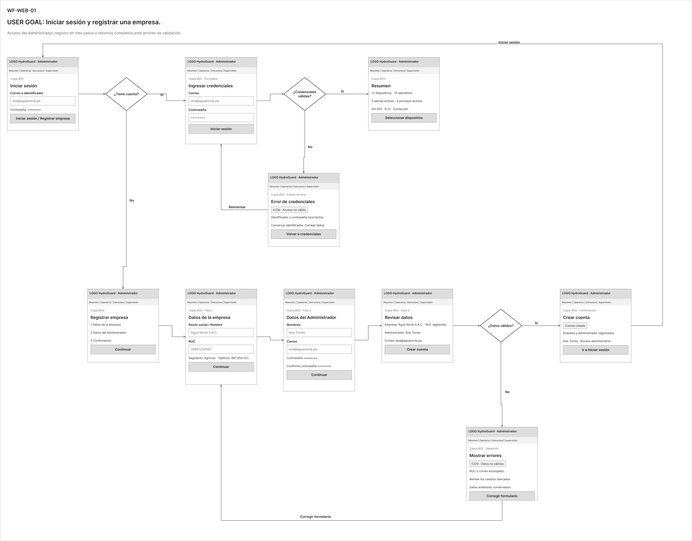
</a>

---

#### **WF-WEB-02 · Registro y asignación de operarios**
- User Goal: Registrar un operario y asignarle los recursos necesarios para sus actividades.
- User Persona: Administrador de empresa.

Desde el panel de resumen, el administrador ingresa a la sección de operarios → selecciona "Registrar operario" y completa sus datos de cuenta. Si la información es incorrecta → se muestra un error para corregirla; si es válida → continúa con el perfil del operario. Posteriormente, selecciona el grupo, reservorio y dispositivo que tendrá asignados. El sistema verifica la disponibilidad del dispositivo → si no está disponible, solicita elegir otro; si está disponible, permite revisar y confirmar la asignación. Finalmente, se genera un código de primer acceso y se muestra la confirmación del registro, dejando al operario pendiente de completar su acceso inicial.

<a href="./assets/wireframes/WF-WEB-02.png">
  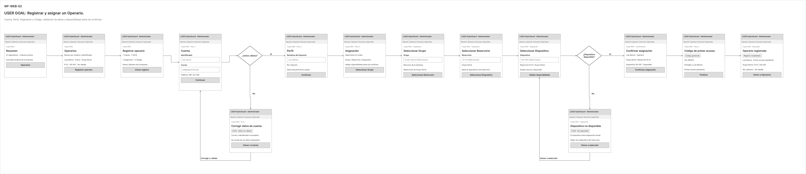
</a>

---

#### **WF-WEB-03 · Supervisión de dispositivos y revisión de incidencias**
- User Goal: Supervisar el funcionamiento de un dispositivo y consultar las incidencias registradas.
- User Persona: Administrador de empresa.

Desde el panel de resumen, el administrador selecciona un dispositivo → consulta sus datos operativos y accede a la telemetría para revisar las mediciones de pH, temperatura y el proceso relacionado. Si no existen alertas activas → continúa con el monitoreo; si existe una alerta → accede al listado y consulta su detalle. Cuando la alerta tiene una incidencia asociada → revisa su información y trazabilidad, incluyendo el proceso, responsable y eventos registrados. Posteriormente, consulta el historial y puede exportar un reporte. Si no se generó una incidencia → regresa a la telemetría para continuar supervisando el dispositivo.

<a href="./assets/wireframes/WF-WEB-03.png">
  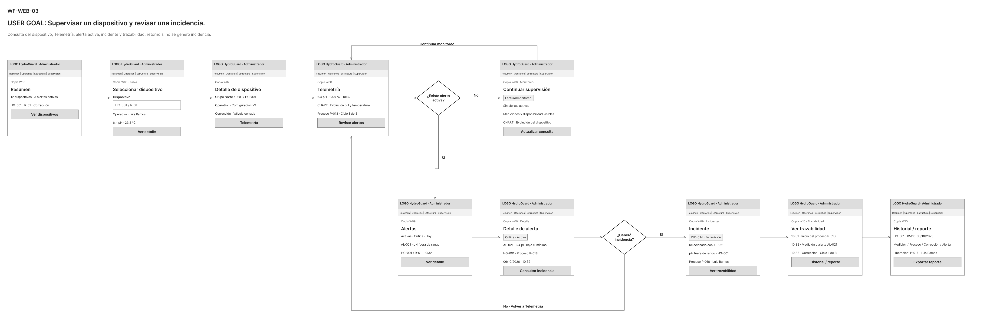
</a>

---

### Aplicación móvil — Operario

---

#### **WF-MOB-01 · Primer acceso e inicio de sesión**
- User Goal: Completar el primer acceso e iniciar sesión en la aplicación móvil.
- User Persona: Operario.

El operario ingresa a la pantalla de primer acceso → introduce el código proporcionado por el administrador y el sistema verifica su validez. Si el código es incorrecto → se muestra un mensaje de error con la opción de reintentar; si es válido → accede al formulario para establecer su identificador y contraseña. Al completar sus credenciales → se muestra la confirmación del acceso y sus reservorios asignados. Posteriormente, ingresa a la pantalla de inicio de sesión y proporciona sus credenciales. Si son correctas → accede al inicio de la aplicación; si son incorrectas → se muestra el error correspondiente y puede volver a intentarlo.

<a href="./assets/wireframes/WF-MOB-01.png">
  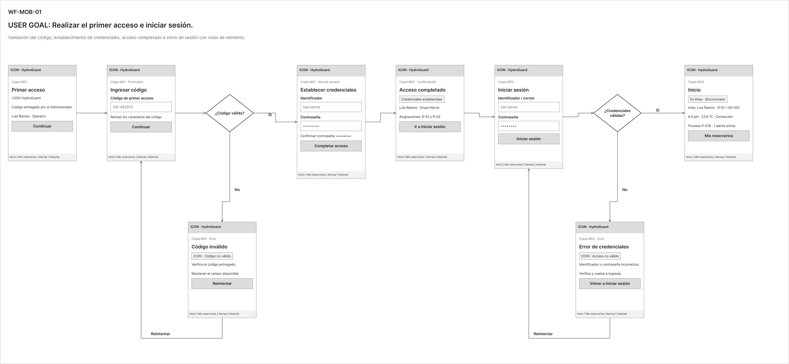
</a>

---

#### **WF-MOB-02 · Consulta del estado de reservorios**
- User Goal: Consultar las mediciones y el estado operativo de un reservorio asignado.
- User Persona: Operario.

Desde la pantalla de inicio, el operario accede a "Mis reservorios" → selecciona uno de los reservorios asignados y consulta su detalle, donde se muestran las mediciones de pH y temperatura, el estado del agua y la última actualización. Al seleccionar "Consultar mediciones" → revisa los valores de pH y temperatura junto con sus rangos autorizados y el estado actual del reservorio. Desde el detalle también puede navegar hacia cuatro secciones: Proceso, para supervisar el tratamiento; Configuración, para consultar los parámetros operativos; Alertas, para revisar eventos activos; e Historial, para consultar mediciones y trazabilidad. Finalmente, puede regresar al detalle del reservorio para continuar con su supervisión.

<a href="./assets/wireframes/WF-MOB-02.png">
  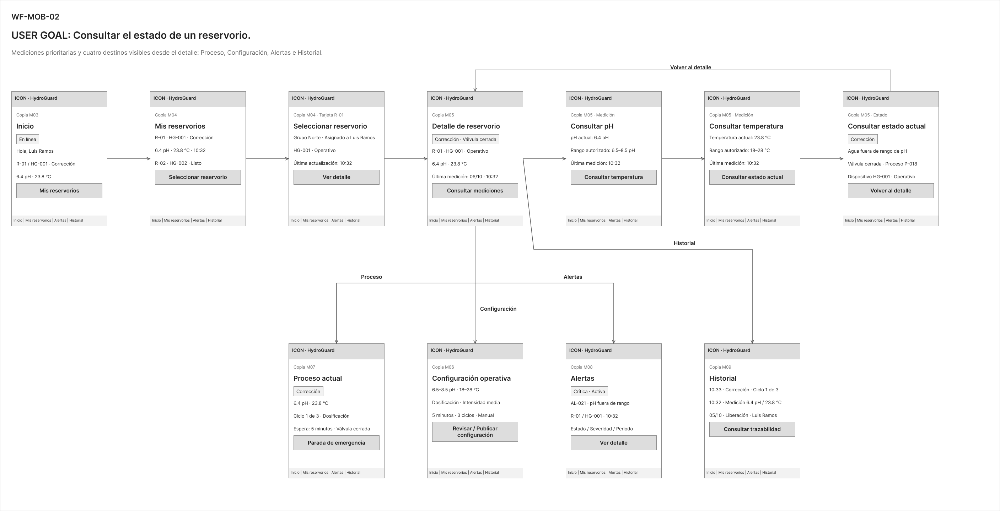
</a>

---

#### **WF-MOB-03 · Supervisión del tratamiento y liberación segura del agua**
- User Goal: Supervisar el tratamiento y liberar el agua únicamente cuando cumpla las condiciones de seguridad.
- User Persona: Operario.

Desde el detalle del reservorio, el operario accede al proceso actual → revisa las mediciones de pH y temperatura y verifica si el agua se encuentra dentro de los rangos permitidos. Si cumple las condiciones → el agua pasa al estado "LISTO" y se evalúa el modo de liberación. En modo automático → se autoriza la apertura de la válvula; en modo manual → el operario confirma la acción antes de completar la liberación. Si las mediciones están fuera de rango → se inicia un ciclo de corrección, se ejecuta la acción correctiva y se espera una nueva medición. Si el agua continúa fuera de rango y quedan ciclos disponibles → se repite el tratamiento; si se alcanza el máximo de ciclos → se registra el fallo, se genera una alerta y la válvula permanece cerrada. Adicionalmente, el operario puede solicitar una parada de emergencia → al confirmarla, se detiene el proceso y se cierra la válvula para impedir la liberación del agua.

<a href="./assets/wireframes/WF-MOB-03.png">
  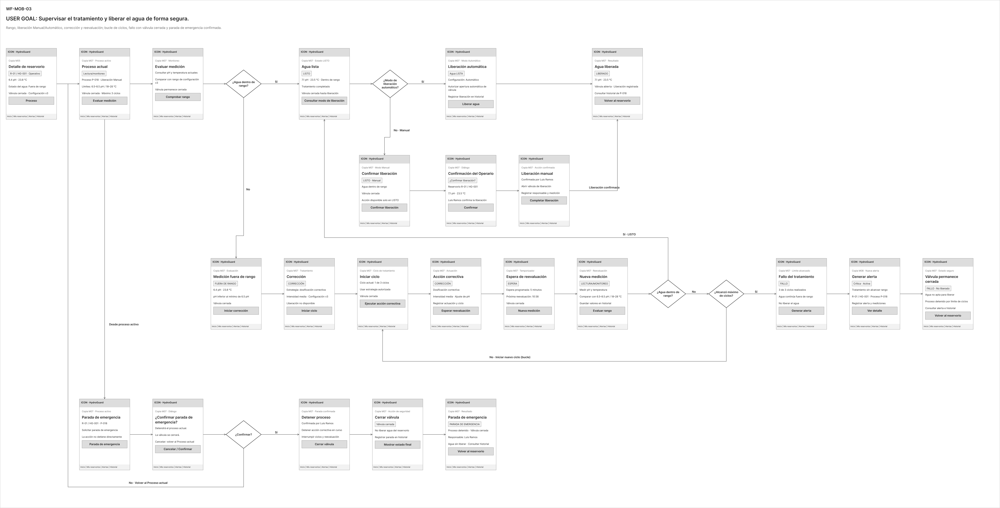
</a>

---

#### **WF-MOB-04 · Atención de alertas y consulta de trazabilidad**
- User Goal: Atender una alerta activa y consultar su trazabilidad operativa.
- User Persona: Operario.

Desde la pantalla de inicio, el operario identifica una alerta activa → ingresa a la sección de alertas y selecciona el evento que desea revisar. Al consultar su detalle → visualiza la severidad, fecha, medición fuera de rango y proceso relacionado. Posteriormente, accede a la información del reservorio y dispositivo involucrados → consulta el proceso de tratamiento asociado y revisa su historial operativo. Al seleccionar la opción de trazabilidad → examina las mediciones, ciclos de corrección y actuaciones registradas durante el evento. Finalmente, regresa al detalle del reservorio para comprobar su estado actual y continuar con la supervisión.

<a href="./assets/wireframes/WF-MOB-04.png">
  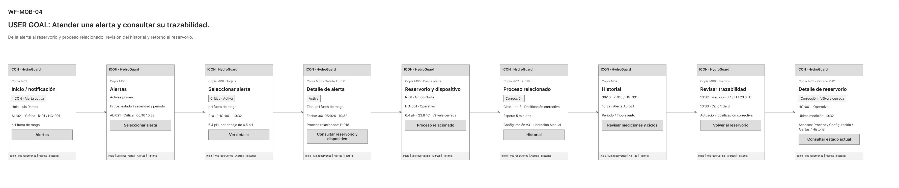
</a>

---

### 5.4.3. Applications Mock-ups.

Los mock-ups aplican una estructura visual común para que el Administrador identifique rápidamente su ubicación y las acciones disponibles. La aplicación web utiliza una barra lateral persistente agrupada por acceso, estructura operativa y supervisión; las páginas conservan encabezado, contexto, acción principal, filtros y contenido. Las listas priorizan reconocimiento sobre memoria y los detalles presentan primero el estado actual antes del historial o las acciones de riesgo.

El color refuerza, pero no reemplaza, las etiquetas de estado. Las acciones destructivas o irreversibles requieren confirmación; los formularios muestran instrucciones y errores junto al campo correspondiente; y los estados de carga, vacío y fallo se distinguen explícitamente. El diseño utiliza los tokens de color, tipografía, espaciado, radios y elevación definidos en 5.1, junto con componentes de Angular Material adaptados al lenguaje visual de HydroGuard.

En móvil, la información se reduce a la asignación y al proceso que el Operario debe atender. Las acciones operativas se muestran únicamente cuando el estado lo permite, con controles táctiles amplios y mensajes directos. Esta separación evita presentar capacidades administrativas en el canal móvil y mantiene una arquitectura de información acorde con cada rol.

Link del figma: https://www.figma.com/design/zwubZlZ5k3BaILJMHbYa7E/Hydroguard---Mockups?node-id=2-2&t=ViQYkj32RbslL2e6-1

#### Inicio de sesión:

[](https://postimg.cc/ZvyfkYCV)

[](https://postimg.cc/TLjVny5g)

#### Operarios:

[](https://postimg.cc/RJHzPB9W)

[](https://postimg.cc/ZWjXxR3r)

[](https://postimg.cc/vDNrfdcB)

[](https://postimg.cc/CBtRBSmD)

#### Grupos:

[](https://postimg.cc/xq3CVGS0)

[](https://postimg.cc/kVNrRcsQ)

[](https://postimg.cc/Z0GLXS4S)

#### Reservorios:

[](https://postimg.cc/ykh053L9)

[](https://postimg.cc/Yvs0ypBb)

[](https://postimg.cc/QF1NScSD)

#### Dispositivos:

[](https://postimg.cc/7GbptkDV)

[](https://postimg.cc/nsh5MJXR)

[](https://postimg.cc/RNvTvT6Q)

#### Perfiles:

[](https://postimg.cc/rKpQSJVM)

[](https://postimg.cc/PPcz1nFX)

[](https://postimg.cc/8sXhVVGS)

#### Estado Operacional:

[](https://postimg.cc/5YNFZskK)

#### Alertas:

[](https://postimg.cc/nXGrpvm5)

#### Incidentes:

[](https://postimg.cc/cv019rz6)

#### Trazabilidad:

[](https://postimg.cc/CRxTnDXp)

#### Mobile:

[](https://postimg.cc/MMvyFWTF)

[](https://postimg.cc/7JNSWX7H)

[](https://postimg.cc/YLtd0vz4)

[](https://postimg.cc/CdQzNWWS)

[](https://postimg.cc/wtdLgSV2)

[](https://postimg.cc/nCjD7HSR)

[](https://postimg.cc/m1zMjRj1)

[](https://postimg.cc/Fkf7jZp4)

[](https://postimg.cc/181fqDqZ)

[](https://postimg.cc/bdKv71Lb)

### 5.4.4. Applications User Flow Diagrams.

Los User Flows utilizan los mismos objetivos definidos para los Wireflows y reemplazan la representación estructural por los mock-ups de alta fidelidad. Las rutas esperadas y alternativas se interpretan de la siguiente manera:

| User Goal | Happy path | Unhappy paths y condiciones principales |
|:--|:--|:--|
| Acceder o registrar una empresa | El Administrador ingresa credenciales válidas o registra una empresa y accede al área protegida. | Credenciales inválidas, correo o RUC duplicado, campos incompletos y servicio no disponible. Solo puede existir un Administrador por empresa. |
| Preparar una unidad operativa y asignarla | Se crea grupo, reservorio y dispositivo; luego se crea el Operario, su perfil, la asignación exclusiva y el código de acceso. | Recurso inactivo, dispositivo ya vinculado, reservorio ocupado, Operario sin cuenta completa o intento de asignar un dispositivo compartido. |
| Supervisar la operación | El Administrador consulta telemetría, proceso, alertas, incidentes y trazabilidad del dispositivo seleccionado. | Dispositivo sin mediciones, pérdida de monitoreo, filtros sin resultados, recurso de otra organización o error de comunicación. |
| Activar acceso y configurar desde móvil | El Operario utiliza el código recibido, inicia sesión y completa la configuración de su asignación. | Código inexistente o revocado, credenciales inválidas, asignación cerrada o configuración incompleta. |
| Autorizar y seguir un tratamiento | El Operario revisa la estrategia, aprueba una vez, observa los ciclos automáticos y confirma la liberación únicamente cuando el sistema marca el agua como apta. | Estrategia no disponible, proceso fallido, emergencia, límites de ciclos alcanzados o intento de liberar agua no apta. |

Las decisiones de cada diagrama deben estar etiquetadas y las rutas alternativas deben regresar a un estado recuperable o explicar por qué el proceso queda bloqueado. El recorrido móvil distingue guardar, publicar y aplicar la configuración antes de iniciar el proceso; posteriormente presenta la aprobación de la estrategia, los ciclos de corrección y espera, la reevaluación y la autorización de liberación según el estado del proceso. La aplicación administrativa permite preparar las unidades y supervisar sus mediciones, alertas, incidentes y trazabilidad.

Link: https://www.figma.com/board/aA4hZeydBIROAefYuThSnW/IOT?node-id=3-318&t=q4MvEYSWK2j0nY4e-1

#### Incio de sesión:

[](https://postimg.cc/T5jxZNRd)

[](https://postimg.cc/SjQwqGmv)

#### Secciones:

Aqui se pueden ver las 9 secciones:

[](https://postimg.cc/YvD7KWwj)

[](https://postimg.cc/RJHzPB9W)

#### Operarios:

[](https://postimg.cc/YGcJMNDQ)

[](https://postimg.cc/Jy2Bnq9p)

[](https://postimg.cc/Vd80d5H4)

[](https://postimg.cc/pmV9J4vr)

#### Grupos:

[](https://postimg.cc/Wqpjc6th)

[](https://postimg.cc/0rq7JtzK)

[](https://postimg.cc/nMYBKvm6)

#### Reservorios:

[](https://postimg.cc/14MscTYk)

[](https://postimg.cc/fJVWWsMB)

[](https://postimg.cc/sGvz2PC7)

#### Dispositivos:

[](https://postimg.cc/SXWpXtMX)

[](https://postimg.cc/bZLmm7td)

[](https://postimg.cc/nC4RDjVz)

[](https://postimg.cc/hh73KZHH)

#### Perfiles:

[](https://postimg.cc/PCnhQwkV)

[](https://postimg.cc/zLV4Kzc8)

[](https://postimg.cc/JHcFMGGZ)

[](https://postimg.cc/dD8p8S4d)

[](https://postimg.cc/bZv5fY80)

#### Monitoreo:

[](https://postimg.cc/f3wN6Qyj)

[](https://postimg.cc/5YNFZskK)

#### Alertas:

[](https://postimg.cc/R6Yx63RZ)

[](https://postimg.cc/nXGrpvm5)

#### Incidentes:

[](https://postimg.cc/ZWLkPsc7)

[](https://postimg.cc/cv019rz6)

#### Trazabilidad:

[](https://postimg.cc/MfBNn9HN)

[](https://postimg.cc/CRxTnDXp)

## 5.5. Applications Prototyping.

Como complemento de los wireframes, mock-ups y flujos descritos en la sección 5.4, el equipo presenta el video de demostración del prototipo de HydroGuard. Este recurso permite revisar la propuesta de interacción y navegación del producto durante la revisión de su diseño UX/UI.

**Video del prototipo:** [Ver demostración del prototipo de HydroGuard](https://youtu.be/lFp6UkqJ40U).

La evidencia de ejecución de la aplicación web se documenta por separado en [6.2.1.6. Execution Evidence for Sprint Review](#6216-execution-evidence-for-sprint-review).


Los prototipos deben permitir recorrer los mismos cinco objetivos definidos en los Wireflows y User Flows. La navegación de escritorio conserva la barra lateral como referencia global y utiliza breadcrumbs o enlaces contextuales para pasar de grupo a reservorio, dispositivo, telemetría y tratamiento. En móvil, la navegación prioriza la asignación activa, el estado del reservorio y las acciones operativas disponibles.

Las interacciones deben simular validación de formularios, confirmaciones, estados de carga, vacío y error, apertura de detalles y retorno sin pérdida innecesaria de contexto. Las acciones condicionadas por el dominio solo deben habilitarse en el estado correspondiente: aprobación única de la estrategia, continuación automática de ciclos, liberación cuando el agua está apta y parada de emergencia durante un proceso activo.


## 5.6. IoT Device Design

El diseño físico prioriza la separación entre sensado y actuación, la protección de la entrada analógica y una señalización sencilla que complemente las aplicaciones. La alimentación del servo se separa de la línea de sensores y comparte tierra con el ESP32 para conservar la referencia de la señal de control. Los indicadores mantienen los significados definidos en la guía IoT de 5.1.2, mientras las mediciones y los estados detallados se consultan en el monitor serie y en las aplicaciones. El montaje permite representar el flujo de corrección y liberación sin atribuir al prototipo dosificación automática o medición de caudal.

### 5.6.1. Montaje y conexiones vigentes

El prototipo utiliza ESP32 DevKit, módulo PH4502C con electrodo BNC, sonda DS18B20, tres LED y servomotor. No utiliza LM35 ni LCD. La referencia ejecutable se encuentra en `prototipo-wokwi/sketch/sketch.ino`; Wokwi conserva además `diagram.json` y `libraries.txt` para representar el montaje virtual. El pin analógico vigente es GPIO35, después de una prueba de sustitución de GPIO34.

| Elemento | Conexión del prototipo físico |
|:--|:--|
| Alimentación ESP32 | USB de 5 V con cable y contacto estables. `3V3` alimenta el riel de 3.3 V y `GND` el riel de tierra común. No se une el riel de 3.3 V con VIN/5 V. |
| PH4502C | `V+` a la alimentación de 5 V disponible en VIN con la placa alimentada por USB; `G` a tierra común. `Po` pasa por el divisor resistivo antes de GPIO35. `Do` y `To` no se utilizan. |
| Divisor de pH | Dos resistencias iguales de 10 kΩ: `Po → resistencia → nodo GPIO35 → resistencia → GND`. Reduce aproximadamente a la mitad la tensión aplicada al ADC; la entrada GPIO no debe recibir directamente los 5 V del módulo. |
| DS18B20 | Rojo a 3.3 V, negro a GND, amarillo a GPIO4. La línea de datos requiere pull-up a 3.3 V; en las primeras pruebas se usaron dos resistencias de 10 kΩ en paralelo (5 kΩ nominales), en lugar de una de 4.7 kΩ. |
| LED verde | GPIO25, resistencia serie de 1 kΩ y LED hacia GND. Indica adquisición, no conformidad. |
| LED amarillo | GPIO26, resistencia serie limitadora y LED hacia GND. Representa corrección, no dosificación automática. |
| LED rojo | GPIO27, resistencia serie limitadora y LED hacia GND. Indica fallo de sensor, bloqueo local/remoto o problema de inicialización del control de salidas; no certifica por sí solo el estado de la conexión. |
| Servomotor | Señal a GPIO18; rojo a fuente externa regulada de 5 V adecuada a la corriente del servo, marrón a su negativo. El negativo se une a GND del ESP32. No se une el positivo externo con el riel de 3.3 V. |
| Entradas locales del firmware | GPIO32 para confirmación y GPIO33 para parada, con `INPUT_PULLUP` y pulsador hacia GND si se monta. Son controles locales y de banco, no sustituyen la aprobación del Operario en la app. |

El servomotor probado puede representar movimiento, pero la apertura de la válvula real requiere torque y fijación adecuados. La corriente admisible del cable no se deduce únicamente de la etiqueta del cargador. No se considera resuelta la mecánica ni garantizado el caudal por recibir una confirmación de posición ordenada.

### 5.6.2. Adquisición y conversión de lecturas

El firmware programa una adquisición cada cinco segundos, aunque una operación de red bloqueante puede retrasarla. Utiliza ADC de 12 bits en GPIO35 y `analogReadMilliVolts`. Obtiene 31 muestras, descarta las cinco inferiores y superiores y promedia las 21 restantes. Los valores ADC crudos y de milivoltios se adquieren por separado; `Po_estimado` es el doble del voltaje ADC según el divisor nominal, no una medición independiente de Po o de la alimentación.

La conversión vigente se obtuvo de dos buffers medidos cerca de 25 °C: pH 4.003, con promedio de entrada de aproximadamente 2264.89 mV, y pH 6.864, con aproximadamente 2015.81 mV. La interpolación es:

```text
pendiente_mV_por_pH = (V_4.003 - V_6.864) / (6.864 - 4.003)
pH = 4.003 + (V_4.003 - V_entrada) / pendiente_mV_por_pH
```

Estos coeficientes se obtuvieron cuando se utilizaba GPIO34 y se conservaron después de cambiar a GPIO35. Los nombres internos `PH_ACID_D34_MV` y `PH_NEUTRAL_D34_MV` preservan esa procedencia; no indican que el firmware siga leyendo GPIO34. La nueva entrada, el cableado y la alimentación requieren corroboración con buffers. No hay una compensación térmica de pH implementada por el solo hecho de registrar DS18B20. Wokwi utiliza un modelo independiente de potenciómetro para representar 0–14, sin aplicar la fórmula física al sensor virtual.

Una lectura no finita o fuera de rango se rechaza, no se recorta a 0 o 14 para aparentar validez. El diagnóstico informa `ADC`, milivoltios, dispersión del conjunto recortado, temperatura, estado de LED, WiFi, identidad y versión aplicada. La dispersión en milivoltios y la variación entre lecturas no equivalen a exactitud instrumental certificada.

### 5.6.3. Indicadores y flujo integrado

El LED verde permanece apagado durante la adquisición y emite un pulso de aproximadamente 100 ms después. Esta separación redujo el acoplamiento observado, pero no prueba que el voltaje del módulo sea invariable con otras cargas. Amarillo representa la orden correctiva y rojo señala condiciones locales de fallo o bloqueo. Treatment, no el color del LED, decide la conformidad según la configuración aplicada y las mediciones recientes.

La corrección del prototipo físico se representa mediante LED y adición/mezcla manuales. En el modo de simulación del firmware se confirma al finalizar la duración indicada; el modo académico también contempla confirmación local. La espera pertenece a Treatment y la reevaluación exige una lectura posterior a su vencimiento. La liberación solo se ordena con autorización válida; el firmware revisado cierra la representación de apertura a los cinco segundos y contempla cierre ante pérdida crítica de control, emergencia o lectura inválida.

### 5.6.4. Configuración, memoria y límites pendientes

La configuración de transporte se introduce como JSON por el monitor serie a 115200 baudios: URL de Edge, WiFi e identidad del dispositivo. Edge gestiona el token técnico y su renovación; el dispositivo no requiere que el usuario copie JWT. Tras reinicio se debe reintroducir la configuración de aplicación almacenada en RAM. El programa y los coeficientes permanecen en flash. No debe afirmarse que el ESP32 carece de persistencia: `Preferences` mantiene un diario NVS de ocho posiciones para comandos y sus resultados, evitando repetir una actuación ante reintentos. El firmware conserva una medición pendiente en RAM, no un archivo histórico completo de todas las muestras durante una desconexión.

Las cadenas de configuración no se imprimen ni se incluyen como secretos en el sketch. La ausencia de escritura explícita de esas cadenas en `Preferences` no demuestra que el controlador WiFi no persista sus parámetros: el firmware no deshabilita explícitamente esa persistencia mediante `WiFi.persistent(false)`. No se presenta una garantía de borrado de credenciales de toda la memoria del dispositivo.

Edge almacena temporalmente las entregas aceptadas en SQLite y reintenta hacia el backend con identificadores estables. El historial permanente corresponde a las bases del backend. En el despliegue virtual con disco efímero, reiniciar Edge puede perder su cola local; no se garantiza entrega infinita ni ausencia total de pérdidas en cualquier interrupción.

Permanecen pendientes la revalidación de la calibración tras cambios eléctricos, la verificación de alimentación bajo carga y el ajuste mecánico/torque de la válvula. No se implementaron bomba dosificadora, enfriamiento físico ni sensor de caudal. Las pruebas integrales acreditan intercambio de datos y decisiones del proceso, no aptitud sanitaria del agua ni dosis químicas controladas.

Referencia de diseño inicial en Cirkit Designer (montaje anterior; no describe el cableado vigente): https://app.cirkitdesigner.com/project/cbdef7ec-8293-4e11-94d1-0bf2247bb2e8

[](https://postimg.cc/w3gG2jCq)

# Capítulo VI: Product Implementation, Validation & Deployment

## 6.1. Software Configuration Management

Esta sección define las reglas, estándares y herramientas establecidas para garantizar la integridad, trazabilidad y consistencia del ecosistema de software de HydroGuard durante todo su ciclo de vida. La configuración abarca desde el entorno de desarrollo y la gestión del código fuente hasta las estrategias de despliegue.   

### 6.1.1. Software Development Environment Configuration.

Para asegurar un flujo de trabajo colaborativo y estandarizado, el equipo ha configurado el siguiente entorno de desarrollo, cumpliendo con las restricciones tecnológicas del proyecto:

| Actividad | Producto | Propósito en HydroGuard | Referencia |
|:--|:--|:--|:--|
| Gestión del proyecto | Trello | Administrar Product Backlog, Sprint Backlog y estados de trabajo. | <https://trello.com/> |
| Comunicación | Discord | Reuniones de planificación y coordinación síncrona. | <https://discord.com/download> |
| UX/UI | Figma y FigJam | Elaborar wireframes, mock-ups, prototipos, Wireflows y User Flows. | <https://www.figma.com/> |
| Modelado de dominio | Miro | Elaborar EventStorming y Context Mapping colaborativos. | <https://miro.com/> |
| Investigación UX | UXPressia | Elaborar User Personas, Journey Maps y Empathy Maps. | <https://uxpressia.com/> |
| Desarrollo web | WebStorm | Editar, depurar y mantener el proyecto Angular y TypeScript. | <https://www.jetbrains.com/webstorm/download/> |
| Runtime y dependencias | Node.js 22 y npm 11 | Ejecutar Angular CLI, el Mock API y las verificaciones automatizadas. | <https://nodejs.org/en/download> |
| Frontend web | Angular, Angular Material y Axios | Implementar la aplicación administrativa, sus componentes y la comunicación HTTP. | <https://angular.dev/> / <https://material.angular.dev/> / <https://axios-http.com/> |
| Control de versiones | Git y GitHub | Aplicar GitFlow, Conventional Commits, revisión e integración del código. | <https://git-scm.com/downloads> / <https://github.com/> |
| Pruebas del incremento | Node.js Assert y guías manuales | Ejecutar comprobaciones HTTP reproducibles y validar los flujos desde la interfaz. | <https://nodejs.org/api/assert.html> |
| Documentación de servicios | OpenAPI y Swagger | Especificar y publicar los contratos del futuro backend REST. | <https://swagger.io/specification/> |
| Despliegue | GitHub Pages, Vercel y Render | Publicar respectivamente el Landing Page, el frontend Angular y el Mock API académico. | <https://pages.github.com/> / <https://vercel.com/> / <https://render.com/> |
| Backend y Edge planificados | Spring Boot y Flask | Implementar posteriormente el backend cloud y el Edge API definidos en la arquitectura. | <https://spring.io/projects/spring-boot> / <https://flask.palletsprojects.com/> |
| Dispositivo IoT | C++, ESP32 y Cirkit Designer | Programar y representar el prototipo físico y su circuito. | <https://docs.espressif.com/projects/arduino-esp32/> / <https://www.cirkitdesigner.com/> |

**Project & Requirements Management**
*   **Trello** Plataforma principal para la gestión ágil del proyecto, administración del Product Backlog, y seguimiento de los Sprint Backlogs. (SaaS: trello.com)
  
<p align="center">
  
</p>
    
*   **Discord** Canales oficiales para las reuniones de *Sprint Planning*, *Daily Standups* y coordinación síncrona.
  
<p align="center">
  
</p>

**Product UX/UI Design**
*   **Figma:** Herramienta colaborativa basada en la nube utilizada para la creación de *wireframes*, *mock-ups* de alta fidelidad, *wireflows* y prototipado interactivo de las aplicaciones. (SaaS: figma.com)

<p align="center">
  
</p>

*   **Miro / UXPressia:** Empleado para la digitalización de los artefactos de Needfinding (User Personas, Journey Maps) y las sesiones de *Design-Level EventStorming*.

<p align="center">
  
  
</p>
  
**Software Development**
*   **WebStorm:** Entorno de desarrollo integrado (IDE) avanzado utilizado como herramienta principal para el desarrollo web. Ofrece soporte especializado para TypeScript y herramientas integradas de depuración que aseguran la mantenibilidad del código frontend.

<p align="center">
  
</p>

*   **Angular Framework:** Framework principal para el desarrollo de la *Web Application* de administración de HydroGuard, utilizando TypeScript.

<p align="center">
  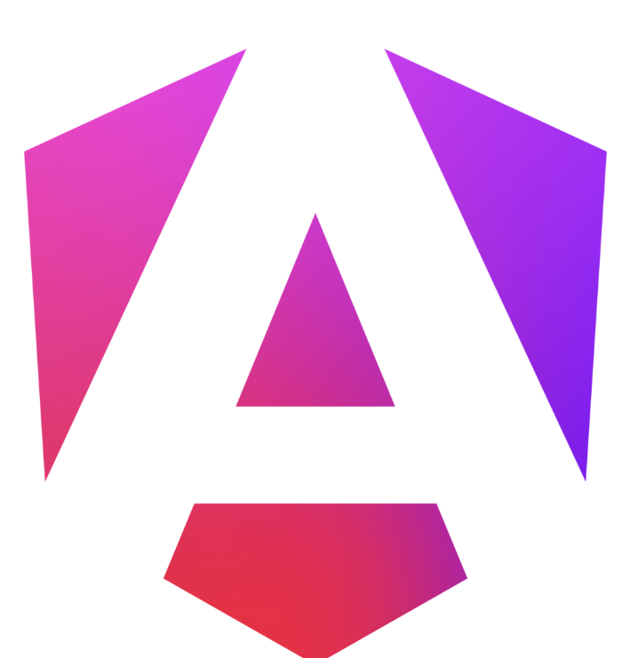
</p>

*   **Spring Boot / Flask:** Frameworks para el desarrollo de los *RESTful Web Services* y el *Edge API*, respectivamente, permitiendo el procesamiento ágil e integración de la telemetría IoT.
*   **C++ (Arduino/ESP32):** Lenguaje y entorno para la programación del *Embedded System* en el prototipo físico IoT de monitoreo de calidad del agua.
*   **VisualParadigma:** Herramienta implementada bajo *Diagram-as-Code* para la elaboración de la arquitectura de software bajo el modelo C4.

<p align="center">
  
</p>

**Source Code Management & Deployment**

*   **GitHub:** Plataforma de control de versiones y colaboración en la nube, indispensable para gestionar los repositorios del proyecto, habilitar el trabajo en equipo mediante Git y asegurar la trazabilidad del código fuente aplicando GitFlow.

<p align="center">
  
</p>

*   **GitHub Pages:** Plataforma utilizada para publicar el Landing Page estático desde su repositorio.
*   **Vercel:** Plataforma seleccionada para desplegar la aplicación web Angular del Administrador y publicar cada versión integrada del frontend.
*   **Render:** Plataforma seleccionada para desplegar el Mock API durante esta etapa académica y ofrecer al frontend una URL HTTPS configurable mediante variables de entorno.

### 6.1.2. Source Code Management

Para el seguimiento de las modificaciones del código fuente, el equipo utiliza **Git** como sistema de control de versiones y **GitHub** como plataforma, dentro de la organización pública <https://github.com/1ASI0572-2620-8740-IOT>. Cada producto digital cuenta con su propio repositorio:
 
* **Informe del proyecto:** <https://github.com/1ASI0572-2620-8740-IOT/report>
* **Frontend Web Application (Administrador):** <https://github.com/1ASI0572-2620-8740-IOT/hydroguard-admin-web-frontend>
* **Landing Page:** <https://github.com/1ASI0572-2620-8740-IOT/LandingPage>
* **Mock API:** <https://github.com/1ASI0572-2620-8740-IOT/mock-api>
 
Para la gestión de versiones, el equipo adopta **GitFlow**, el modelo de ramificación descrito por Vincent Driessen en el artículo *A successful Git branching model*. Este modelo permite establecer claramente las convenciones de ramificación que se aplican en el proyecto: cada funcionalidad se desarrolla en su propia rama, el código en integración se mantiene separado del código publicado y cada versión publicada queda identificada.
 
<p align="center">
  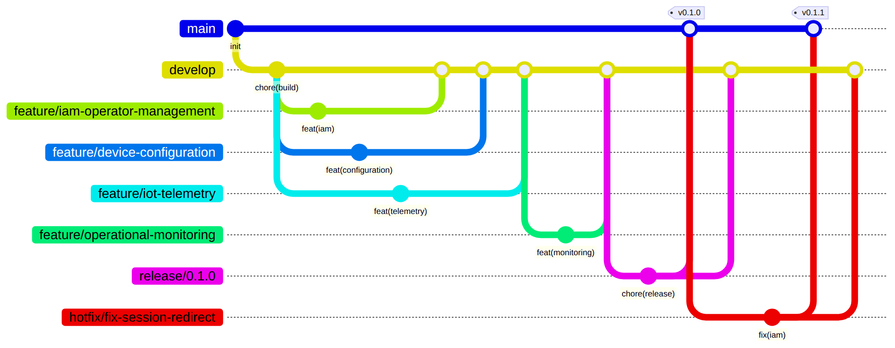
  <br><em>Modelo de ramificación GitFlow de HydroGuard (Mermaid). Los nombres de las ramas feature corresponden al Sprint 1; los commits, las ramas release y hotfix y las etiquetas de versión ilustran la convención de nombres y de integración.</em>
</p>
* **Rama principal (Main branch):** contiene el código publicado. Cada commit que llega a esta rama corresponde a una versión y se etiqueta.
  * Notación: `main`
* **Rama de desarrollo (Develop branch):** acumula las últimas funcionalidades terminadas para la siguiente versión. Funciona como entorno de integración y prueba continua.
  * Debe derivarse de: `main`
  * Notación: `develop`
* **Rama de características (Feature branch):** se utiliza para desarrollar una funcionalidad o un bounded context, de modo que el avance incompleto no afecte la rama de integración. Cada feature tiene su propia rama.
  * Debe derivarse de: `develop`
  * Debe fusionarse de vuelta a: `develop`
  * Notación: `feature/<bounded-context>-<capacidad>`, en minúsculas y en `kebab-case`. Ejemplos del Sprint 1: `feature/iam-operator-management`, `feature/device-configuration`, `feature/iot-telemetry` y `feature/operational-monitoring`.
* **Rama de lanzamiento (Release branch):** prepara una nueva versión; permite correcciones menores y ajustes finales mientras `develop` continúa recibiendo funcionalidades.
  * Debe derivarse de: `develop`
  * Debe fusionarse con: `main` y `develop`
  * Notación: `release/<MAJOR.MINOR.PATCH>`. Ejemplo: `release/0.1.0`.
* **Rama de corrección rápida (Hotfix branch):** corrige un defecto crítico detectado en la versión publicada, sin esperar al siguiente lanzamiento.
  * Debe derivarse de: `main`
  * Debe fusionarse con: `main` y `develop`
  * Notación: `hotfix/<descripcion-corta>`. Ejemplo: `hotfix/fix-session-redirect`.
La integración en `develop` y en `main` se realiza mediante *pull request*. Para ello, la compilación debe finalizar sin errores y, cuando el bounded context cuenta con verificación automatizada, los scripts `verify:bc02` o `verify:bc05` deben aprobarse. Como mejora acordada para el siguiente Sprint, cada pull request recibe la revisión de al menos otro integrante y referencia el identificador del Product Backlog que implementa.
 
**Conventional Commits:**
 
El equipo adopta **Conventional Commits** para estructurar los mensajes de commit de manera estándar y semántica, lo que facilita la comunicación y la generación automática del registro de cambios. Los mensajes se redactan en inglés con el formato `<type>(<scope>): <imperative summary>`.
 
Tipos de commit:
 
* `feat`: nuevas funcionalidades.
* `fix`: correcciones de errores.
* `docs`: cambios o mejoras en la documentación.
* `style`: cambios de formato que no afectan la ejecución.
* `refactor`: mejoras en la estructura o legibilidad del código sin cambiar su comportamiento.
* `test`: adición o modificación de pruebas y scripts de verificación.
* `build` y `ci`: compilación, dependencias e integración continua.
* `chore`: tareas de mantenimiento.
El `scope` identifica el bounded context o el componente: `iam`, `configuration`, `telemetry`, `monitoring`, `layout`, `mock-api`, `build` o `report`. Ejemplos reales del repositorio del frontend:
 
```text
feat(mock-api): add mock routes and seed datasets for operational monitoring (BC-05)
feat(monitoring): implement application use cases and query state management
test(monitoring): add automated verification script and npm script for BC-05
docs(monitoring): add testing and verification guide for BC-05 bounded context
fix(build): resolve app configuration typing and template warnings
```
 
 


### 6.1.3. Source Code Style Guide & Conventions

El equipo utiliza inglés para nombres de archivos, símbolos de programación, contratos, rutas y mensajes de commit. El español se mantiene en el contenido visible para el usuario y en la documentación dirigida a los stakeholders. Se priorizan nombres completos del lenguaje ubicuo; no se emplean abreviaciones ambiguas ni comentarios que repitan literalmente el código.

#### Convenciones comunes

- Los archivos se codifican en UTF-8, terminan con una nueva línea, eliminan espacios finales y usan dos espacios de indentación en TypeScript, HTML, CSS, JSON y Gherkin.
- La longitud recomendada es de 100 caracteres por línea. Se utilizan comillas simples en TypeScript y JavaScript, salvo que el contenido requiera otra forma.
- Cada bounded context organiza sus responsabilidades en `domain`, `application`, `infrastructure` y `presentation`. Las dependencias apuntan hacia el dominio mediante puertos; los detalles HTTP, almacenamiento y framework permanecen en infraestructura o presentación.
- Las clases, funciones y módulos tienen una sola responsabilidad. Los valores repetidos o relevantes para el dominio se extraen como constantes o tokens; se evitan números mágicos.
- Los comentarios explican decisiones, restricciones o motivos. Las reglas de negocio se expresan en código y pruebas con nombres legibles.
- Los datos sensibles, secretos y direcciones dependientes del ambiente no se incluyen en el repositorio. Se suministran mediante variables de entorno y archivos de configuración ignorados por Git.

#### TypeScript y Angular

Se siguen la guía oficial de Angular y las convenciones de Google para TypeScript, ajustadas a la arquitectura del producto:

- Los archivos usan `kebab-case` y un sufijo que expresa su rol: `monitoring-dashboard.page.ts`, `get-operational-alerts.use-case.ts`, `monitoring.repository.ts` o `monitoring.dto.ts`.
- Componentes, clases, interfaces, tipos y enumeraciones usan `PascalCase`; funciones, variables, propiedades y métodos usan `camelCase`; las constantes globales usan `UPPER_SNAKE_CASE` cuando son valores inmutables del sistema.
- Se mantiene el modo estricto de TypeScript. No se utiliza `any`; ante datos aún no validados se usa `unknown` y se realiza un estrechamiento explícito.
- Se prefieren componentes standalone, propiedades `readonly`, inyección de dependencias y composición. Los componentes de presentación delegan la obtención y transformación de datos a casos de uso y repositorios.
- Los estados asíncronos distinguen carga, datos, vacío y error. Las suscripciones o efectos deben finalizar con el ciclo de vida correspondiente.
- Los imports se agrupan en framework, dependencias externas y módulos internos. No se accede a una capa interna atravesando rutas privadas de otro bounded context.

#### HTML y CSS

El HTML utiliza elementos semánticos (`header`, `nav`, `main`, `section`, `table`, `button`) y atributos accesibles cuando el significado no puede inferirse del elemento nativo. Cada campo tiene una etiqueta asociada, cada imagen un texto alternativo apropiado y cada botón un nombre comprensible fuera de contexto. No se agregan estilos en línea.

Las clases CSS usan `kebab-case` y describen función, no apariencia circunstancial. Los colores, espacios, radios y sombras se consumen desde propiedades personalizadas. Se trabaja desde una base responsiva y se introducen puntos de quiebre solo cuando el contenido lo exige. Se evitan selectores por identificador y `!important`; cualquier excepción necesaria para adaptar un componente de Angular Material debe permanecer localizada y documentada.

#### JavaScript, JSON y API REST

Los scripts auxiliares y el mock server utilizan módulos ECMAScript (`.mjs`), `const` por defecto, `let` únicamente para reasignación y `async/await` para operaciones asíncronas. Las propiedades JSON se escriben en `lowerCamelCase`; las fechas viajan en ISO 8601 y las unidades forman parte del contrato o del nombre cuando existe ambigüedad. Las rutas REST usan sustantivos plurales en minúsculas, segmentos con guion y versionado `/api/v1`. Los códigos HTTP y el cuerpo de error mantienen un contrato uniforme y no exponen trazas internas.

#### Java/Spring y software embebido

El backend sigue Google Java Style: paquetes en minúsculas, tipos en `PascalCase`, miembros en `lowerCamelCase`, constantes en `UPPER_SNAKE_CASE` y cuatro espacios de indentación. Los sufijos `Controller`, `Service`, `Repository`, `Resource` y `Assembler` hacen explícito el rol. Los controladores traducen HTTP, los servicios coordinan casos de uso y las entidades no dependen del framework web.

En C/C++ para el dispositivo, los nombres técnicos permanecen en inglés, las constantes y pines usan `UPPER_SNAKE_CASE`, se declaran unidades y rangos, y se evita memoria dinámica innecesaria. Las operaciones de red tienen timeout y reintentos acotados. El control de válvula y las transiciones de seguridad se encapsulan, se prueban y se documentan con la razón de su comportamiento fail-safe.

#### Gherkin, pruebas y commits

Los archivos Gherkin usan nombres en `kebab-case` y las palabras clave `Feature`, `Scenario`, `Given`, `When` y `Then`. Cada escenario describe un comportamiento observable y evita detalles de implementación. Las pruebas unitarias siguen el patrón Arrange–Act–Assert; su nombre indica condición y resultado esperado.

Los commits siguen **Conventional Commits**:

```text
<type>(<scope>): <imperative summary>
```


Los tipos aceptados incluyen `feat`, `fix`, `docs`, `test`, `refactor`, `style`, `build`, `ci` y `chore`. El `scope` identifica el bounded context o componente, por ejemplo `monitoring`, `configuration`, `iam` o `report`. Ejemplos reales del desarrollo son `feat(monitoring): implement monitoring dashboard and operational alerts pages`, `test(monitoring): add bounded context verification script` y `fix(build): resolve app configuration typing and template warnings`. Antes de integrar una rama se ejecutan el formateador, la compilación y las verificaciones específicas del bounded context.

### 6.1.4. Software Deployment Configuration

Esta sección reúne la configuración necesaria para publicar los productos incluidos en el alcance actual de TB1: el Landing Page en GitHub Pages, la aplicación web Angular del Administrador en Vercel y el Mock API en Render. La aplicación web debe consumir la URL pública del servicio mediante configuración de entorno, sin incorporar direcciones dependientes del despliegue directamente en el código fuente.

**Deployment Landing Page:**
La Landing Page de HydroGuard se publica en GitHub Pages desde la rama `main` y la carpeta raíz del repositorio.

Se crea el repositorio de GitHub para alojar los archivos fuente de la Landing Page, `index.html`, `styles.css` y `script.js`.

<p align="center">
  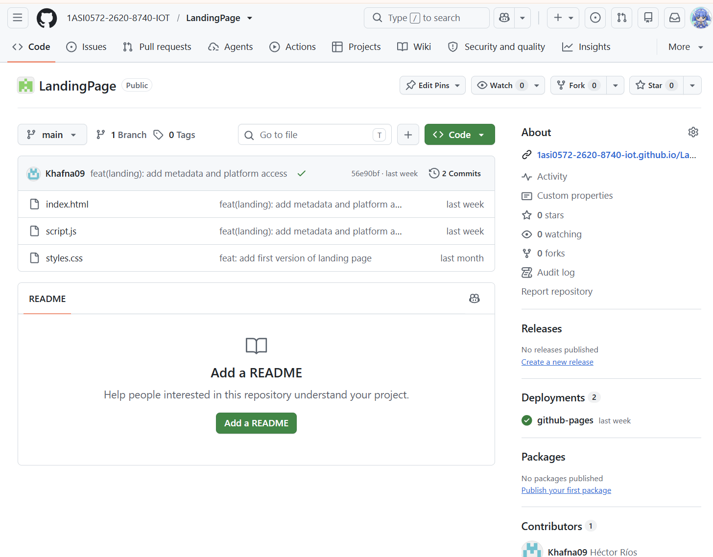
</p>
<p align="center"><em>Repositorio fuente: aquí se aloja el código; todavía no es la vista del sitio publicado.</em></p>

Se habilita GitHub Pages seleccionando la rama `main` y la carpeta raíz (`/`). La captura muestra además la URL asignada y el estado de publicación.

<p align="center">
  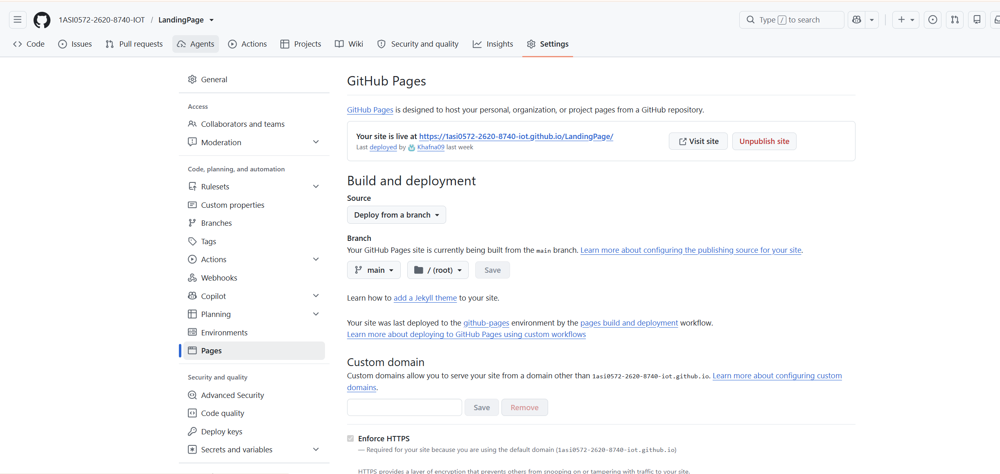
</p>
<p align="center"><em>Configuración de Pages: fuente seleccionada y enlace al sitio publicado.</em></p>

Finalmente, se comprueba el resultado abriendo [la Landing Page desplegada](https://1asi0572-2620-8740-iot.github.io/LandingPage/). Esta captura corresponde al sitio visible para los visitantes, no al repositorio ni a su configuración.

<p align="center">
  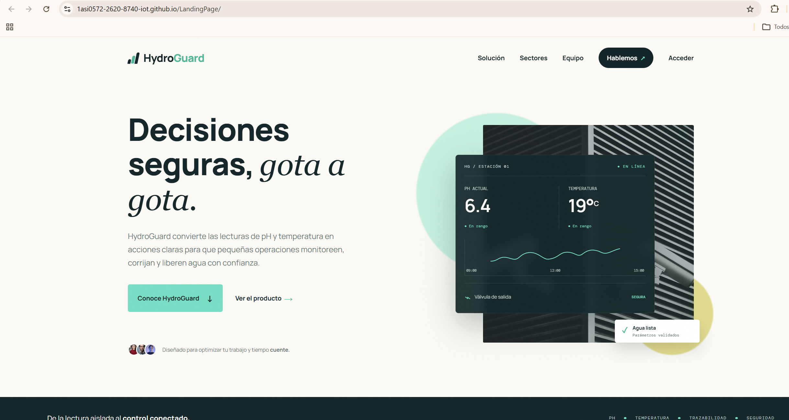
</p>
<p align="center"><em>Resultado del despliegue: Landing Page abierta desde su URL pública.</em></p>

El diagrama C4 resume este despliegue: el repositorio activa el workflow de GitHub Actions, que publica el sitio estático en GitHub Pages; los visitantes acceden mediante HTTPS.

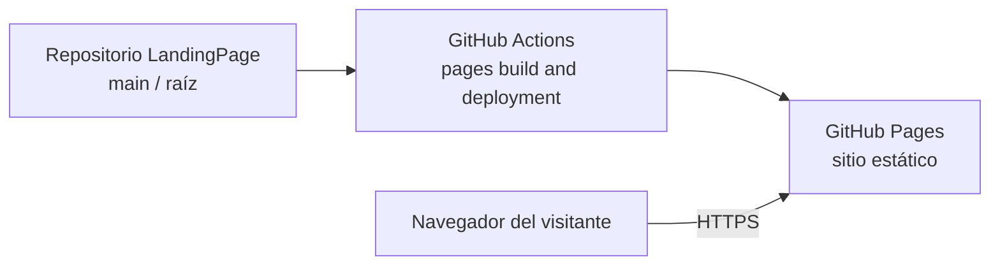

#### Frontend Web Applications

**Deployment Frontend Web Application:**

El repositorio `hydroguard-admin-web-frontend` contiene `vercel.json`, que ejecuta `npm run build` y publica `dist/hydroguard-admin-web-frontend/browser`. La primera regla reenvía las solicitudes `/api/:path*` hacia `https://hydroguard-mock-api-8740.onrender.com/api/:path*`; de esta manera, Angular conserva una URL relativa `/api` y no acopla sus repositorios Axios al dominio del servidor temporal. La segunda regla reescribe las demás rutas hacia `/index.html`, lo que permite abrir directamente direcciones como `/users`, `/telemetry` o `/treatments` sin recibir un error 404 del servidor estático.

El procedimiento de publicación y verificación en Vercel se desarrolla mediante los siguientes pasos:

Se conecta el repositorio `hydroguard-admin-web-frontend` desde la organización de GitHub en Vercel.

<p align="center">
  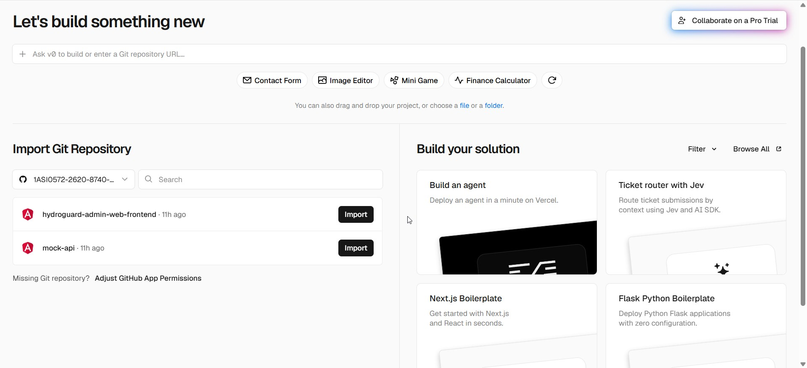
</p>
<p align="center"><em>Paso 1: Selección e importación del repositorio del frontend desde la organización de GitHub.</em></p>

Se configura el proyecto estableciendo el preset de framework en Angular, el directorio raíz (`./`) y los parámetros de compilación.

<p align="center">
  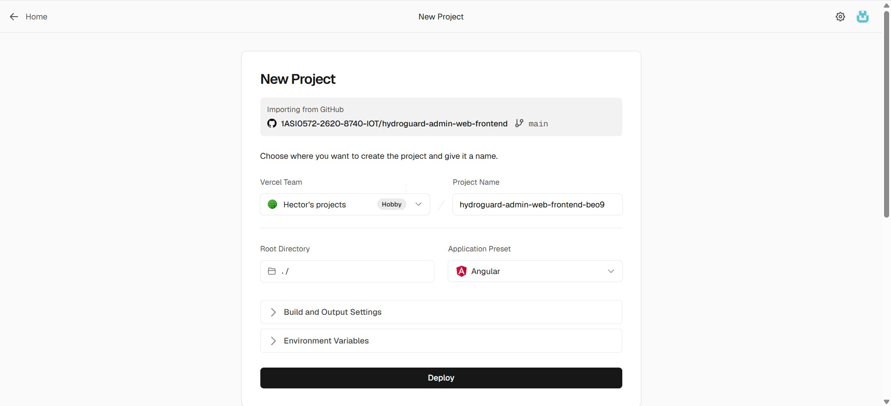
</p>
<p align="center"><em>Paso 2: Configuración del proyecto seleccionando el preset Angular y directorio raíz.</em></p>

Vercel compila y despliega en producción desde la rama `develop`, asignando la URL pública <https://hydroguard-admin-web-frontend.vercel.app/> con estado *Ready*.

<p align="center">
  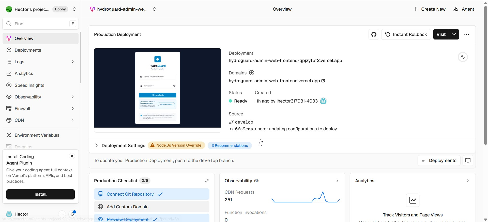
</p>
<p align="center"><em>Paso 3: Despliegue en producción completado con estado Ready desde la rama develop.</em></p>

Se comprueba la disponibilidad del frontend accediendo directamente a la pantalla de inicio de sesión (`/login`).

<p align="center">
  
</p>
<p align="center"><em>Paso 4: Comprobación de la aplicación web administrativa en funcionamiento desde su dominio público.</em></p>

**Deployment Mock API:**

El repositorio `mock-api` incluye `render.yaml` para crear un Web Service gratuito denominado `hydroguard-mock-api-8740`. Render ejecuta `npm ci` durante la construcción y `npm run mock:api` para iniciar el servidor con Node.js 22. El proceso escucha en el valor de `PORT` suministrado por Render y utiliza `HOST=0.0.0.0`, por lo que puede recibir solicitudes externas.

El procedimiento de despliegue en Render mediante Blueprints se realiza siguiendo estos pasos:

Se vincula el repositorio `1ASI0572-2620-8740-IOT/mock-api` en el asistente de creación de Blueprint de Render.

<p align="center">
  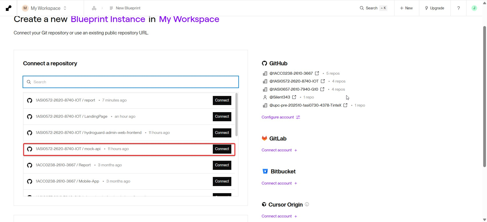
</p>
<p align="center"><em>Paso 1: Vinculación del repositorio mock-api en el asistente de Blueprint de Render.</em></p>

Se declara el servicio web a partir del archivo de especificación `render.yaml` ubicado en la rama `master`.

<p align="center">
  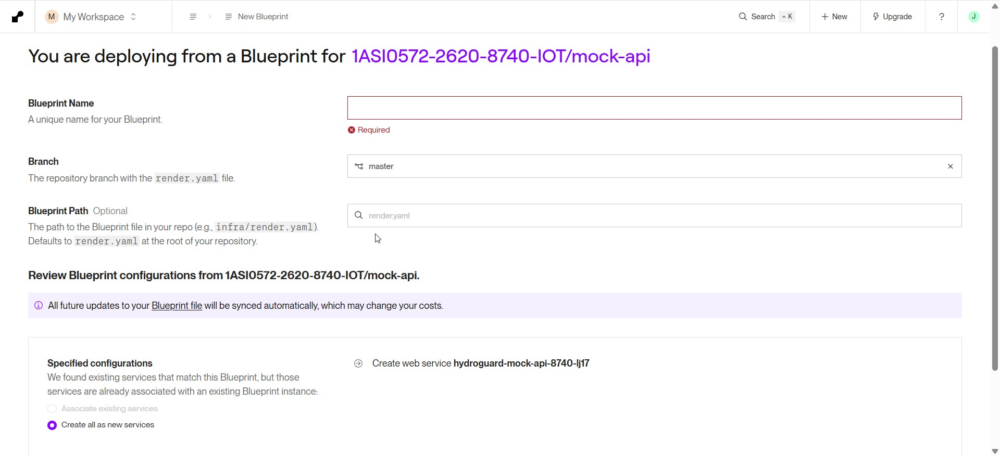
</p>
<p align="center"><em>Paso 2: Configuración del Blueprint a partir de render.yaml sobre la rama master.</em></p>

Render finaliza la construcción e inicialización del Web Service con estado *Live*, publicando el endpoint HTTPS <https://hydroguard-mock-api-8740.onrender.com>.

<p align="center">
  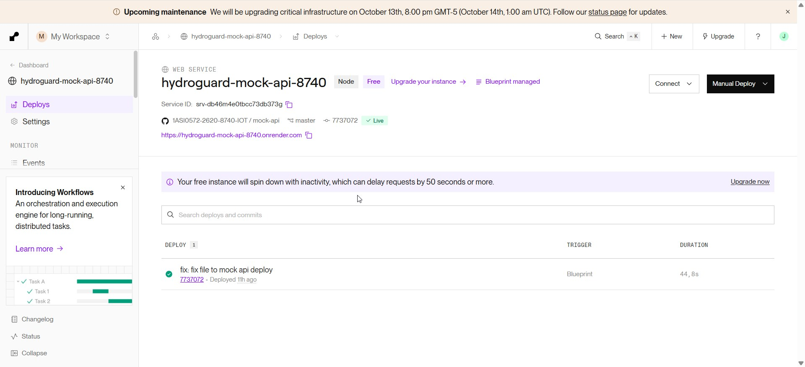
</p>
<p align="center"><em>Paso 3: Despliegue del servicio web con estado Live y asignación de la URL HTTPS.</em></p>

Se valida la sincronización y disponibilidad del recurso `hydroguard-mock-api-8740` en el panel de Blueprint.

<p align="center">
  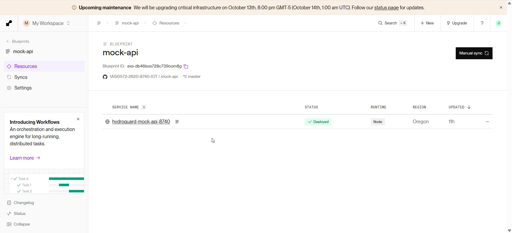
</p>
<p align="center"><em>Paso 4: Verificación del recurso web desplegado y activo en la región asignada.</em></p>

El endpoint `GET /api/v1/health` permite comprobar que el servicio se encuentra disponible y devuelve el estado del servidor y la URL base calculada. El Mock API acepta los métodos `GET`, `POST`, `PATCH` y `OPTIONS`, junto con los encabezados `Content-Type`, `Authorization` y `X-Correlation-Id`. Para el prototipo académico se permite CORS; en el backend real deberá restringirse a los orígenes autorizados.

El archivo `db.json` se almacena en el sistema de archivos efímero del plan gratuito. Por ello, los datos vuelven a su semilla después de un reinicio o nuevo despliegue. Este comportamiento es útil para repetir la demostración desde un estado conocido, pero no representa una estrategia de persistencia productiva.


## 6.2. Landing Page, Services & Applications Implementation
Esta sección detalla la ejecución técnica y colaborativa del desarrollo de HydroGuard. Se documentan las ceremonias, el diseño técnico y las evidencias de código que transforman los requisitos y modelos de arquitectura en componentes de software desplegables, estructurados de manera iterativa por *Sprints*.

### 6.2.1. Sprint 1

#### 6.2.1.1. Sprint Planning 1

En esta sesión, el equipo acordó orientar el Sprint 1 a construir el primer incremento visible de HydroGuard: publicar el *Landing Page* y desarrollar la base de la aplicación web para el Administrador. El alcance técnico se organizó en torno a los bounded contexts de acceso administrativo, configuración de dispositivos, telemetría y monitoreo operativo. La arquitectura y los contratos entre componentes se trabajaron como base para la integración progresiva; no se considera que esto demuestre por sí solo una integración funcional de extremo a extremo con el backend o la aplicación móvil.

| **Sprint #** | Sprint 1 |
|:--|:--|
| **Sprint Planning Background** | |
| Date | 2026-09-01 |
| Time | 11:00 AM |
| Location | Servidor del equipo en Discord |
| Prepared By | Santur Tello, Andrea Elizabeth |
| Attendees (to planning meeting) | Gomez Hurtado, Miguel Angel / Rodriguez Macedo, Sebastian / Santur Tello, Andrea Elizabeth / Prieto Mantari, Leonardo Fabrizzio Junior / Rios Pacheco, Hector Javier / Olivera Barzola, Eric Marlon |
| Sprint 0 Review Summary | No aplica: el Sprint 1 es el primer Sprint del proyecto. |
| Sprint 0 Retrospective Summary | No aplica: el Sprint 1 es el primer Sprint del proyecto. |
| **Sprint Goal & User Stories** | |
| Sprint 1 Goal | **Nuestro enfoque** es publicar el *Landing Page* de HydroGuard y desarrollar las principales vistas de la aplicación web del Administrador con Mock API para gestionar accesos, operarios y dispositivos, y consultar telemetría e incidencias.<br><br>**Creemos que** este primer incremento permitirá presentar la solución y validar la experiencia web antes de completar la integración con los servicios reales.<br><br>**Esto se confirmará cuando** el sitio esté publicado, las vistas administrativas implementadas puedan recorrerse y el frontend compile correctamente. |
| Sprint 1 Velocity | Pendiente de conciliación mediante aceptación de historias completas. Los 47 SP corresponden al compromiso planificado, no a velocidad acreditada por cerrar tareas frontend/mock. No se asigna velocidad a historias parcialmente aceptadas. |
| Sum of Story Points | 47 Story Points, correspondientes a las User Stories incluidas en el Sprint Backlog y estimadas en el Product Backlog. |

#### 6.2.1.2. Aspect Leaders and Collaborators

La matriz LACX identifica quién lidera (**L**) y quién colabora (**C**) en cada aspecto transversal o funcional. El liderazgo no implica propiedad exclusiva: la persona líder mantiene la coherencia del aspecto, coordina decisiones e integra los aportes; los colaboradores revisan, implementan dependencias y aportan evidencia. La asignación se deriva de las ramas, commits y entregables realizados hasta el 3 de octubre de 2026.

| Integrante / GitHub | IAM y acceso administrativo | Configuración de dispositivos | Telemetría IoT | Monitoreo y trazabilidad | UX/UI y estándares | Arquitectura e informe |
|:--|:--:|:--:|:--:|:--:|:--:|:--:|
| Gomez Hurtado, Miguel Angel (`Miguel26112001`) | C | C | C | C | C | L |
| Rodriguez Macedo, Sebastian (`Shiftinnnnn`) | C | L | C | C | C | L |
| Santur Tello, Andrea Elizabeth (`andreli-star`) | C | C | L | C | C | C |
| Prieto Mantari, Leonardo Fabrizzio Junior (`leitojunior36`) | C | C | C | L | L | C |
| Rios Pacheco, Hector Javier (`Khafna09`) | L | C | C | C | C | C |
| Olivera Barzola, Eric Marlon (`EricMOB-afk`) | C | C | C | C | C | L |

La matriz refleja la división por bounded contexts aplicada en el frontend: Hector lideró IAM y la estructura administrativa; Sebastian, Device and Operational Configuration; Andrea, IoT Telemetry; y Leonardo, Operational Monitoring and Traceability. Miguel, Sebastian y Eric sostuvieron entregables de modelado, arquitectura y documentación. UX/UI es transversal, pero Leonardo lidera su formalización para esta entrega al convertir los patrones ya implementados en una guía verificable.

#### 6.2.1.3. Sprint Backlog 1

El Sprint Backlog 1 reúne las historias seleccionadas para el primer incremento de HydroGuard: el *Landing Page*, la aplicación web del Administrador y las tareas transversales de desarrollo y verificación. Al corte del **9 de octubre de 2026**, se registran **17 User Stories seleccionadas, 47 Story Points y 29 Work-items con una estimación total de 118 horas**. El cierre documentado de T-01 a T-29 corresponde a las interfaces, los flujos administrativos y las verificaciones del incremento web, utilizando una API mock cuando se requieren servicios.

**Criterio de lectura del estado:** `Done` en este Sprint Backlog significa que se completó la tarea comprometida para el incremento web/mock. No significa que estén cumplidos todos los criterios de aceptación de la historia integral ni que exista integración de extremo a extremo con Flutter, backend productivo, base de datos persistente o dispositivos IoT. En particular, US-11 conserva su objetivo de monitoreo para el Operario: la vista administrativa y el heartbeat simulado son un avance, no una demostración de monitoreo móvil en tiempo real. US-37 tiene terminada la interfaz, pero todavía no envía ni registra solicitudes reales.

**Sprint #:** Sprint 1

**Tablero de Trello actualizado:** [Hydroguard — Sprint 1 y Product Backlog](https://trello.com/b/6aafc8a787b6bbbecd455184).

Se reorganizaron las tarjetas originales sin duplicar las US seleccionadas. Cada tarjeta del Sprint 1 conserva la historia y registra sus Story Points, tareas, responsables, alcance entregado, límites y referencias a las evidencias del informe. US-39 se alineó con la definición vigente de asignación automática de rol según el flujo de alta. También se incorporó TS-13, que ya figuraba en el Product Backlog del informe pero faltaba en el tablero.

- **Sprint 1 — Done Landing:** US-34, US-35, US-36, US-37 y US-38; **10 SP**, T-01 a T-06 y **16 horas** estimadas. US-37 mantiene pendiente el envío y registro real de solicitudes.
- **Sprint 1 — Done Web / API mock:** US-01, US-02, US-39, US-03, US-04, US-05, US-10, US-11, US-27, US-25, US-24 y US-30; **37 SP**, T-07 a T-25 y **81 horas** estimadas, con integración real pendiente.
- **Pendiente — Integración posterior:** una tarjeta de resumen del Sprint 1 y seis tarjetas de brechas P01–P06. El resumen incluye las cuatro tareas transversales T-26 a T-29 (**21 horas** estimadas), que no agregan Story Points independientes. Las brechas no se incorporan retroactivamente a las 29 tareas del Sprint 1.
- **Product Backlog — Próximos sprints:** **36 historias no seleccionadas** para este incremento: 23 US y 13 TS. Se mantienen para planificación posterior; no se presentan como tareas comprometidas e incumplidas del Sprint 1.

**Capturas del tablero al corte de la revisión:**

<p align="center">
  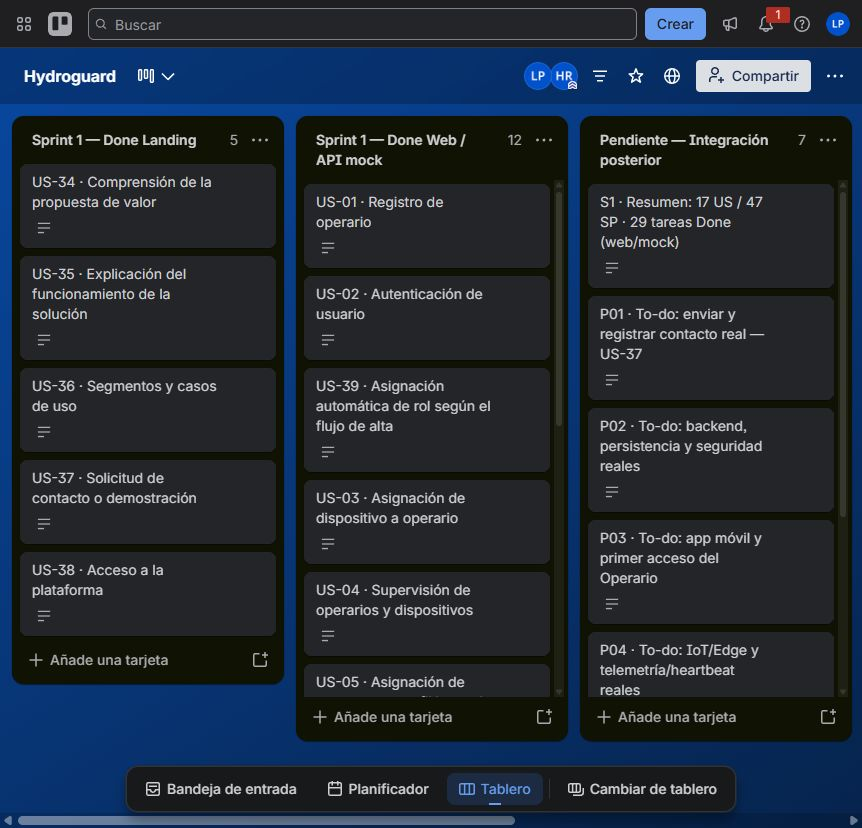
</p>
<p align="center"><em>Vista inicial: selección del Sprint 1, alcance Done y primeras brechas pendientes. Los contadores 5 y 12 corresponden a las 17 US; la tercera lista contiene un resumen y seis pendientes.</em></p>

<p align="center">
  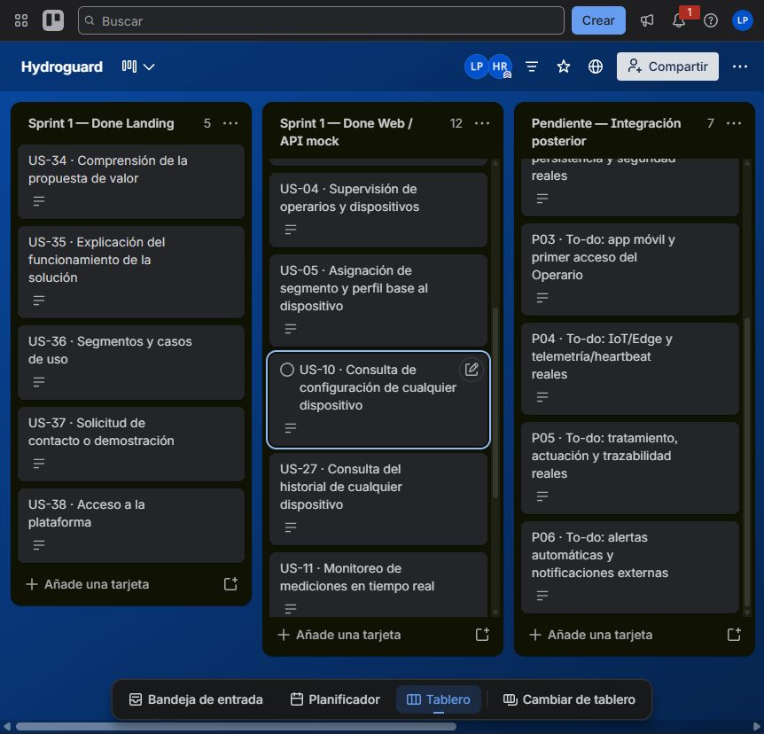
</p>
<p align="center"><em>Continuación de las historias Web: supervisión, segmento y perfil base, consulta de configuración e historial.</em></p>

<p align="center">
  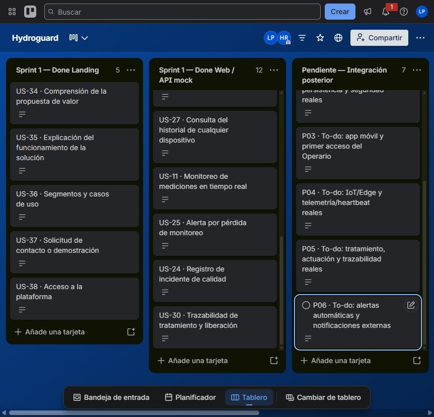
</p>
<p align="center"><em>Parte inferior de las listas: telemetría, alertas, incidentes y trazabilidad, junto con las brechas de integración. Las tres capturas son vistas complementarias del mismo tablero, no tres backlogs distintos.</em></p>

**Historias seleccionadas y resultado del incremento:**

La columna «Entregado» describe las tareas cerradas en este Sprint; la columna «Pendiente» identifica lo que impide afirmar el cierre integral de la historia. Los SP son los del Product Backlog y suman 47, no una medición de funcionalidades productivas completamente aceptadas.

| User Story / tarjeta | SP | Entregado en Sprint 1 | Pendiente o límite del alcance |
|:--|:--:|:--|:--|
| [US-34 — Comprensión de la propuesta de valor](https://trello.com/c/AMUu8UFa) | 2 | Hero, propuesta de valor y tokens de estilo del Landing Page publicados; T-01 y T-02. | Sin pendiente identificado para el alcance informativo de estas tareas. |
| [US-35 — Explicación del funcionamiento de la solución](https://trello.com/c/SmiIyCAz) | 2 | Sección que explica el funcionamiento de la solución; T-03. | La explicación publicada no demuestra la ejecución física del proceso. |
| [US-36 — Segmentos y casos de uso](https://trello.com/c/RCzT9SOw) | 2 | Sección de casos de uso textiles e hidropónicos; T-04. | Sin pendiente identificado para el alcance informativo de esta tarea. |
| [US-37 — Solicitud de contacto o demostración](https://trello.com/c/FGUUsKI8) | 3 | Formulario, validación de campos y mensaje informativo; T-05. | Enviar y registrar solicitudes reales. El código actual indica que el formulario aún no realiza envíos. |
| [US-38 — Acceso a la plataforma](https://trello.com/c/4j1xk9C4) | 1 | Los tres accesos del Landing Page conducen al [login desplegado](https://hydroguard-admin-web-frontend.vercel.app/login); T-06 y commit `d764e49`. | Sin pendiente identificado para la navegación Landing → Web del Sprint 1. |
| [US-01 — Registro de operario](https://trello.com/c/3uHkp6es) | 2 | Alta de cuenta y generación, consulta y revocación del código de primer acceso desde la Web; T-07 a T-09. | Consumo del código desde móvil y persistencia/autenticación en servicios reales. |
| [US-02 — Autenticación de usuario](https://trello.com/c/Vsvu25oN) | 3 | Login del Administrador, sesión, guard de rutas y cierre de sesión con API mock; T-10 y T-11. | Autenticación del Operario móvil y validación segura de sesiones en backend productivo. |
| [US-39 — Asignación automática de rol según el flujo de alta](https://trello.com/c/yIDZVP4X) | 2 | Registro de empresa y su única cuenta Administradora, sin selección manual de roles; T-12. | Persistencia y autorización de roles en backend real. No se contempla añadir un segundo Administrador. |
| [US-03 — Asignación de dispositivo a operario](https://trello.com/c/6FqbJTDZ) | 2 | Perfiles por grupo, asignación de pares reservorio-dispositivo y cierre con historial; T-13. | Aplicar las restricciones del Operario desde móvil y backend real. |
| [US-04 — Supervisión de operarios y dispositivos](https://trello.com/c/MdNu9vZr) | 3 | Listados, detalles, filtros, estados y asignaciones vigentes; T-14 y T-15. | Alimentar disponibilidad y estados desde servicios y dispositivos reales. |
| [US-05 — Asignación de segmento y perfil base al dispositivo](https://trello.com/c/tbeYxbE4) | 3 | Grupos por segmento, reservorios, alta y vinculación de dispositivos; T-16 y T-17. | Aplicación del perfil base y sincronización de configuración con el dispositivo real. |
| [US-10 — Consulta de configuración de cualquier dispositivo](https://trello.com/c/W3MDbfEj) | 2 | Consulta de configuración vigente e historial de versiones con datos mock; T-18. | Publicación desde móvil y sincronización real; la vista no prueba el envío de parámetros al hardware. |
| [US-11 — Monitoreo de mediciones en tiempo real](https://trello.com/c/3YUuAmSn) | 3 | Vista administrativa de última medición y cálculo simulado de disponibilidad; T-19 y T-20. | Monitoreo del Operario móvil, adquisición IoT e ingesta Edge con mediciones reales. |
| [US-27 — Consulta del historial de cualquier dispositivo](https://trello.com/c/A9S55F2b) | 3 | Historial por dispositivo con paginación y ordenamiento; T-21. | Almacenamiento y consulta persistente de mediciones reales. |
| [US-25 — Alerta por pérdida de monitoreo](https://trello.com/c/D2AqioST) | 3 | Dashboard y consulta/gestión de alertas con estados simulados; T-22 y T-23. | Detección automática por heartbeat real y notificaciones externas. |
| [US-24 — Registro de incidente de calidad](https://trello.com/c/Qc8r6jY7) | 3 | Registro, consulta y cierre de incidentes con API mock; T-24. | Persistencia y correlación con mediciones/incidentes reales en backend productivo. |
| [US-30 — Trazabilidad de tratamiento y liberación](https://trello.com/c/xlK3l0sH) | 8 | Consulta de eventos correlacionados por dispositivo/periodo y reporte CSV sencillo con datos mock; T-25. | Eventos reales de evaluación, corrección y liberación e integración del motor de tratamiento y la actuación física. |

**Trabajo no completado en la solución integral:**

Las siguientes brechas se registraron como **To-do al cierre del Sprint 1**. Su ejecución y estado posterior se siguen en Sprint 2; esta relación es una fotografía histórica, no una lista actualizada de todo lo que falta hoy. No representan seis nuevas US ni tareas originalmente estimadas en las 118 horas; se descompondrán y estimarán al planificar la integración posterior.

1. [P01 — Contacto real](https://trello.com/c/t6jFn5Qe): enviar y registrar solicitudes válidas de US-37 y demostrar su recepción. La validación visual ya está implementada.
2. [P02 — Backend, persistencia y seguridad](https://trello.com/c/HcNBnvKY): sustituir los contratos mock por servicios y base de datos reales, verificando autenticación, autorización y aislamiento por empresa. Afecta IAM, configuración, incidentes e historial.
3. [P03 — Aplicación móvil y primer acceso](https://trello.com/c/tpDa0mvm): consumir el código desde Flutter, autenticar al Operario y restringir el monitoreo y las consultas a sus dispositivos asignados; relacionadas US-01, US-02, US-11, US-12, US-26 y US-33.
4. [P04 — Integración IoT/Edge y telemetría](https://trello.com/c/jMSHCfTv): adquirir, validar e ingresar mediciones y heartbeat del dispositivo/prototipo o simulador; demostrar historial y detección real de pérdida de comunicación. Relacionadas US-11, US-25 y US-27, y las TS de identidad, adquisición, ingesta y disponibilidad.
5. [P05 — Tratamiento y actuación](https://trello.com/c/KTbOLYEI): integrar evaluación, corrección, sincronización de parámetros, ejecución/confirmación de comandos, liberación y parada de emergencia. La supervisión web y los eventos mock no prueban actuación sobre hardware; relacionadas US-06 a US-10, US-13 a US-21, US-30, US-40 y TS-05, TS-07, TS-08 y TS-13.
6. [P06 — Alertas y notificaciones](https://trello.com/c/w8UXdUIb): generar alertas a partir de condiciones reales y comprobar el envío mediante un servicio externo; relacionadas US-22, US-23, US-25, US-32, TS-10 y TS-11.

**Historias no seleccionadas para Sprint 1:** US-06, US-07, US-08, US-09, US-12, US-13, US-14, US-15, US-16, US-17, US-18, US-19, US-20, US-21, US-22, US-23, US-26, US-28, US-29, US-31, US-32, US-33 y US-40, más TS-01 a TS-13. Permanecen en el Product Backlog para planificación posterior. Esto no implica ausencia absoluta de avances auxiliares: por ejemplo, la Web ya permite gestionar alertas y descargar un CSV sencillo, pero no se declara la aceptación integral de US-32, US-28 o US-29 dentro de este Sprint.

El alcance se contrastó con los commits de [Development Evidence](#6214-development-evidence-for-sprint-review), las verificaciones de [Testing Suite Evidence](#6215-testing-suite-evidence-for-sprint-review), las capturas de [Execution Evidence](#6216-execution-evidence-for-sprint-review) y el estado de [Software Deployment Evidence](#6218-software-deployment-evidence-for-sprint-review). Los límites de integración se apoyan también en la [guía de pruebas manuales del frontend](https://github.com/1ASI0572-2620-8740-IOT/hydroguard-admin-web-frontend/blob/develop/docs/guia-pruebas-manuales-integrales.md); el pendiente de contacto se observa en [script.js del Landing Page](https://github.com/1ASI0572-2620-8740-IOT/LandingPage/blob/main/script.js).

**Descomposición corregida del incremento frontend/mock**

La siguiente tabla es una **reformulación documental retrospectiva**, no una planificación original ni un registro de horas consumidas. Cada una de las 17 US se descompone en dos tareas de cuatro horas; las cuatro tareas transversales se estiman entre cuatro y seis horas. Son **38 tareas y 158 horas reestimadas**: 136 horas vinculadas a historias y 22 transversales. Las estimaciones originales de 29 tareas y 118 horas se conservan debajo para trazabilidad y no se suman a esta reformulación.

Los identificadores `S1-Rxx` y `S1-Xxx` permiten relacionar el desglose corregido con T-01 a T-29 sin reutilizar los identificadores T-30 en adelante del Sprint 2. Cuando dos tareas proceden de un mismo Work-item, separan aspectos de su alcance ya documentado; no representan dos ejecuciones nuevas del trabajo.

El estado `ToReview` identifica la conciliación de esta descomposición, responsables y estimaciones con la evidencia histórica y el tablero. **No significa que el frontend entregado haya dejado de funcionar ni que las nuevas estimaciones hayan sido aprobadas durante la planificación original.** No se inventan fechas, transiciones de Trello ni pruebas realizadas. Los responsables se conservan según las tareas fuente y deben confirmar la reformulación antes de actualizar el tablero.

| Story Id | Story Title | Task Id | Task Title | Task Description | Estimation (Hours) | Assigned To | Status (To-do / InProcess / ToReview / Done) |
|:--|:--|:--|:--|:--|:--:|:--|:--|
| US-34 | Comprensión de la propuesta de valor | S1-R01 | Maquetar propuesta de valor y sección principal | Desglose del alcance frontend/informativo de T-01; no incluye implementación backend, móvil ni actuación IoT. | 4 | Rios Pacheco, Hector Javier | ToReview |
| US-34 | Comprensión de la propuesta de valor | S1-R02 | Aplicar estilos y jerarquía al contenido principal | Desglose del alcance frontend/informativo de T-02; no incluye implementación backend, móvil ni actuación IoT. | 4 | Rios Pacheco, Hector Javier | ToReview |
| US-35 | Explicación del funcionamiento de la solución | S1-R03 | Estructurar el contenido del funcionamiento | Desglose del alcance frontend/informativo de T-03; no incluye implementación backend, móvil ni actuación IoT. | 4 | Rios Pacheco, Hector Javier | ToReview |
| US-35 | Explicación del funcionamiento de la solución | S1-R04 | Maquetar el recorrido visual de funcionamiento | Desglose del alcance frontend/informativo de T-03; no incluye implementación backend, móvil ni actuación IoT. | 4 | Rios Pacheco, Hector Javier | ToReview |
| US-36 | Segmentos y casos de uso | S1-R05 | Estructurar contenido textil e hidropónico | Desglose del alcance frontend/informativo de T-04; no incluye implementación backend, móvil ni actuación IoT. | 4 | Rios Pacheco, Hector Javier | ToReview |
| US-36 | Segmentos y casos de uso | S1-R06 | Maquetar los bloques de segmentos y beneficios | Desglose del alcance frontend/informativo de T-04; no incluye implementación backend, móvil ni actuación IoT. | 4 | Rios Pacheco, Hector Javier | ToReview |
| US-37 | Solicitud de contacto o demostración | S1-R07 | Maquetar formulario de contacto sin servicio de envío | Desglose del alcance frontend/informativo de T-05; no incluye implementación backend, móvil ni actuación IoT. | 4 | Rios Pacheco, Hector Javier | ToReview |
| US-37 | Solicitud de contacto o demostración | S1-R08 | Implementar validaciones y aviso de envío no disponible | Desglose del alcance frontend/informativo de T-05; no incluye implementación backend, móvil ni actuación IoT. | 4 | Rios Pacheco, Hector Javier | ToReview |
| US-38 | Acceso a la plataforma | S1-R09 | Implementar CTA de ingreso a la web administrativa | Desglose del alcance frontend/informativo de T-06; no incluye implementación backend, móvil ni actuación IoT. | 4 | Rios Pacheco, Hector Javier | ToReview |
| US-38 | Acceso a la plataforma | S1-R10 | Unificar los destinos de acceso de la landing | Desglose del alcance frontend/informativo de T-06; no incluye implementación backend, móvil ni actuación IoT. | 4 | Rios Pacheco, Hector Javier | ToReview |
| US-01 | Registro de operario | S1-R11 | Implementar formulario y caso de uso frontend de alta con Mock API | Desglose del alcance frontend/informativo de T-07 y T-08; no incluye implementación backend, móvil ni actuación IoT. | 4 | Rios Pacheco, Hector Javier | ToReview |
| US-01 | Registro de operario | S1-R12 | Implementar gestión web del código de primer acceso con Mock API | Desglose del alcance frontend/informativo de T-09; no incluye implementación backend, móvil ni actuación IoT. | 4 | Rios Pacheco, Hector Javier | ToReview |
| US-02 | Autenticación de usuario | S1-R13 | Implementar login administrativo y sesión con Mock API | Desglose del alcance frontend/informativo de T-10; no incluye implementación backend, móvil ni actuación IoT. | 4 | Rios Pacheco, Hector Javier | ToReview |
| US-02 | Autenticación de usuario | S1-R14 | Implementar guards de navegación y cierre local de sesión | Desglose del alcance frontend/informativo de T-11; no incluye implementación backend, móvil ni actuación IoT. | 4 | Rios Pacheco, Hector Javier | ToReview |
| US-39 | Asignación automática de rol según el flujo de alta | S1-R15 | Implementar formulario frontend de empresa y Administrador con Mock API | Desglose del alcance frontend/informativo de T-12; no incluye implementación backend, móvil ni actuación IoT. | 4 | Rios Pacheco, Hector Javier | ToReview |
| US-39 | Asignación automática de rol según el flujo de alta | S1-R16 | Integrar el alta mock sin selector manual de rol | Desglose del alcance frontend/informativo de T-12; no incluye implementación backend, móvil ni actuación IoT. | 4 | Rios Pacheco, Hector Javier | ToReview |
| US-03 | Asignación de dispositivo a operario | S1-R17 | Implementar vistas frontend de perfiles y asignaciones con Mock API | Desglose del alcance frontend/informativo de T-13; no incluye implementación backend, móvil ni actuación IoT. | 4 | Rodriguez Macedo, Sebastian | ToReview |
| US-03 | Asignación de dispositivo a operario | S1-R18 | Implementar casos de uso mock de asignación y cierre con historial | Desglose del alcance frontend/informativo de T-13; no incluye implementación backend, móvil ni actuación IoT. | 4 | Rodriguez Macedo, Sebastian | ToReview |
| US-04 | Supervisión de operarios y dispositivos | S1-R19 | Implementar listado y detalle frontend de Operarios con Mock API | Desglose del alcance frontend/informativo de T-14; no incluye implementación backend, móvil ni actuación IoT. | 4 | Rios Pacheco, Hector Javier | ToReview |
| US-04 | Supervisión de operarios y dispositivos | S1-R20 | Implementar listado y detalle frontend de dispositivos con Mock API | Desglose del alcance frontend/informativo de T-15; no incluye implementación backend, móvil ni actuación IoT. | 4 | Rodriguez Macedo, Sebastian | ToReview |
| US-05 | Vinculación de dispositivo y configuración base | S1-R21 | Implementar vistas frontend de grupos y reservorios con Mock API | Desglose del alcance frontend/informativo de T-16; no incluye implementación backend, móvil ni actuación IoT. | 4 | Rodriguez Macedo, Sebastian | ToReview |
| US-05 | Vinculación de dispositivo y configuración base | S1-R22 | Implementar alta y vinculación frontend del dispositivo con Mock API | Desglose del alcance frontend/informativo de T-17; no incluye implementación backend, móvil ni actuación IoT. | 4 | Rodriguez Macedo, Sebastian | ToReview |
| US-10 | Consulta de configuración de dispositivos | S1-R23 | Integrar consulta frontend de configuración con Mock API | Desglose del alcance frontend/informativo de T-18; no incluye implementación backend, móvil ni actuación IoT. | 4 | Rodriguez Macedo, Sebastian | ToReview |
| US-10 | Consulta de configuración de dispositivos | S1-R24 | Presentar versiones de configuración del Mock API | Desglose del alcance frontend/informativo de T-18; no incluye implementación backend, móvil ni actuación IoT. | 4 | Rodriguez Macedo, Sebastian | ToReview |
| US-11 | Monitoreo de pH y temperatura | S1-R25 | Implementar supervisión administrativa frontend de telemetría mock | Desglose del alcance frontend/informativo de T-19; no incluye implementación backend, móvil ni actuación IoT. | 4 | Santur Tello, Andrea Elizabeth | ToReview |
| US-11 | Monitoreo de pH y temperatura | S1-R26 | Simular disponibilidad mediante heartbeat del Mock API | Desglose del alcance frontend/informativo de T-20; no incluye implementación backend, móvil ni actuación IoT. | 4 | Santur Tello, Andrea Elizabeth | ToReview |
| US-27 | Consulta del historial de dispositivos | S1-R27 | Integrar historial frontend por dispositivo con Mock API | Desglose del alcance frontend/informativo de T-21; no incluye implementación backend, móvil ni actuación IoT. | 4 | Santur Tello, Andrea Elizabeth | ToReview |
| US-27 | Consulta del historial de dispositivos | S1-R28 | Implementar paginación y orden de lecturas mock | Desglose del alcance frontend/informativo de T-21; no incluye implementación backend, móvil ni actuación IoT. | 4 | Santur Tello, Andrea Elizabeth | ToReview |
| US-25 | Alerta por pérdida de monitoreo | S1-R29 | Implementar tablero frontend con estados simulados | Desglose del alcance frontend/informativo de T-22; no incluye implementación backend, móvil ni actuación IoT. | 4 | Prieto Mantari, Leonardo Fabrizzio Junior | ToReview |
| US-25 | Alerta por pérdida de monitoreo | S1-R30 | Implementar consulta y filtros frontend de alertas mock | Desglose del alcance frontend/informativo de T-23; no incluye implementación backend, móvil ni actuación IoT. | 4 | Prieto Mantari, Leonardo Fabrizzio Junior | ToReview |
| US-24 | Gestión y consulta de incidentes | S1-R31 | Implementar registro frontend de incidentes con Mock API | Desglose del alcance frontend/informativo de T-24; no incluye implementación backend, móvil ni actuación IoT. | 4 | Prieto Mantari, Leonardo Fabrizzio Junior | ToReview |
| US-24 | Gestión y consulta de incidentes | S1-R32 | Implementar consulta y cierre frontend de incidentes mock | Desglose del alcance frontend/informativo de T-24; no incluye implementación backend, móvil ni actuación IoT. | 4 | Prieto Mantari, Leonardo Fabrizzio Junior | ToReview |
| US-30 | Trazabilidad de tratamiento y liberación | S1-R33 | Implementar consulta frontend de eventos correlacionados mock | Desglose del alcance frontend/informativo de T-25; no incluye implementación backend, móvil ni actuación IoT. | 4 | Prieto Mantari, Leonardo Fabrizzio Junior | ToReview |
| US-30 | Trazabilidad de tratamiento y liberación | S1-R34 | Implementar presentación temporal y reporte CSV de datos mock | Desglose del alcance frontend/informativo de T-25; no incluye implementación backend, móvil ni actuación IoT. | 4 | Prieto Mantari, Leonardo Fabrizzio Junior | ToReview |
| — | Trabajo transversal | S1-X01 | Preparar servidor Mock API | Conciliación de T-26: contratos simulados y datos locales; no es el backend persistente. | 6 | Rios Pacheco, Hector Javier | ToReview |
| — | Trabajo transversal | S1-X02 | Implementar layout y componentes comunes web | Conciliación de T-27: navegación, presentación y estados reutilizables. | 6 | Prieto Mantari, Leonardo Fabrizzio Junior | ToReview |
| — | Trabajo transversal | S1-X03 | Automatizar verificaciones de contratos mock | Conciliación de T-28: scripts existentes y guías; no acredita pruebas E2E del sistema real. | 6 | Rodriguez Macedo, Sebastian | ToReview |
| — | Trabajo transversal | S1-X04 | Documentar convenciones y colaboración | Conciliación de T-29: convenciones y matriz LACX del informe. | 4 | Prieto Mantari, Leonardo Fabrizzio Junior | ToReview |

**Regla de aceptación y continuidad hacia Sprint 2**

- El cierre de una tarea de frontend/mock no acepta automáticamente la historia completa. La aceptación requiere contrastar todos sus criterios, no solo que compile la pantalla.
- US-37 conserva pendiente la recepción real de solicitudes; un mensaje de validación o aviso informativo no acredita un envío.
- Las US de registro, sesión, asignaciones, configuración, telemetría, incidentes e historial conservan su ID. Las tareas posteriores de servicios reales, persistencia, autorización, Flutter y Edge/ESP32 pertenecen al Sprint 2, no se añaden retrospectivamente como trabajo ejecutado del Sprint 1.
- La tabla de entregado/pendiente anterior se interpreta **al cierre del Sprint 1**. Los avances posteriores se registran en Sprint 2; no se describen sus brechas históricas como si todas siguieran pendientes hoy.
- La evidencia histórica del tablero corresponde a T-01 a T-29. La actualización del tablero con el desglose conciliado requiere revisión del equipo; estas filas no se presentan como tarjetas ya sincronizadas.
- Los 47 SP comprometidos se mantienen en Product Backlog. Su selección o la reestimación de tareas no acredita 47 SP de velocidad aceptada ni permite volver a contabilizar el frontend como trabajo nuevo en Sprint 2.

**Registro histórico de los Work-items originales**

<details>
<summary>Consultar las 29 tareas originales y sus estimaciones al cierre del Sprint 1</summary>


Esta tabla conserva las estimaciones originales, incluidas las inferiores a cuatro horas, como antecedente de la corrección, no como desglose que cumple la regla actual. `Done` reproduce el cierre histórico de tareas con alcance frontend/mock; no certifica la aceptación integral de sus US.

| Story Id | Story Title | Task Id | Task Title | Task Description | Estimation (Hours) | Assigned To | Status (To-do / InProcess / ToReview / Done) |
|:--|:--|:--|:--|:--|:--:|:--|:--|
| US-34 | Comprensión de la propuesta de valor | T-01 | Maquetar la sección principal del Landing Page | Presentar el problema del control manual del agua y la propuesta de valor de HydroGuard. | 3 | Rios Pacheco, Hector Javier | Done |
|  |  | T-02 | Aplicar los tokens de la guía de estilo | Usar la tipografía, la paleta y los espaciados definidos en la sección 5.1 en el Landing Page. | 2 | Rios Pacheco, Hector Javier | Done |
| US-35 | Explicación del funcionamiento de la solución | T-03 | Maquetar la sección de funcionamiento | Explicar las etapas de lectura, evaluación, corrección, espera y liberación. | 3 | Rios Pacheco, Hector Javier | Done |
| US-36 | Segmentos y casos de uso | T-04 | Maquetar la sección de segmentos | Describir los casos de uso del segmento textil y del hidropónico. | 3 | Rios Pacheco, Hector Javier | Done |
| US-37 | Solicitud de contacto o demostración | T-05 | Implementar el formulario de contacto | Formulario con validación de campos obligatorios y mensaje informativo; el envío y registro real quedan pendientes en P01. | 4 | Rios Pacheco, Hector Javier | Done |
| US-38 | Acceso a la plataforma | T-06 | Enlazar el acceso con la aplicación web | El llamado a la acción dirige a la vista de inicio de sesión de la aplicación web. | 1 | Rios Pacheco, Hector Javier | Done |
| US-01 | Registro de operario | T-07 | Implementar el caso de uso frontend de alta de operario con Mock API | Modelo de dominio, puerto de repositorio, adaptador Axios y caso de uso `create-operator-account`. | 3 | Rios Pacheco, Hector Javier | Done |
|  |  | T-08 | Implementar la página de alta de operario con Mock API | Página `operator-create` con validaciones de formulario y retroalimentación de errores. | 3 | Rios Pacheco, Hector Javier | Done |
|  |  | T-09 | Implementar gestión web del código de primer acceso con Mock API | Casos de uso y página `first-access-code` para generar, consultar y revocar el código. | 3 | Rios Pacheco, Hector Javier | Done |
| US-02 | Autenticación de usuario | T-10 | Implementar el inicio de sesión del Administrador | Página `admin-login`, caso de uso `sign-in-admin` y manejo de la sesión. | 4 | Rios Pacheco, Hector Javier | Done |
|  |  | T-11 | Proteger las rutas de la aplicación | Guard `adminAuthGuard` sobre el layout y las rutas hijas, con cierre de sesión. | 3 | Rios Pacheco, Hector Javier | Done |
| US-39 | Asignación automática de rol según el flujo de alta | T-12 | Implementar el registro de empresa | Página `administrator-register`: crea la empresa y su única cuenta Administradora. | 4 | Rios Pacheco, Hector Javier | Done |
| US-03 | Asignación de dispositivo a operario | T-13 | Implementar perfiles de operario y asignaciones | Páginas `operator-profiles`, `operator-profile-detail` y casos de uso de asignación y cierre. | 5 | Rodriguez Macedo, Sebastian | Done |
| US-04 | Supervisión de operarios y dispositivos | T-14 | Implementar el listado y el detalle de operarios | Páginas `users` y `user-detail` con estado y filtros. | 4 | Rios Pacheco, Hector Javier | Done |
|  |  | T-15 | Implementar el listado y el detalle de dispositivos | Páginas `devices` y `device-detail` con disponibilidad y asignación vigente. | 5 | Rodriguez Macedo, Sebastian | Done |
| US-05 | Asignación de segmento y perfil base al dispositivo | T-16 | Implementar grupos de trabajo y reservorios | Páginas de listado, alta y detalle de `work-groups` y `reservoirs` del segmento de la empresa. | 6 | Rodriguez Macedo, Sebastian | Done |
|  |  | T-17 | Implementar el alta de dispositivos | Página `device-create` con entorno operativo y capacidades, y vinculación exclusiva con el reservorio. | 4 | Rodriguez Macedo, Sebastian | Done |
| US-10 | Consulta de configuración de cualquier dispositivo | T-18 | Implementar la consulta de versiones de configuración | Página `configuration-versions` con la configuración vigente y su historial de versiones. | 4 | Rodriguez Macedo, Sebastian | Done |
| US-11 | Monitoreo de mediciones en tiempo real | T-19 | Implementar la vista general de telemetría | Página `telemetry-overview` con la última medición y la disponibilidad de cada dispositivo. | 5 | Santur Tello, Andrea Elizabeth | Done |
|  |  | T-20 | Simular el heartbeat en el servidor mock | Ruta `mock-api/telemetry` que calcula la disponibilidad según el intervalo de heartbeat. | 3 | Santur Tello, Andrea Elizabeth | Done |
| US-27 | Consulta del historial de cualquier dispositivo | T-21 | Implementar el historial de mediciones por dispositivo | Página `device-telemetry-detail` con paginación y ordenamiento por fecha, pH y temperatura. | 5 | Santur Tello, Andrea Elizabeth | Done |
| US-25 | Alerta por pérdida de monitoreo | T-22 | Implementar el tablero de monitoreo | Página `monitoring-dashboard` con el estado operativo por dispositivo y la pérdida de monitoreo. | 5 | Prieto Mantari, Leonardo Fabrizzio Junior | Done |
|  |  | T-23 | Implementar las alertas operativas | Página `operational-alerts` con filtros por prioridad y estado. | 4 | Prieto Mantari, Leonardo Fabrizzio Junior | Done |
| US-24 | Registro de incidente de calidad | T-24 | Implementar los incidentes de calidad | Página `quality-incidents` para registrar y consultar incidentes. | 5 | Prieto Mantari, Leonardo Fabrizzio Junior | Done |
| US-30 | Trazabilidad de tratamiento y liberación | T-25 | Implementar la trazabilidad | Página `traceability` que relaciona mediciones, ciclos de corrección y liberaciones. | 6 | Prieto Mantari, Leonardo Fabrizzio Junior | Done |
| — | Tareas transversales | T-26 | Implementar el servidor mock base | `mock-api/server.mjs` y `db.json` con los contratos `/api/v1` de IAM por empresa. | 6 | Rios Pacheco, Hector Javier | Done |
|  |  | T-27 | Implementar el layout y la guía de estilo web | Layout de administración con barra lateral y componentes compartidos de carga, vacío y error. | 6 | Prieto Mantari, Leonardo Fabrizzio Junior | Done |
|  |  | T-28 | Automatizar la verificación de los bounded contexts | Scripts `verify:bc02` y `verify:bc05`, y sus guías de pruebas en `docs/`. | 6 | Rodriguez Macedo, Sebastian | Done |
|  |  | T-29 | Documentar convenciones de código y matriz LACX | Secciones 6.1.3 y 6.2.1.2 del informe. | 3 | Prieto Mantari, Leonardo Fabrizzio Junior | Done |

</details>

#### 6.2.1.4. Development Evidence for Sprint Review

Durante el Sprint 1 se implementó el Landing Page, la primera versión de la aplicación web administrativa y el Mock API utilizado para demostrar los flujos sin depender del backend productivo. El frontend se organizó por bounded contexts y utiliza puertos, casos de uso, adaptadores Axios y páginas standalone. La selección siguiente excluye commits de fusión y conserva los cambios representativos de implementación y despliegue.

| Repository | Branch | Commit Id | Commit Message | Commit Message Body | Committed on (Date) |
|:--|:--|:--|:--|:--|:--:|
| `LandingPage` | `main` | `9c4b932` | `feat: add first version of landing page` | — | 2026-09-07 |
| `LandingPage` | `main` | `56e90bf` | `feat(landing): add metadata and platform access` | — | 2026-09-30 |
| `LandingPage` | `main` | `d764e49` | `fix(landing): link access to deployed frontend` | Los tres accesos públicos dirigen a la pantalla de inicio de sesión desplegada en Vercel. | 2026-10-09 |
| `hydroguard-admin-web-frontend` | `develop` | `4e58957` | `feat(mock-api): implement local mock server and seed data for operators and auth` | — | 2026-09-28 |
| `hydroguard-admin-web-frontend` | `develop` | `cc202ca` | `feat(core): configure layout shell, routing hierarchy and admin auth guard` | — | 2026-09-29 |
| `hydroguard-admin-web-frontend` | `develop` | `4ee9c0c` | `feat(iam): add organization and administrator registration onboarding flow` | — | 2026-09-29 |
| `hydroguard-admin-web-frontend` | `develop` | `bdb314f` | `feat(configuration): implement BC-02 operational configuration` | — | 2026-10-01 |
| `hydroguard-admin-web-frontend` | `develop` | `69e54b9` | `feat(mock-api): add mock routes and seed datasets for operational monitoring (BC-05)` | — | 2026-10-03 |
| `hydroguard-admin-web-frontend` | `develop` | `27bee0f` | `feat(monitoring): build monitoring dashboard and operational alerts views` | — | 2026-10-03 |
| `hydroguard-admin-web-frontend` | `develop` | `49464de` | `feat(monitoring): implement quality incidents and batch traceability views` | — | 2026-10-03 |
| `hydroguard-admin-web-frontend` | `develop` | `b5f5dcc` | `feat(telemetry): implement overview table, detail view, dialog and register routes` | — | 2026-10-04 |
| `hydroguard-admin-web-frontend` | `develop` | `1740108` | `feat(device-identity): add credential lifecycle flow` | — | 2026-10-06 |
| `hydroguard-admin-web-frontend` | `develop` | `b7687b7` | `feat(monitoring): complete simple incident lifecycle` | — | 2026-10-08 |
| `hydroguard-admin-web-frontend` | `develop` | `fbbbbe9` | `feat(treatment): add administrative process supervision` | — | 2026-10-08 |
| `hydroguard-admin-web-frontend` | `develop` | `f4d10be` | `chore(deploy): configure vercel and render mock` | — | 2026-10-08 |
| `mock-api` | `master` | `86294b2` | `Add foundational setup for admin layout, authentication flows, and operational monitoring features` | — | 2026-10-08 |
| `mock-api` | `master` | `f6824ac` | `Update mock API server to use dynamic host configuration and HTTPS support for base URL` | — | 2026-10-08 |
| `mock-api` | `master` | `7737072` | `fix: fix file to mock api deploy` | — | 2026-10-08 |

#### 6.2.1.5. Testing Suite Evidence for Sprint Review

El incremento dispone de verificaciones HTTP automatizadas que levantan el Mock API sobre una copia temporal de `db.json`, ejecutan solicitudes con datos controlados y eliminan la copia al finalizar. Por su alcance, estas verificaciones se consideran pruebas de integración del contrato mock y comprobaciones de aceptación técnica; no son pruebas unitarias del frontend ni reemplazan las pruebas end-to-end de interfaz.

| Comando | Alcance relacionado | Resultado obtenido el 2026-10-09 |
|:--|:--|:--|
| `npm run build` | Compilación de producción de la aplicación Angular. | Aprobado; bundle generado en `dist/hydroguard-admin-web-frontend`. |
| `npm run verify:bc02` | US-03, US-04, US-05 y US-10: exclusividad, aislamiento por organización, persistencia, identidad técnica e historial. | 88 comprobaciones HTTP aprobadas. |
| `npm run verify:bc04` | US-30 y supervisión administrativa del tratamiento: consulta, estados, detalle y aislamiento. | 12 comprobaciones HTTP aprobadas. |
| `npm run verify:bc05` | US-24, US-25 y US-30: alertas, incidentes, correlación, reportes y aislamiento. | 18 comprobaciones HTTP aprobadas. |

| Repository | Branch | Commit Id | Commit Message | Commit Message Body | Committed on (Date) |
|:--|:--|:--|:--|:--|:--:|
| `hydroguard-admin-web-frontend` | `develop` | `bdb314f` | `feat(configuration): implement BC-02 operational configuration` | Incluye la primera versión de `verify-bc02.mjs`. | 2026-10-01 |
| `hydroguard-admin-web-frontend` | `develop` | `eddf312` | `test(monitoring): add automated verification script and npm script for BC-05` | — | 2026-10-03 |
| `hydroguard-admin-web-frontend` | `develop` | `1740108` | `feat(device-identity): add credential lifecycle flow` | Amplía la verificación de BC-02 con identidad técnica. | 2026-10-06 |
| `hydroguard-admin-web-frontend` | `develop` | `a4ac772` | `test(monitoring): make BC05 verification date independent` | — | 2026-10-08 |
| `hydroguard-admin-web-frontend` | `develop` | `fbbbbe9` | `feat(treatment): add administrative process supervision` | Incluye `verify-bc04.mjs`. | 2026-10-08 |
| `hydroguard-admin-web-frontend` | `develop` | `b7687b7` | `feat(monitoring): complete simple incident lifecycle` | Amplía los casos verificados de BC-05. | 2026-10-08 |

No se han implementado pruebas unitarias, pruebas end-to-end de la interfaz ni escenarios BDD en archivos `.feature`; estas categorías no se presentan como completadas para TB1.


#### 6.2.1.6. Execution Evidence for Sprint Review

Al cierre del Sprint 1, el Landing Page puede recorrerse desde su propuesta de valor hasta el formulario de contacto. La aplicación administrativa permite registrar una empresa con su único Administrador, iniciar y cerrar sesión, crear Operarios, gestionar el código de primer acceso y administrar la estructura operativa. También permite consultar telemetría, supervisar tratamientos, atender alertas, registrar o cerrar incidentes, consultar trazabilidad y generar un reporte sencillo.

| Área ejecutable | Vistas o acciones principales | Limitación actual |
|:--|:--|:--|
| Acceso | Registro de empresa y Administrador, login, protección de rutas y logout. | La sesión y las credenciales pertenecen al Mock API académico. |
| Operarios | Listado, filtros, alta, detalle, baja lógica y código de primer acceso. | El Operario todavía no consume estas credenciales desde una aplicación móvil. |
| Configuración | Grupos, reservorios, dispositivos, identidad técnica, vinculaciones, perfiles, asignaciones e historial de configuración. | No existe comunicación con un dispositivo físico ni backend real. |
| Telemetría | Resumen por dispositivo, última medición e historial con filtros y ordenamiento. | Las mediciones proceden de datos semilla o simulados. |
| Tratamiento | Listado, filtros y detalle del estado, estrategia y ciclos de tratamiento. | La web supervisa el proceso; la aprobación y actuación física del Operario no están implementadas en móvil. |
| Monitoreo | Estado operacional, alertas, incidentes, trazabilidad y generación de reporte. | Las notificaciones FCM y la exportación avanzada no forman parte del incremento. |


**Evidencias visuales de ejecución — aplicación web del Administrador**

**1. Registro de empresa y acceso administrativo**

El recorrido comienza con el registro de la empresa SomosTextiles, perteneciente al segmento de producción textil, junto con los datos de su Administrador. Después del registro, la pantalla de acceso presenta el mensaje «Empresa y administrador registrados correctamente. Ya puede iniciar sesión». Las vistas posteriores muestran el panel con una sesión de Administrador abierta. Estas evidencias corresponden al flujo de alta empresarial y acceso contemplado en US-39 y US-02.

<p align="center">
  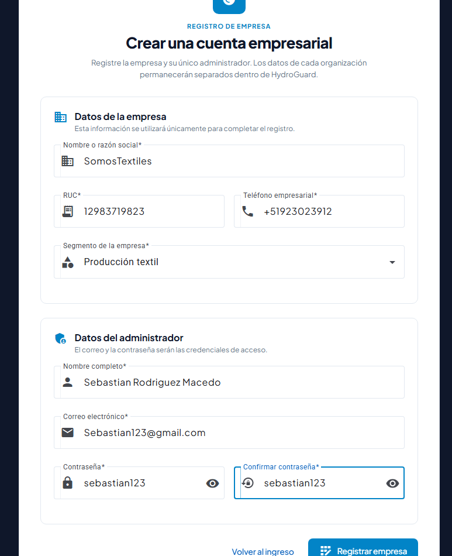
</p>
<p align="center"><em>EE-01. Formulario de registro de la empresa y su Administrador.</em></p>

<p align="center">
  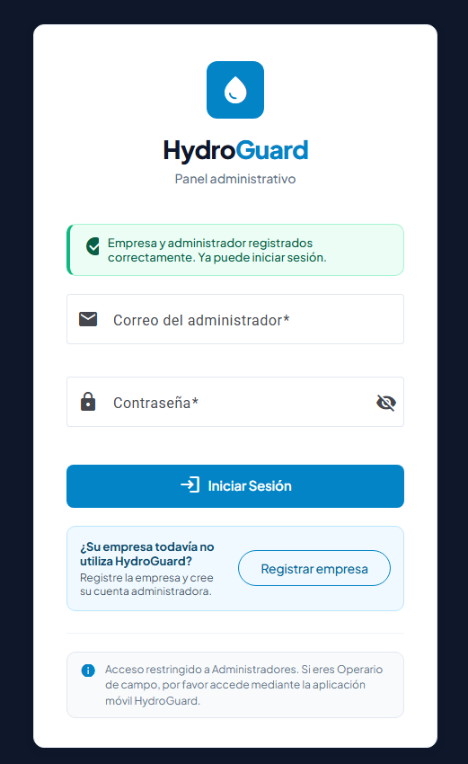
</p>
<p align="center"><em>EE-02. Confirmación del registro y pantalla de inicio de sesión.</em></p>

**2. Registro y consulta de cuentas de Operarios**

Desde el módulo Operarios, el Administrador completa el formulario de creación de la cuenta de Hector Rios con su identificador de acceso y contraseña definitiva. La captura siguiente muestra al Operario en el listado con estado Activo y acciones de consulta y gestión. La secuencia evidencia el alta y la visualización de la cuenta; el perfil y las asignaciones se completan posteriormente. Se relaciona con US-01 y US-04.

<p align="center">
  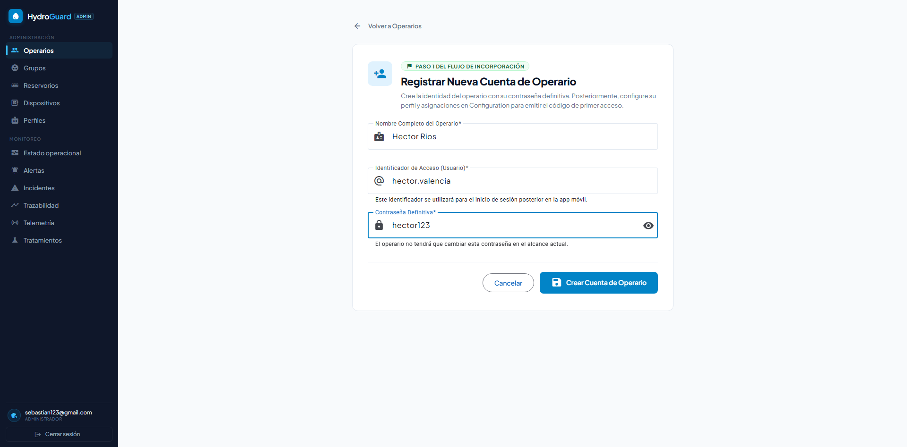
</p>
<p align="center"><em>EE-03. Formulario de creación de la cuenta de Operario.</em></p>

<p align="center">
  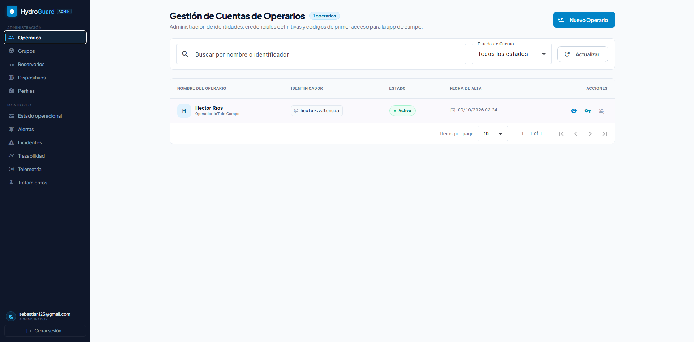
</p>
<p align="center"><em>EE-04. Cuenta del Operario registrada y visible en estado Activo.</em></p>

**3. Creación del grupo de trabajo**

El Administrador registra el grupo Planta Textil Surco e indica su propósito: desarrollar telas para distintas marcas. La vista de detalle muestra el grupo en estado Activo y el segmento Textil heredado de la empresa. En este momento del recorrido, las secciones de Operarios y reservorios todavía se encuentran vacías. La evidencia corresponde a la organización de la estructura operativa considerada en US-05.

<p align="center">
  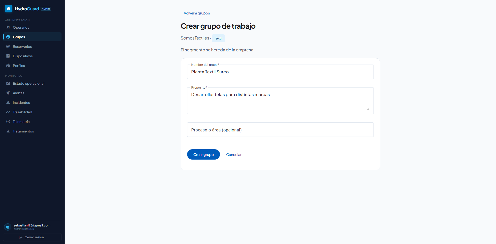
</p>
<p align="center"><em>EE-05. Formulario de creación del grupo Planta Textil Surco.</em></p>

<p align="center">
  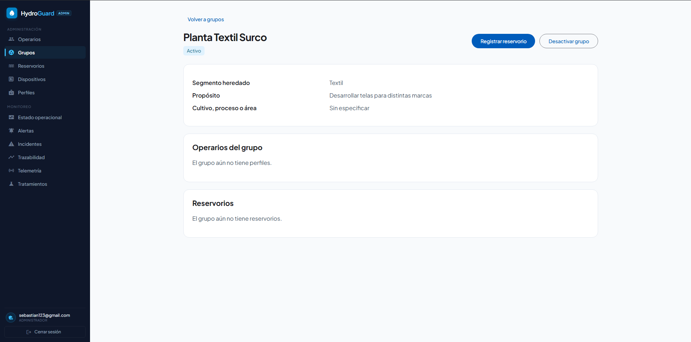
</p>
<p align="center"><em>EE-06. Detalle del grupo activo antes de incorporar sus recursos.</em></p>

**4. Consulta del reservorio**

La pantalla de detalle presenta el reservorio Revisar Maquina 03, asociado al grupo Planta Textil Surco, con su código, ubicación en Planta 2 y capacidad de 50 litros. Su estado es Activo, pero aún no tiene un dispositivo vinculado. Esta captura evidencia la consulta del recurso registrado y la identificación del vínculo pendiente; no muestra el formulario de creación del reservorio.

<p align="center">
  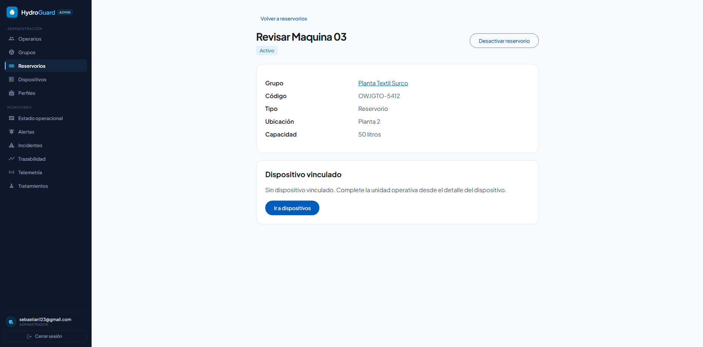
</p>
<p align="center"><em>EE-07. Detalle del reservorio activo y todavía sin dispositivo vinculado.</em></p>

**5. Registro y listado del dispositivo**

El formulario de alta contiene el dispositivo dev-115, con alias HydroGuard-Pro-V1, modelo ESP32-HG-TX-010, entorno Prototipo académico y capacidades de lectura de pH y temperatura. La captura posterior lo muestra en el listado como Activo sin vincular, Sin comunicación registrada y Sin configuración publicada. La secuencia evidencia el registro administrativo del dispositivo, sin atribuirle todavía disponibilidad operativa ni transmisión de mediciones. Se relaciona con US-04 y US-05.

<p align="center">
  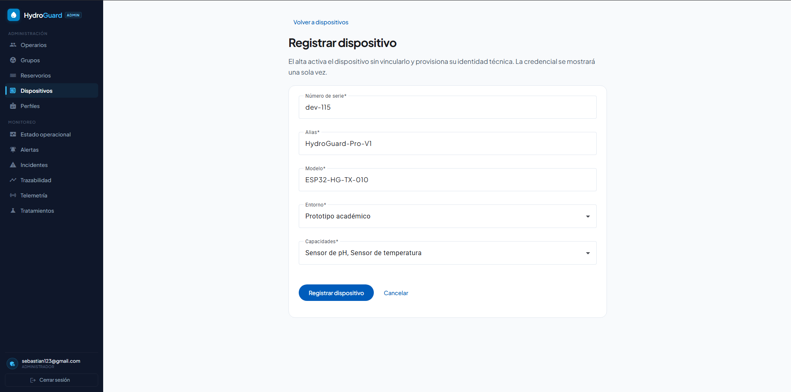
</p>
<p align="center"><em>EE-08. Formulario de registro de dev-115 y sus capacidades.</em></p>

<p align="center">
  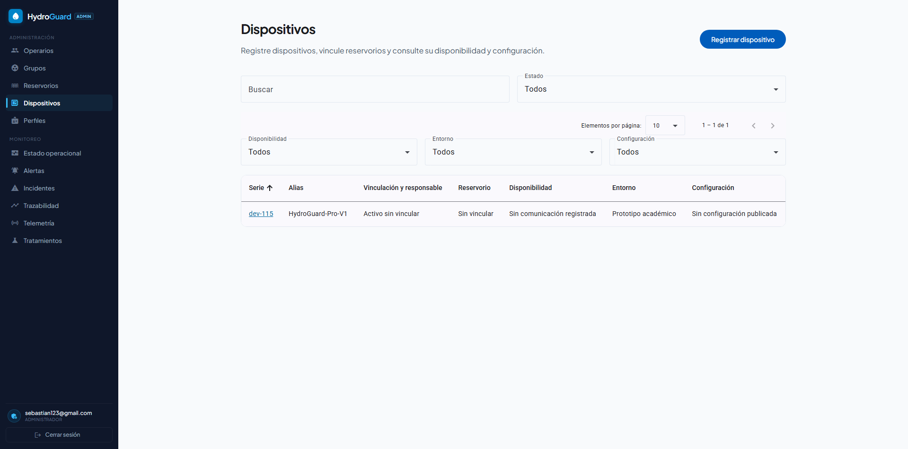
</p>
<p align="center"><em>EE-09. Dispositivo registrado, sin vínculo, comunicación ni configuración publicada.</em></p>

**6. Vinculación del dispositivo con el reservorio**

En el detalle de HydroGuard-Pro-V1 se selecciona el reservorio Revisar Maquina 03 mediante el campo de reservorios activos sin dispositivo. La pantalla ofrece la acción Vincular reservorio. El resultado del vínculo puede observarse más adelante en la selección del par reservorio-dispositivo y en el historial de asignaciones del Operario. Esta secuencia documenta la preparación de la unidad operativa.

<p align="center">
  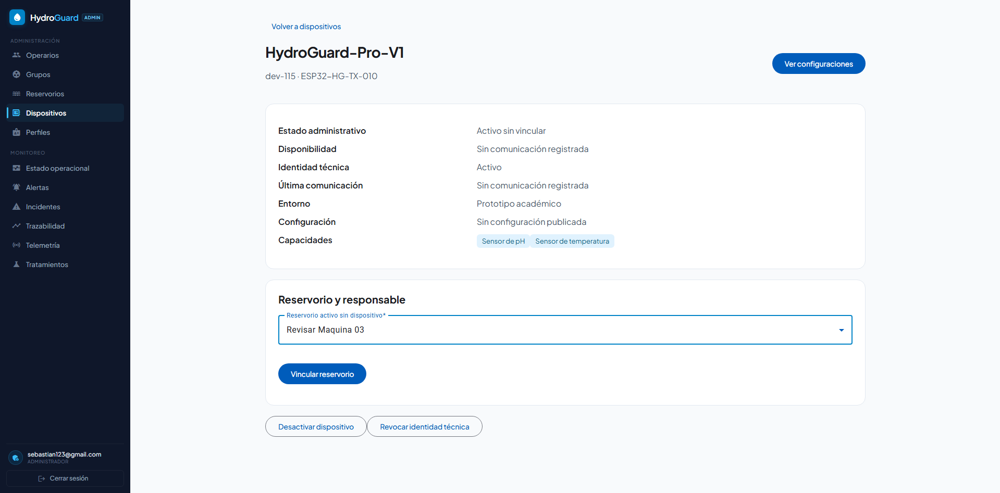
</p>
<p align="center"><em>EE-10. Selección del reservorio para vincularlo con HydroGuard-Pro-V1.</em></p>

**7. Creación del perfil y asignación al Operario**

El Administrador selecciona la cuenta de Hector Rios, el grupo Planta Textil Surco y el par Revisar Maquina 03 · dev-115 para crear el perfil. El detalle posterior muestra la asignación en estado Activo y el perfil Pendiente de primer acceso. También presenta el historial y la acción de cierre de asignación. Al no existir otros pares disponibles en el grupo, la opción Agregar asignaciones permanece deshabilitada. La evidencia corresponde a US-03.

<p align="center">
  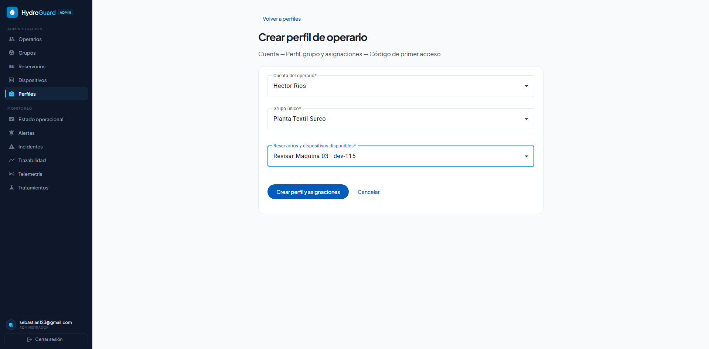
</p>
<p align="center"><em>EE-11. Creación del perfil con grupo y par reservorio-dispositivo.</em></p>

<p align="center">
  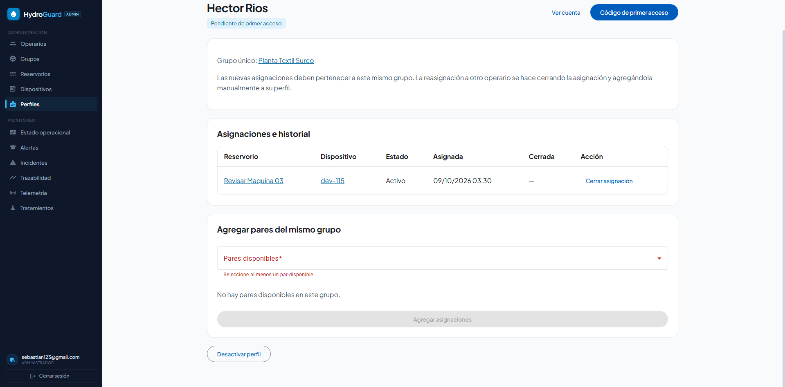
</p>
<p align="center"><em>EE-12. Perfil del Operario con asignación activa e historial.</em></p>

**8. Generación del código de primer acceso**

La aplicación muestra el mensaje de generación exitosa del código de primer acceso y lo presenta como código de activación de un solo uso en estado Activo. La misma vista indica el cumplimiento de las precondiciones: cuenta activa, grupo asociado, perfil creado y al menos un par reservorio-dispositivo activo asignado. Se evidencia la emisión del código prevista en US-01; su utilización en la aplicación móvil no está incluida en estas capturas.

<p align="center">
  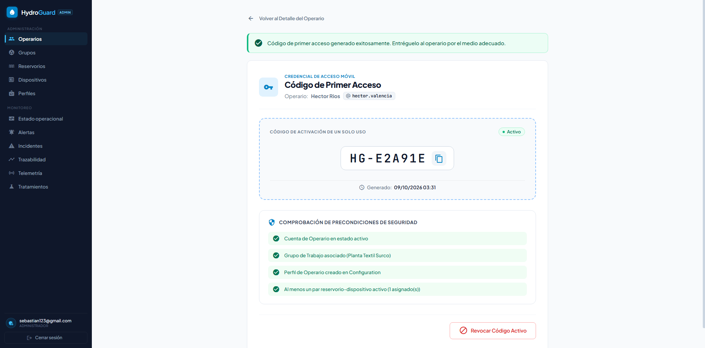
</p>
<p align="center"><em>EE-13. Código de primer acceso generado y comprobación de precondiciones.</em></p>

**9. Centro de monitoreo y estado operacional**

El tablero presenta un dispositivo supervisado, ninguno en línea, uno que requiere atención, cero alertas activas y cero incidentes abiertos. La fila de HydroGuard-Pro-V1 indica Sin comunicación y Sin mediciones, con actualización Desactualizada. Los valores de pH y temperatura aparecen como guiones, diferenciando la ausencia de datos de una medición de valor cero. La captura evidencia la consulta del estado inicial del dispositivo en el tablero de monitoreo.

<p align="center">
  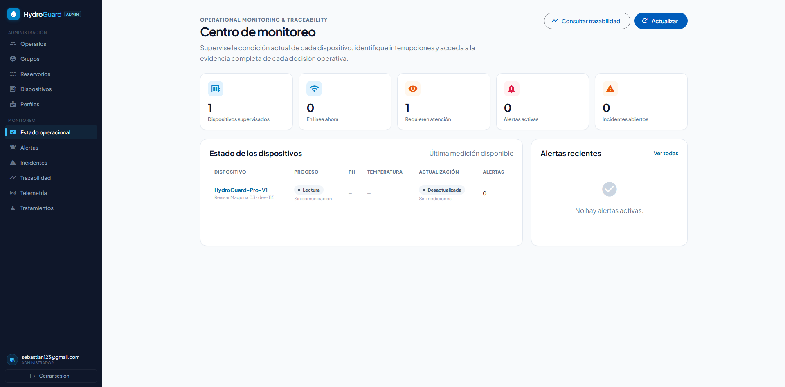
</p>
<p align="center"><em>EE-14. Centro de monitoreo con un dispositivo sin comunicación ni mediciones.</em></p>

**10. Consulta de alertas**

La vista Alertas presenta el buscador y los controles de estado y severidad. Para la selección visible de estado Activa y severidad Todas, la tabla informa que no existen alertas y muestra un total de cero registros. Esta evidencia documenta la presentación del estado vacío de la consulta; no acredita la generación o atención de una alerta por pérdida de monitoreo de US-25.

<p align="center">
  
</p>
<p align="center"><em>EE-15. Consulta de alertas con cero resultados.</em></p>

**11. Vista de incidentes de calidad**

El módulo Incidentes muestra el formulario con los campos dispositivo, tipo y descripción de la situación, además de la acción Registrar incidente. La sección de consulta ofrece filtros por estado y tipo y presenta cero incidentes. La captura evidencia el acceso al formulario y al listado asociado a US-24; no incluye un incidente registrado ni la confirmación de su creación.

<p align="center">
  
</p>
<p align="center"><em>EE-16. Formulario y listado vacío de incidentes de calidad.</em></p>

**12. Consulta de trazabilidad operacional**

La vista de trazabilidad muestra la selección de dev-115, asociado a Revisar Maquina 03, y el periodo del 2 al 9 de octubre de 2026. El resumen no presenta valores de pH ni temperatura, y la línea temporal indica cero eventos para el periodo seleccionado. La acción Generar reporte se encuentra deshabilitada. La evidencia documenta el estado vacío de la consulta de US-30; no demuestra todavía la correlación de mediciones, ciclos correctivos y liberaciones.

<p align="center">
  
</p>
<p align="center"><em>EE-17. Consulta de trazabilidad sin eventos y con generación de reporte deshabilitada.</em></p>

**13. Supervisión e historial de telemetría**

La vista general de telemetría incluye dev-115 en el entorno Prototipo académico y presenta Sin comunicación registrada, sin registro de heartbeat y sin valores de pH o temperatura. Al acceder a su historial, el detalle muestra cero mediciones, controles de origen y fechas, y una tabla vacía. Estas capturas evidencian la navegación entre las vistas de US-11 y US-27 y su presentación sin datos; no acreditan recepción de telemetría ni monitoreo en tiempo real.

<p align="center">
  
</p>
<p align="center"><em>EE-18. Supervisión de telemetría sin heartbeat ni lecturas registradas.</em></p>

<p align="center">
  
</p>
<p align="center"><em>EE-19. Historial de dev-115 con cero mediciones.</em></p>

**14. Consulta de procesos de tratamiento**

El módulo Tratamientos presenta el buscador, el filtro por estado y las columnas de dispositivo, estado, medición, estrategia, ciclo, liberación y actualización. La tabla informa que no existen procesos para los filtros seleccionados y muestra cero registros. La captura evidencia el acceso a la vista de supervisión del Administrador, pero no la ejecución de una corrección, un ciclo de tratamiento o una liberación de agua.

<p align="center">
  
</p>
<p align="center"><em>EE-20. Vista de supervisión de tratamientos sin procesos registrados.</em></p>


#### 6.2.1.7. Services Documentation Evidence for Sprint Review

Para TB1 se utiliza un Mock API Node.js con base `/api/v1`. Salvo el endpoint de salud, el registro de organización y el inicio de sesión, las operaciones requieren `Authorization: Bearer <token>`. El servidor deriva `organizationId` de la sesión administrativa y rechaza el acceso cruzado; el cliente no decide el ámbito organizacional.

| Capacidad | Método y endpoint | Entrada principal | Resultado esperado |
|:--|:--|:--|:--|
| Estado | `GET /health` | Sin parámetros. | `200` con `name`, `status`, `baseUrl` y mensaje de disponibilidad. |
| Registro | `POST /organization-registrations` | `organization{name,ruc,phone,segment}` y `administrator{displayName,email,password}`. | `201` con empresa y Administrador creados; `409` para RUC o correo duplicado. |
| Autenticación | `POST /authentication/sign-in` | `identifier`, `password`. | `200` con token, rol, organización y expiración; `401` para credenciales inválidas. |
| Autenticación | `POST /authentication/sign-out` | Bearer token. | `204` y sesión invalidada. |
| Operarios | `GET /operators` | `searchTerm`, `status`, `page`, `pageSize`. | Página de Operarios de la organización autenticada. |
| Operarios | `POST /operators` | `displayName`, `identifier`, `password`. | `201` con la cuenta activa; `409` si el identificador ya existe. |
| Operarios | `GET /operators/{operatorId}` | Identificador en ruta. | Detalle de la cuenta o `404`. |
| Operarios | `PATCH /operators/{operatorId}/status` | `{status:"INACTIVE"}`. | `204`; puede devolver `409` si existe un proceso activo. |
| Primer acceso | `GET /operators/{operatorId}/access-summary` | Identificador en ruta. | Cuenta, perfil, asignaciones y precondiciones de acceso. |
| Primer acceso | `GET /operators/{operatorId}/first-access-code` | `operatorProfileId` opcional. | Último código encontrado o `404`. |
| Primer acceso | `POST /operators/{operatorId}/first-access-code` | `operatorProfileId`. | `201` con código no temporal; `409` si faltan perfil o asignación válidos. |
| Primer acceso | `POST /first-access-codes/{codeId}/revoke` | Identificador en ruta. | `204` si el código activo fue revocado. |
| Organización | `GET /organizations/current` | Bearer token. | Organización actual con segmento. |
| Grupos | `GET /groups`, `POST /groups` | Filtros de listado o datos del grupo. | Página de grupos o grupo creado. |
| Grupos | `GET /groups/{groupId}`, `PATCH /groups/{groupId}/status` | ID; para baja, `{status:"INACTIVE"}`. | Detalle con miembros y reservorios, o baja lógica. |
| Reservorios | `GET /reservoirs`, `POST /reservoirs` | Filtros o datos del reservorio y grupo. | Página de reservorios o reservorio creado. |
| Reservorios | `GET /reservoirs/{reservoirId}`, `PATCH /reservoirs/{reservoirId}/status` | ID y estado de baja. | Detalle con dispositivo o baja lógica. |
| Dispositivos | `GET /devices`, `POST /devices` | Filtros o identificación, entorno y capacidades. | Página de dispositivos o dispositivo activo creado. |
| Dispositivos | `GET /devices/{deviceId}`, `PATCH /devices/{deviceId}/status` | ID y estado de baja. | Detalle o baja lógica controlada. |
| Vinculación | `POST /devices/{deviceId}/link`, `POST /devices/{deviceId}/unlink` | `reservoirId` para vincular. | Dispositivo vinculado o desvinculado, respetando exclusividad. |
| Identidad técnica | `POST /device-identities/{deviceId}/revoke` | ID del dispositivo. | Credencial técnica revocada. |
| Configuración | `GET /devices/{deviceId}/configurations` | ID del dispositivo. | Historial ordenado de versiones de configuración. |
| Perfiles | `GET /operator-profiles`, `POST /operator-profiles` | Filtros o `userId` y `groupId`. | Página de perfiles o perfil creado. |
| Perfiles | `GET /operator-profiles/{profileId}`, `PATCH /operator-profiles/{profileId}/status` | ID y estado de baja. | Detalle del perfil o baja lógica. |
| Asignaciones | `POST /operator-profiles/{profileId}/assignments` | Pares de dispositivo y reservorio. | Asignaciones exclusivas añadidas. |
| Asignaciones | `POST /assignments/{assignmentId}/close` | ID de asignación. | Asignación cerrada si no existe proceso activo. |
| Catálogos | `GET /operational-options`, `GET /available-pairs` | Para pares: `groupId`. | Opciones activas y pares disponibles para asignar. |
| Telemetría | `GET /telemetry/devices`, `GET /telemetry/devices/{deviceId}` | Filtros o ID. | Resumen de dispositivos y detalle telemétrico. |
| Mediciones | `GET /devices/{deviceId}/water-measurements/latest` | ID. | Última medición disponible. |
| Mediciones | `GET /devices/{deviceId}/water-measurements` | Fechas, página, tamaño y orden. | Historial paginado de pH y temperatura. |
| Tratamiento | `GET /treatments`, `GET /treatments/{processId}` | Filtros/paginación o ID. | Procesos de la organización y detalle con estrategia y ciclos. |
| Monitoreo | `GET /monitoring/overview` | Bearer token. | Resumen operacional de dispositivos. |
| Alertas | `GET /monitoring/alerts`, `PATCH /monitoring/alerts/{alertId}/status` | Filtros; para actualizar, nuevo estado. | Página de alertas o alerta actualizada. |
| Incidentes | `GET /monitoring/incidents`, `POST /monitoring/incidents` | Filtros o dispositivo, tipo, severidad y descripción. | Página de incidentes o incidente creado. |
| Incidentes | `PATCH /monitoring/incidents/{incidentId}/status` | Nuevo estado. | Incidente actualizado o cerrado. |
| Trazabilidad | `GET /monitoring/devices/{deviceId}/traceability` | ID del dispositivo. | Línea de tiempo correlacionada de mediciones, procesos, alertas e incidentes. |
| Reportes | `POST /monitoring/reports/generate` | Dispositivo y rango solicitado. | Reporte sencillo generado para descarga desde la web. |

Ejemplo mínimo de autenticación:

```http
POST /api/v1/authentication/sign-in
Content-Type: application/json

{"identifier":"admin.textil@hydroguard.pe","password":"adminpassword123"}
```

La respuesta satisfactoria contiene `token`, `role`, `organizationId` y `expiresAt`. Los errores mantienen el contrato `{ "message": "Descripción comprensible" }` y utilizan códigos `401`, `403`, `404`, `409` o `422` según la condición.

Repositorio: <https://github.com/1ASI0572-2620-8740-IOT/mock-api>. Los commits de preparación del servicio para TB1 incluyen `86294b2`, `f6824ac` y `7737072`.


#### 6.2.1.8. Software Deployment Evidence for Sprint Review

Durante el Sprint se publicó el Landing Page en GitHub Pages y se prepararon configuraciones reproducibles para separar el frontend Angular y el Mock API. La aplicación web incluye `vercel.json`, mientras el repositorio `mock-api` incluye `render.yaml`. El frontend está disponible en Vercel y conserva la regla `/api/*` para comunicarse con el servicio configurado en Render.

##### Landing Page — Deployment Evidence

Link: https://1asi0572-2620-8740-iot.github.io/LandingPage/

Este es el deploy de la landing page de HydroGuard en Github Pages.

[](https://postimg.cc/YG3dQFkt)

| Producto | Plataforma | Estado documental y técnico |
|:--|:--|:--|
| Landing Page | GitHub Pages | Desplegado y disponible en <https://1asi0572-2620-8740-iot.github.io/LandingPage/>. |
| Frontend Angular | Vercel | Desplegado y comprobado el 2026-10-09 en <https://hydroguard-admin-web-frontend.vercel.app/>; la ruta raíz dirige a `/login`. |
| Mock API | Render | Desplegado en <https://hydroguard-mock-api-8740.onrender.com/>; su disponibilidad se comprueba mediante `GET /api/v1/health`. |

El plan gratuito de Render reinicia el estado del Mock API desde `db.json` después de determinados reinicios o despliegues. Esta restricción es aceptable para una demostración repetible y debe explicarse durante la ejecución.

##### Frontend Web Applications — Deployment Evidence

Link: https://hydroguard-admin-web-frontend.vercel.app

Este es el deploy del FrontEnd con una Mock Api de HydroGuard en Vercel.

[](https://postimg.cc/Dmwgt8n5)


#### 6.2.1.9. Team Collaboration Insights during Sprint

Durante el Sprint 1, el equipo distribuyó el trabajo por bounded contexts y utilizó ramas de funcionalidad para mantener aislados los cambios: `feature/iam-operator-management`, `feature/device-configuration`, `feature/iot-telemetry` y `feature/operational-monitoring` en el frontend; y ramas personales o documentales para el informe. La integración se realizó sobre ramas compartidas, conservando commits pequeños y descriptivos que permiten reconstruir la evolución del producto.

En el frontend, Operational Monitoring and Traceability se desarrolló después de Device and Operational Configuration para aprovechar su estructura y lenguaje visual. Se incorporaron progresivamente modelos de dominio, puerto de repositorio, adaptador Axios, casos de uso, estado de presentación, datos mock, tablero, alertas, incidencias, trazabilidad, rutas y acceso desde la barra lateral. Esta secuencia redujo el acoplamiento y permitió verificar el bounded context de manera independiente.

Las tablas siguientes resumen los commits incorporados entre el 21 de septiembre y el 9 de octubre de 2026. Se consolidaron las identidades alternativas de una misma persona. El conteo incluye commits de integración y representa actividad versionada, pero no se interpreta por sí solo como medida de calidad o esfuerzo.

| Integrante | Frontend | Mock API | Landing Page | Informe |
|:--|--:|--:|--:|--:|
| Rios Pacheco, Hector Javier | 41 | 1 | 3 | 14 |
| Prieto Mantari, Leonardo Fabrizzio Junior | 10 | 0 | 0 | 12 |
| Santur Tello, Andrea Elizabeth | 9 | 0 | 0 | 9 |
| Rodriguez Macedo, Sebastian | 4 | 0 | 0 | 1 |
| Gomez Hurtado, Miguel Angel | 0 | 5 | 0 | 11 |
| Olivera Barzola, Eric Marlon | 0 | 0 | 0 | 0 |


La actividad puede consultarse en [los commits del frontend](https://github.com/1ASI0572-2620-8740-IOT/hydroguard-admin-web-frontend/commits), [los commits del Mock API](https://github.com/1ASI0572-2620-8740-IOT/mock-api/commits), [los commits del Landing Page](https://github.com/1ASI0572-2620-8740-IOT/LandingPage/commits) y [los commits del informe](https://github.com/1ASI0572-2620-8740-IOT/report/commits).

Como evidencia histórica complementaria de TB1, la captura de GitHub Contributors muestra la actividad semanal y la participación por cuenta.


*Figura: actividad de GitHub Contributors del 4 de julio al 3 de octubre de 2026. El periodo de la captura no coincide con el corte de TB1 de las tablas (21 de septiembre al 9 de octubre) ni con el de AV2, por lo que no sustituye sus conteos.*

Los principales retos de integración fueron mantener rutas y providers coherentes al agregar módulos, compartir el layout sin acoplar los dominios, alinear DTOs con contratos mock y sostener una interfaz homogénea. El equipo los afrontó mediante una arquitectura por capas, puertos de repositorio, tokens visuales compartidos, contratos versionados y verificación de compilación antes de integrar. Como mejora para el siguiente sprint, se acordó reforzar la revisión cruzada mediante pull requests, adjuntar evidencia de pruebas a cada historia, asociar commits con identificadores del Product Backlog y registrar decisiones de arquitectura cuando afecten a más de un bounded context.

En conjunto, el sprint permitió trabajar de manera paralela sin perder una experiencia unificada. La separación de responsabilidades facilitó el liderazgo distribuido, mientras que las convenciones de código, las ramas por funcionalidad y la documentación común ofrecieron puntos concretos de coordinación.

### 6.2.2. Sprint 2

El Sprint 2 de HydroGuard se orienta a la evolución del incremento web y del Landing Page desarrollado en el Sprint 1 hacia una solución IoT con servicios backend reales, aplicación móvil para el Operario y componentes de comunicación con el dispositivo físico. El objetivo es avanzar desde las interfaces administrativas conectadas a una Mock API hacia la integración funcional de los bounded contexts y la ejecución de los procesos de monitoreo, configuración, tratamiento y trazabilidad.

El trabajo comprende el desarrollo de microservicios con Spring Boot y Java 21, la comunicación mediante una API Gateway, la persistencia de datos en bases PostgreSQL independientes por servicio, la aplicación móvil desarrollada con Flutter y el servicio Edge implementado en Python con Flask. Se considera además el prototipo basado en ESP32 para la adquisición de mediciones y la representación o ejecución de acciones físicas según las capacidades verificadas del hardware.

La distribución funcional mantiene al Administrador en la aplicación web, responsable de la organización, los operarios, los grupos, los reservorios, los dispositivos y sus asignaciones. El Operario utiliza la aplicación móvil para consultar las unidades asignadas, visualizar mediciones y participar en los flujos de configuración, tratamiento y liberación conforme a las autorizaciones y reglas del sistema.

A diferencia del Sprint 1, cuyo alcance demostrado correspondió principalmente a interfaces web y flujos apoyados en Mock API, el Sprint 2 incorpora implementaciones orientadas a servicios REST reales y persistencia. Sin embargo, la existencia de código o de endpoints no se considera por sí sola evidencia suficiente de integración completa, despliegue estable, calibración de sensores ni validación física de las actuaciones. Cada resultado deberá sustentarse con commits, pruebas, capturas y evidencias de ejecución verificables.

Las siguientes subsecciones presentan la planificación del Sprint 2, la distribución de liderazgo y colaboración, y las historias y tareas de ingeniería comprometidas. Los estados de avance se documentarán de acuerdo con la evidencia disponible, diferenciando las funcionalidades implementadas de las integraciones o validaciones pendientes.

#### 6.2.2.1. Sprint Planning 2

Para el Sprint 2, el equipo HydroLink planteó continuar el desarrollo de HydroGuard mediante la implementación e integración de los servicios backend reales, la aplicación móvil para el Operario y los componentes IoT. Esta planificación da continuidad al incremento desarrollado durante el Sprint 1, en el cual se publicó el Landing Page y se implementaron las principales interfaces de administración web utilizando Mock API.

El equipo identificó como prioridad reemplazar progresivamente las operaciones simuladas por servicios persistentes, implementar las funcionalidades correspondientes al Operario y establecer la comunicación entre el backend, el servicio Edge y el prototipo ESP32. Asimismo, se acordó distinguir las funcionalidades implementadas, las integraciones verificadas y las validaciones físicas pendientes, a fin de mantener una trazabilidad coherente entre ambos sprints.

| **Sprint #** | Sprint 2 |
|:--|:--|
| **Sprint Planning Background** | |
| Date | 2026-11-07 |
| Time | 8:00 PM |
| Location | Servidor del equipo en Discord |
| Prepared By | Santur Tello, Andrea Elizabeth |
| Attendees (to planning meeting) | Gomez Hurtado, Miguel Angel / Rodriguez Macedo, Sebastian / Santur Tello, Andrea Elizabeth / Prieto Mantari, Leonardo Fabrizzio Junior / Rios Pacheco, Hector Javier |
| Sprint 1 Review Summary | Durante el Sprint 1 se seleccionaron 17 User Stories, correspondientes a 47 Story Points planificados, y se documentaron 29 Engineering Tasks con una estimación total de 118 horas. El incremento desarrollado comprendió principalmente el Landing Page y las interfaces de administración web, cuyos flujos se verificaron mediante Mock API. Aunque las tareas de este alcance fueron registradas como Done, ello no acredita la aceptación integral de las historias que requieren autenticación y persistencia reales, aplicación móvil o integración IoT. Por esta razón, las funcionalidades pendientes mantienen sus User Stories originales y continúan en Sprint 2 mediante nuevas tareas de ingeniería, sin duplicar el trabajo frontend ya realizado. |
| Sprint 1 Retrospective Summary | A partir de la revisión del incremento anterior, se identificaron oportunidades de mejora en la descomposición de historias y tareas, la consistencia de las estimaciones, la trazabilidad entre los criterios de aceptación y las evidencias de desarrollo, y la diferenciación entre interfaces simuladas y funcionalidades integradas. También se reconoció la necesidad de documentar los resultados de pruebas de software independientemente de las pruebas físicas, registrar los estados reales de avance y evitar considerar como completadas las historias cuyo alcance integral continúa pendiente. |
| **Sprint Goal & User Stories** | |
| Sprint 2 Goal | **Nuestro enfoque** es implementar e integrar los servicios backend reales de HydroGuard, la aplicación móvil del Operario y los componentes IoT, dando continuidad al incremento web desarrollado en Sprint 1.<br><br>**Creemos que** esta integración permitirá gestionar organizaciones, usuarios, dispositivos y asignaciones con persistencia real, así como habilitar los flujos de monitoreo, configuración, tratamiento y trazabilidad mediante los servicios del sistema.<br><br>**Esto se confirmará cuando** los componentes comprometidos presenten evidencias verificables de comunicación, persistencia, autorización y funcionamiento, incluyendo pruebas de integración y ejecución de los flujos correspondientes, sin confundir dichas pruebas con la validación física completa del prototipo ni con la calibración de los sensores. |
| Sprint 2 Velocity | 103 SP |
| Sum of Story Points | 103 SP |

El Sprint 2 contempla trabajo relacionado con los bounded contexts de Identity and Access Management, Device Identity, Device and Operational Configuration, IoT Telemetry, Water Treatment y Operational Monitoring and Traceability. La implementación técnica comprende microservicios desarrollados con Spring Boot y Java 21, una API Gateway, persistencia PostgreSQL independiente por servicio, la aplicación móvil Flutter, el servicio Edge en Python con Flask y el prototipo basado en ESP32.

La integración entre los componentes se plantea mediante comunicaciones HTTP/REST. Las pruebas automatizadas de los servicios, las verificaciones de despliegue y las demostraciones del hardware se documentan como evidencias diferenciadas, considerando las limitaciones instrumentales y de integración que correspondan.

#### 6.2.2.2. Aspect Leaders and Collaborators

Durante el Sprint 2, el equipo HydroLink organizó la colaboración técnica considerando las necesidades de implementación e integración de HydroGuard. La distribución de responsabilidades se orientó al desarrollo del backend, las interfaces de usuario, la telemetría IoT, la configuración de dispositivos y los procesos de monitoreo y trazabilidad.

| Integrante / GitHub | IAM y acceso administrativo | Configuración de dispositivos | Telemetría IoT | Monitoreo y trazabilidad | UX/UI y estándares | Arquitectura e informe |
|:--|:--:|:--:|:--:|:--:|:--:|:--:|
| Gomez Hurtado, Miguel Angel (`Miguel26112001`) | C | C | L | C | C | L |
| Rodriguez Macedo, Sebastian (`Shiftinnnnn`) | C | L | C | C | C | L |
| Santur Tello, Andrea Elizabeth (`andreli-star`) | C | C | C | C | L | C |
| Prieto Mantari, Leonardo Fabrizzio Junior (`leitojunior36`) | C | C | C | L | C | C |
| Rios Pacheco, Hector Javier (`Khafna09`) | L | C | C | C | L | C |

Esta matriz documenta la distribución de liderazgo y colaboración del equipo. Las contribuciones individuales de implementación, pruebas e integración se detallarán mediante Engineering Tasks, commits y evidencias en el Sprint Backlog 2.

#### 6.2.2.3. Sprint Backlog 2

El Sprint 2 de HydroGuard tiene como objetivo integrar el frontend administrativo Angular, los microservicios Spring Boot, la aplicación móvil Flutter, el servicio Edge y el prototipo ESP32. Se da continuidad a las User Stories del Sprint 1 que requieren integración real, conservando sus identificadores y evitando duplicar las tareas desarrolladas con Mock API.

El Sprint Backlog 2 contempla 28 historias seleccionadas de manera preliminar, con 103 Story Points y 62 Engineering Tasks estimadas en 319 horas. La siguiente tabla presenta las tareas, responsables propuestos, estimaciones y estados, sujetos a validación con el equipo y las evidencias de desarrollo.

**Sprint #:** Sprint 2

**URL del Board:** https://trello.com/b/6aafc8a787b6bbbecd455184

**Screenshot del Board — Sprint 2:**

<!-- Insertar aquí la captura real del tablero de Sprint 2 -->

**Tabla de control de estado del Sprint 2:**

| **Sprint #** | **Sprint 2** | | | | | | |
|:--|:--|:--|:--|:--|:--|:--|:--|
| **Story Id** | **Story Title** | **Task Id** | **Task Title** | **Task Description** | **Estimation (Hours)** | **Assigned To** | **Status (To-do / InProcess / ToReview / Done)** |
| US-01 | Registro de operario | T-30 | Implementación e integración: US-01 | Integrar registro de Operario, validaciones y pertenencia organizacional | 5 | Rios Pacheco, Hector Javier (propuesto) | To-do |
| US-01 | Registro de operario | T-31 | Validación y pruebas: US-01 | Verificar primer acceso y rechazo de datos inválidos desde cliente real | 5 | Santur Tello, Andrea Elizabeth (propuesto) | To-do |
| US-02 | Autenticación de usuario | T-32 | Implementación e integración: US-02 | Integrar login JWT y autorización de roles en clientes | 5 | Rios Pacheco, Hector Javier (propuesto) | To-do |
| US-02 | Autenticación de usuario | T-33 | Validación y pruebas: US-02 | Comprobar cierre, caducidad de sesión y rechazo de rol incorrecto | 4 | Rios Pacheco, Hector Javier (propuesto) | To-do |
| US-03 | Asignación de dispositivo a operario | T-34 | Implementación e integración: US-03 | Persistir asignación exclusiva de par reservorio/dispositivo a Operario | 5 | Rodriguez Macedo, Sebastian (propuesto) | To-do |
| US-03 | Asignación de dispositivo a operario | T-35 | Validación y pruebas: US-03 | Probar restricciones por organización/grupo y reasignación autorizada | 5 | Rios Pacheco, Hector Javier (propuesto) | To-do |
| US-39 | Asignación automática de rol según el flujo de alta | T-36 | Implementación e integración: US-39 | Aplicar alta automática de roles según flujo de organización/Operario | 4 | Rios Pacheco, Hector Javier (propuesto) | To-do |
| US-39 | Asignación automática de rol según el flujo de alta | T-37 | Validación y pruebas: US-39 | Probar rechazo a segundo Administrador y cambio manual de rol | 4 | Rios Pacheco, Hector Javier (propuesto) | To-do |
| US-04 | Supervisión de operarios y dispositivos | T-38 | Implementación e integración: US-04 | Conectar consulta administrativa con servicios reales de organización | 5 | Rios Pacheco, Hector Javier (propuesto) | To-do |
| US-04 | Supervisión de operarios y dispositivos | T-39 | Validación y pruebas: US-04 | Validar listados, vacíos, permisos y disponibilidad no reciente | 4 | Santur Tello, Andrea Elizabeth (propuesto) | To-do |
| US-05 | Vinculación de dispositivo y configuración base | T-40 | Implementación e integración: US-05 | Integrar vínculo reservorio-dispositivo y contexto base con API persistente | 5 | Rodriguez Macedo, Sebastian (propuesto) | To-do |
| US-05 | Vinculación de dispositivo y configuración base | T-41 | Validación y pruebas: US-05 | Probar exclusividad, segmento y compatibilidad desde web real | 5 | Rodriguez Macedo, Sebastian (propuesto) | To-do |
| US-10 | Consulta de configuración de dispositivos | T-42 | Implementación e integración: US-10 | Conectar consulta de configuración y versiones a backend real | 5 | Rodriguez Macedo, Sebastian (propuesto) | To-do |
| US-10 | Consulta de configuración de dispositivos | T-43 | Validación y pruebas: US-10 | Comprobar estados guardada/publicada/aplicada, vacío y autorización | 4 | Santur Tello, Andrea Elizabeth (propuesto) | To-do |
| US-06 | Configuración de rangos de calidad del dispositivo | T-44 | Implementación e integración: US-06 | Implementar guardado validado de rangos por asignación | 5 | Rodriguez Macedo, Sebastian (propuesto) | To-do |
| US-06 | Configuración de rangos de calidad del dispositivo | T-45 | Validación y pruebas: US-06 | Integrar formulario móvil y probar límites y autorización | 4 | Santur Tello, Andrea Elizabeth (propuesto) | To-do |
| US-09 | Configuración del modo de liberación | T-46 | Implementación e integración: US-09 | Persistir modo MANUAL/AUTOMATIC en configuración versionada | 4 | Rodriguez Macedo, Sebastian (propuesto) | To-do |
| US-09 | Configuración del modo de liberación | T-47 | Validación y pruebas: US-09 | Probar comportamiento de autorización según modo publicado/aplicado | 5 | Rodriguez Macedo, Sebastian (propuesto) | To-do |
| US-11 | Monitoreo de pH y temperatura | T-48 | Implementación e integración: US-11 | Consultar lecturas reales de asignaciones con fecha y origen | 5 | Gomez Hurtado, Miguel Angel (propuesto) | To-do |
| US-11 | Monitoreo de pH y temperatura | T-49 | Validación y pruebas: US-11 | Validar pantalla del Operario, antigüedad y restricción de acceso | 5 | Santur Tello, Andrea Elizabeth (propuesto) | To-do |
| US-12 | Monitoreo desde aplicación móvil | T-50 | Implementación e integración: US-12 | Conectar pantalla de monitoreo móvil mediante Gateway y sesión | 5 | Santur Tello, Andrea Elizabeth (propuesto) | To-do |
| US-12 | Monitoreo desde aplicación móvil | T-51 | Validación y pruebas: US-12 | Verificar carga, vacío, error y dispositivos ajenos | 4 | Santur Tello, Andrea Elizabeth (propuesto) | To-do |
| US-13 | Evaluación de conformidad | T-52 | Implementación e integración: US-13 | Evaluar pH y temperatura con lectura vigente y configuración aplicada | 6 | Prieto Mantari, Leonardo Fabrizzio Junior (propuesto) | To-do |
| US-13 | Evaluación de conformidad | T-53 | Validación y pruebas: US-13 | Probar conforme/no conforme y rechazo de lectura inválida/antigua | 5 | Prieto Mantari, Leonardo Fabrizzio Junior (propuesto) | To-do |
| US-15 | Aprobación y ejecución de la acción correctiva | T-54 | Implementación e integración: US-15 | Implementar aprobación única del plan correctivo y transiciones | 6 | Rodriguez Macedo, Sebastian (propuesto) | To-do |
| US-15 | Aprobación y ejecución de la acción correctiva | T-55 | Validación y pruebas: US-15 | Probar bloqueo previo a autorización y continuidad de ciclos aprobados | 5 | Prieto Mantari, Leonardo Fabrizzio Junior (propuesto) | To-do |
| US-18 | Reevaluación posterior al tratamiento | T-56 | Implementación e integración: US-18 | Registrar espera y solicitar reevaluación con nueva lectura | 5 | Prieto Mantari, Leonardo Fabrizzio Junior (propuesto) | To-do |
| US-18 | Reevaluación posterior al tratamiento | T-57 | Validación y pruebas: US-18 | Verificar que ACK no supla medición reciente ni reevaluación | 5 | Prieto Mantari, Leonardo Fabrizzio Junior (propuesto) | To-do |
| US-19 | Liberación automática | T-58 | Implementación e integración: US-19 | Emitir orden automática solo con estado listo y modo AUTOMATIC | 6 | Rodriguez Macedo, Sebastian (propuesto) | To-do |
| US-19 | Liberación automática | T-59 | Validación y pruebas: US-19 | Probar respuesta/idempotencia y registrar límite de validación física | 5 | Gomez Hurtado, Miguel Angel (propuesto) | To-do |
| US-20 | Liberación manual | T-60 | Implementación e integración: US-20 | Autorizar liberación manual desde sesión de Operario responsable | 5 | Santur Tello, Andrea Elizabeth (propuesto) | To-do |
| US-20 | Liberación manual | T-61 | Validación y pruebas: US-20 | Probar rechazo anticipado, modo incorrecto y par ajeno | 5 | Santur Tello, Andrea Elizabeth (propuesto) | To-do |
| US-24 | Gestión y consulta de incidentes | T-62 | Implementación e integración: US-24 | Persistir incidente automático y relación causal disponible | 5 | Prieto Mantari, Leonardo Fabrizzio Junior (propuesto) | To-do |
| US-24 | Gestión y consulta de incidentes | T-63 | Validación y pruebas: US-24 | Integrar consulta administrativa y comprobar origen/manual y cierre según contrato | 5 | Prieto Mantari, Leonardo Fabrizzio Junior (propuesto) | To-do |
| US-25 | Alerta por pérdida de monitoreo | T-64 | Implementación e integración: US-25 | Detectar pérdida por heartbeat/lectura y generar alerta única | 5 | Prieto Mantari, Leonardo Fabrizzio Junior (propuesto) | To-do |
| US-25 | Alerta por pérdida de monitoreo | T-65 | Validación y pruebas: US-25 | Probar recuperación, no duplicación y visualización autorizada | 5 | Prieto Mantari, Leonardo Fabrizzio Junior (propuesto) | To-do |
| US-27 | Consulta del historial de dispositivos | T-66 | Implementación e integración: US-27 | Conectar historial administrativo a registros persistentes | 5 | Prieto Mantari, Leonardo Fabrizzio Junior (propuesto) | To-do |
| US-27 | Consulta del historial de dispositivos | T-67 | Validación y pruebas: US-27 | Validar filtros, paginación, periodo vacío y aislamiento por organización | 5 | Prieto Mantari, Leonardo Fabrizzio Junior (propuesto) | To-do |
| US-30 | Trazabilidad de tratamiento y liberación | T-68 | Implementación e integración: US-30 | Correlacionar lectura, configuración, evaluación y ciclos mediante IDs | 6 | Prieto Mantari, Leonardo Fabrizzio Junior (propuesto) | To-do |
| US-30 | Trazabilidad de tratamiento y liberación | T-69 | Validación y pruebas: US-30 | Verificar traza de liberación y referencias temporales en consulta | 6 | Prieto Mantari, Leonardo Fabrizzio Junior (propuesto) | To-do |
| TS-01 | Provisionamiento y autenticación del dispositivo | T-70 | Implementación e integración: TS-01 | Provisionar credenciales técnicas por dispositivo y organización | 6 | Rios Pacheco, Hector Javier (propuesto) | To-do |
| TS-01 | Provisionamiento y autenticación del dispositivo | T-71 | Validación y pruebas: TS-01 | Probar validación, revocación y rechazo de identidad ajena | 5 | Rios Pacheco, Hector Javier (propuesto) | To-do |
| TS-03 | Adquisición y validación de mediciones | T-72 | Implementación e integración: TS-03 | Integrar adquisición de pH/temperatura y controles de validez | 6 | Gomez Hurtado, Miguel Angel (propuesto) | To-do |
| TS-03 | Adquisición y validación de mediciones | T-73 | Validación y pruebas: TS-03 | Documentar ensayo de sensor y límites de calibración física | 6 | Gomez Hurtado, Miguel Angel (propuesto) | To-do |
| TS-04 | Ingesta de telemetría en el Edge API | T-74 | Implementación e integración: TS-04 | Implementar recepción y bandeja local durable en Edge Flask | 6 | Gomez Hurtado, Miguel Angel (propuesto) | To-do |
| TS-04 | Ingesta de telemetría en el Edge API | T-75 | Validación y pruebas: TS-04 | Probar envío HTTP al Gateway, reintento y deduplicación | 6 | Gomez Hurtado, Miguel Angel (propuesto) | To-do |
| TS-05 | Sincronización de parámetros vigentes | T-76 | Implementación e integración: TS-05 | Exponer versión publicada para sincronización del dispositivo | 5 | Rodriguez Macedo, Sebastian (propuesto) | To-do |
| TS-05 | Sincronización de parámetros vigentes | T-77 | Validación y pruebas: TS-05 | Comprobar ACK de aplicación sin equiparar publicado y aplicado | 5 | Rodriguez Macedo, Sebastian (propuesto) | To-do |
| TS-07 | Control del actuador de flujo | T-78 | Implementación e integración: TS-07 | Implementar orden de apertura/cierre compatible con actuador | 6 | Gomez Hurtado, Miguel Angel (propuesto) | To-do |
| TS-07 | Control del actuador de flujo | T-79 | Validación y pruebas: TS-07 | Probar salida del firmware y separar ensayo físico de prueba simulada | 6 | Gomez Hurtado, Miguel Angel (propuesto) | To-do |
| TS-10 | Estado de disponibilidad del dispositivo | T-80 | Implementación e integración: TS-10 | Registrar heartbeat y última comunicación del dispositivo | 5 | Gomez Hurtado, Miguel Angel (propuesto) | To-do |
| TS-10 | Estado de disponibilidad del dispositivo | T-81 | Validación y pruebas: TS-10 | Probar ventana de disponibilidad y recuperación con fecha real | 5 | Gomez Hurtado, Miguel Angel (propuesto) | To-do |
| TS-12 | Exposición de configuración mediante API RESTful | T-82 | Implementación e integración: TS-12 | Exponer API REST de consulta/edición de configuración autorizada | 5 | Rodriguez Macedo, Sebastian (propuesto) | To-do |
| TS-12 | Exposición de configuración mediante API RESTful | T-83 | Validación y pruebas: TS-12 | Verificar validación, seguridad y contrato de cliente móvil | 5 | Rodriguez Macedo, Sebastian (propuesto) | To-do |
| TS-13 | Ejecución y confirmación de la actuación correctiva | T-84 | Implementación e integración: TS-13 | Registrar comando correctivo y resultado con ID idempotente | 6 | Gomez Hurtado, Miguel Angel (propuesto) | To-do |
| TS-13 | Ejecución y confirmación de la actuación correctiva | T-85 | Validación y pruebas: TS-13 | Probar reintentos y confirmación sin duplicación de actuación | 6 | Gomez Hurtado, Miguel Angel (propuesto) | To-do |
| N/A | Infraestructura y actividades transversales | T-86 | Infraestructura: API Gateway | Revisar rutas públicas y protegidas, autorización y bloqueo de rutas internas en el Gateway HTTP/REST. | 6 | Rios Pacheco, Hector Javier (propuesto) | To-do |
| N/A | Infraestructura y actividades transversales | T-87 | Infraestructura: persistencia | Revisar migraciones, variables de entorno y aislamiento de bases PostgreSQL por microservicio. | 6 | Rodriguez Macedo, Sebastian (propuesto) | To-do |
| N/A | Infraestructura y actividades transversales | T-88 | Integración Angular–API | Verificar configuración de entornos, contratos REST, estados vacíos/errores y sustitución de Mock API en pantallas seleccionadas. | 5 | Santur Tello, Andrea Elizabeth (propuesto) | To-do |
| N/A | Infraestructura y actividades transversales | T-89 | Verificación automatizada | Ejecutar pruebas de contratos e integración backend–Gateway y documentar sus límites frente a ensayos con hardware. | 6 | Prieto Mantari, Leonardo Fabrizzio Junior (propuesto) | To-do |
| N/A | Infraestructura y actividades transversales | T-90 | Documentación OpenAPI | Comprobar endpoints y documentación Swagger/OpenAPI de los servicios; asociar la evidencia con 6.2.2.7. | 5 | Prieto Mantari, Leonardo Fabrizzio Junior (propuesto) | To-do |
| N/A | Infraestructura y actividades transversales | T-91 | Despliegue y diagnóstico | Verificar URLs, salud, variables de entorno y comunicación de servicios en el entorno elegido; asociar evidencia con 6.2.2.8. | 5 | Rios Pacheco, Hector Javier (propuesto) | To-do |
| N/A | Infraestructura y actividades transversales | T-91 | Despliegue y diagnóstico | Verificar URLs, salud, variables de entorno y comunicación de servicios en el entorno elegido; asociar evidencia con 6.2.2.8. | 5 | Rios Pacheco, Hector Javier (propuesto) | To-do |

#### 6.2.2.4. Development Evidence for Sprint Review

El incremento documentado para Sprint 2 pasó de las pantallas web respaldadas por Mock API a código de integración con servicios persistentes, una aplicación móvil para el Operario y componentes de telemetría IoT. Esta sección recoge cambios del ciclo AV2 entre el 10 de octubre y el 12 de noviembre de 2026, incluida la preparación anterior al Sprint Planning del 7 de noviembre.

La tabla sigue la estructura del Sprint 1. La rama indicada es aquella en la que se comprobó que el commit está disponible; no necesariamente es la rama en que se creó. Las fechas están en hora de Lima (UTC−5). El guion en la columna **Commit Message Body** indica que el commit no tiene un cuerpo adicional; la última columna describe el cambio observado. Los enlaces a repositorios privados requieren acceso al equipo.

| Repository | Branch | Commit Id | Commit Message | Commit Message Body | Committed on (Date) | Evidencia del cambio |
|:--|:--|:--|:--|:--|:--|:--|
| Landing Page | `main` | [085246a](https://github.com/1ASI0572-2620-8740-IOT/LandingPage/commit/085246a0dc21d18c67e58b688e6c7feafb915a6a) | `feat: add translation and terms and conditions` | — | 2026-11-11 | Traducción del sitio y términos y condiciones. |
| Web administrativa | `develop` | [1a1e434](https://github.com/1ASI0572-2620-8740-IOT/hydroguard-admin-web-frontend/commit/1a1e4349f7a9a18a847228950863a427392c87c5) | `fix(network): route local admin requests to backend gateway` | — | 2026-11-05 | Proxy local de Angular hacia el API Gateway. |
| Web administrativa | `feature/render-backend-connection` | [7ad7a0c](https://github.com/1ASI0572-2620-8740-IOT/hydroguard-admin-web-frontend/commit/7ad7a0ceec836c9ae8e81d2c22afa983c1d7163b) | `build(vercel): route production API requests to Render gateway` | — | 2026-11-07 | Enrutamiento de `/api` en Vercel hacia el Gateway de Render en la rama de despliegue. |
| Backend | `develop` | [3d54fa9](https://github.com/1ASI0572-2620-8740-IOT/hydroguard_backend/commit/3d54fa99c7b7ff89b3675a6a6cf564c183769314) | `feat(human-iam): complete persistent local backend workflows` | — | 2026-11-05 | Flujos persistentes de acceso humano y primer acceso del operario. |
| Backend | `develop` | [cb1d691](https://github.com/1ASI0572-2620-8740-IOT/hydroguard_backend/commit/cb1d69181c80a8d0c5f871d12247d18b07d39d91) | `feat(device-identity): complete persistent local backend workflows` | — | 2026-11-05 | Gestión persistente de identidad técnica de dispositivos. |
| Backend | `develop` | [9e89abc](https://github.com/1ASI0572-2620-8740-IOT/hydroguard_backend/commit/9e89abcd83da3c98f214880068d624f0f1c6c4cb) | `feat(configuration): complete persistent local backend workflows` | — | 2026-11-05 | Servicios y persistencia del catálogo y la configuración operativa. |
| Backend | `develop` | [9038d9e](https://github.com/1ASI0572-2620-8740-IOT/hydroguard_backend/commit/9038d9e2854f397151bfc8bebfea1d18228839c6) | `feat(telemetry): complete persistent local backend workflows` | — | 2026-11-05 | Recepción de lecturas y gestión de comandos técnicos. |
| Backend | `develop` | [4f18c31](https://github.com/1ASI0572-2620-8740-IOT/hydroguard_backend/commit/4f18c3103f2dc8c73d361754934b83f090f215e5) | `feat(treatment): complete persistent local backend workflows` | — | 2026-11-05 | Lógica persistente de estados y acciones del tratamiento. |
| Backend | `develop` | [62b66d0](https://github.com/1ASI0572-2620-8740-IOT/hydroguard_backend/commit/62b66d02890bced5d0e9ac981c615b88a61d358d) | `feat(monitoring): complete persistent local backend workflows` | — | 2026-11-05 | Flujos persistentes de monitoreo y trazabilidad. |
| Backend | `develop` | [6b1d242](https://github.com/1ASI0572-2620-8740-IOT/hydroguard_backend/commit/6b1d24297b7d19ac7d28c37974e26beaee9023f3) | `build(render): prepare free Docker services and Supabase configuration` | — | 2026-11-07 | Preparación de servicios Docker y configuración de Render con PostgreSQL en Supabase. |
| Backend | `develop` | [980c692](https://github.com/1ASI0572-2620-8740-IOT/hydroguard_backend/commit/980c6922534447895492222f9d9a812a523799ac) | `feat(api-docs): expose secured per-service Swagger and OpenAPI` | — | 2026-11-08 | Publicación de OpenAPI y Swagger UI por servicio, con controles de acceso. |
| Móvil del Operario | `develop` | [16f1ab3](https://github.com/1ASI0572-2620-8740-IOT/hydroguard_operator_mobile_frontend/commit/16f1ab34acca6e48d57d7098a2c6feb8238950d2) | `feat(mobile): deliver integrated operator frontend` | — | 2026-10-25 | Incremento Flutter del Operario, integrado en la rama de desarrollo. |
| Móvil del Operario | `develop` | [4de810a](https://github.com/1ASI0572-2620-8740-IOT/hydroguard_operator_mobile_frontend/commit/4de810a964a2870d9ced65ea5fb344d589a713db) | `feat(treatment): start assigned processes and support process reset` | — | 2026-11-05 | Inicio y restablecimiento de procesos desde las asignaciones del Operario. |
| Edge | `develop` | [3faceb2](https://github.com/1ASI0572-2620-8740-IOT/hydroguard-edge-service/commit/3faceb291ce61d33cc227ac7b842f38cd412c0a6) | `feat(edge): implement telemetry commands and durable synchronization` | — | 2026-11-05 | Recepción de telemetría, manejo de comandos y sincronización persistente en el Edge local. |
| Edge | `develop` | [cde7f54](https://github.com/1ASI0572-2620-8740-IOT/hydroguard-edge-service/commit/cde7f5464bcfe781c1d3cd0743b9b859ecb74e11) | `fix(edge): log command confirmation rejection status and verify academic acknowledgements` | — | 2026-11-11 | Diagnóstico de confirmaciones rechazadas y verificación de confirmaciones académicas. |
| Edge | `feature/render-wokwi-deployment` | [91127ea](https://github.com/1ASI0572-2620-8740-IOT/hydroguard-edge-service/commit/91127ea5f0eb6113b20816617eeaaef064935d38) | `build(render): configure isolated free Wokwi edge deployment` | — | 2026-11-11 | Configuración de un despliegue Edge separado para Wokwi. |
| Prototipo virtual | `master` | [4bef51c](https://github.com/1ASI0572-2620-8740-IOT/IOT-Prototype/commit/4bef51ccfaca9f425d17526be300265c5bfd099f) | `feat: add device-auth/session endpoint with Basic auth` | — | 2026-11-11 | Cliente del prototipo virtual que solicita una sesión técnica al Edge. |
| Prototipo virtual | `master` | [4f5d94e](https://github.com/1ASI0572-2620-8740-IOT/IOT-Prototype/commit/4f5d94e5305270dcad90ffb2ae9060ce52d7dde5) | `feat: periodic telemetry to edge` | — | 2026-11-11 | Envío periódico de telemetría del prototipo virtual hacia Edge. |
| Firmware en el informe | `develop` | [44e9fc1](https://github.com/1ASI0572-2620-8740-IOT/report/commit/44e9fc1b2b0bbf414ca1881b3f2b663c94117bdd) | `fix(prototype): confirm academic treatment commands with matching execution mode` | — | 2026-11-11 | Ajuste del sketch del prototipo académico para confirmar órdenes con su modo de ejecución. |

**Mejoras administrativas y operativas**

P-02 permite al Administrador corregir el alias y el modelo de un dispositivo sin modificar su identidad ni sus asignaciones. P-03 permite al Operario conocer por qué no puede iniciar un tratamiento, publicar una configuración o autorizar la liberación manual. La interfaz muestra el motivo; las reglas de autorización y seguridad siguen en el backend.

| Tarea | Producto | Rama | Commit | Mensaje | Fecha | Evidencia del cambio |
|:--|:--|:--|:--|:--|:--|:--|
| P-02 | Backend | `develop` | [847d1e1](https://github.com/1ASI0572-2620-8740-IOT/hydroguard_backend/commit/847d1e1314d3d0eb9ec9a53249f1d81e1bf5fcb5) | `feat(configuration): allow editing device alias and model` | 2026-11-12 | Actualización de alias y modelo, limitada al Administrador de la organización. Conserva identidad técnica, capacidades y vínculos. |
| P-02 | Backend | `develop` | [d115adc](https://github.com/1ASI0572-2620-8740-IOT/hydroguard_backend/commit/d115adc50779ccc8206618cf72e481221f185ba5) | `docs(configuration): document device description update contract` | 2026-11-12 | Contrato público y OpenAPI para la edición descriptiva. |
| P-02 | Web administrativa | `develop` | [b60f560](https://github.com/1ASI0572-2620-8740-IOT/hydroguard-admin-web-frontend/commit/b60f56018f1cc2ec31f101ef9dd6621ca299fdfa) | `feat(configuration): add device alias and model editing` | 2026-11-12 | Formulario de edición en el detalle del dispositivo, con validación y recarga de los datos guardados. |
| P-03 | Backend | `develop` | [661717f](https://github.com/1ASI0572-2620-8740-IOT/hydroguard_backend/commit/661717f8ee6f24967c9f3cd6d1f83a2bcbbc5216) | `feat(treatment): explain blocked operator actions` | 2026-11-12 | Motivos de bloqueo al iniciar, publicar y autorizar la liberación. El backend conserva las reglas de autorización. |
| P-03 | Backend | `develop` | [280ba1f](https://github.com/1ASI0572-2620-8740-IOT/hydroguard_backend/commit/280ba1fabc970ba07ecb3311a575e5274a0fdf78) | `docs(treatment): document manual release block reasons` | 2026-11-12 | Contrato del motivo de bloqueo de liberación manual. |
| P-03 | Móvil del Operario | `develop` | [dc0ec26](https://github.com/1ASI0572-2620-8740-IOT/hydroguard_operator_mobile_frontend/commit/dc0ec26cb196fec49cf7e7078d90c8f9c26ff264) | `feat(configuration): explain blocked publication in operator app` | 2026-11-12 | Mensajes junto a Publicar cuando falta un borrador o el servidor rechaza la operación. |
| P-03 | Móvil del Operario | `develop` | [28e8068](https://github.com/1ASI0572-2620-8740-IOT/hydroguard_operator_mobile_frontend/commit/28e8068132978b89babc1b5d8ddaf2c626750cb7) | `feat(treatment): show start and manual release block reasons` | 2026-11-12 | Mensajes junto al inicio del tratamiento y en la vista del proceso cuando la liberación manual no está disponible. |

Los cambios de código están integrados en `develop`. Sus verificaciones se registran en [Testing Suite Evidence](#6225-testing-suite-evidence-for-sprint-review). La integración en la rama no acredita por sí sola un despliegue actualizado ni una prueba de extremo a extremo con el backend y PostgreSQL.

**Evidencia visual del código versionado**


*Figura: el commit `7ad7a0c` reemplaza el destino del Mock API por el Gateway de Render en `vercel.json`. La captura acredita el cambio de configuración en la rama indicada, no la ejecución de todos los endpoints.*


*Figura: historial de `IOT-Prototype` con los cambios del cliente HTTPS, la sesión técnica y el envío periódico de telemetría desde Wokwi. No corresponde a un ensayo con el prototipo físico.*

Los commits permiten identificar qué código se entregó y dónde revisarlo. Para los resultados de pruebas y el estado de publicación, consultar [Testing Suite Evidence](#6225-testing-suite-evidence-for-sprint-review) y [Software Deployment Evidence](#6228-software-deployment-evidence-for-sprint-review). La evidencia de código no implica por sí sola la aceptación completa de historias, la instalación de la aplicación móvil en un dispositivo ni la calibración o dosificación física del prototipo.

#### 6.2.2.5. Testing Suite Evidence for Sprint Review

**Ejecución de la suite automatizada del backend**

El 11 de noviembre de 2026 se ejecutó la suite Maven del backend en PowerShell. La primera captura muestra el comando y los módulos; la segunda, el resultado final exitoso. El resultado no significa que todas las pruebas hayan corrido: en Human IAM se omitieron 16 pruebas de integración, ejecutadas por separado a continuación.


**Ejecución de integración con PostgreSQL y Edge**

La ejecución independiente de `AccountPersistenceIntegrationTest` completó 16 pruebas sin fallos ni omisiones, utilizando PostgreSQL y servicios de integración. Los mensajes de duplicidad visibles corresponden a escenarios de restricción verificados por la prueba; el resultado final fue exitoso. Esta evidencia automatizada no sustituye una prueba con el hardware físico ni demuestra por sí sola la experiencia completa de las interfaces.


**Evidencia del código de las pruebas**


**Historial de commits de testing**

La siguiente tabla registra commits de pruebas presentes en `develop`; la rama indicada es la rama que los contiene, no necesariamente la rama original de creación. Los commits mostrados no incluyen cuerpo adicional.

| Repositorio | Rama | Commit ID | Mensaje | Cuerpo | Fecha |
|:--|:--|:--|:--|:--|:--|
| [hydroguard_backend](https://github.com/1ASI0572-2620-8740-IOT/hydroguard_backend) | develop | [9801202](https://github.com/1ASI0572-2620-8740-IOT/hydroguard_backend/commit/98012024399c6251dd55cd2d226f76a870c6373e) | test(api-docs): verify Swagger access and protected API contracts | Sin cuerpo | 08/11/2026 |
| hydroguard_backend | develop | [68f4cc2](https://github.com/1ASI0572-2620-8740-IOT/hydroguard_backend/commit/68f4cc21bb59d77348e9a8ca6d8899b1ef1dcb08) | test(monitoring): use UTC report dates across local time zones | Sin cuerpo | 05/11/2026 |
| hydroguard_backend | develop | [fc43406](https://github.com/1ASI0572-2620-8740-IOT/hydroguard_backend/commit/fc434069df4807024de2f13e262b94e239d4eaf8) | test(iam): cover account security and isolated PostgreSQL persistence | Sin cuerpo | 26/10/2026 |
| hydroguard_backend | develop | [a39324d](https://github.com/1ASI0572-2620-8740-IOT/hydroguard_backend/commit/a39324dd0050f3b1cf88c74bd29a7f1b387df1f4) | test(contracts): verify public API structure and query matrix | Sin cuerpo | 26/10/2026 |

Las pruebas mostradas son pruebas automatizadas JUnit y de integración; no se presentan como escenarios BDD con archivos `.feature` ni como pruebas de aceptación física.

**Verificación de P-02 y P-03 (12 de noviembre de 2026)**

- **Backend:** 58 pruebas de Gateway, Configuration y Treatment sin fallos ni omisiones. P-02 cubre la validación de la edición, el aislamiento por organización y el enrutamiento al servicio ([c7d990d](https://github.com/1ASI0572-2620-8740-IOT/hydroguard_backend/commit/c7d990dad67ba14e53bfe2d715084a306bbe269c)). P-03 cubre el rechazo de un nuevo inicio cuando ya existe un proceso activo y el bloqueo de liberación ante una lectura no reciente ([cc11c28](https://github.com/1ASI0572-2620-8740-IOT/hydroguard_backend/commit/cc11c288dfa6952115c2444be9446938e8daa8de)).
- **Web:** compilación exitosa y 97 comprobaciones HTTP con Mock API. P-02 incluye guardado y consulta posterior del alias y modelo, conservación del vínculo y rechazo de entradas inválidas y accesos ajenos ([b010cb1](https://github.com/1ASI0572-2620-8740-IOT/hydroguard-admin-web-frontend/commit/b010cb1ecd9025cfd28cb5e2c14736cda54f55aa)).
- **Móvil:** 84 pruebas Flutter aprobadas. P-03 incluye el rechazo al publicar, el mensaje asociado al dispositivo al intentar iniciar y la explicación de una liberación no disponible sin ofrecer la acción ([da11b57](https://github.com/1ASI0572-2620-8740-IOT/hydroguard_operator_mobile_frontend/commit/da11b57947b6aed631a03d649cb399326ba4aab9)).

Estas verificaciones no sustituyen una ejecución de los clientes contra el backend desplegado ni una prueba de actuación con el prototipo físico.

#### 6.2.2.8. Software Deployment Evidence for Sprint Review

Durante el Sprint 2 se prepararon y publicaron los servicios del backend, la aplicación administrativa y una instancia Edge separada para el prototipo virtual. Las siguientes capturas muestran el estado observado en el navegador durante la revisión; no reemplazan una prueba integral ni acreditan que todos los componentes respondan en ese instante.

**Backend y API Gateway.** El monorepositorio se preparó con imágenes Docker para los seis microservicios y el Gateway. En Render se configuraron como servicios independientes mediante un Blueprint y se definieron sus variables y archivos secretos en el proveedor. Se utilizó Supabase como proveedor PostgreSQL. La captura del tablero también incluye el Mock API anterior, que no es parte del backend real.


La vista de Monitoring muestra Docker, el plan Free, la rama `feature/render-supabase-deployment` y el commit desplegado `5b79c2b`. El estado **Live** acredita la versión publicada de ese servicio, no la disponibilidad simultánea ni la corrección funcional de todos los servicios. Las instancias Free pueden detenerse por inactividad y demorar al iniciar.


La documentación OpenAPI y Swagger UI se incorporó a los servicios; la siguiente captura corresponde a Monitoring y muestra sus operaciones y la opción de autorización. Visualizar Swagger no implica haber probado operaciones protegidas.


**Edge para Wokwi.** Se creó la rama `feature/render-wokwi-deployment` del repositorio Edge y una instancia independiente en Render para la simulación virtual. La vista muestra el commit `91127ea` como Live y también conserva un intento de despliegue anterior fallido. Esta instancia no sustituye el Edge local utilizado con el prototipo físico; la persistencia local del entorno gratuito desplegado no debe asumirse durable.


**Aplicación administrativa.** Se desplegó el frontend web en Vercel y se verificó la carga de su pantalla de acceso. La captura no demuestra por sí sola autenticación ni operaciones con datos reales.


**Landing Page.** La página está publicada en GitHub Pages y enlaza a la aplicación administrativa. Los espacios de videos mostrados como próximos aún no evidencian la publicación de dichos videos.


**Aplicación móvil y persistencia.** La instalación en un dispositivo físico y su conexión al backend requieren evidencia de ejecución propia; no se afirma una publicación en una tienda. La configuración de Supabase no se capturó en esta revisión y queda pendiente incorporar una vista que no revele contraseñas ni cadenas de conexión. Las capturas anteriores no muestran creación de cuentas ni todos los pasos históricos de configuración, por lo que esos aspectos no se presentan como verificados visualmente.

#### 6.2.2.9. Team Collaboration Insights during Sprint

El trabajo del Sprint 2 se apoyó en la coordinación entre quienes versionaron cambios en los productos y quienes prepararon el diseño, la planificación y el informe. El historial permite identificar contribuciones y puntos de integración; la [matriz de liderazgo y colaboración](#6222-aspect-leaders-and-collaborators) registra responsabilidades asignadas y no se utiliza para atribuir commits.

**Corte y método.** Se contabilizaron commits únicos sin fusiones por autor y repositorio, según la fecha de registro del commit en hora de Lima (UTC−5). Las columnas por repositorio cubren del **10 de octubre al 12 de noviembre de 2026**, es decir, el ciclo AV2 después del corte TB1. La última columna muestra por separado el subconjunto del **7 al 12 de noviembre**, a partir de la fecha del Sprint Planning. Se revisaron `main` de Landing Page, `develop` del frontend web hasta `b010cb1` y su rama `feature/render-backend-connection`, `develop` del backend hasta `280ba1f`, `develop` del móvil hasta `da11b57`, `develop` y `feature/render-wokwi-deployment` de Edge, `master` de IOT-Prototype y `develop` del informe hasta `2c693b5`. Los commits alcanzables desde dos ramas de un mismo repositorio se contaron una vez. Los commits registrados con el autor `Leonardo Prieto` se atribuyen a Leonardo Prieto Mantari. La presente actualización queda fuera del corte.

| Integrante | Landing | Web | Backend | Móvil | Edge | IoT virtual | Informe | Total AV2 | Desde Planning |
|:--|--:|--:|--:|--:|--:|--:|--:|--:|--:|
| Rios Pacheco, Hector Javier (`Khafna09`) | 1 | 7 | 29 | 40 | 9 | 0 | 11 | 97 | 22 |
| Gomez Hurtado, Miguel Angel (`Miguel26112001`) | 0 | 0 | 0 | 0 | 0 | 4 | 34 | 38 | 4 |
| Santur Tello, Andrea Elizabeth (`andreli-star`) | 0 | 0 | 2 | 0 | 0 | 0 | 4 | 6 | 6 |
| Rodriguez Macedo, Sebastian (`Shiftinnnnn`) | 0 | 0 | 0 | 0 | 0 | 0 | 2 | 2 | 0 |
| Prieto Mantari, Leonardo Fabrizzio Junior (`Wuux1`) | 0 | 2 | 6 | 3 | 0 | 0 | 3 | 14 | 14 |
| **Total** | **1** | **9** | **37** | **43** | **9** | **4** | **54** | **155** | **46** |

El conteo refleja la autoría registrada en las ramas consultadas. Un cero indica que no se encontró un commit de esa persona en el corte; no descarta aportes en revisión, coordinación, pruebas, reuniones o trabajo aún no integrado. Los conteos tampoco permiten comparar esfuerzo ni calidad.

**Evidencias de colaboración e integración.** El historial concentra en Hector el versionado de los servicios, la web, el móvil y Edge. Miguel aportó al prototipo virtual y al informe, Andrea actualizó el backlog y añadió el diseño de validación, y Sebastian incorporó los wireflows. Estos aportes se pueden contrastar en el [historial del prototipo](https://github.com/1ASI0572-2620-8740-IOT/IOT-Prototype/commits/master/), el [ab7cba7](https://github.com/1ASI0572-2620-8740-IOT/report/commit/ab7cba79c498a49b12b46bca113d9f8afce21396) de validación y el [2b4039e](https://github.com/1ASI0572-2620-8740-IOT/report/commit/2b4039ea208ace59e01d36008b08768f1b663ddd) de wireflows. La integración del informe también quedó registrada en el [PR #7](https://github.com/1ASI0572-2620-8740-IOT/report/pull/7), anterior al Sprint Planning. Dicho PR es evidencia de integración y no se contabilizó como un commit de contribución en la tabla.


*Figura: historial de la rama `develop` de `report`, filtrado del 7 al 12 de noviembre. La captura se tomó antes de publicar las secciones de evidencia, colaboración y Student Outcome; muestra solo el informe e incluye fusiones, a diferencia del conteo de la tabla. GitHub puede agrupar las fechas en una zona horaria distinta al corte de Lima.*

Leonardo complementó el trabajo de documentación con la implementación de P-02 en backend y web y de P-03 en backend y móvil. Los aportes incluyen código, contrato y pruebas, enlazados en las [evidencias de desarrollo](#6224-development-evidence-for-sprint-review) y [pruebas](#6225-testing-suite-evidence-for-sprint-review).

**Aprendizaje del sprint.** El punto de coordinación más visible fue mantener los contratos compatibles entre web, Gateway, servicios y Edge. Por ejemplo, la ruta publicada del frontend se ajustó en [7ad7a0c](https://github.com/1ASI0572-2620-8740-IOT/hydroguard-admin-web-frontend/commit/7ad7a0ceec836c9ae8e81d2c22afa983c1d7163b) y la confirmación de órdenes académicas requirió cambios relacionados en Edge ([cde7f54](https://github.com/1ASI0572-2620-8740-IOT/hydroguard-edge-service/commit/cde7f5464bcfe781c1d3cd0743b9b859ecb74e11)) y en el sketch ([44e9fc1](https://github.com/1ASI0572-2620-8740-IOT/report/commit/44e9fc1b2b0bbf414ca1881b3f2b663c94117bdd)). Para el siguiente sprint se recomienda vincular las tareas de Trello con sus commits y evidencias de aceptación, documentar las revisiones entre repositorios y anotar si cada verificación se realizó en local, en nube o con hardware.

### 6.3. Validation Interviews

Las entrevistas de validación de HydroGuard tienen como objetivo evaluar la comprensión, utilidad y experiencia de uso de la solución propuesta con representantes de los dos segmentos objetivo: industria textil y producción hidropónica. A diferencia de las entrevistas de descubrimiento, estas sesiones se centran en la interacción de los participantes con la Landing Page, las aplicaciones y la demostración del prototipo IoT.

El proceso de validación se organiza en tres etapas: diseño de entrevistas y flujos de interacción, registro de las sesiones con sus evidencias audiovisuales y evaluación de los hallazgos mediante heurísticas de usabilidad, arquitectura de información y diseño inclusivo.

Se contempla un mínimo de tres entrevistas por segmento, para un total mínimo de seis participantes. Los resultados se incorporarán conforme se ejecuten las sesiones y se obtengan evidencias verificables. Durante las demostraciones se distinguirán las funcionalidades integradas de aquellas representadas mediante simulaciones o pruebas parciales del prototipo.

#### 6.3.1. Diseño de Entrevistas

El diseño de las entrevistas busca identificar si los representantes de cada segmento comprenden la propuesta de valor de HydroGuard, pueden interpretar las funcionalidades de las aplicaciones y consideran útil el comportamiento observado del prototipo IoT.

Cada sesión comprende tres componentes: validación de la Landing Page, validación de la aplicación y validación del prototipo físico. Se utilizarán preguntas abiertas para recoger opiniones, dificultades, expectativas y oportunidades de mejora sin inducir respuestas positivas.

**Objetivos de validación por componente**

| Componente | Objetivo de validación |
|:--|:--|
| Landing Page | Verificar la comprensión del problema, la solución propuesta y su utilidad para el segmento. |
| Aplicación web y/o móvil | Evaluar la facilidad de navegación, la comprensión de mediciones, configuraciones, alertas e historial, según los flujos disponibles para cada rol. |
| Prototipo IoT | Recoger percepciones sobre la utilidad, confianza y funcionamiento observado de las mediciones y del control de la válvula. |
| Experiencia de usuario | Identificar dificultades de usabilidad, organización de información, claridad visual y accesibilidad. |

**Flujos de interacción propuestos para la validación**

| Código | Segmento | Componente | Flujo o tarea a realizar |
|:--|:--|:--|:--|
| VF-01 | Industria textil e hidroponía | Landing Page | Ingresar a la página, identificar el problema abordado, revisar los beneficios y localizar el medio de contacto. |
| VF-02 | Industria textil | Aplicación administrativa | Consultar el estado de un dispositivo, interpretar las mediciones disponibles y revisar las alertas. |
| VF-03 | Industria textil | Aplicación administrativa | Consultar el historial de mediciones, tratamientos y liberaciones de una unidad autorizada. |
| VF-04 | Producción hidropónica | Aplicación del Operario | Identificar un reservorio asignado y consultar sus mediciones de pH y temperatura. |
| VF-05 | Producción hidropónica | Aplicación del Operario | Revisar o configurar rangos permitidos y comprender las indicaciones ante una condición fuera de rango. |
| VF-06 | Industria textil e hidroponía | Prototipo IoT | Observar las mediciones disponibles, el estado del agua y el comportamiento de apertura o cierre del actuador. |

Los flujos se realizarán únicamente con las funcionalidades disponibles durante la sesión. Si un recorrido depende de datos simulados, una integración no terminada o un montaje de demostración, esta condición se explicará al participante y se registrará en el informe.

**Segmento Objetivo 1: Industria Textil**

**A. Validación de Landing Page**

1. Al observar la Landing Page de HydroGuard, ¿le quedó claro qué problema busca solucionar en el monitoreo y control del agua residual textil?

**B. Validación de la aplicación**

2. Al explorar la aplicación, ¿qué tan sencillo le resultó encontrar y comprender las mediciones de pH y temperatura del agua?

3. ¿La información sobre alertas, estados del agua y acciones correctivas le permite identificar qué debe hacer cuando los parámetros están fuera del rango establecido?

4. ¿Qué tan útil y comprensible le parece consultar el historial de mediciones, tratamientos y liberaciones para supervisar las operaciones de su empresa?

**C. Validación del prototipo IoT**

5. Después de observar el funcionamiento del prototipo, ¿qué tan confiable le parece el proceso de medición de pH y temperatura, evaluación del agua y control de apertura o cierre de la válvula? ¿Por qué?

6. Al observar cómo el prototipo mantiene el agua retenida cuando está fuera de rango y permite su liberación cuando se cumplen las condiciones, ¿considera que este funcionamiento ayudaría en su proceso de trabajo? ¿Qué mejoraría?

**Segmento Objetivo 2: Producción Hidropónica**

**A. Validación de Landing Page**

1. Al observar la Landing Page de HydroGuard, ¿le quedó claro cómo podría ayudarle a monitorear y controlar las condiciones del agua utilizada en sus cultivos hidropónicos?

**B. Validación de la aplicación**

2. Al explorar la aplicación, ¿qué tan fácil le resultó consultar los valores de pH y temperatura para conocer el estado del agua de su cultivo?

3. ¿Qué tan comprensible le pareció la posibilidad de configurar rangos de pH y temperatura según las necesidades de sus cultivos?

4. ¿Las alertas y las indicaciones de corrección le permiten comprender qué debe hacer cuando el agua se encuentra fuera de los parámetros configurados?

**C. Validación del prototipo IoT**

5. Después de observar el prototipo, ¿qué tan útil considera que sería medir automáticamente el pH y la temperatura del agua antes de utilizarla para el riego? ¿Por qué?

6. Al observar cómo el prototipo controla la válvula y permite liberar el agua cuando cumple las condiciones configuradas, ¿considera que este mecanismo podría facilitar su proceso de riego? ¿Qué mejoraría?

**Procedimiento de cada entrevista**

1. Presentar brevemente HydroGuard y explicar el propósito de la validación.
2. Solicitar autorización para registrar la sesión en video y utilizarla como evidencia académica.
3. Permitir que el participante explore la Landing Page y formule sus primeras impresiones.
4. Guiar la ejecución de los flujos de la aplicación correspondientes a su segmento.
5. Demostrar el comportamiento disponible del prototipo IoT, explicando las limitaciones del montaje.
6. Formular las seis preguntas del segmento y solicitar ejemplos o aclaraciones cuando sea necesario.
7. Registrar dificultades observadas, comentarios y recomendaciones del participante.

#### 6.3.2. Registro de Entrevistas

El registro de entrevistas documentará las sesiones realizadas con representantes de ambos segmentos objetivo. Para cada participante se incluirán sus datos generales, una captura de la videollamada o grabación, el enlace al video de evidencia, el instante de inicio y la duración de su intervención.

Las grabaciones se publicarán mediante Microsoft Stream o Clipchamp, según las indicaciones del curso. Si se utiliza un video compilado de varias entrevistas, se identificará el intervalo correspondiente a cada participante.

**Resumen del registro de entrevistas**

| Entrevista | Segmento objetivo | Entrevistado | Fecha | Inicio en video | Duración | Estado |
|:--|:--|:--|:--|:--|:--|:--|
| EV-T01 | Industria textil | Pendiente | Pendiente | Pendiente | Pendiente | Por realizar |
| EV-T02 | Industria textil | Pendiente | Pendiente | Pendiente | Pendiente | Por realizar |
| EV-T03 | Industria textil | Pendiente | Pendiente | Pendiente | Pendiente | Por realizar |
| EV-H01 | Producción hidropónica | Pendiente | Pendiente | Pendiente | Pendiente | Por realizar |
| EV-H02 | Producción hidropónica | Pendiente | Pendiente | Pendiente | Pendiente | Por realizar |
| EV-H03 | Producción hidropónica | Pendiente | Pendiente | Pendiente | Pendiente | Por realizar |

**Entrevistas del Segmento Objetivo 1: Industria Textil**

**Entrevista EV-T01**

| Campo | Información |
|:--|:--|
| Nombre y apellidos | Pendiente de registrar |
| Edad | Pendiente |
| Distrito | Pendiente |
| Ocupación o relación con el sector textil | Pendiente |
| Fecha de entrevista | Pendiente |
| URL del video (Microsoft Stream/Clipchamp) | Pendiente |
| Inicio de la entrevista en el video | Pendiente (hh:mm:ss) |
| Duración | Pendiente (hh:mm:ss) |

**Captura de la entrevista:** Pendiente de insertar.

**Resumen descriptivo:** Pendiente de redactar después de la entrevista. Se registrarán las apreciaciones sobre la Landing Page, la interpretación de mediciones, las alertas, la trazabilidad y la demostración del prototipo, incluyendo dificultades y sugerencias expresadas por el participante.

**Entrevista EV-T02**

| Campo | Información |
|:--|:--|
| Nombre y apellidos | Pendiente de registrar |
| Edad | Pendiente |
| Distrito | Pendiente |
| Ocupación o relación con el sector textil | Pendiente |
| Fecha de entrevista | Pendiente |
| URL del video (Microsoft Stream/Clipchamp) | Pendiente |
| Inicio de la entrevista en el video | Pendiente (hh:mm:ss) |
| Duración | Pendiente (hh:mm:ss) |

**Captura de la entrevista:** Pendiente de insertar.

**Resumen descriptivo:** Pendiente de redactar después de la entrevista, considerando la comprensión de la solución, la utilidad del monitoreo y las recomendaciones del participante.

**Entrevista EV-T03**

| Campo | Información |
|:--|:--|
| Nombre y apellidos | Pendiente de registrar |
| Edad | Pendiente |
| Distrito | Pendiente |
| Ocupación o relación con el sector textil | Pendiente |
| Fecha de entrevista | Pendiente |
| URL del video (Microsoft Stream/Clipchamp) | Pendiente |
| Inicio de la entrevista en el video | Pendiente (hh:mm:ss) |
| Duración | Pendiente (hh:mm:ss) |

**Captura de la entrevista:** Pendiente de insertar.

**Resumen descriptivo:** Pendiente de redactar después de la entrevista, considerando la experiencia de uso, la utilidad operativa del prototipo y las oportunidades de mejora.

**Entrevistas del Segmento Objetivo 2: Producción Hidropónica**

**Entrevista EV-H01**

| Campo | Información |
|:--|:--|
| Nombre y apellidos | Pendiente de registrar |
| Edad | Pendiente |
| Distrito | Pendiente |
| Ocupación o relación con la hidroponía | Pendiente |
| Fecha de entrevista | Pendiente |
| URL del video (Microsoft Stream/Clipchamp) | Pendiente |
| Inicio de la entrevista en el video | Pendiente (hh:mm:ss) |
| Duración | Pendiente (hh:mm:ss) |

**Captura de la entrevista:** Pendiente de insertar.

**Resumen descriptivo:** Pendiente de redactar después de la entrevista. Se documentarán las opiniones sobre la Landing Page, los rangos de pH y temperatura, las indicaciones correctivas y la utilidad del prototipo para el riego.

**Entrevista EV-H02**

| Campo | Información |
|:--|:--|
| Nombre y apellidos | Pendiente de registrar |
| Edad | Pendiente |
| Distrito | Pendiente |
| Ocupación o relación con la hidroponía | Pendiente |
| Fecha de entrevista | Pendiente |
| URL del video (Microsoft Stream/Clipchamp) | Pendiente |
| Inicio de la entrevista en el video | Pendiente (hh:mm:ss) |
| Duración | Pendiente (hh:mm:ss) |

**Captura de la entrevista:** Pendiente de insertar.

**Resumen descriptivo:** Pendiente de redactar después de la entrevista, incluyendo la comprensión de la configuración, la facilidad de navegación y las sugerencias recibidas.

**Entrevista EV-H03**

| Campo | Información |
|:--|:--|
| Nombre y apellidos | Pendiente de registrar |
| Edad | Pendiente |
| Distrito | Pendiente |
| Ocupación o relación con la hidroponía | Pendiente |
| Fecha de entrevista | Pendiente |
| URL del video (Microsoft Stream/Clipchamp) | Pendiente |
| Inicio de la entrevista en el video | Pendiente (hh:mm:ss) |
| Duración | Pendiente (hh:mm:ss) |

**Captura de la entrevista:** Pendiente de insertar.

**Resumen descriptivo:** Pendiente de redactar después de la entrevista, considerando la percepción de confianza, la utilidad de la medición previa al riego y las mejoras propuestas.

**Síntesis de entrevistas por segmento**

Una vez concluidas las sesiones, se compararán las respuestas y observaciones para identificar patrones comunes y diferencias entre los segmentos.

| Aspecto | Industria textil | Producción hidropónica |
|:--|:--|:--|
| Comprensión de la propuesta de valor | Pendiente de evaluar | Pendiente de evaluar |
| Facilidad de consulta de mediciones | Pendiente de evaluar | Pendiente de evaluar |
| Comprensión de alertas y correcciones | Pendiente de evaluar | Pendiente de evaluar |
| Utilidad de configuración o historial | Pendiente de evaluar | Pendiente de evaluar |
| Confianza en el prototipo | Pendiente de evaluar | Pendiente de evaluar |
| Mejoras solicitadas | Pendiente de evaluar | Pendiente de evaluar |

Los resultados se utilizarán para contrastar las hipótesis del proyecto y priorizar acciones de mejora. No se considerarán validadas las hipótesis únicamente por la existencia de funcionalidades desarrolladas.

#### 6.3.3. Evaluaciones según heurísticas

La evaluación de experiencia de usuario de HydroGuard se realizará tomando como referencia el formato de evaluación heurística establecido en el Anexo D de la rúbrica del proyecto. Se considerarán heurísticas de usabilidad, principios de diseño inclusivo y criterios de arquitectura de información.

El análisis se sustentará en las dificultades observadas durante los flujos de interacción y en los comentarios de los participantes. Cada problema identificado se documentará con su descripción, principio afectado, severidad, evidencia visual y recomendación.

**UX Heuristics & Principles Evaluation**

*Usability – Inclusive Design – Information Architecture*

| Campo | Información |
|:--|:--|
| Carrera | Ingeniería de Software |
| Curso | Desarrollo de Soluciones IoT |
| Sección | 1ASI0572 |
| Auditor | HydroLink |
| Clientes | Participantes de las entrevistas de validación (pendientes de registrar) |
| Sitios o aplicaciones a evaluar | Landing Page HydroGuard, aplicación administrativa Angular y aplicación móvil Flutter |
| Segmentos | Industria textil y producción hidropónica |
| Estado de evaluación | Pendiente de ejecución y consolidación |

**Tareas incluidas en la evaluación**

1. Identificar el problema y los beneficios presentados en la Landing Page.
2. Localizar el medio de contacto o solicitud de información.
3. Acceder a las funcionalidades disponibles para el rol correspondiente.
4. Identificar una unidad o reservorio autorizado.
5. Consultar e interpretar mediciones de pH y temperatura.
6. Comprender estados, alertas y acciones correctivas.
7. Consultar la configuración o el historial, según el rol y segmento.
8. Observar e interpretar los estados mostrados durante la demostración del prototipo.

**Fuera del alcance de esta evaluación:** calibración instrumental del sensor de pH, certificación del mecanismo físico de liberación, validación de procesos industriales reales y pruebas de carga o seguridad no ejecutadas durante las sesiones.

**Escala de severidad**

| Nivel | Descripción |
|:--:|:--|
| 1 | Problema superficial: ocurre con poca frecuencia o es fácil de superar. |
| 2 | Problema menor: genera dificultades moderadas y puede resolverse con prioridad baja. |
| 3 | Problema mayor: aparece frecuentemente o dificulta significativamente la tarea; requiere prioridad alta. |
| 4 | Problema muy grave: impide continuar con una tarea relevante; debe corregirse antes del lanzamiento. |

**Criterios de evaluación**

| Categoría | Principios a observar | Aplicación en HydroGuard |
|:--|:--|:--|
| Usabilidad | Visibilidad del estado del sistema; consistencia; prevención de errores; reconocimiento antes que recuerdo; libertad y control del usuario. | Claridad de mediciones, estados de conformidad, alertas, navegación y mensajes de error. |
| Arquitectura de información | Organización, claridad de etiquetas, facilidad de búsqueda y localización de contenidos. | Localización de dispositivos, reservorios, configuración, historial y opciones de contacto. |
| Diseño inclusivo | Legibilidad, contraste, lenguaje comprensible, navegación accesible y experiencias comparables. | Comprensión de valores, ayudas visuales y estados operativos sin depender únicamente del color. |

**Tabla resumen de problemas identificados**

| # | Problema observado | Heurística o principio vulnerado | Severidad (1-4) | Evidencia |
|:--:|:--|:--|:--:|:--|
| 1 | Pendiente de identificar durante la validación | Pendiente | — | Pendiente |
| 2 | Pendiente de identificar durante la validación | Pendiente | — | Pendiente |
| 3 | Pendiente de identificar durante la validación | Pendiente | — | Pendiente |

Las filas anteriores son espacios de registro y no representan problemas confirmados. Se agregarán o eliminarán filas según los hallazgos reales de las sesiones.

**Descripción detallada de problemas**

Para cada problema confirmado se completará la siguiente estructura:

**Problema # [NÚMERO]: [TÍTULO DEL PROBLEMA]**

- **Severidad:** [1, 2, 3 o 4]
- **Heurística o principio vulnerado:** [Usabilidad / Arquitectura de información / Diseño inclusivo y principio específico]
- **Componente evaluado:** [Landing Page / Angular / Flutter]
- **Segmento y tarea asociada:** [Segmento y código VF correspondiente]
- **Descripción del problema:** [Qué ocurrió, en qué paso, cómo afectó al participante y qué evidencia lo demuestra]
- **Captura de pantalla:** [Incorporar imagen real del problema]
- **Recomendación:** [Cambio específico propuesto para mejorar la experiencia]

**Conclusión de la evaluación heurística**

La evaluación permitirá priorizar mejoras de navegación, comprensión de información y accesibilidad a partir de los problemas efectivamente observados. Los resultados y niveles de severidad se completarán después de realizar las entrevistas y revisar sus grabaciones. Las recomendaciones resultantes servirán como entrada para la mejora continua y la planificación de futuros incrementos de HydroGuard.

# Conclusiones

## Conclusiones y recomendaciones

* **Resultados frente al Problem Statement:** El diseño y el primer incremento de HydroGuard abordan la dependencia de mediciones manuales aisladas y registros dispersos en pequeñas organizaciones textiles e hidropónicas. La aplicación web y el Mock API permiten comprobar la administración de la estructura operativa, la consulta de telemetría, el seguimiento del tratamiento y la trazabilidad. La arquitectura DDD plantea un núcleo configurable capaz de evaluar pH y temperatura, aplicar correcciones por ciclos y controlar la liberación; su integración con backend, Edge y dispositivo físico todavía debe validarse en los siguientes Sprints. En el prototipo académico, el LED representa la actuación mientras una persona del equipo realiza manualmente la corrección por falta de dosificadores físicos.

* **Contrastación preliminar de Assumptions:** Las entrevistas de descubrimiento respaldan que ambos segmentos comparten el flujo base de medir, corregir, esperar y liberar, y valoran la supervisión remota para reducir desplazamientos. También muestran una diferencia relevante: el sector textil puede beneficiarse de una liberación automática al alcanzar conformidad, mientras que en hidroponía se conserva la confirmación manual final antes del riego. Estas observaciones todavía deben contrastarse mediante entrevistas de validación sobre los productos implementados.

* **Estado de Hypotheses Statements y Criterios de Éxito:** Las hipótesis H-01 a H-04 cuentan con soporte preliminar en las entrevistas y en la capacidad del prototipo para representar perfiles configurables, telemetría, estados del proceso y reglas de seguridad. Aún no pueden considerarse confirmadas porque faltan las sesiones de validación con usuarios, la medición de los criterios de éxito y la integración de extremo a extremo con Edge y el dispositivo IoT.

* **Recomendaciones para el Roadmap de productos digitales:** Para los siguientes ciclos se recomienda priorizar la integración de los microservicios en Spring Boot con las aplicaciones web (Angular) y móviles (Flutter), afianzar la comunicación con el dispositivo IoT (ESP32 y simulador Wokwi) incorporando almacenamiento local temporal ante caídas de red, y realizar pruebas piloto en entornos operativos reales. A mediano plazo, se sugiere evaluar la incorporación modular de nuevos parámetros (como conductividad eléctrica) y herramientas de analítica histórica.

* **Evolución técnica y mejora continua del proyecto:**  Esta evolución permitió ampliar el alcance funcional de los procesos de autenticación, asignación de dispositivos, configuración, monitoreo, tratamiento y trazabilidad. Asimismo,  las tareas de ingeniería completadas de las historias aceptadas integralmente, manteniendo la coherencia entre los criterios de aceptación, los commits y las evidencias de prueba. Se recomienda continuar verificando la integración entre componentes y documentar por separado las pruebas de software, la calibración de sensores y las validaciones físicas del prototipo antes de considerar completado el sistema.

# Bibliografía

Autoridad Nacional del Agua. (s. f.). *Solicitar la autorización de vertimiento de aguas residuales tratadas a los cuerpos naturales de agua*. Plataforma Digital Única del Estado Peruano. Recuperado el 1 de septiembre de 2026, de <https://www.gob.pe/10822-solicitar-la-autorizacion-de-vertimiento-de-aguas-residuales-tratadas-a-los-cuerpos-naturales-de-agua>

Angular. (s. f.). *Style guide*. Recuperado el 3 de octubre de 2026, de <https://angular.dev/style-guide>

Angular. (s. f.). *Angular Material*. Recuperado el 9 de octubre de 2026, de <https://material.angular.dev/>

Axios. (s. f.). *Getting started*. Recuperado el 9 de octubre de 2026, de <https://axios-http.com/docs/intro>

Bluelab. (s. f.). *Bluelab Pro Controller Wi-Fi*. Recuperado el 3 de septiembre de 2026, de <https://bluelab.com/products/bluelab-pro-controller-wi-fi>

Cucumber. (s. f.). *Gherkin reference*. Recuperado el 3 de octubre de 2026, de <https://cucumber.io/docs/gherkin/reference/>

Firebase. (s. f.). *Firebase Cloud Messaging architectural overview*. Recuperado el 6 de octubre de 2026, de <https://firebase.google.com/docs/cloud-messaging/fcm-architecture>

Firebase. (s. f.). *Your server environment and FCM*. Recuperado el 6 de octubre de 2026, de <https://firebase.google.com/docs/cloud-messaging/server-environment>

Google. (s. f.). *Google HTML/CSS Style Guide*. Recuperado el 3 de octubre de 2026, de <https://google.github.io/styleguide/htmlcssguide.html>

Google. (s. f.). *Google Java Style Guide*. Recuperado el 3 de octubre de 2026, de <https://google.github.io/styleguide/javaguide.html>

Google. (s. f.). *Google TypeScript Style Guide*. Recuperado el 3 de octubre de 2026, de <https://google.github.io/styleguide/tsguide.html>

GitHub. (s. f.). *GitHub Pages documentation*. Recuperado el 9 de octubre de 2026, de <https://docs.github.com/en/pages>

Hach. (s. f.). *SC4500 Controller, Claros-enabled, LAN + mA output, 2 analog UPW pH/ORP sensors*. Recuperado el 3 de septiembre de 2026, de <https://uk.hach.com/controllers-analogue/sc4500-analog-controller/family?productCategoryId=68824439962>

Hanna Instruments. (s. f.). *HALO2 wireless pH meter*. Recuperado el 3 de septiembre de 2026, de <https://hannainst.com/halo2/>

Instituto Nacional de Innovación Agraria. (2024, 19 de agosto). *MIDAGRI: Más de 6,500 productores incrementan producción de hortalizas de calidad en módulos hidropónicos*. Plataforma Digital Única del Estado Peruano. <https://www.gob.pe/institucion/inia/noticias/1008212-midagri-mas-de-6-500-productores-incrementan-produccion-de-hortalizas-de-calidad-en-modulos-hidroponicos>

Ministerio de la Producción. (2024). *Reporte de producción manufacturera: Julio 2024*. Oficina General de Evaluación de Impacto y Estudios Económicos. <https://ogeiee.produce.gob.pe/index.php/en/shortcode/oee-documentos-publicaciones/boletines-industria-manufacturera/item/download/2242_f5124d16622da3a644ec5a2adc815339>

Ministerio de Trabajo y Promoción del Empleo. (s. f.). *Registro de la Micro y Pequeña Empresa (REMYPE)*. Plataforma Digital Única del Estado Peruano. Recuperado el 1 de septiembre de 2026, de <https://www.gob.pe/279-registro-de-la-micro-y-pequena-empresa->

Ministerio de Vivienda, Construcción y Saneamiento. (2019). *Decreto Supremo N.° 010-2019-VIVIENDA, Reglamento de Valores Máximos Admisibles para las descargas de aguas residuales no domésticas en el sistema de alcantarillado sanitario*. Diario Oficial El Peruano. <https://busquedas.elperuano.pe/dispositivo/NL/1748339-3>

Node.js. (s. f.). *Assert*. Recuperado el 9 de octubre de 2026, de <https://nodejs.org/api/assert.html>

Ocas Sifuentes, M., Vilcapoma Aquino, D., Meza Montalvo, A., Mestanza Velasco, S., & Borjas Ventura, R. (2025). *Cultivo hidropónico de hortalizas de hoja*. Instituto Nacional de Innovación Agraria. <http://hdl.handle.net/20.500.12955/2782>

OpenAPI Initiative. (s. f.). *OpenAPI Specification*. Recuperado el 9 de octubre de 2026, de <https://spec.openapis.org/oas/latest.html>

Render. (s. f.). *Blueprint YAML reference*. Recuperado el 9 de octubre de 2026, de <https://render.com/docs/blueprint-spec>

Superintendencia Nacional de Servicios de Saneamiento. (2020). *Resolución de Consejo Directivo N.° 011-2020-SUNASS-CD: Norma complementaria al Reglamento de Valores Máximos Admisibles*. Plataforma Digital Única del Estado Peruano. <https://www.gob.pe/institucion/sunass/normas-legales/992245-011-2020-sunass-cd>

Vercel. (s. f.). *Project configuration*. Recuperado el 9 de octubre de 2026, de <https://vercel.com/docs/project-configuration>

World Wide Web Consortium. (2024). *Web Content Accessibility Guidelines (WCAG) 2.2*. <https://www.w3.org/TR/WCAG22/>

